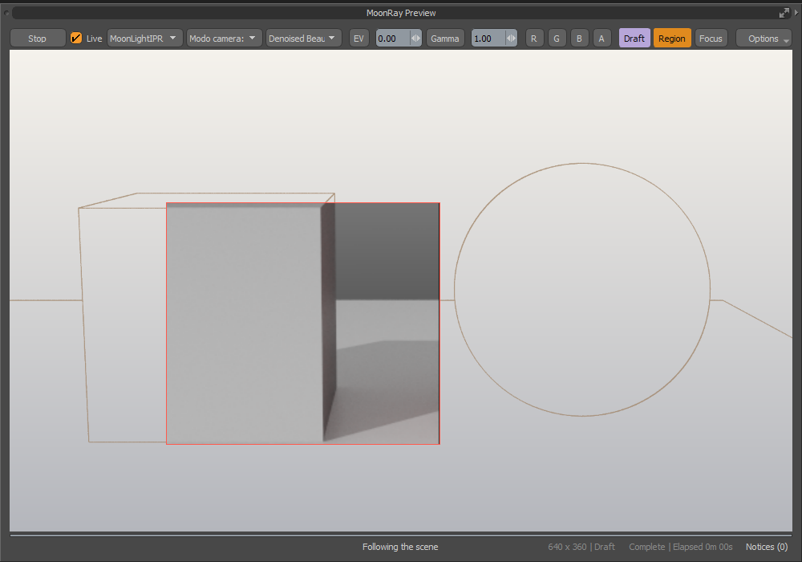
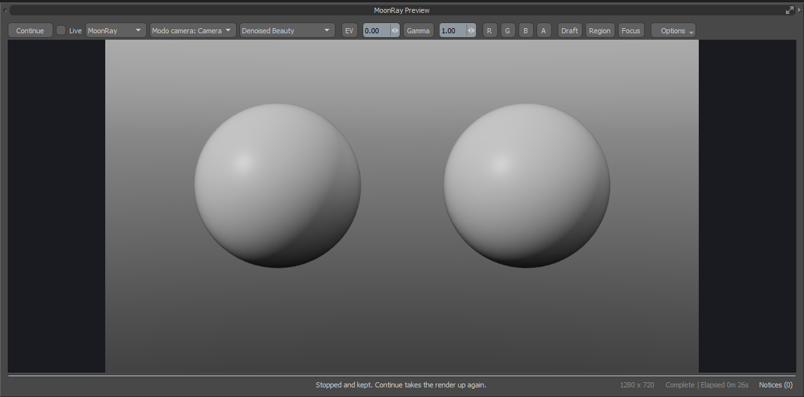
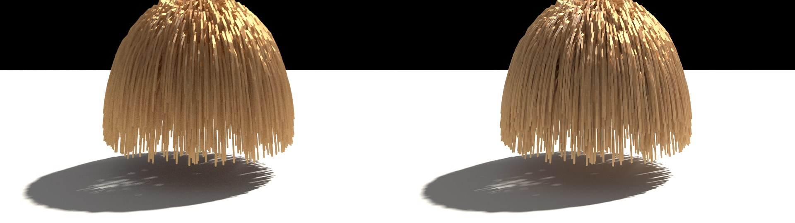
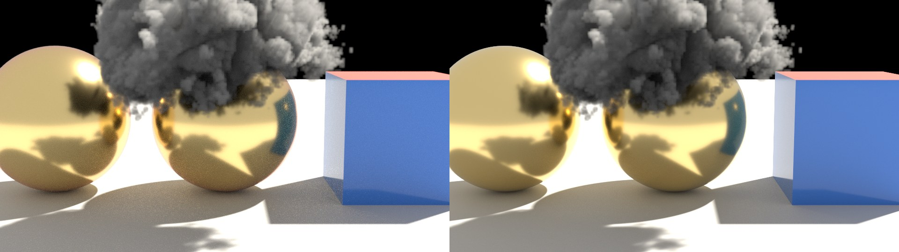
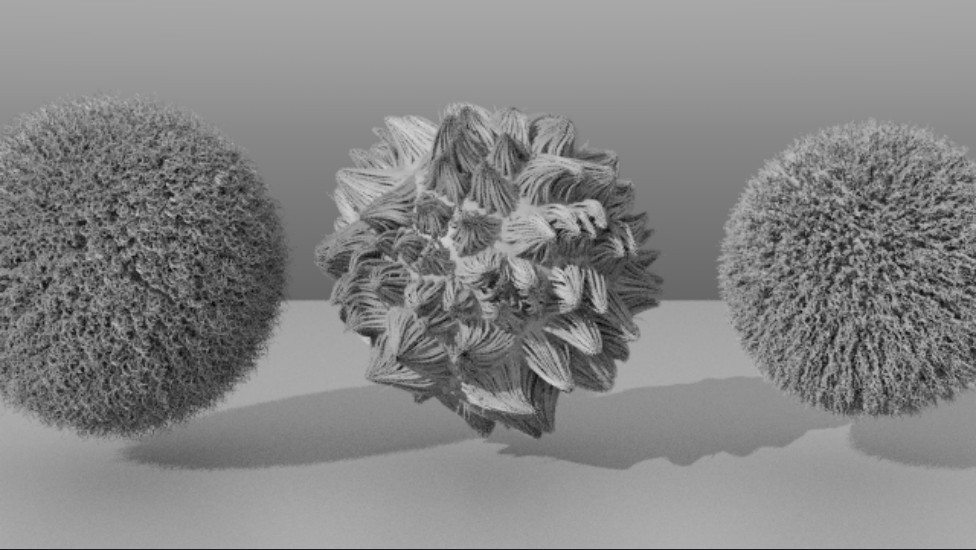

# MoonLightIPR

This is the development branch of [MoonRay for Modo](https://github.com/Pbaroque20/MoonRayForModo/tree/codex/native-avx-modo), where the next version is built and tried. For the plugin itself, its download and its installation, see the [main page](https://github.com/Pbaroque20/MoonRayForModo/tree/codex/native-avx-modo).

**MoonLightIPR** (echoing DreamWorks' earlier rasterizer MoonLight) is the plugin's fast GPU preview. It shows an approximation of what MoonRay will render and updates quickly after each edit. Final renders always come from MoonRay.

The current release is [0.4.1](https://github.com/Pbaroque20/MoonRayForModo/releases/tag/v0.4.1). **Built on MoonRay [2026.29.1](https://github.com/dreamworksanimation/openmoonray/releases/tag/v2026.29.1)** (OpenMoonRay's latest release; MoonRay 18.4), with the plugin's own patches for Windows and the preview.

## Coming in 0.4.2

Not released yet. More detail is in [What's new](docs/WHATS_NEW_04.md).

- **Large MoonRay pictures the right way up**: a preview at 3840 x 2160 came out upside down in MoonRay, and now does not.
- **MoonRay lights, cameras, light filters, shapes and volumes have a Transform section** in their Properties, laid out as Modo's: Position, Rotation with its order, and Scale as X, Y and Z, with the Reset, Freeze, Zero and Add menus.
- **MoonLightIPR looks through MoonRay's own cameras** from their own place: perspective, orthographic and dome as well as fisheye and spherical. Modo's orthographic camera previews too.
- **Less memory kept over a long session**: small leaks after each render and selection are gone.
- **Gaussian, Triangle and Blackman-Harris pixel filters** in Render Settings. They are not in MoonRay's source: the plugin adds them to MoonRay, built the way its own are. They never go negative, as MoonRay's sampling needs. Box and the two B-splines are MoonRay's own.
- **MoonRay's display filters**: all 18 from MoonRay's source (colour correct, toon, halftone, blur, depth of field and the rest) as MoonRay items. Each takes in the beauty, an AOV or another filter, and is a buffer of the preview and a channel of the final EXR.
- **Switch displacement in the node editor.** The switch colour, float and normal maps, the switch and mix materials, and the toon materials' per-point ramp multipliers and offsets now reach MoonRay: they were never passed on before. Scenes saved with them are carried over.
- **MoonLightIPR draws MoonRay's hair toon material**: its hair colour under up to three toon highlights. A toon ramp that ends lit is now drawn right past its end.
- **Time per pixel** as an output: where the render spends its time, shown with the average pixel at a quarter of white. Its timings are now fine-grained on Windows.
- **EXR compression** for Render EXR and animations: zip, as before, or any of MoonRay's others, lossy ones included.
- **Modo's weight and colour vertex maps reach MoonRay** for its materials to read by name (AttributeMap): a value at each point, or set apart on a face's corners so that each face keeps its own. MoonRay scenes with such values import as vertex maps.
- **Primitive attribute outputs** in the Outputs window: a vertex map or other value the shapes carry, by its name, as a picture of the render, a number or a colour. MoonRay scenes with such outputs import with them.
- **Global Switches** in Render Settings: displacement, subsurface scattering and shadows on or off, lights seen by the camera, a limit to geometry resolution, and a dicing camera for adaptive tessellation.
- **Visibility outputs** in the Outputs window: how much of the light reaches each point, from every light or from one light group, 0 in shadow to 1. MoonRay scenes with such outputs import with them.
- **The graph editor's properties fold by group**: a MoonShine material's settings sit under its own groups (Diffuse, Specular, Clearcoat and the rest), each folded or unfolded with a click and kept that way for that kind of material.
- **The graph editor's MoonRay Widget is quicker**: it renders under MoonRay LS with more samples to a pixel, starts as the editor opens, and shows a material it has already rendered at once. It has one Refresh/Stop button, no bucket outlines, and the object sits higher in the picture.
- **A MoonRay preview is always one render**, as MoonRay's own command makes it: it no longer starts over twice at 1 and 4 samples before the full render.
- **Toon materials have smooth edges on coarse meshes**: the lit band no longer comes out in steps along the faces of a low-poly or subdivided mesh, in MoonRay and in MoonLightIPR. A preference on the MoonRay page of Modo's Preferences, on by default; off renders as MoonRay itself does.
- **Toon materials denoise cleanly**: MoonRay's albedo output, the denoiser's guide, was full of bright specks on toon surfaces, and a denoised toon stayed as noisy as it was rendered. A preference of its own on the MoonRay page, on by default.
- **A new toon material is brightest facing the light**: its diffuse ramp starts bright where the surface faces the light and darkens towards the shadow side, as Modo's toon does. MoonRay's own default runs the other way; a toon material whose ramp was never set takes the new start, and a MoonRay scene's own materials keep MoonRay's.
- **Motion blur in MoonLightIPR, on by default**: while the scene is followed too (an edit is shown blurred once it is let go; a drag is followed sharp), and moving lights blur, in MoonLightIPR and in MoonRay, which held them still before. MoonRay's own items (its lights and shapes) blur when they move, as Modo's do.
- **MoonRay Source Overrides**: the MoonRay page of Modo's Preferences, now named with the MoonRay release it renders with (MoonRay (2026.29.1)), gathers in a section that folds where the plugin changes how MoonRay itself renders: smooth toon edges, toon materials that denoise cleanly, and blurred moving lights. Each is on by default; off renders as MoonRay's source does.
- **The compositor runs on the graphics card**, or on the processor where there is none, giving the same picture either way; wide blurs and glows are now true full-size blurs.
- **ACEScg scenes render and look right**: MoonRay no longer refuses them, and the preview no longer shows their colours washed out.
- **The About window** has MoonRay's current logo, and names the MoonRay version the plugin is compiled from.
- **The preview shows MoonRay's wordmark** before anything is rendered.

## New in 0.4.1

- **MoonRay's toon material** starts as a toon material, and MoonLightIPR draws it.
- **Ramps are edited with the mouse**, and a material's ramp shows in the preview as you edit it.
- **The scene importer can import into a new scene**, and has a Close button.
- **Color management follows Modo's system preferences**, and what you choose in MoonRay is remembered.
- **MoonRay LS** shows and renders the beauty alone.

## New in 0.4

More detail and pictures are in [What's new in 0.4 and 0.4.1](docs/WHATS_NEW_04.md).

**New**

- **Compositor**: a node graph over a finished render's buffers, in Options > Compositor: merge, colour correction, filters such as blur, glow, sharpen and vignette, and mattes. Nothing is rendered again.
- **MoonLightIPR Playblast**: renders an animation on the graphics card and plays it back. In the MoonRay menu and the preview's Options.
- **Three engines**: **MoonRay** for the full render; **MoonRay LS** for a quick low-sample render; **MoonLightIPR** updates after each edit once you press **RT Off** to switch realtime on.
- **Pixel samples for MoonRay LS and MoonLightIPR**, in the preview's Preferences.
- **Important Parts First**: MoonRay renders the buckets with the most detail before the plain ones, with or without Smart Render.
- **Smart Render**: MoonRay stops by itself once the picture is clean enough for the denoiser, and denoises it. Right-click the picture to choose Draft, Medium or Fine.
- **File > Open reads MoonRay scenes** (`.rdla`, `.rdlb`), as does File > Import.
- **Sampling shown beside the picture size**, such as "Uniform 16 ps", and new scenes start on uniform sampling.
- **The MoonRay menu is regrouped** by what each entry is for.
- **Modo fur without a limit**: every fibre Modo would grow, each as thick as the Fur material says. Remove Base Surface is followed.
- **Keep Fine Detail** when denoising: fur, hair and curves stay sharp over a denoised surface.
- **Cellular, Wood, Weave and Ripples** layers render.
- **The preview follows Modo's color management** by default, and names the view and LUT at the foot of the window.
- **Environment lighting preference**: always, or only with Modo's Global Illumination on.

**Faster**

- **Dragging with realtime on is much smoother**: MoonLightIPR updates quickly after drag.
- **Draft** redraws in about a third of a second after a move, where it took over a second, and follows the scene by itself.
- **Stop keeps a whole picture**: MoonRay finishes the tiles it is on, so nothing is left dark or blocky.
- **One pass, not three**: a MoonRay preview no longer starts over twice, and is about a third shorter.
- **A steadier time-left estimate**: one countdown for the whole render.
- **An idle MoonRay uses no processor.**

**Better pictures**

- **Denoised Beauty just works**: choose it in the list, with nothing to set up.
- **Safe Denoising** is on the picture's right-click menu and shows the render as it goes.
- **Reduced dark blocks** while MoonRay renders.
- **MoonLightIPR is much closer to MoonRay** on layered materials, glass, coats, subsurface and see-through shadows.
- **Rough Principled materials** are no longer dark at low angles.
- **Hidden items stay hidden**: an item with its eye off does not render, and a Shader's Cast Shadows switch is followed.
- **Imported MoonRay lights** are no longer far too bright.
- **Bump and normal images show on subdivision surfaces** in MoonRay.
- **An image layer's Low Value and High Value** are followed.
- **The Notices button is coloured** when there is something to read: yellow for notices, red for errors.

0.4 comes with a new runtime ZIP: install it together with the kit.

*MoonLightIPR chosen, RT On.*

*The compositor: the beauty graded, given a vignette and sharpened, with the nodes to add listed on the left.*

## Released in 0.3.51

**The preview window**

- **Draft**: the scene as clean outlines, with nothing rendered until you drag a **Region**. Then only that part is rendered, among the lines.
- **Region** is a button: press it and drag a rectangle in the picture.
- **R, G, B, A** channel buttons, a **colour probe** under the pointer, and **EV** and **Gamma** with one-click resets.
- **Export AOVs as Images** from the picture's right-click menu.
- **MoonRay's crest** in the window before the first render; click it to start one.

*Draft, with a region rendered among the lines.*

**Rendering with MoonRay**

- **Safe Denoising**: stop a MoonRay render at any time after a first pass and keep it, denoised. **Continue** then takes it up where it stood.

*Stopped part way, kept and denoised, with Continue on offer.*

**In the MoonLightIPR preview**

- **Hair** shaded as hair, with MoonRay's hair material.
- **Skin** with MoonRay's skin material, including light glowing through thin parts.
- **Curves** drawn as real strands, as ribbons or round tubes.
- **Fog** inside a MoonRay box or sphere, and **VDB clouds and smoke** from a file, with their own glow. VDB volumes can overlap.
- **Rod, barn door, cookie and VDB light filters**, on MoonRay lights and on Modo lights.
- **Textures on every kind of light**, not only rect lights.
- **Render region**, and **mesh lights seen glowing**, clean in MoonRay too.

*Hair in MoonRay (left) and in the MoonLightIPR preview (right).*

*A cloud from a VDB file, MoonRay (left) and MoonLightIPR (right).*

**Closer to Modo**

- **Blinn and Ashikhmin materials** now match Modo's highlights, also where an image drives the roughness (in MoonRay).
- **The sun's disc** in a physical sky has Modo's colour and follows Disc In-Scatter.

**Working faster**

- **Assign a MoonRay material to selected polygons**, with a name, type, colour and smoothing angle.
- **MoonRay's materials in the Shader Tree's Add Layer list**, under Custom Materials.
- **A MoonRay page in Modo's Preferences**, including having the M key open MoonRay's Assign Material.
- **The asset library shows pictures** of saved materials, models, scenes and textures, each with one button for what it is for.
- **MoonRay Content**: MoonRay's example scenes as a third ZIP of the release, merged into the kit folder.
- **Graph editor**: big graphs open on the output node and zoom freely.
- **Ramps** open in the ramp editor straight from a material's properties.
- **Light Path Expressions** has its own entry in the MoonRay menu and under Advanced in the render settings.
- **Dragging the sun or an environment light** updates the preview when you let go.
- **Dense hair** grows and re-renders several times faster.
- **Smoothing** follows Modo's smoothing angle, and can be changed in a MoonRay material's properties.
- **Opening a large MoonRay scene** shows how far it has come.
- **A material that is on nothing says so** in Notices, with the polygon tag to set.

**More of MoonRay**

- **Bake Selected Mesh to Texture** in the MoonRay menu.
- **Deep EXR** output, saved beside the render.
- **More render settings**: volume, hair and presence bounces, a Volumes group, clamping, pixel filter and texture blur.
- **More one-click outputs**: indirect diffuse and glossy, reflections, subsurface, diffuse without shadows, albedo, motion vectors.
- **Light path presets**, and a plain message when an expression is mistyped.
- **Cast no shadow onto chosen objects**, per object, in Light Links, Emitters and Volumes.
- **Width and height of a MoonRay light scale together**, with Modo's own link button.
- **MoonRay light items can be linked**, and imported MoonRay scenes keep their light, shadow and shadow receiver sets.
- **Subsurface Neighbours** in a material's properties: the objects that share its subsurface light, so no seam shows where they meet.
- **OpenPBR and glTF materials** import from MaterialX files.
- **Modo's Fur material** grows fur in MoonRay and in the preview, with its curls, clumps, kink, frizz, strays and weight maps. Guides are not read yet.

*Modo's Fur material in MoonRay: curls, clumps with kink, and fur thinned by a weight map.*

## Known issues

The ones you are most likely to meet:

- Very smooth highlights are dimmer than Modo's, though closer than before under GTR.
- Hair in MoonLightIPR is close to MoonRay's but not exact.
- A glowing VDB volume, or a light with a cookie filter, renders in MoonRay's slower scalar mode. The faster modes do not draw them rightly in this build.
- Tested on one machine (RTX 3090) only.

Every known issue, and what is still to implement, is in the [issue tracker](https://github.com/Pbaroque20/MoonRayForModo/issues). Found something else? Please report it there.

## More

- [How MoonLightIPR works, what it draws and how closely it matches MoonRay](moonlightipr/README.md)
- [The plugin's main page](https://github.com/Pbaroque20/MoonRayForModo/tree/codex/native-avx-modo), with the full feature list, limitations and installation
- [What's new in 0.4](docs/WHATS_NEW_04.md)
- [What was new in 0.3.51](docs/WHATS_NEW_0351.md)
- [What was new in 0.3.50](docs/WHATS_NEW_0350.md)

Developed by Raphael Tobar with AI assistance. MoonLightIPR is under the [MIT License](moonlightipr/LICENSE) and is not affiliated with DreamWorks Animation; see [moonlightipr/NOTICE.md](moonlightipr/NOTICE.md). Plugin licensing is in [LICENSE](LICENSE).
