# Dreamworks' MoonRay for Modo

<i>Technik Tom by Pixelwerk, with MoonLightIPR active</i>
 

MoonRay for Modo integrates DreamWorks’ open-source MoonRay renderer with **Modo 16.1v9 on Windows**, running natively without WSL. Developed by Raphael Tobar w/ AI-Assistance.

The plugin includes CPU, XPU and XPU2 rendering, a dockable live preview with a second GPU preview engine, native MoonRay materials with a graph editor, Shader Tree translation, MoonRay's own lights and other items, MaterialX and RDL scene import, AOVs, and denoising.

**Built on MoonRay [2026.29.1](https://github.com/dreamworksanimation/openmoonray/releases/tag/v2026.29.1)** (OpenMoonRay's latest release; MoonRay 18.4), with the plugin's own patches for Windows and the preview.

**Current version: 0.5.3.2 — pre-production release.** The plugin is no longer experimental. 0.5 brought **MoonRay XPU2**, a new GPU renderer for previews in which the processor and the graphics card work on the same picture at once, now the default; realtime that keeps up with heavy scenes and a Scene cache; Modo's procedural textures worked out through the object, 145 of Modo's Enhance textures among them; Modo's light volumetrics and fog; and MoonLightIPR starting in seconds. Install the new runtime with it.

· [Download 0.5.3.2: the kit, the Windows runtime and the MoonRay content](https://github.com/Pbaroque20/MoonRayForModo/releases/tag/v0.5.3.2)

· [Installation instructions](docs/INSTALLATION.md) 

· [What's new in 0.5](docs/WHATS_NEW_05.md) 

· [What's new in 0.4 to 0.4.3.1](docs/WHATS_NEW_04.md) 

· [MoonRay's features in the plugin](#moonrays-features-in-the-plugin) 

· [Modo's features in the plugin](#modos-features-in-the-plugin) 

· [Engineers' notes: where the plugin changes MoonRay](patches/native-windows/README.md)

Work on the next version goes on in the [MoonLightIPR branch](https://github.com/Pbaroque20/MoonRayForModo/tree/MoonLightIPR).

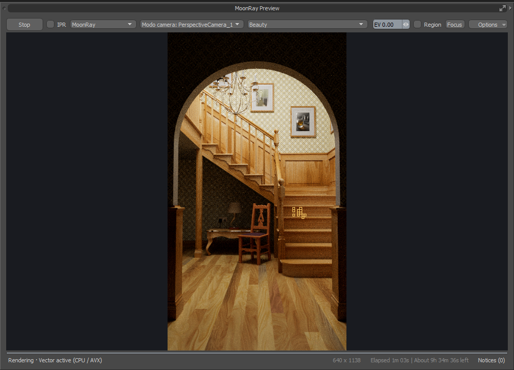

*The preview window in Modo 16.1v9, rendering The Wooden Staircase (by Wig42, CC BY) after it was imported from MoonRay's own scene files.*

## Major features

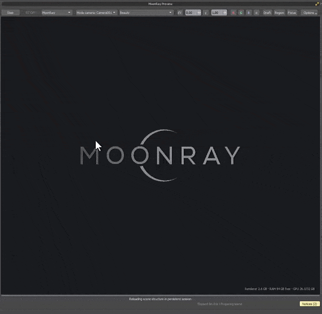

*Cellular automata scheduling in XPU2. Both CPU/GPU contribute asynchronously towards the image. Footage provided by Pixelwerk.*

- **MoonRay XPU2**: a new hybrid renderer for previews. The processor and the graphics card work on the same picture at once, samples go where the picture is still noisy, and its pictures settle to MoonRay's own. Final renders come from MoonRay. *XPU2: Asynchronous Monte Carlo Path Tracer designed by Raphael Tobar. Not affiliated with or endorsed by DreamWorks Animation.* (Core architecture information can be found in [xpu2-foundation](https://github.com/Pbaroque20/xpu2-foundation).)
- **MoonLightIPR**: the plugin's own GPU preview engine (NVIDIA), which shows an approximation of MoonRay's picture moments after each edit. Final renders always come from MoonRay.
- **Smart Render** (XPU Only): MoonRay stops by itself once the picture is clean enough for the denoiser, and denoises it.
- **Safe Denoising** (XPU Only): stop a MoonRay render at any time and keep it, denoised. **Continue** takes it up where it stood.
- **Draft mode**: the scene as clean outlines, redrawn in about a third of a second after a move. Press **Region** and drag to render just that part among the lines.
- **One dockable preview, three engines**: MoonRay for the full render, MoonRay LS for a quick low-sample look, and MoonLightIPR. **Important Parts First** renders the most detailed buckets before the plain ones.
- **MoonRay's own materials and items in Modo**: native MoonRay materials with a node graph editor, and 30 of MoonRay's lights, light filters, cameras, shapes and volumes as Modo items.
- **Modo scenes render in MoonRay**: Modo's lights, daylight, standard and Principled materials, textures, fur, curves, hair and instances are translated for you.
- **Compositor**: a node graph over a finished render's buffers, with nothing rendered again.
- **MoonRay scene and MaterialX import**: `.rdla` and `.rdlb` scenes come in whole; `.mtlx` materials become Shader Tree materials.
- **Outputs**: AOVs and light path expressions, one-click Cryptomatte, deep EXR, texture baking, and denoising with OptiX or Open Image Denoise.

| | |
|---|---|
| 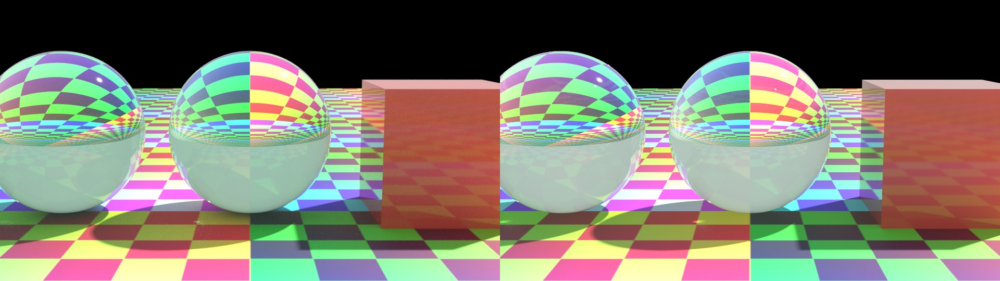 | 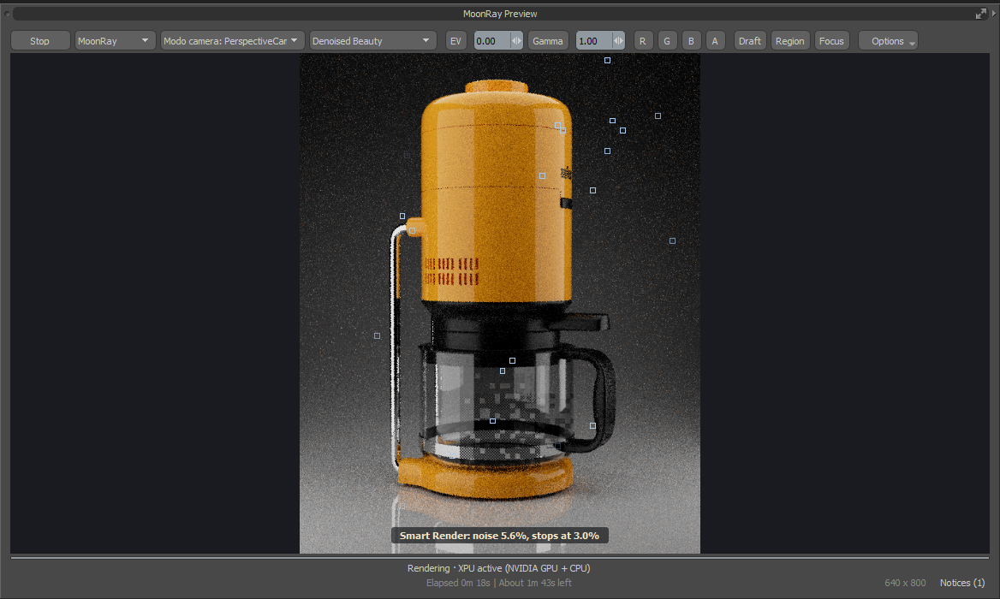 |
| **MoonLightIPR**: MoonRay (left), MoonLightIPR (right) | **Smart Render**: the noise falling, and where it will stop |
|  | 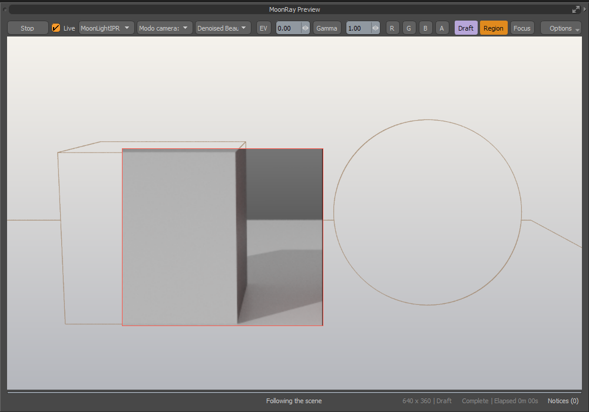 |
| **Safe Denoising**: stopped part way, kept and denoised | **Draft mode**: a region rendered among the outlines |
| 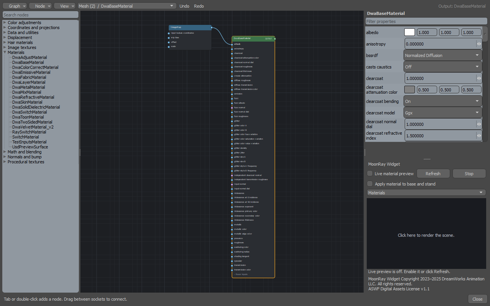 | 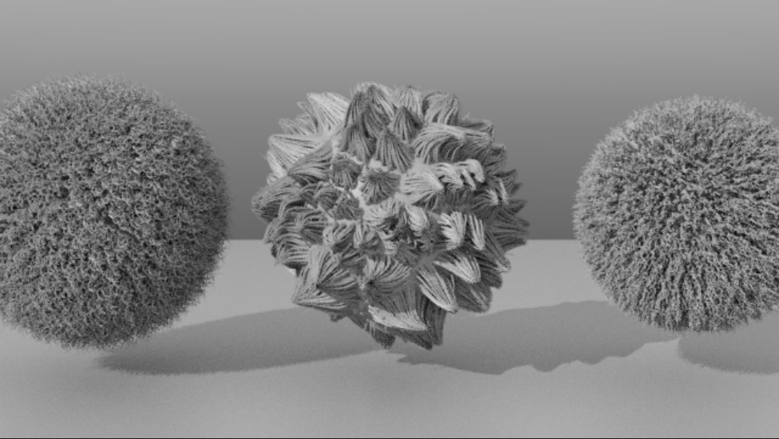 |
| **The graph editor**, with a MoonRay material | **Modo's Fur material** rendered by MoonRay |
| 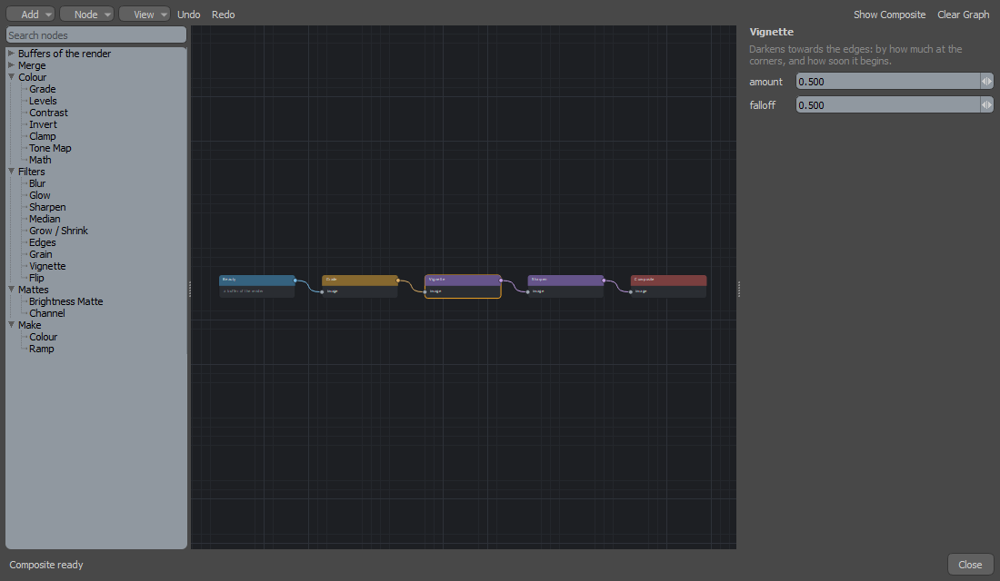 | 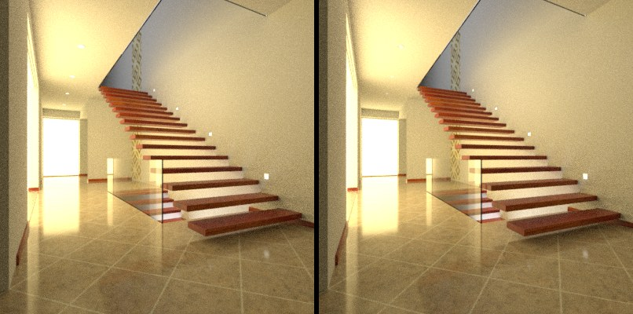 |
| **The compositor**: the beauty graded, vignetted and sharpened | **An imported MoonRay scene**: its own render (left), after the trip through Modo (right). Modern Hall by NewSee2l035, CC BY |

## New in 0.5.3.2

Fire, fluids and faster volumes: VDB fire from temperature grids and in its colours, VDB and Alembic sequences, imported Alembic fluids with motion blur, Scene Proxies with their own materials, and a cleaner, quicker MoonLightIPR. It comes with a new runtime: install it, and **Compile XPU2 Shaders once more**. The full list is in [What's new in 0.5](docs/WHATS_NEW_05.md).

- **Edits that change nothing leave realtime alone**: a value entered as it already is, in the graph editor or a MoonRay material's Properties (0 where it was 0, 0.3 where it was 0.30000000000000004), and Schematic work (workspaces, nodes added, moved or taken out) no longer start MoonLightIPR or XPU2's realtime again, nor read the scene whole.
- **One resolution for every realtime preview**: Preview Preferences' Realtime preview resolution now goes down to 1/8 and 1/16 of the render's, and MoonRay LS renders at it as MoonLightIPR and RT do. LS's own Width limit is gone, under which a tall picture stayed tall.
- **EV and gamma by dragging**: press anywhere on the preview window's EV or gamma field, its number or its arrows, and drag right or up for more, left or down for less; Ctrl for fine steps, Shift for coarse. A click on an arrow steps once; a click on the number lets you type. The picture follows exposure as it changes, where holding an arrow showed nothing until it stopped. The MoonShine graph's numbers drag the same way (a tester's report: their steps were 0.1 only, and the two arrows a few pixels apart): Ctrl drags in hundredths, and one drag is one undo.
- **MoonLightIPR clears its noise sooner**: the preview draws its samples from [OpenQMC](https://github.com/AcademySoftwareFoundation/openqmc), the Academy Software Foundation's sampling library, so each pixel's samples spread evenly instead of by chance. For the same noise it needs about half the samples where the light comes from lamps, an environment or fog, and fewer on VDB fog, hair, depth of field and glass. A sample takes up to about a tenth longer; the cleared picture is unchanged.
- **RT goes off after a MoonLightIPR Playblast**: once its frames are done, or it is stopped, RT says Off and one press follows the scene again. It stayed On with nothing updating until another engine was chosen.
- **Select a material from the picture**: right-click a surface in the preview window and choose Select Material Here: the material it wears is selected in Modo, found as Focus Here finds a surface's distance.
- **Toon lines in a colour, with their own alpha** (issue 134): a Toon filter's Ink Color draws its lines in any colour, the Compositor's Ink Lines node lays them over a picture, and lines saved or rendered alone keep their own alpha. A MoonRay Source Override, on by default.

  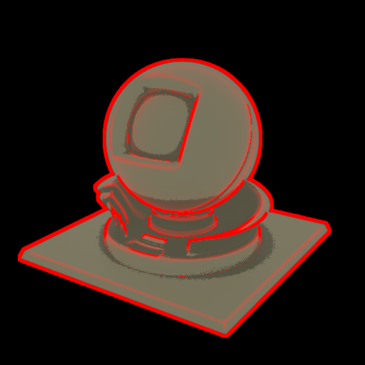

- **Toon lines smoothed**: outlines no longer step with the pixel grid. A MoonRay Source Override, on by default.

  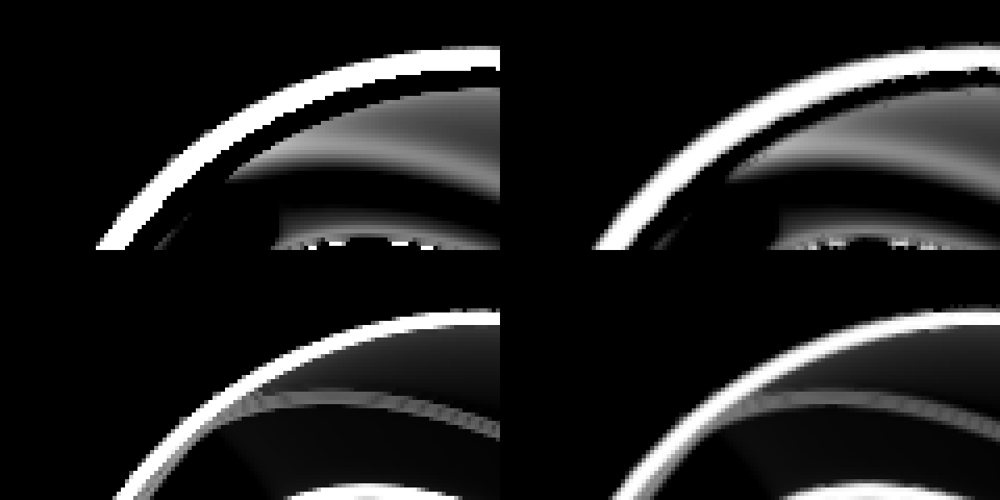

- **VDB fire from temperature or flames grids**: a VDB whose emission grid holds single values, as EmberGen, Houdini and Blender write fire, now glows in MoonRay, XPU2 and MoonLightIPR, coloured by the VDB volume's incandescence gain mult. MoonRay refused such a grid and left the whole VDB out. A MoonRay Source Override, on by default.

  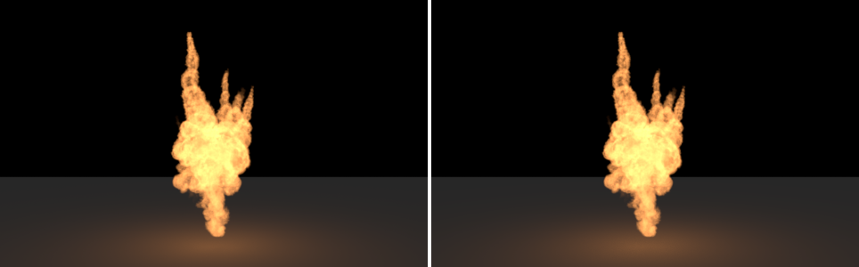

- **Alembic fluids and other changing meshes**: set an object's Geometry file (production settings) to an .abc, and the kit reads its meshes itself each frame, even ones whose points and faces change, as a fluid mesher's do (Modo's own loader shows one frame of those), blurred along the file's velocities. A mesh that changes during the shutter no longer stops a render with "Motion blur requires stable topology".
- **VDB sequences**: untick a VDB shape's static (now beside its file) and the numbered files beside the one you chose (fire_1.vdb, fire_2.vdb...) play with the timeline, with a frame offset, and the volume hidden or held outside its frames.

  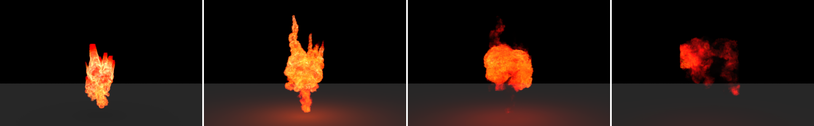

- **Scene Proxies render with their own materials**: each proxy's geometry once, where it stands, shaded by the scene file it loads, as Modo renders it. Modo may crash as it quits with such a scene still open (Modo's own; your work and settings are kept).
- **Imported Alembic fluids blur**: a mesh brought in with File > Import of an .abc renders from the file itself, its own points and faces at each frame, blurred along the file's velocities. Modo's own import stretched one fixed mesh and had no velocities to blur a fluid mesher's mesh with.

  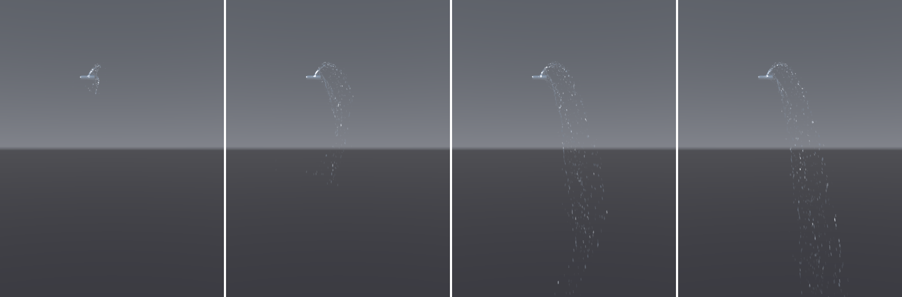

- **VDB fire coloured by its temperature**: turn on a VDB shape's blackbody colour and choose its temperature grid as the emission grid: the fire glows deep red where it is cool, orange, then yellow-white where it is hottest, with kelvin at 1 to make it hotter or cooler. In MoonRay, XPU2 and MoonLightIPR. A MoonRay Source Override, on by default.

  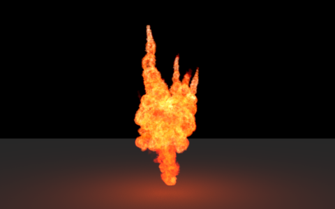

- **MoonLightIPR keeps a VDB fire's colour**: an orange incandescence no longer glows white in the preview.
- **Glowing fog from maps on XPU2's graphics card**: a volume whose glow or colour comes from procedural maps (a gradient, a noise) renders on the card instead of the processor. Maps that read image files still glow on the processor.

  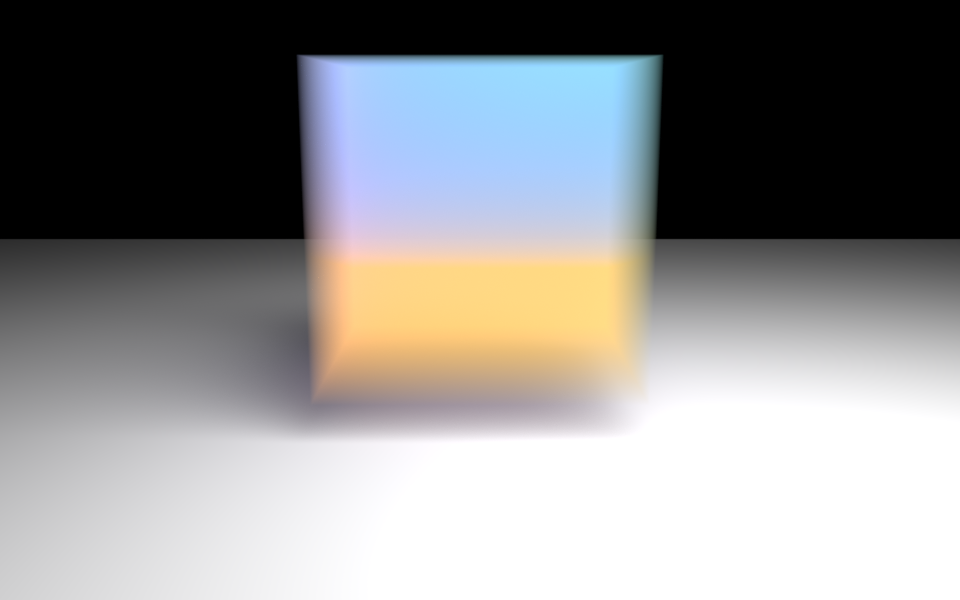

- **Volumes render faster in XPU2**: VDB clouds and glowing fog render in about two thirds of the time on the graphics card, with the same picture.
- **A smaller XPU2 shader compile, with a memory meter**: Compile XPU2 Shaders takes 8 to 15 minutes and well under 12 GB, where it could climb past 40 GB. Preferences shows the free memory beside the button (enough, tight or not enough); the compile needs about 8 GB free to begin and stops itself before memory runs out.

## New in 0.5.3.1

A release of fixes and speed for scenes as Modo makes them: mesh lights, fur, checkers and heavy scenes, with a new runtime: install it, and **Compile XPU2 Shaders once more**. The full list is in [What's new in 0.5](docs/WHATS_NEW_05.md).

- **Mesh lights render as in Modo in every engine**: a Prototype's n-gons, or quads beside triangles, shine in their own shape in MoonRay and XPU2; a mesh emitting by its Object controls lights again; the shown Prototype is the light, not also a grey surface over it; a hidden Prototype gives no light, as in Modo. MoonLightIPR shows a Mesh Light that is Visible to Camera, and shines from the polygons' front only, as Modo and MoonRay do.

  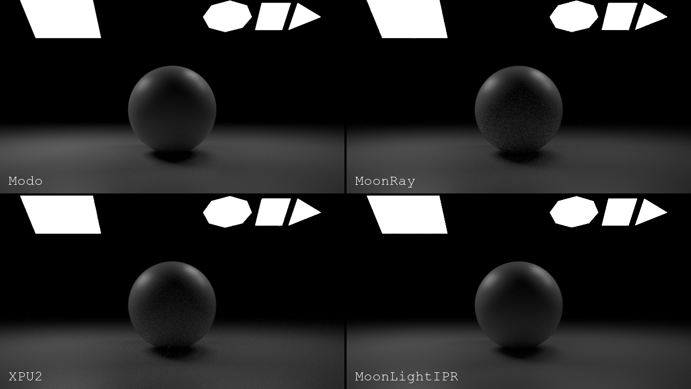

- **A mesh light hidden from the camera still shows in reflections**: with Object controls' camera appearance at Hidden, other surfaces reflect the light cleanly, not blotched with the mesh's grey; MoonLightIPR follows that setting too.
- **Glowing volumes render on XPU2's graphics card**: a fog that glows (a MoonRay volume's emission) or a VDB fire (its emission grid) renders on the card with the rest of the scene, lighting the surfaces and the fog around it; before, one glowing volume sent the whole scene to the processor. Compile XPU2 Shaders once more after installing.
- **Bump node in the MoonShine graph**: under Normals and bump, a Bump node turns a greyscale height image into the material's normal, as a Shader Tree Bump layer does; Amplitude is how high white stands, in scene units. In every engine; a MoonRay Source Override (Bump node in MoonShine graphs), on by default.
- **Realtime preview resolution as a share of the render's**: Full, 1/2, 1/3 or 1/4 in Preview Preferences, in place of a width in pixels, under which a tall picture could stay at full size. A width chosen before becomes the nearest share.
- **Exported Cryptomattes open as Cryptomattes**: Export AOVs saves each with its mattes' names (CryptoObject, CryptoMaterial) and the header readers need, so Photoshop (with ProEXR or Exr-IO), Nuke and Fusion pick its mattes; several in one multilayer EXR no longer clash. Object and material Cryptomattes render together again (since 0.5.2.1 the kit refused them).
- **Checkers placed as in Modo**: a Checker's squares, through its texture locator, are the size, angle and colour Modo gives them in every engine (they were twice as large and turned).
- **A missing UV map is a notice, not a failed render**: a material whose texture reads a UV map the mesh has not (one set up on another mesh) rendered nothing, with "missing UV values"; those polygons now render with the map at 0, and a notice names the mesh, the map and the material.
- **PBR validity in Preview Preferences** too, the same switch as in Modo's Preferences.
- **Realtime with standard XPU: Off, On the processor or On the graphics card**: RT with the standard MoonRay XPU can now render on the card too, in Modo's Preferences and Preview Preferences alike.

  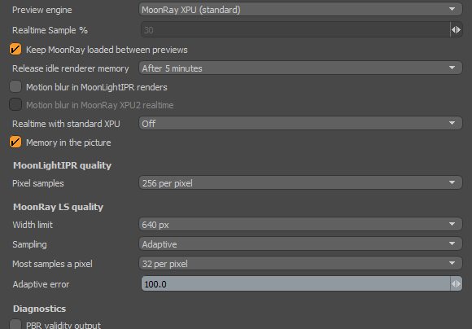

- **Heavy scenes start much sooner**: a 1.5-million-polygon car's first realtime picture came after about 2 min 20 s of preparing; it now comes in about 16 s. Smoothing by each material's smoothing angle is done in the kit's native code on all processor threads, Cryptomatte by material no longer hashes every polygon, and the mesh reader no longer makes Python lists of every point. Meshes of any size now take their material's Modo smoothing angle.
- **A scene's first realtime run is much quicker**: environment images are shrunk straight from the file, side by side (the car's three HDRs: 85 s to 15 s), and meshes whose textures lay out their own UVs, or whose materials use different UV maps, are read whole. Grey environment images are no longer black. An environment's layers are laid over one another in the kit's native code (the car's: 10 s to nothing), every mesh is read by the native adapter, and a mesh missing a UV map its texture reads is read whole too, with its notice (the car's reading: 7.1 s to 3.2 s).
- **Fur guides**: a Fur material's guides are followed in every engine, from curves on the fur's own mesh wearing its material or from a guide item, in Modo's modes: Direction, Direction + Length, Shape, Range and Clump, with Guide Range and Guide Length.
- **Fur vector and width maps**: a Fur material's Vector VMap grows each fibre along its vector, as long as it is (none where it is nothing), and its width map thins the fibres by its weight, in every engine.
- **Weight and colour maps, and creases, read at once**: a mesh's weight, RGB and RGBA maps, and a subdivided mesh's Subdivision weights, are read in the kit's native code in one call, not a point or an edge at a time (a mesh of 21,600 polygons and six maps: 1 s to 0.08 s; its creases: 0.3 s to 0.05 s). Planar, cubic, cylindrical and spherical texture projections are worked out there too (a mesh of 359,400 faces: 6 s to 0.5 s). Hair grown from guides is shaped there too, its scalp read at once and its strands kept as the grower made them (30,000 strands on a 399,000-triangle scalp: the scene read 8.4 s to 3 s, MoonLightIPR's packing 1.2 s to 0.1 s).

## New in 0.5.3

A release for its lighter use of memory and XPU2 on several devices, with a new runtime: install it, and **Compile XPU2 Shaders once more**. The full list is in [What's new in 0.5](docs/WHATS_NEW_05.md).

- **Look-dev is lighter on Modo**: graph editor changes no longer re-read the whole scene, hidden meshes' materials are left alone, and Low Value, High Value, gamma, brightness and contrast change without reloading the scene.
- **Wired inputs are locked in Properties**, and **a material node's inputs fold into groups** (Diffuse, Specular, Clearcoat ...), connected ones always shown.

  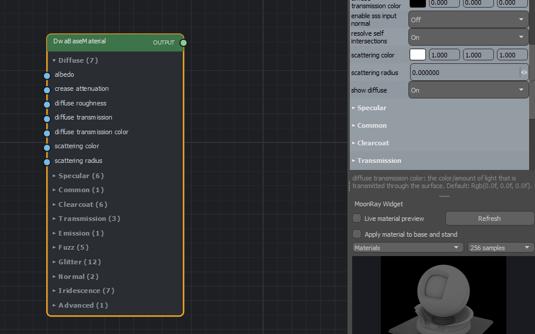

- **A material's lists come up quicker** in Properties and the graph editor, **switching networks keeps the graph editor open**, and **Remove Network** removes another material's network or a loose one, after asking.
- **A cookie light filter renders in XPU2**, at XPU2's speed, where it sent the whole render to MoonRay's slow scalar mode.
- **A bokeh image turns bokeh on**, and the dw camera fields Modo's camera drives are greyed while it does.

  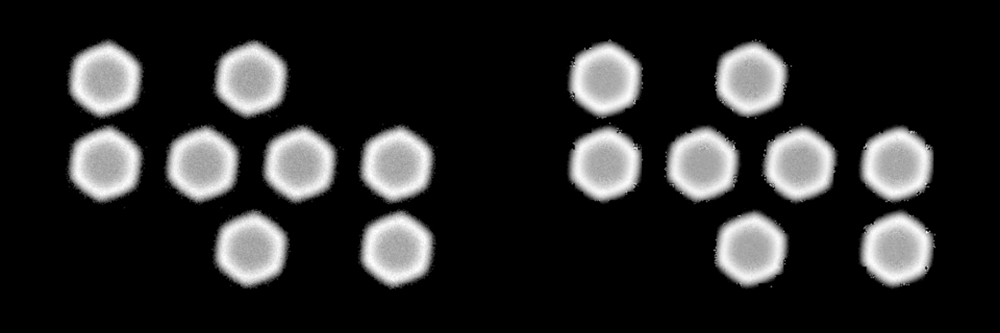

- **XPU2 needs a third of the texture memory**: a scene with a few 8K maps that went into texture overflow mode now holds 1.4 GB of textures on the graphics card, not 4 GB, with the same picture. **XPU2 also holds less of the card**: a scene with grass peaked at 9.7 GB rather than 10.9 GB (8.7 GB without subsurface).

  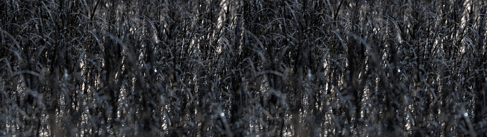

- **Depth of field in XPU2 has even grain**: a light far out of focus showed a lattice inside its bokeh disc; the lens samples now have an order of their own and every sample sequence is Owen-scrambled, so the noise is MoonRay's kind.
- **A sliver triangle no longer sends an XPU2 frame to MoonRay**: a hit on a triangle too thin for its normal in single precision failed the sample, and with it the whole frame. The grass scene fell back to MoonRay every time on the processor alone and now and then with the graphics card.
- **XPU2 uses every graphics card and every processor**: a second or third NVIDIA card renders the same picture alongside the first, and a machine with more than 64 threads uses them all. A card that can't run OptiX's denoiser hands realtime denoising to one that can, or to Open Image Denoise on the processor. Tested in simulation only, as we have one card here.
- **Device Management**: under XPU2 in Preferences > MoonRay, lists the processor and every NVIDIA card XPU2 finds, each with its own switch, and compiles XPU2's shaders for each kind of card that is not up to date: a new kind of card shows as Out of date, naming it, and only it is compiled. It replaces the Devices choice on the XPU2 page.
- **XPU2 knows NUMA**: on two-socket workstations and many-die processors (Threadripper, EPYC, Xeons with Sub-NUMA Clustering), XPU2 puts its workers on every node, feeds each card from the node nearest it, and keeps texture tiles in the memory of the node that reads them. A node that runs short moves its tiles to another before letting any go. On a one-socket machine nothing changes. Tested in simulation only.
- **VDB volumes render on XPU2's graphics card**: a VDB cloud that did not glow was handed sample by sample to the processor; the card now samples its grids itself and marches it without a table of steps, about five times faster on a test cloud with the same picture. Glowing VDBs still render on the processor.
- **Mirrored meshes face outward**: a mesh with a negative scale and normals of its own rendered black in MoonRay and XPU2 (MoonRay's own behaviour), and one without them slightly wrong; a new MoonRay Source Override, on by default, turns them outward.
- **The graph editor does not restart the preview for nothing**: moving a node, or adding one wired to nothing, no longer renders the picture again.
- **A dw material's own roughness in MoonLightIPR**: a dw Metal or Base material's roughness was taken from Modo's Material Ref tab; it is now the material's own.
- **The MoonRay Widget renders with XPU2** (whatever the preview's choice), at the size it is shown, with 1024, 2048 or 4096 samples, and a **Scale** to size the ball in scene units for curvature and other procedurals.
- **A dwVdbVolume takes its VDB file**: adding one asks for the file, and its form has Load VDB File; the VDB shape that shows it is made for it.
- **PBR validity**, a diagnostic in Preferences > MoonRay > Renderer > Diagnostics: while it is on, MoonRay XPU's and XPU2's renders hold MoonRay's PBR validity output in place of the standard outputs, and the preview window shows it. Green is a plausible material, red one out of range, yellow in between: here the dragon's bright orange is just above the brightest plausible albedo. Off, the standard outputs come back.

  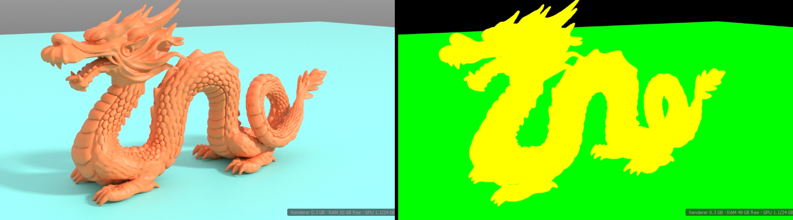

- **Realtime with MoonRay XPU, on the processor**: an opt-in in Preferences > MoonRay > XPU; with XPU2 off, RT then follows the scene with MoonRay and MoonRay LS.
- **After XPU2 hands a scene to MoonRay XPU**, MoonRay's sampling settings are no longer greyed: they are the ones used.
- **Modo no longer crashes as it quits**: with a graph editor open, or once the preview window or a material's properties had been used, Modo could end with an error on the way out. The kit no longer looks through all of Modo's windows to find its own, puts its open windows away first, and lets go of its scene listener properly.
- **Modo's Mesh Lights shine**: a Mesh Light gave no light in MoonRay, XPU2 or MoonLightIPR. It now shines from its Prototype mesh, shown or hidden, placed by the prototype or by the light as Use Prototype Transform says, with its radiance and colour, and seen by the camera when Visible to Camera is on.
- **Alembic streams in**: a file loaded as Alembic Streaming Meshes (Modo's Alembic Mesh items) now renders, moving over time and with motion blur, as files loaded as Modo meshes with streaming deformers already did. Alembic Curves and Point Clouds take the same path, though untested.
- **An environment no longer renders red**: a grey environment, saved as one channel since the texture memory work, lit the scene red in MoonRay and XPU2; images that light the scene keep three channels.

## New in 0.5.2.2

A hotfix to the kit alone: the runtime of 0.5.2.1 stays. The full list is in [What's new in 0.5](docs/WHATS_NEW_05.md).

- **Smart Render and Safe Denoising follow the renderer chosen:** switching Preferences > MoonRay > XPU2 to MoonRay XPU makes them editable at once, and they work in Vector and Scalar mode whichever renderer is chosen. Smart Render chosen with the Denoiser off sets one: OptiX with an NVIDIA graphics card, Open Image Denoise without.
- **Render over a draft renders at the first press**, where it had to be pressed again once Draft's lines were done.

## New in 0.5.2.1

A hotfix, with a new runtime ZIP: install both, and Compile XPU2 Shaders once more. The full list is in [What's new in 0.5](docs/WHATS_NEW_05.md).

- **XPU2 needs about half the graphics card's memory:** a simple scene went from about 11 GB to 4.5 GB, at the same speed and with the same picture, so XPU2 runs on smaller graphics cards.
- **Moving subdivision surfaces render in XPU2:** a moving mesh with adaptive subdivision, and copies of a subdivision mesh that changes shape during the shutter, no longer send the scene to MoonRay XPU.
- **Playblasts render flat out**, each frame as fast as the graphics card can.
- **dw Perspective and Orthographic cameras use the Modo camera's lens**, edited in the camera's own tabs.
- **Saved pictures keep their alpha:** Save Image and Export AOVs save the Beauty and the Denoised Beauty with it, and Export AOVs can save one multilayer OpenEXR.
- **A file in your Windows PATH no longer stops MoonRay**, where every preview and scene load failed with "directory iterator cannot open directory".

## New in 0.5.2

A hotfix, with a new runtime ZIP: install both, and Compile XPU2 Shaders once more. The full list is in [What's new in 0.5](docs/WHATS_NEW_05.md).

- **XPU2 renders Modo's procedural textures worked out through the object**, Enhance: Modo's patterns among them, with the patterns MoonRay and MoonLightIPR share. Such a scene used to go to MoonRay XPU.
- **Scenes with Modo's fur render in XPU2**: they stopped with "No Attribute named 'vertex_list_1'" and went to MoonRay XPU.
- **XPU2 renders moving objects on the GPU:** moving meshes, subdivision surfaces, instances, curves, fog and any number of moving lights, and points whether moving or still. Test scenes finished about 2.6 to 8.5 times sooner; a scene with nothing moving takes about 2 to 3% longer.
- **Render Animation and Render to a File render with XPU2**, each picture shown in the preview as it comes. **Render has motion blur**, from Render Settings or the Modo camera, and XPU2 realtime has it as a Preview Preference.
- **Alpha reaches every file that can hold it:** a denoised EXR, and a PNG, TIFF or Targa saved from a render. In those three, **soft edges no longer flare** in front of a visible environment.
- **Frames as JPEG, PNG, TIFF or Targa alone**, denoised when the render is. Denoised and composite frames keep their number last, frame digits are yours to choose, and several sequences can share a folder.
- **MoonRay cameras no longer render black up close**, and a new one starts where the render camera stands.
- **Round lights under an unevenly scaled parent stay on** and stay round, with a notice, in every engine.
- **The Environment background output has its picture.** A new MoonRay Source Override, on by default.
- **Fog no longer goes missing from XPU2's CPU samples**, and XPU2 no longer stalls on a second motion-blurred picture.
- **In the graph editor:** the marquee starts at once, and hues and angles have a slider. **In the compositor:** sliders on Blur, Glow, Sharpen and Median radius and Vignette.
- **Playblasts show motion blur**, Realtime Sample % starts at 30%, and notices name more of what is left out.

## New in 0.5.1

A hotfix, with a new runtime ZIP: install both, and Compile XPU2 Shaders once more. The full list is in [What's new in 0.5](docs/WHATS_NEW_05.md).

- **XPU2 fixes:** Subsurface Samples above 4, Material Samples of any count and Gaussian, Triangle and Blackman-Harris filters render. Render gives the samples you set, its progress climbing steadily, so a scene with heavy textures takes longer than it did, with a cleaner picture. A scene XPU2 hands to MoonRay XPU keeps its geometry.
- **Texture overflow mode:** where a scene runs out of memory as it loads, XPU2 compresses its textures, then makes them smaller if it must, and the preview says so.
- **Realtime on a heavy scene:** a first picture in seconds, and back in under a second after a mesh's detail is cut anew.
- **Weight Map Texture layers render**, in MoonRay, XPU2 and MoonLightIPR. Gradient and Curvature layers no longer stop halfway.
- **Multi-part EXRs**, by choice, and EXR channels by standard names.
- **MoonLightIPR's subsurface** follows a material's chosen model, and its colour is much closer to MoonRay's. Subdivided meshes no longer stretch its textures.
- **Glitter no longer turns a material pink.** Toon lines come out whole, and the Toon filter's Output Mode works under XPU2.
- **Automatic Presence Shadows** (Preferences > MoonRay > Renderer, off unless chosen): a label's cut-out parts no longer shade what lies under them.
- **In the graph editor:** presets, Samples for the material widget, and colours that match Modo's form. A Car paint material in the library.
- **Realtime Sample %** in the preview's preferences as well as Render Settings, and a build number in the About window.

## New in 0.5

A pre-production release, with a new runtime ZIP: install both. The full list is in [What's new in 0.5](docs/WHATS_NEW_05.md).

- **MoonRay XPU2**, the default GPU renderer for previews (MoonRay XPU is still a choice in Preferences > MoonRay > XPU2). Compile its shaders once on that page; its settings are in Render Settings > XPU2 Sampling, and realtime takes up camera, object and light changes at once.
- **Realtime that keeps up**: after the first reading the scene is never read whole again, and heavy scenes start much sooner.
- **A Scene cache** (Preferences): a prepared scene opens faster the next time.
- **Modo's procedural textures through the object**, with no baking and no UVs: Noise, Cellular, Checker, Grid, Dots, Wood, Weave, Ripples, Gabor and Poisson, and 145 of Modo's Enhance textures, in MoonRay and MoonLightIPR. Curvature and Wireframe too.
- **Modo's light volumetrics and environment fog** render.
- **Displacement follows Modo's Displacement Rate**, with far less geometry where a mesh is small on screen.
- **MoonLightIPR starts in seconds**, follows an edit at once, and matches MoonRay's brightness for lights that are not normalized.
- **MoonRay lights take the Scale tool**: width, height and radius follow the scale.
- **Cleaner denoising**, Toon lines apart from the shading, area lights seen by the camera, shadow rays in Light Links, and N-gons triangulated cleanly.

## New in 0.4.3.1

A hotfix: the kit alone changed (with its geometry adapter); the 0.4.3 runtime is the same.

- **Adding geometry while MoonLightIPR follows the scene no longer stops or freezes it.** Turning realtime on could wait on Modo without end (while Modo's colour picker was open, for one).
- **Modo's fur renders with Modo evaluated geometry**, where it stopped the render with "Polygon indices failed". Under motion blur in the preview, fur that cannot be followed through the shutter is shown still, with a notice.
- **Assign MoonRay Material on a whole mesh tags its polygons**, as Modo's Polygon Set Material does: its item mask slowed a large scene's preview to seconds an edit. Polygons made in the mesh later keep the tag they are made with.
- **Large scenes read faster**: Modo's texture projections are worked out several times faster and kept between readings (a test scene with fur and a 324,706-face mesh, 45 s to 13 s, then under 2 s an edit), and moving an item with fur on it is followed at once.

## New in 0.4.3

A critical performance update, with a new runtime ZIP: install both. The full list, with pictures, is in [What's new](docs/WHATS_NEW_04.md).

- **Scenes load far faster before a render starts**, in MoonRay and in MoonLightIPR: a mesh's long lists go to MoonRay in its own binary scene format, the geometry adapter joins the pieces Modo's render cache hands over into one per surface, and what was read of the scene is kept from one reading to the next. On a test interior, getting MoonRay ready went from about 107 seconds to 18.
- **Low-latency rendering**: MoonRay runs below Modo's priority and leaves a processor thread free, so Modo stays quick to use while it renders.
- **MoonLightIPR saves power**: it stops once the picture is clean, spreads a render over a few seconds, and no longer starts again for a change of frame alone.
- **MoonLightIPR draws more of a scene**: displacement (Shader Tree layers and every displacement node), stencils, light links, and a material stack's rows with their own shine.
- **Modo's materials nearer Modo's** in MoonRay: Shader Tree displacement and stencils, Principled sheen and highlights, anisotropy's strength, tinted and rough glass, and masks checked against Modo's renders.
- **Fixes**: replicators with motion blur, RDLB export leaving only what was asked for, a missing light picture left out with a notice.

## New in 0.4.2

0.4.2 came with a new runtime ZIP.

- **MoonRay's display filters** (all 18), **pixel filters**, **time per pixel**, **visibility** and **primitive attribute** outputs.
- **The compositor builds itself from passes or light groups**, takes a mask on its colour nodes, and runs on the graphics card.
- **Cryptomatte**: pick mattes in the preview, names and IDs on objects and materials, a Cryptomatte node, fog with mattes of its own.
- **MoonRay's cameras are Modo cameras**: looked through in the viewport with Modo's gate; a Modo camera converts in place; a Camera Sequence; stereo and overscan from Modo's camera.
- **Export as MoonRay Scene** (RDLA, RDLB or both), and more of a MoonRay scene comes in on import.
- **MoonLightIPR**: velvet, motion blur on by default, MoonRay's cameras, hair toon and fog; faster on most scenes.
- **Saving pictures**: PNG, JPEG, TIFF and Targa besides OpenEXR, a new Export AOVs window, and EXR compression.
- **Modo's own light linking reaches MoonRay**, HDRI environments turn quickly and match Modo, and glitter works in reference space.
- **Eleven MoonRay Source Overrides**: fixes to MoonRay's own source, each a checkbox in Preferences, on by default.
- **Colour**: an ACES 2.0 view beside ACES 1.3, and ACEScg scenes that render and look right.

## New in 0.4.1

- **MoonRay's toon material** starts as a toon material, and MoonLightIPR draws it.
- **Ramps are edited with the mouse**, and a material's ramp shows in the preview as you edit it.
- **The scene importer can import into a new scene**, and has a Close button.
- **Color management follows Modo's system preferences**, and what you choose in MoonRay is remembered.
- **MoonRay LS** shows and renders the beauty alone.

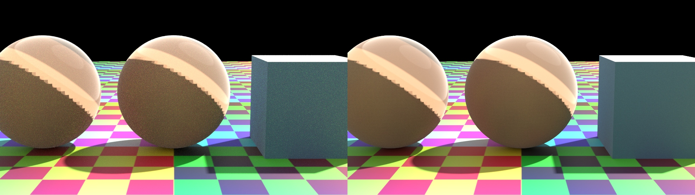

*A toon material: MoonRay (left), MoonLightIPR (right).*

## New in 0.4

The full list, with pictures, is in [What's new in 0.4, 0.4.1 and 0.4.2](docs/WHATS_NEW_04.md).

**The preview window**

- **Three engines**: **MoonRay** for the full render; **MoonRay LS** for a quick low-sample render; **MoonLightIPR**, which updates after each edit once you press **RT Off** to switch realtime on.
- **Smart Render**: MoonRay stops by itself once the picture is clean enough for the denoiser, and denoises it.
- **Important Parts First**: the buckets with the most detail render before the plain ones.
- **Stop keeps a whole picture**, and **Denoised Beauty just works**: choose it in the buffer list.
- **The preview follows Modo's color management** by default, and names the view and LUT at the foot of the window.
- **Draft** redraws in about a third of a second after a move, and follows the scene by itself.

*MoonLightIPR activated. Paper Cheetah model by Raphael Tobar/Genoma*

**New tools**

- **Compositor**: a node graph over a finished render's buffers, in Options > Compositor. Nothing is rendered again.
- **MoonLightIPR Playblast**: renders an animation on the graphics card and plays it back.
- **File > Open reads MoonRay scenes** (`.rdla`, `.rdlb`), of any size.

*The compositor: the beauty graded, given a vignette and sharpened.*

**Closer to Modo**

- **Modo fur without a limit**: every fibre Modo would grow, each as thick as the Fur material says.
- **Keep Fine Detail** when denoising: fur, hair and curves stay sharp over a denoised surface.
- **Bump and normal images show on subdivision surfaces**; an image layer's **Low Value and High Value** are followed.
- **Cellular, Wood, Weave and Ripples** layers render.
- **Hidden items stay hidden**: an item, or a light's material, with its eye off does not render.
- **MoonLightIPR is much closer to MoonRay** on layered materials, glass, coats and subsurface.

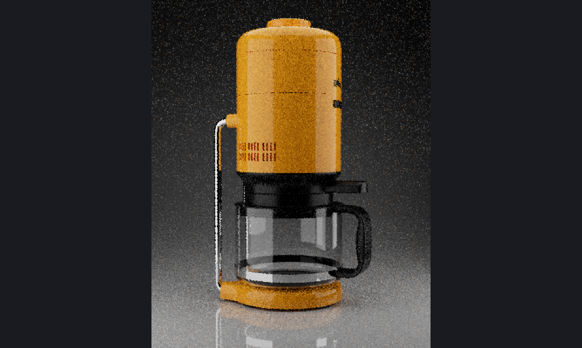

*Stopped part way: MoonRay finishes the tiles it is on, so nothing is left dark or blocky.*

## From 0.3.51

The full list is in [What's new in 0.3.51](docs/WHATS_NEW_0351.md).

**The preview window**

- **Draft**: the scene as clean outlines, with nothing rendered until you press **Region** and drag. Then only that part is rendered, among the lines.
- **Region** is a button you drag with; **R, G, B, A** show one channel; a **colour probe** follows the pointer; **EV** and **Gamma** reset with a click.
- **Export AOVs as Images** from the picture's right-click menu.

*Draft, with a region rendered among the lines.*

**Rendering with MoonRay**

- **Safe Denoising**: stop a MoonRay render at any time and keep it, denoised. **Continue** then takes it up where it stood.
- **Bake Selected Mesh to Texture**, **deep EXR** output, more render settings and one-click outputs, and **light path presets**.
- **Mesh lights** are seen glowing; MoonRay light items can be **linked**; an object can cast **no shadow onto chosen objects**.

*Stopped part way, kept and denoised, with Continue on offer.*

**The MoonLightIPR preview** (echoing DreamWorks' earlier rasterizer MoonLight; it was shown as "MoonLight" in 0.3.50)

- **Hair, skin and curves** shaded with MoonRay's own materials; **fog and VDB clouds**, with their glow.
- **Rod, barn door, cookie and VDB light filters**, textures on every kind of light, and **render regions**.

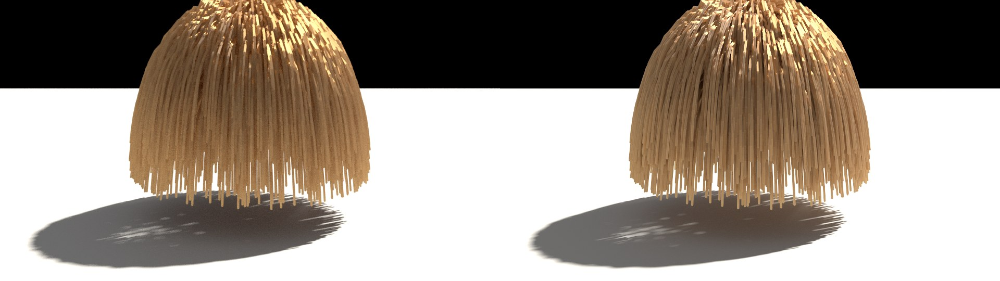

*Hair in MoonRay (left) and in the MoonLightIPR preview (right).*

**Materials and scenes**

- **Modo's Fur material** grows fur, with its curls, clumps, kink, frizz and weight maps.
- **Blinn and Ashikhmin** highlights match Modo's, and a material's **smoothing angle** is followed.
- **MoonRay's materials in the Shader Tree's Add Layer list**; assign one to **selected polygons**; **OpenPBR and glTF** surfaces from MaterialX.
- **Imported MoonRay scenes** keep their light, shadow and shadow receiver sets.

*Modo's Fur material in MoonRay: curls, clumps with kink, and fur thinned by a weight map.*

**Working with the plugin**

- **The asset library shows pictures** of things to use, each with one button for what it is for.
- **MoonRay Content**: MoonRay's ten example scenes, as a third ZIP of the release that merges into the kit.
- **A MoonRay page in Modo's Preferences**, including having the M key open MoonRay's Assign Material.
- **Dense hair** grows and re-renders several times faster.

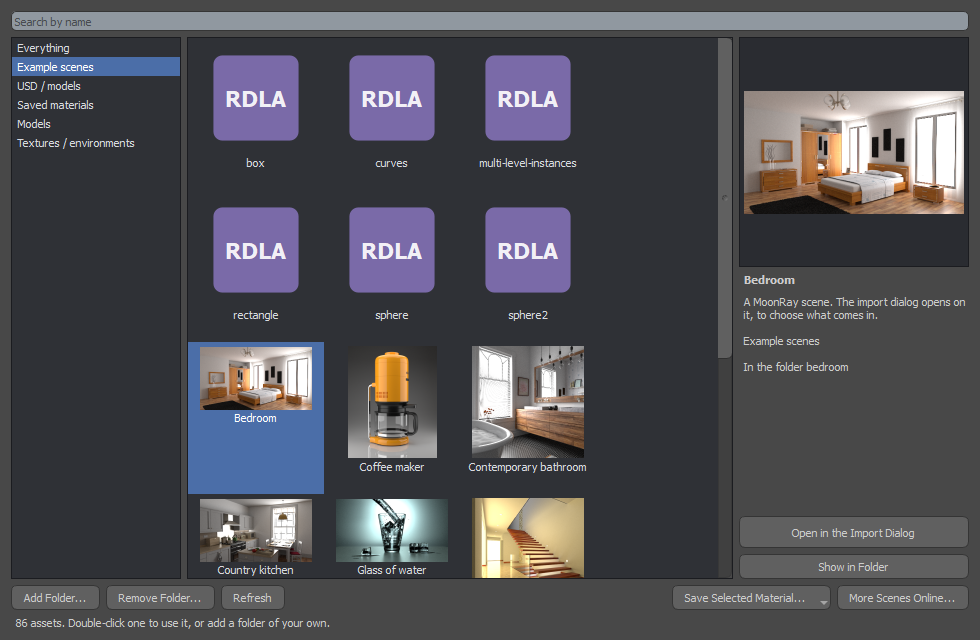

*The asset library, showing MoonRay's example scenes.*

## From 0.3.50

- **MoonLightIPR** (echoing DreamWorks' earlier rasterizer MoonLight), an approximate NVIDIA GPU preview engine, chosen in the preview window. It follows edits as they are made; output renders still use MoonRay. See [moonlightipr/README.md](moonlightipr/README.md).
- **MoonRay-specific items, added from the MoonRay menu**: 30 of MoonRay's own lights, light filters, cameras, shapes and volumes as Modo items (dwEnvLight, dwRectLight, dwSpotLight and the rest), each with its own properties form and a viewport proxy, for what Modo has no item for. VDB volumes load from a file.
- **Import MoonRay Scene (RDL)**: a MoonRay scene comes in whole. Meshes keep their transforms and are instanced, curves come in as curves, lights and other MoonRay objects become MoonRay items, materials keep their graphs, and the scene's settings and outputs go to the render settings. A scene in two files (`scene.rdlb` and `scene.rdla`) is read as one. All ten of MoonRay's published example scenes re-render as the same picture after a trip through Modo.
- **MaterialX import**: a `.mtlx` material becomes a material of its own kind in the Shader Tree, with controls for the values and images its file names.
- **Curves and hair**: a mesh's curves render as tubes or ribbons, with width, taper and UVs along the length; hair can be grown from guide curves, held to a scalp mesh. (In the releases MoonLightIPR draws them as tubes of polygons; on the branch they are true curves.)
- **Modo parity for lights, daylight and standard materials**: Modo's lights, physically based daylight (with its sun disc) and the standard material's specular, roughness and Fresnel are translated by measurement against Modo's own renderer.
- **A leaner preview window**: one toolbar with a single Render/Stop button, IPR, engine, buffer, exposure, region and a focus picker; render settings on the Render item; one-click Cryptomatte; a working time estimate.
- **MoonRay materials on objects, in place of material overrides**: select a mesh and assign a MoonRay material to it. Each is a material of its own kind with its own properties form. The separate MoonShine and MaterialX override layers of earlier versions are no longer offered; scenes that hold them still load and render.
- **A redesigned graph editor**: its own window that does not block Modo, a gridded canvas, compact nodes, an add-node search, and a proper control for every property, including ramps and a UV map chooser.
- **Editing that goes both ways, live**: a material can be edited in the graph editor, in its properties form or in the Shader Tree; a change in one shows in the others, and with IPR on the preview follows each change as it is made, without a re-read of the scene. MoonLightIPR follows lights, transforms and materials even while they are being dragged.
- **ACES by default**: the preview's view transform starts as ACES for an sRGB monitor, with no configuration file to find. Plain sRGB and others remain as choices.
- **Heavy scenes**: meshes of 5,000 polygons or more are read from Modo in one call by the native adapter, and written out for MoonRay several times faster. GPU renders with many outputs have four times the room they had, and fall back to the CPU rather than stop if that still runs out.

### The graph editor

*A MoonRay material in the graph editor: nodes to add on the left, the graph in the middle, and a control for every property of the selected node on the right. Edits here, in the material's form and in the Shader Tree show in each other, and IPR follows them.*

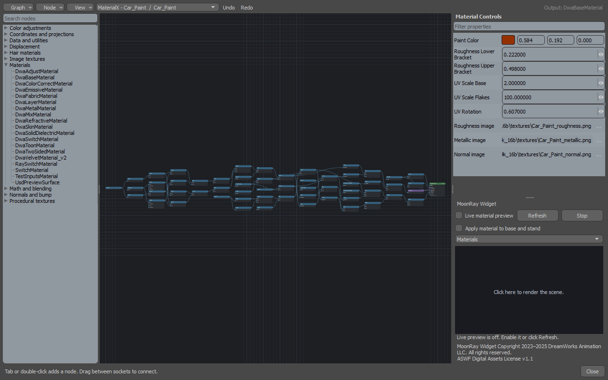

*An imported MaterialX car paint. With no node selected the panel shows the material's own controls: the colours, numbers and images its file names.*

### Curves as tubes

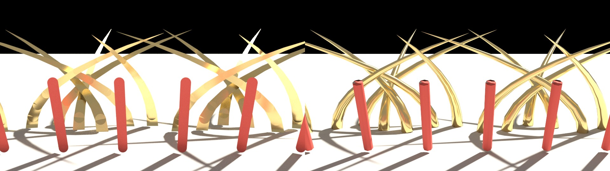

*A mesh's curves, splines and line polygons rendered with a width at the root and at the tip: MoonRay on the left, MoonLightIPR on the right. The gold strands taper to a point; the red ones keep their width.*

### Imported MoonRay scenes, before and after

In each pair, MoonRay's render of the scene from its own files is on the left; on the right is the same scene after it was imported into Modo and rendered through the plugin. Small, low-sample test renders; [docs/images](docs/images/README.md) has the scenes' authors and licenses.

| | |
|---|---|
| 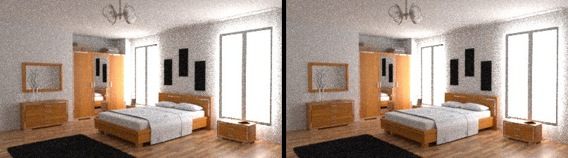 | 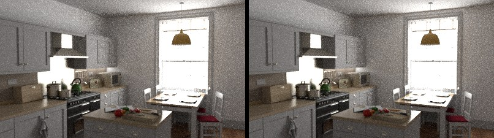 |
| Bedroom (SlykDrako, CC0) | Country Kitchen (Jay-Artist, CC BY) |
|  | 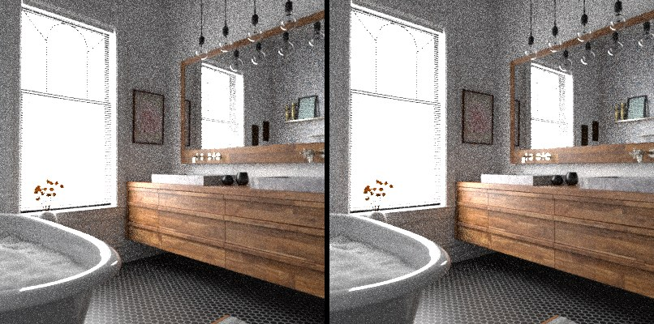 |
| Modern Hall (NewSee2l035, CC BY) | Contemporary Bathroom (Mareck, CC0) |

### Imported MaterialX materials

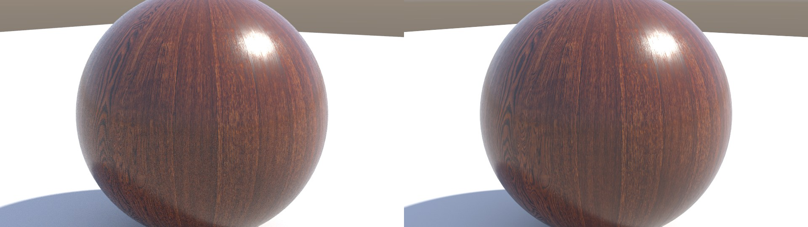

*TH Wood Table from [AMD's GPUOpen MaterialX Library](https://matlib.gpuopen.com/main/materials/all), imported from its `.mtlx` file: MoonRay on the left, MoonLightIPR on the right.*

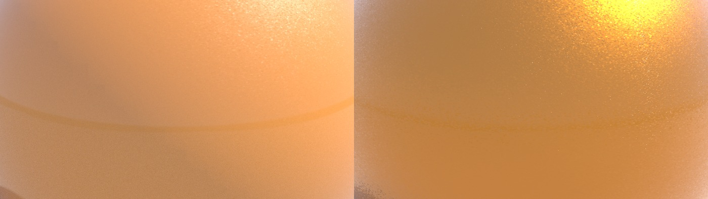

*The flakes of the library's Car Paint, close up: MoonRay on the left, MoonLightIPR on the right. The flakes are in the reflection, driven by the file's own flake textures.*

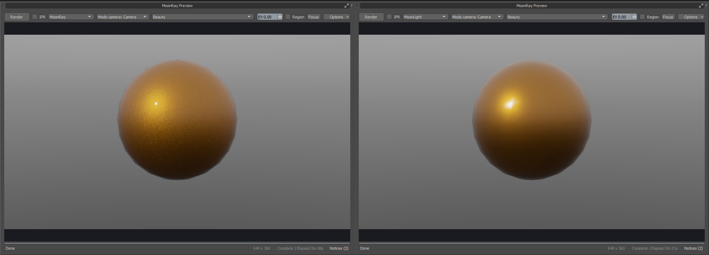

*The same material at a normal viewing distance in the preview window, with MoonRay and then MoonLightIPR chosen. MoonLightIPR's denoiser softens the flakes at this distance until the picture has gathered more samples.*

### View transforms

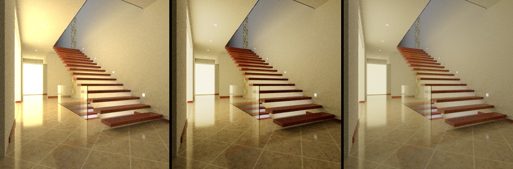

*One linear render shown three ways: plain sRGB, ACES (the default), and highlight compression + sRGB. Modern Hall by NewSee2l035, CC BY.*

### MoonLightIPR beside MoonRay

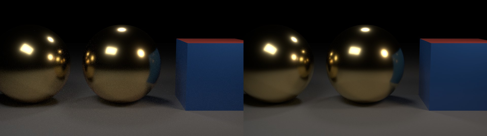

*MoonRay on the left, MoonLightIPR on the right: a rect, a disk and a sphere light. [moonlightipr/README.md](moonlightipr/README.md) has more pairs and the measured differences.*

## Currently implemented

- Native Windows rendering: CPU/AVX and NVIDIA XPU, with XPU → Vector → Scalar fallback.
- Interactive preview: dockable window, live updates, draft and region rendering, a colour probe, worker-tile/bucket overlays, the quick MoonRay LS engine, and the realtime MoonLightIPR GPU engine with playblasts.
- Materials: native MoonRay materials with their own forms, a visual node editor, material preview, and MaterialX import.
- Modo scene translation: standard and Principled materials, image textures, normal/bump maps, procedurals, lights, daylight, environments, subdivisions, instances, replicators, curves and hair—with the limits below.
- MoonRay items: lights, light filters, cameras, analytic shapes and volumes with their own properties.
- Render outputs: configurable AOVs, Cryptomatte surface categories, buffer switching, deep EXR, texture baking, a compositor over the finished buffers, and denoising (OptiX or Open Image Denoise) that survives a stopped render.
- Workflow tools: ACES/sRGB/OCIO view transforms and LUTs, animation output and recovery controls, an asset library with MoonRay's example scenes, and RDL scene import.

## Known issues in 0.5.3.2

The ones you are most likely to meet:

- Very smooth highlights (roughness under about 0.2) are dimmer than Modo's: about three quarters as bright under GTR, less under Blinn and Ashikhmin.
- Under Principled, Modo's diffuse gets brighter with roughness and MoonRay's does not.
- Glass under Blinn and Ashikhmin lets through about 8% less light than Modo's, and a very strong anisotropy draws a shorter streak than Modo's.
- MoonRay tessellates a displaced polygon mesh coarsely, so fine displacement shows little on it; subdivision surfaces show it fully.
- Hair in MoonLightIPR is close to MoonRay's but not exact, and its subsurface can have less red than MoonRay's on a strongly coloured material.
- A glowing VDB volume, or a light with a cookie filter, renders in MoonRay's slower scalar mode; the plugin switches for you and says so.
- With alpha and an environment the camera sees, an EXR still holds the environment where its alpha is 0, so a plain "over" looks washed out: subtract its `environment_background` channel, or hide the environment from the camera. A MoonRay EnvLight item is not in that channel, so soft edges in front of one can still flare.
- Smart Render and Important Parts First work on MoonRay renders in the preview window, not on Render EXR or animations.
- XPU2 renders previews only after its shaders are compiled once (Preferences > MoonRay > XPU2 > Compile XPU2 Shaders); until then the preview says so. A scene XPU2 cannot render yet goes to MoonRay XPU.
- Now and then, a preview with glitter in the GPU (XPU) mode fails on the graphics card; it is rendered on the CPU instead, with a notice.

Every open issue is in the [issue tracker](https://github.com/Pbaroque20/MoonRayForModo/issues). Found something else? Please report it there.

## This Version's Current Limitations

- **Windows and Modo 16.1v9 only.** XPU and MoonLightIPR need an NVIDIA GPU, and so does XPU2 except with its Devices preference set to the processor only; they have been exercised on an RTX 3090 only.
- **MoonLightIPR is an approximation.** It matches MoonRay closely on many scenes but not all; [moonlightipr/README.md](moonlightipr/README.md) says how closely, scene by scene, and what it leaves out.
- **Modo parity is partial.** Only Modo's own lights and standard/Principled materials are matched. Blinn and Ashikhmin highlights are matched to Modo's by measurement (the lobe, roughness and strength that came closest to Modo's own renders), closely once the roughness is 0.2 or more and loosely below that; a roughness driven by an image is matched the same way. A Modo material's smoothing angle is followed, except on a mesh of more than 300,000 faces, which is smoothed all over and named in a notice. Under Principled, Modo's diffuse brightens with roughness and MoonRay's does not. Anisotropy runs along the material's UV map, with its strength fitted to Modo's renders. Rough environment reflections come out dimmer in MoonRay. Specular Tint, Flatness and a reflection amount apart from specular have nothing like them in MoonRay's material and are named in a notice. Modo's cylinder, dome and photometric lights are left out, with a notice; MoonRay's own lights and volume items stand in. Modo's own group light linking is translated but experimental; check it against Modo.
- **MaterialX is a supported subset**: Standard Surface, OpenPBR and glTF surfaces made of images, maths, mixes, remaps, UV transforms and MoonRay's own maps. Nodes outside that subset are not read.
- **RDL import leaves a few things out**, and names each in its report. This comes with the format: an RDL file is MoonRay's own description of a scene, and it can hold things Modo has nothing to turn them into. MoonRay item kinds with no Modo counterpart, ways of instancing Modo cannot express (instances read from a point file, some instancing methods), and render outputs Modo's settings have no place for are left out and named, rather than turned into something that would render differently. Motion, values and words that differ face by face or point by point, subdivision creases and meshes filled with fog do come in.
- **Geometry**: some instancing, motion, subdivision, UV-projection and normal-map cases differ from Modo. A mesh that mixes polygon kinds or needs per-polygon projection is read the slower way. A shadow a coarse mesh casts on itself, as a torus's on the inside of its hole, follows its faces, in MoonRay and MoonLightIPR alike; subdivision smooths it.
- **Cryptomatte**: mattes are picked in the preview and named on objects and materials; the compositor's Cryptomatte node works on finished MoonRay renders.
- **Preview**: some edits still need the whole scene read again; the compositor works on finished MoonRay renders, not on MoonLightIPR's. Safe Denoising and Continue are for the MoonRay engine, and Safe Denoising is greyed while XPU2 renders the preview.

### MoonRay's features in the plugin

Comparison audit between MoonRay 2026.29.1's source and the current plugin.

| MoonRay feature | Plugin | Notes |
|---|:---:|---|
| CPU rendering (scalar and vector) |  | AVX build |
| XPU rendering on the graphics card |  | NVIDIA only. XPU2, the plugin's own GPU renderer (new in 0.5), renders previews by default, and Render to a File and animations; deep images and checkpoints stay with MoonRay. XPU2 takes about half the graphics card memory it did before 0.5.2.1. XPU2 needs a third of the texture memory, and less of the card; it renders on every NVIDIA card in the machine and every processor, past 64 threads, with each card and processor switched on or off in Preferences > MoonRay > XPU2 > Device Management, and its workers and texture memory placed by NUMA node on two-socket and many-die machines. Compile XPU2 Shaders compiles only the kinds of card that are not up to date, and names a new one. |
| Progressive rendering, and region rendering |  | The preview window, and the graph editor's MoonRay Widget. The widget renders under MoonRay LS, which is quicker. The widget renders with XPU2, at 1024 to 4096 samples, with a Scale for the ball |
| Cameras: perspective, orthographic, fisheye, spherical, dome |  | MoonRay camera items, or Modo's camera. A Modo camera converted to any of them in its place (animation kept), and changed back to a Modo camera; a Camera Sequence keying cameras to ranges of frames, and MoonRay cameras that are Modo cameras, looked through in the viewport by their lens with Modo's resolution gate. A MoonRay camera sees as near as a Modo camera unless Near is set, and a new one starts where the render camera stands. dw Perspective and Orthographic cameras take the Modo camera's lens, edited in its own tabs. |
| Stereo cameras |  | Modo's camera Stereo: one eye, or both with a red/cyan picture in Render EXR; MoonLightIPR shows the eye chosen, and the left for both |
| Overscan (rendering past the frame edge) |  | Modo's camera Overscan, or a MoonRay camera's own when it is rendered through, in final renders |
| Bake camera |  | Texture baking |
| Lights: rect, disk, sphere, spot, cylinder, distant, environment, mesh, portal |  | MoonRay light items, or Modo's lights. A round light under an uneven scale stays on and round, in every engine, and a notice says so. |
| Light filters: barn door, colour ramp, combine, cookie, decay, intensity, rod, VDB |  | A cookie filter renders in XPU2, where it sent the render to MoonRay's scalar mode. |
| Light, shadow and light filter linking |  | MoonRay's own sets, and Modo's own Light Linking groups (include or exclude), which reach MoonRay Shadow receiver sets, and a shadow ray offset, in Light Links |
| Meshes, subdivision, curves, points, instancing |  | From Modo's geometry. Creases from Modo's Subdivision weights |
| Box and sphere shapes |  | |
| VDB volumes, base and cutout volumes |  | A VDB renders on XPU2's graphics card, glowing ones too, about five times faster; fire from a temperature or flames grid glows, in its blackbody colours where asked; numbered VDB files play as a sequence (static unticked); a dwVdbVolume asks for its VDB file |
| Motion blur |  | Final renders, and MoonLightIPR previews, where it is a Preview Preference, off by default, with moving lights blurred too; MoonRay XPU2 for Render, Render to a File and animations, and for XPU2 realtime as a Preview Preference. XPU2 traces moving objects on the GPU, subdivision surfaces that move or change shape among them. MoonLightIPR playblasts show it when it is active. |
| Depth of field |  | A polygon or disc bokeh, by sides and angle, or an image. MoonRay's two bokeh weight settings, which it does not use, are marked as having no effect. With the Modo camera's lens, a bokeh image turns bokeh on. |
| DWA materials (base, metal, fabric, skin, layer, mix and the rest) |  | Two Sided and Color Correct take the other DWA materials as their inputs, and a layer or two-sided material missing an input no longer crashes MoonRay |
| Hair, toon and USD Preview Surface materials |  | Toon edges smooth on coarse meshes, and toon renders that denoise cleanly, each a preference; a new toon material is brightest facing the light |
| Switch and Ray Switch materials |  | In the node editor |
| Maps, normal maps and displacement nodes |  | In the node editor, with a Bump node turning a height image into the normal (a Source Override, on by default), and the Shader Tree's Displacement and Stencil layers |
| Switch displacement |  | In the node editor |
| Display filters (colour correct, toon, halftone and the rest) |  | All 18, as MoonRay items; each a preview buffer and an EXR channel |
| Uniform and adaptive sampling, light sampling, bounce limits, clamping |  | Render Settings. Settings a sampling mode does not use are greyed, and MoonRay LS samples adaptively or uniformly, chosen in Preview Preferences |
| Shadow terminator fix, Russian roulette, roughness clamp, texture blur, same noise every frame, tile order |  | Render Settings |
| Volume quality and overlap settings |  | |
| Volume attenuation and contribution factors |  | Render Settings, Volumes, with the phase attenuation factor; MoonLightIPR follows them |
| Pixel filters: box, cubic and quadratic B-spline |  | Also Gaussian, Triangle and Blackman-Harris, added by the plugin |
| Adaptive tessellation by screen error |  | Displacement Tessellation in Render Settings, following Modo's Displacement Rate, or per object |
| Global switches: displacement, subsurface, shadows, lights seen by the camera, geometry resolution, dicing camera |  | Render Settings, Global Switches |
| Presence quality, Cryptomatte multi-presence, optimised hair sampling switch |  | In Render Settings. Automatic Presence Shadows, in Preferences, sets presence shadows by whether a material is cut out |
| AOVs: light path expressions, material AOVs |  | Ready-made, or type your own expression. The compositor adds the light passes or light groups and puts them back together, each with its own Grade; a probe shows each node's value at a pixel and keeps it as a note; the colour nodes take a mask. The Environment background output has its picture in vector and XPU modes. PBR validity, a diagnostic in Preferences > MoonRay > Renderer, takes the standard outputs' place and is shown in the preview while on. |
| Time per pixel (where the render spent its time) |  | A preview buffer and an EXR channel |
| Depth, normal, position, UV, motion vector, wireframe and sample count outputs |  | Render Settings; each a preview buffer and an EXR channel |
| Visibility outputs (how much of each light reaches a point) |  | Every light or one light group, in the Outputs window |
| Primitive attribute outputs |  | A number or a colour, by the attribute's name, in the Outputs window |
| Cryptomatte |  | Fog, from a VDB or in a MoonRay box or sphere, has mattes of its own, and each sample is counted once in vector and XPU modes; names and IDs given on objects and materials; picking in the preview; a Cryptomatte node in the compositor |
| Deep EXR |  | |
| Checkpoints and resuming a render |  | Recovery, Safe Denoising and Continue |
| EXR metadata |  | |
| Choice of EXR compression |  | All of MoonRay's, zip by default |
| Multi-part EXR |  | Each output in a part of its own, by choice |
| Picture types besides OpenEXR |  | PNG, JPEG, TIFF and Targa for a render to a file, animation frames and exported AOVs, the OpenEXR kept beside them. PNG, TIFF and Targa keep the render's alpha, as do Save Image and Export AOVs; Export AOVs can also save one multilayer OpenEXR. Animation frames can be saved in these types alone, with no EXR left beside them, and a saved picture comes from the denoised render where there is one. Soft edges no longer flare in PNG, TIFF and Targa with alpha and a visible environment. |
| Colour management: OCIO, ACES views, ACEScg working space |  | Modo's own OCIO configuration and colour spaces, any OCIO display and view, and ACES 1.3 and ACES 2.0 for an sRGB display; ACEScg scenes render and look right |
| Denoising (OptiX, Open Image Denoise) |  | The Denoiser set to Off is off everywhere, the denoised beauty and Smart Render included. Denoised and composite frames keep their number last: `frame.denoised.0001.exr`, `frame.composite.0001.exr`. A card that cannot run OptiX's denoiser hands XPU2's realtime denoising to one that can, or to Open Image Denoise on the processor. |
| Primitive attributes (values a shape carries for its materials) |  | Per item or instance, and per point or per face from Modo's weight and colour vertex maps; imported from MoonRay scenes |
| RDL scene import |  | A few things left out, named in its report. Motion, creases, fog meshes and values by point or face come in, and instancers of any size, though past 20,000 copies only meshes do |
| RDL scene export (RDLA, RDLB or split) |  | Export as MoonRay Scene, in the MoonRay menu and the preview's Options, to render with MoonRay on its own or on a farm: outputs, collected textures and each frame of the range optional |
| Arras: rendering spread over several machines |  | |
| Hydra render delegate and USD procedurals |  | For USD applications; not part of Modo |

### Modo's features in the plugin

Comparison audit between Modo 16.1v9 and the current plugin: what of a Modo scene MoonRay renders as Modo does.

| Modo feature | Plugin | Notes |
|---|:---:|---|
| **Lights** | | |
| Directional light, with the physical sun |  |  |
| Point, spot and area lights |  | Their intensity measured against Modo per kind |
| Mesh lights |  | A Mesh Light shines from its shown Prototype mesh, of any polygons, in MoonRay, XPU2 and MoonLightIPR; a hidden Prototype gives no light, as in Modo, and a light hidden from the camera still shows in reflections |
| Cylinder, dome and photometric (IES) lights |  | Skipped, with a notice; MoonRay's own cylinder and environment lights stand in |
| Light linking (Modo's groups, include or exclude) |  | Experimental, with a notice; check it against Modo |
| Light volumetrics, and fog |  | Point, spot and directional light volumetrics, and the environment's fog (new in 0.5); Layered fog has no falloff and a Base Shader's fog is left out, each with a notice; not yet compared with Modo's renders |
| **Environment** | | |
| Gradients, overcast and physical skies, constant colours and HDRI image layers |  | An HDRI turns as in Modo, and quickly |
| **Cameras** | | |
| Perspective and orthographic cameras |  | With depth of field, motion blur, stereo and overscan; Film Roll, distortion and squeeze are not followed, and a notice names them. Motion Blur on the Modo camera turns on motion blur in renders. Edge Weighting is not followed, and a notice says so. |
| Other camera projections |  | Refused; MoonRay's fisheye, spherical and dome cameras in their place |
| **Materials** | | |
| Standard material: GTR, Blinn and Ashikhmin |  | Highlights matched by measurement; very smooth ones (roughness under 0.2) come out dimmer, as do rough reflections of the environment |
| Principled model |  | Sheen, and the highlight's rise toward the edge, fitted to Modo's renders; its diffuse does not brighten with roughness as Modo's does |
| Transparency, refraction and dispersion |  | Tinted and rough glass as Modo's, checked against its renders; glass under Blinn and Ashikhmin lets through about 8% less light than Modo's |
| Subsurface scattering, clearcoat, metallic, luminosity, dissolve |  |  |
| Anisotropy |  | Along the material's UV map, its strength fitted to Modo's renders; a very strong anisotropy draws a shorter streak than Modo's |
| Specular Tint, Flatness, and a reflection amount apart from specular |  | MoonRay's material has nothing like them; named in a notice |
| Unreal, Unity, glTF and AxF materials |  | Nor Modo's Substance, Matcap, Cel, Halftone, Iridescence, Skin and Thin Film materials, each named in a notice. |
| **Shader Tree** | | |
| Image maps: UV and projections, UDIMs, Low and High values |  | UV, planar, cylindrical, spherical and cubic projections, a locator's worked out at the polygons' corners; Box, Front, Triplanar, Light Probe and Implicit UV projections, and image sequences, are left out with a notice |
| Procedural textures |  | Constant, checker, noise, grid, dots, gradient, cellular, wood, weave, ripples, Gabor and Poisson noise, Curvature and Wireframe, EasyGrad and RegionalHSV, and 145 Enhance textures, worked out through the object (new in 0.5); not yet compared with Modo's renders; Surface Probe, Occlusion, Tension, Variation and Process not. MoonRay XPU2 shades them too. |
| Layer blend modes |  | All but Normal Multiply, which is left out; Normal Map Blend on normal maps only. A group mask set to Normal Multiply is drawn as Normal, with a notice, and no longer stops the scene reading. |
| Bump and normal maps |  |  |
| Displacement and Stencil layers |  | Checked against Modo's renders |
| Other texture effects (Modo has 218) |  | Colour, amount, roughness, bump, normal, coat, transmission, subsurface, dissolve, anisotropy, masks, displacement and stencil; reflection, sheen, Fresnel and the rest are left out with a notice |
| Group masks by material, Part and Selection Set |  | Checked against Modo's render |
| Group masks by item |  | Checked against Modo's render |
| **Geometry** | | |
| Meshes, subdivision and creases |  | A mirrored mesh (negative scale) faces outward, a Source Override on by default |
| Instances and replicators |  | Replicators through Modo's evaluated geometry |
| Deformed and animated meshes |  | Through Modo's evaluated geometry |
| Alembic |  | Loaded as Modo meshes with streaming deformers, or as Alembic Streaming Meshes, moving over time with motion blur; read from the file itself, so fluids whose faces change render and blur along their velocities; Alembic Curves and Point Clouds untested |
| Curves, hair and Modo's Fur material |  | Fur follows its guides (Direction, Direction + Length, Shape, Range and Clump, with Guide Range and Guide Length), its vector map and its width map; a guide's Blend Amount and Modo's Hair Material are not read |
| Weight and colour vertex maps |  | As values MoonRay's materials read, and the Shader Tree's Weight Map Texture layer, with weight maps; not in a scene with replicators or masks by item, Part or Selection Set. A notice names a weight map lost that way. |
| Modo's volume items |  | Rendered from a VDB file attached in the MoonRay controls |
| Blobs and particles |  | A mesh's loose points render as points |

### Where the plugin changes MoonRay

Besides the patches that build MoonRay on Windows, the plugin changes MoonRay where it renders something wrongly or
slowly for an artist: nineteen MoonRay Source Overrides, each a checkbox in Preferences (MoonRay, MoonRay Source Overrides;
Auto's is under XPU), on by default; off renders as MoonRay's source does. Low-latency rendering, geometry loaded as binary,
smooth toon edges on coarse meshes, toon materials that denoise cleanly, the denoiser's guides cleaned first, toon lines
without gaps and apart from the shading, display filters given the inputs they need, n-gons triangulated cleanly,
blurred moving lights, fog in Cryptomatte, fog in front of see-through surfaces in alpha, lights seen by the camera in light outputs, each Cryptomatte sample
counted once, a stopped render finishing the tiles in hand, UsdPreviewSurface's specular colour, images without alpha
read as opaque, rough glass under a smooth surface, and Auto rendering on the graphics card first. A few additions have no
switch, such as three more pixel filters. Those that change MoonRay's own code are described in the [engineers' notes](patches/native-windows/README.md).

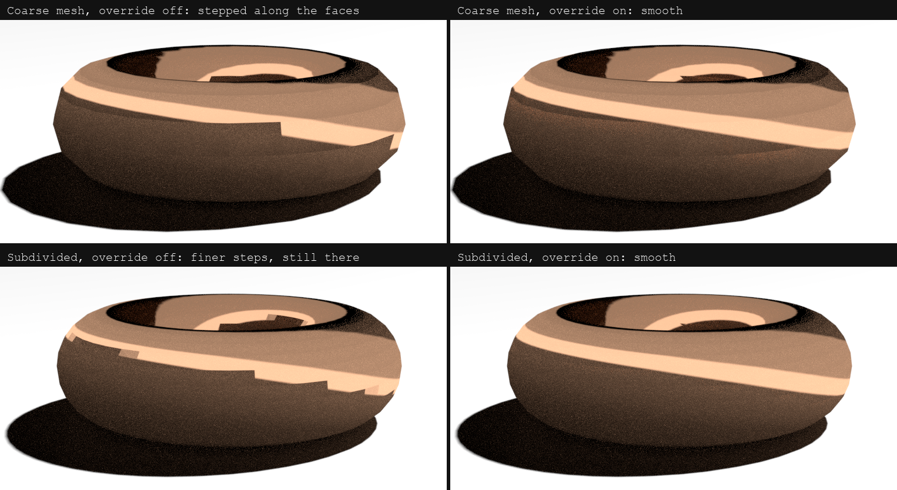

*Smooth toon edges on coarse meshes: MoonRay's toon steps along the faces of a coarse mesh, and still, more finely, on
a subdivided one (left); with the override, both are smooth (right).*

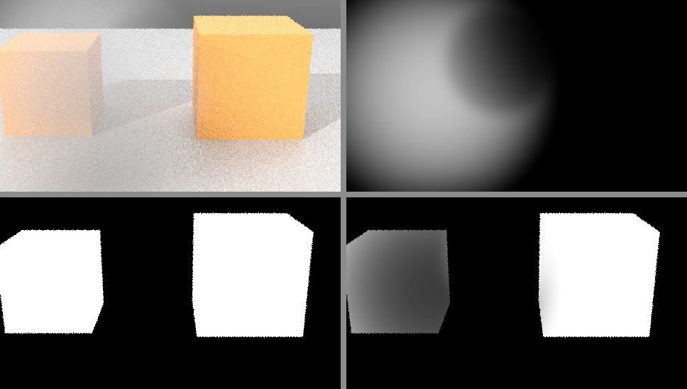

*Fog in Cryptomatte: the render, the fog's own matte, and the boxes' matte as MoonRay makes it, solid behind the fog
(bottom left), and with the override, faded where the fog hides the box (bottom right).*

## Still to implement

- Fur guides, and the fur vector and width maps.
- More of Modo's material: the Principled model's diffuse (which brightens with roughness in Modo) and smooth highlights under every model.
- Modo's cylinder, dome and photometric lights.
- Glass under Blinn and Ashikhmin, which lets through more light in Modo.
- The Shader Tree effects still left out (Modo has 218).
- Modo 17.1 on Windows, then macOS.
- Broader validation: other GPUs and drivers, clean-machine installs, very large scenes, recovery under load, and colour matching.

Each of these, and what MoonRay documents that the plugin has no control for yet (Alembic and USD procedurals, Arras and more), is in the [issue tracker](https://github.com/Pbaroque20/MoonRayForModo/issues).

**Production readiness:** this is a pre-production release, not a production-certified build. Some users have confirmed it works. Each release note says what was and was not checked.

Detailed implementation notes and recorded checks are in [docs](docs/). Plugin licensing is in [LICENSE](LICENSE); MoonRay and bundled assets retain their respective licenses. MoonLightIPR, the GPU preview engine, was created by Raphael Tobar and is under the same MIT License; it is not a DreamWorks Animation product and is not affiliated with or endorsed by DreamWorks Animation (see [moonlightipr/NOTICE.md](moonlightipr/NOTICE.md)).
