# Dreamworks' MoonRay for Modo

Paper Cheetah 3D Model (created by Raphael Tobar/Genoma)
 

MoonRay for Modo integrates DreamWorks’ open-source MoonRay renderer with **Modo 16.1v9 on Windows**, running natively without WSL. Developed by Raphael Tobar w/ AI-Assistance.

The plugin includes CPU and XPU rendering, a dockable live preview with a second GPU preview engine, native MoonRay materials with a graph editor, Shader Tree translation, MoonRay's own lights and other items, MaterialX and RDL scene import, AOVs, and denoising.

**Built on MoonRay [2026.29.1](https://github.com/dreamworksanimation/openmoonray/releases/tag/v2026.29.1)** (OpenMoonRay's latest release; MoonRay 18.4), with the plugin's own patches for Windows and the preview.

**Current version: 0.4.1 — experimental development build.** It is 0.4 with a toon material that starts as toon and shows in MoonLightIPR, ramps edited with the mouse and shown live, and an importer that can import into a new scene.

[Download 0.4.1: the kit, the Windows runtime and the MoonRay content](https://github.com/Pbaroque20/MoonRayForModo/releases/tag/v0.4.1) · [Installation instructions](docs/INSTALLATION.md) · [What's new in 0.4 and 0.4.1](docs/WHATS_NEW_04.md) · [MoonRay's features in the plugin](#moonrays-features-in-the-plugin) · [Engineers' notes: where the plugin changes MoonRay](patches/native-windows/README.md)

Work on the next version goes on in the [MoonLightIPR branch](https://github.com/Pbaroque20/MoonRayForModo/tree/MoonLightIPR).

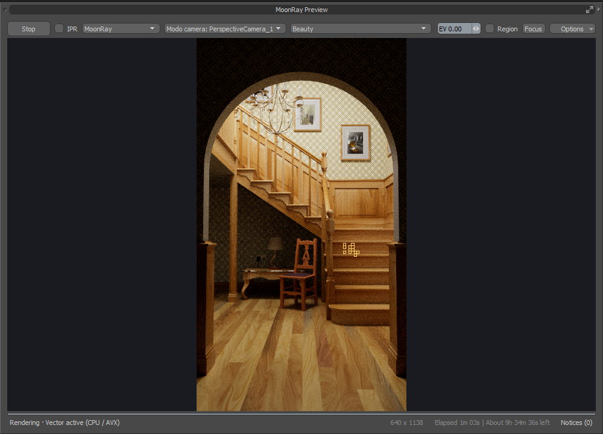

*The preview window in Modo 16.1v9, rendering The Wooden Staircase (by Wig42, CC BY) after it was imported from MoonRay's own scene files.*

## Major features

- **MoonLightIPR**: the plugin's own GPU preview engine (NVIDIA), which shows an approximation of MoonRay's picture moments after each edit. Final renders always come from MoonRay.
- **Smart Render**: MoonRay stops by itself once the picture is clean enough for the denoiser, and denoises it.
- **Safe Denoising**: stop a MoonRay render at any time and keep it, denoised. **Continue** takes it up where it stood.
- **Draft mode**: the scene as clean outlines, redrawn in about a third of a second after a move. Press **Region** and drag to render just that part among the lines.
- **One dockable preview, three engines**: MoonRay for the full render, MoonRay LS for a quick low-sample look, and MoonLightIPR. **Important Parts First** renders the most detailed buckets before the plain ones.
- **MoonRay's own materials and items in Modo**: native MoonRay materials with a node graph editor, and 30 of MoonRay's lights, light filters, cameras, shapes and volumes as Modo items.
- **Modo scenes render in MoonRay**: Modo's lights, daylight, standard and Principled materials, textures, fur, curves, hair and instances are translated for you.
- **Compositor**: a node graph over a finished render's buffers, with nothing rendered again.
- **MoonRay scene and MaterialX import**: `.rdla` and `.rdlb` scenes come in whole; `.mtlx` materials become Shader Tree materials.
- **Outputs**: AOVs and light path expressions, one-click Cryptomatte, deep EXR, texture baking, and denoising with OptiX or Open Image Denoise.

| | |
|---|---|
| 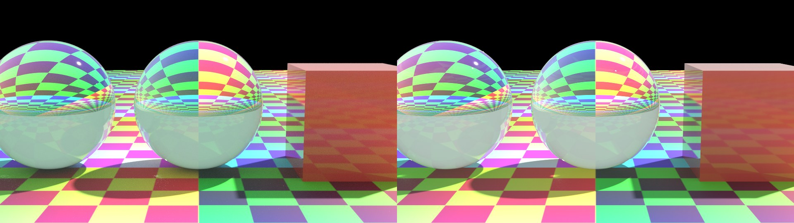 |  |
| **MoonLightIPR**: MoonRay (left), MoonLightIPR (right) | **Smart Render**: the noise falling, and where it will stop |
|  |  |
| **Safe Denoising**: stopped part way, kept and denoised | **Draft mode**: a region rendered among the outlines |
| 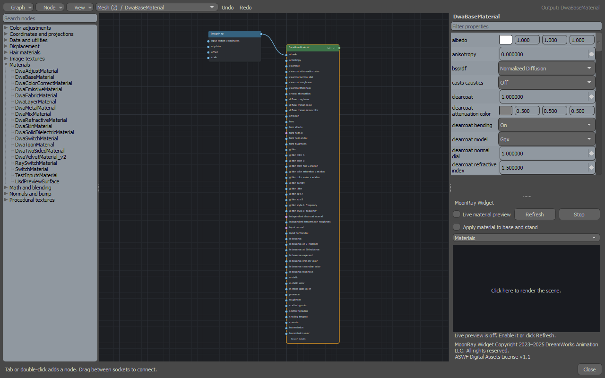 |  |
| **The graph editor**, with a MoonRay material | **Modo's Fur material** rendered by MoonRay |
|  | 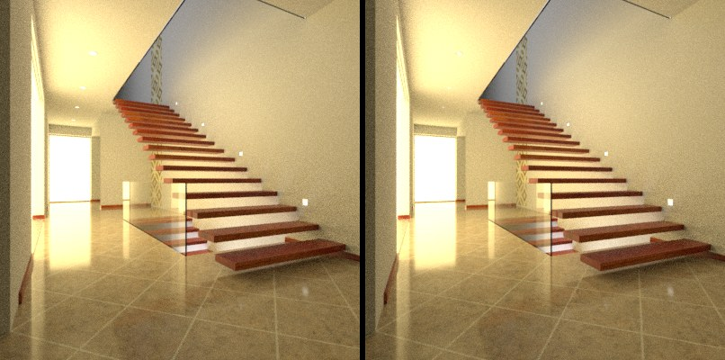 |
| **The compositor**: the beauty graded, vignetted and sharpened | **An imported MoonRay scene**: its own render (left), after the trip through Modo (right). Modern Hall by NewSee2l035, CC BY |

## New in 0.4.1

- **MoonRay's toon material** starts as a toon material, and MoonLightIPR draws it.
- **Ramps are edited with the mouse**, and a material's ramp shows in the preview as you edit it.
- **The scene importer can import into a new scene**, and has a Close button.
- **Color management follows Modo's system preferences**, and what you choose in MoonRay is remembered.
- **MoonRay LS** shows and renders the beauty alone.

*A toon material: MoonRay (left), MoonLightIPR (right).*

## New in 0.4

The full list, with pictures, is in [What's new in 0.4 and 0.4.1](docs/WHATS_NEW_04.md).

**The preview window**

- **Three engines**: **MoonRay** for the full render; **MoonRay LS** for a quick low-sample render; **MoonLightIPR**, which updates after each edit once you press **RT Off** to switch realtime on.
- **Smart Render**: MoonRay stops by itself once the picture is clean enough for the denoiser, and denoises it.
- **Important Parts First**: the buckets with the most detail render before the plain ones.
- **Stop keeps a whole picture**, and **Denoised Beauty just works**: choose it in the buffer list.
- **The preview follows Modo's color management** by default, and names the view and LUT at the foot of the window.
- **Draft** redraws in about a third of a second after a move, and follows the scene by itself.

*MoonLightIPR chosen, RT On.*

**New tools**

- **Compositor**: a node graph over a finished render's buffers, in Options > Compositor. Nothing is rendered again.
- **MoonLightIPR Playblast**: renders an animation on the graphics card and plays it back.
- **File > Open reads MoonRay scenes** (`.rdla`, `.rdlb`), of any size.

*The compositor: the beauty graded, given a vignette and sharpened.*

**Closer to Modo**

- **Modo fur without a limit**: every fibre Modo would grow, each as thick as the Fur material says.
- **Keep Fine Detail** when denoising: fur, hair and curves stay sharp over a denoised surface.
- **Bump and normal images show on subdivision surfaces**; an image layer's **Low Value and High Value** are followed.
- **Cellular, Wood, Weave and Ripples** layers render.
- **Hidden items stay hidden**: an item, or a light's material, with its eye off does not render.
- **MoonLightIPR is much closer to MoonRay** on layered materials, glass, coats and subsurface.

*Stopped part way: MoonRay finishes the tiles it is on, so nothing is left dark or blocky.*

## From 0.3.51

The full list is in [What's new in 0.3.51](docs/WHATS_NEW_0351.md).

**The preview window**

- **Draft**: the scene as clean outlines, with nothing rendered until you press **Region** and drag. Then only that part is rendered, among the lines.
- **Region** is a button you drag with; **R, G, B, A** show one channel; a **colour probe** follows the pointer; **EV** and **Gamma** reset with a click.
- **Export AOVs as Images** from the picture's right-click menu.

*Draft, with a region rendered among the lines.*

**Rendering with MoonRay**

- **Safe Denoising**: stop a MoonRay render at any time and keep it, denoised. **Continue** then takes it up where it stood.
- **Bake Selected Mesh to Texture**, **deep EXR** output, more render settings and one-click outputs, and **light path presets**.
- **Mesh lights** are seen glowing; MoonRay light items can be **linked**; an object can cast **no shadow onto chosen objects**.

*Stopped part way, kept and denoised, with Continue on offer.*

**The MoonLightIPR preview** (echoing DreamWorks' earlier rasterizer MoonLight; it was shown as "MoonLight" in 0.3.50)

- **Hair, skin and curves** shaded with MoonRay's own materials; **fog and VDB clouds**, with their glow.
- **Rod, barn door, cookie and VDB light filters**, textures on every kind of light, and **render regions**.

*Hair in MoonRay (left) and in the MoonLightIPR preview (right).*

**Materials and scenes**

- **Modo's Fur material** grows fur, with its curls, clumps, kink, frizz and weight maps.
- **Blinn and Ashikhmin** highlights match Modo's, and a material's **smoothing angle** is followed.
- **MoonRay's materials in the Shader Tree's Add Layer list**; assign one to **selected polygons**; **OpenPBR and glTF** surfaces from MaterialX.
- **Imported MoonRay scenes** keep their light, shadow and shadow receiver sets.

*Modo's Fur material in MoonRay: curls, clumps with kink, and fur thinned by a weight map.*

**Working with the plugin**

- **The asset library shows pictures** of things to use, each with one button for what it is for.
- **MoonRay Content**: MoonRay's ten example scenes, as a third ZIP of the release that merges into the kit.
- **A MoonRay page in Modo's Preferences**, including having the M key open MoonRay's Assign Material.
- **Dense hair** grows and re-renders several times faster.

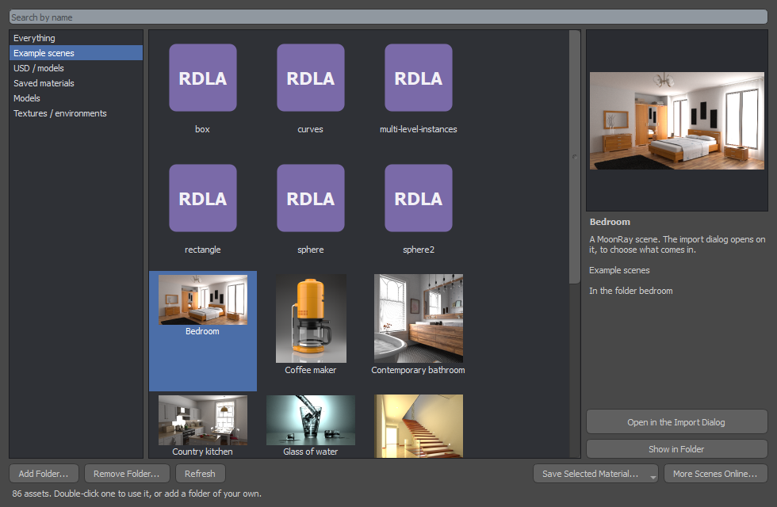

*The asset library, showing MoonRay's example scenes.*

## From 0.3.50

- **MoonLightIPR** (echoing DreamWorks' earlier rasterizer MoonLight), an approximate NVIDIA GPU preview engine, chosen in the preview window. It follows edits as they are made; output renders still use MoonRay. See [moonlightipr/README.md](moonlightipr/README.md).
- **MoonRay-specific items, added from the MoonRay menu**: 30 of MoonRay's own lights, light filters, cameras, shapes and volumes as Modo items (dwEnvLight, dwRectLight, dwSpotLight and the rest), each with its own properties form and a viewport proxy, for what Modo has no item for. VDB volumes load from a file.
- **Import MoonRay Scene (RDL)**: a MoonRay scene comes in whole. Meshes keep their transforms and are instanced, curves come in as curves, lights and other MoonRay objects become MoonRay items, materials keep their graphs, and the scene's settings and outputs go to the render settings. A scene in two files (`scene.rdlb` and `scene.rdla`) is read as one. All ten of MoonRay's published example scenes re-render as the same picture after a trip through Modo.
- **MaterialX import**: a `.mtlx` material becomes a material of its own kind in the Shader Tree, with controls for the values and images its file names.
- **Curves and hair**: a mesh's curves render as tubes or ribbons, with width, taper and UVs along the length; hair can be grown from guide curves, held to a scalp mesh. (In the releases MoonLightIPR draws them as tubes of polygons; on the branch they are true curves.)
- **Modo parity for lights, daylight and standard materials**: Modo's lights, physically based daylight (with its sun disc) and the standard material's specular, roughness and Fresnel are translated by measurement against Modo's own renderer.
- **A leaner preview window**: one toolbar with a single Render/Stop button, IPR, engine, buffer, exposure, region and a focus picker; render settings on the Render item; one-click Cryptomatte; a working time estimate.
- **MoonRay materials on objects, in place of material overrides**: select a mesh and assign a MoonRay material to it. Each is a material of its own kind with its own properties form. The separate MoonShine and MaterialX override layers of earlier versions are no longer offered; scenes that hold them still load and render.
- **A redesigned graph editor**: its own window that does not block Modo, a gridded canvas, compact nodes, an add-node search, and a proper control for every property, including ramps and a UV map chooser.
- **Editing that goes both ways, live**: a material can be edited in the graph editor, in its properties form or in the Shader Tree; a change in one shows in the others, and with IPR on the preview follows each change as it is made, without a re-read of the scene. MoonLightIPR follows lights, transforms and materials even while they are being dragged.
- **ACES by default**: the preview's view transform starts as ACES for an sRGB monitor, with no configuration file to find. Plain sRGB and others remain as choices.
- **Heavy scenes**: meshes of 5,000 polygons or more are read from Modo in one call by the native adapter, and written out for MoonRay several times faster. GPU renders with many outputs have four times the room they had, and fall back to the CPU rather than stop if that still runs out.

### The graph editor

*A MoonRay material in the graph editor: nodes to add on the left, the graph in the middle, and a control for every property of the selected node on the right. Edits here, in the material's form and in the Shader Tree show in each other, and IPR follows them.*

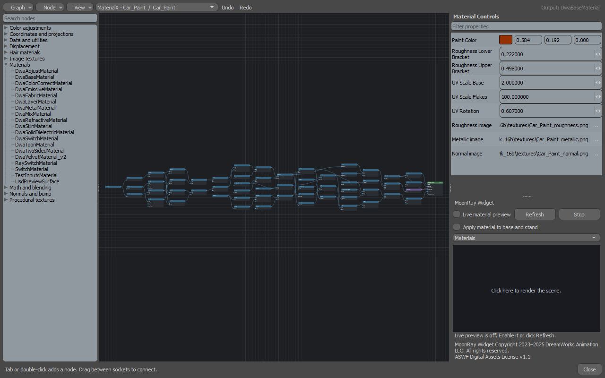

*An imported MaterialX car paint. With no node selected the panel shows the material's own controls: the colours, numbers and images its file names.*

### Curves as tubes

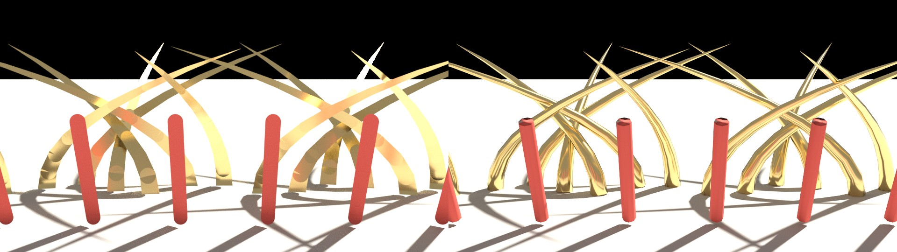

*A mesh's curves, splines and line polygons rendered with a width at the root and at the tip: MoonRay on the left, MoonLightIPR on the right. The gold strands taper to a point; the red ones keep their width.*

### Imported MoonRay scenes, before and after

In each pair, MoonRay's render of the scene from its own files is on the left; on the right is the same scene after it was imported into Modo and rendered through the plugin. Small, low-sample test renders; [docs/images](docs/images/README.md) has the scenes' authors and licenses.

| | |
|---|---|
| 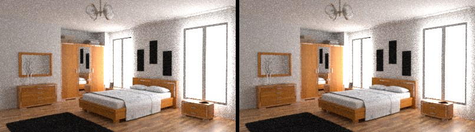 | 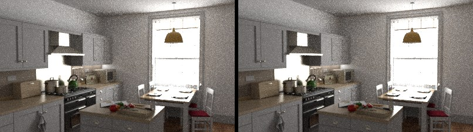 |
| Bedroom (SlykDrako, CC0) | Country Kitchen (Jay-Artist, CC BY) |
|  | 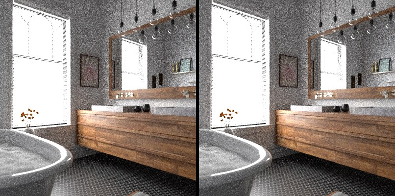 |
| Modern Hall (NewSee2l035, CC BY) | Contemporary Bathroom (Mareck, CC0) |

### Imported MaterialX materials

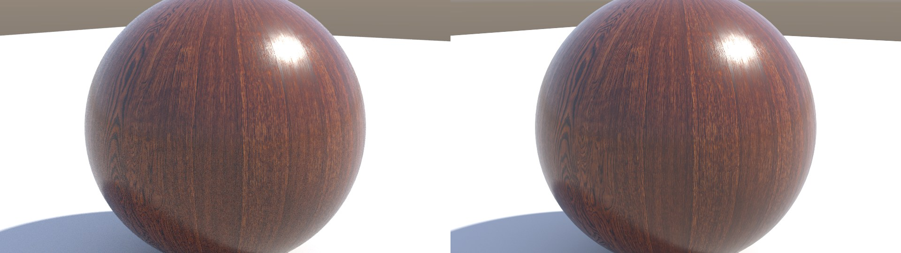

*TH Wood Table from [AMD's GPUOpen MaterialX Library](https://matlib.gpuopen.com/main/materials/all), imported from its `.mtlx` file: MoonRay on the left, MoonLightIPR on the right.*

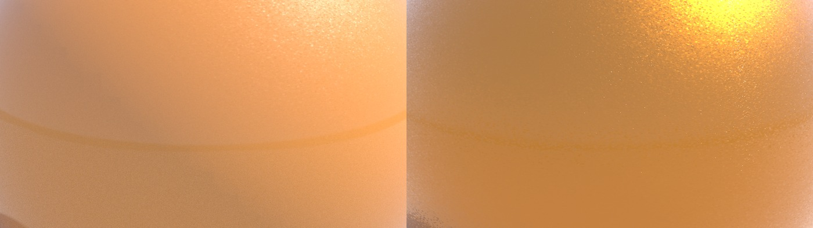

*The flakes of the library's Car Paint, close up: MoonRay on the left, MoonLightIPR on the right. The flakes are in the reflection, driven by the file's own flake textures.*

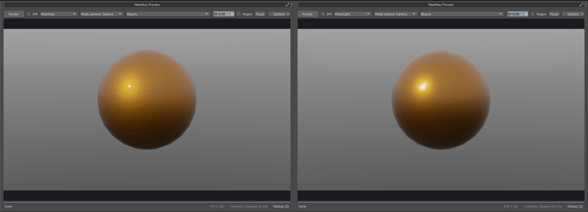

*The same material at a normal viewing distance in the preview window, with MoonRay and then MoonLightIPR chosen. MoonLightIPR's denoiser softens the flakes at this distance until the picture has gathered more samples.*

### View transforms

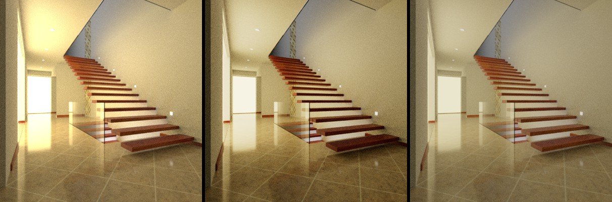

*One linear render shown three ways: plain sRGB, ACES (the default), and highlight compression + sRGB. Modern Hall by NewSee2l035, CC BY.*

### MoonLightIPR beside MoonRay

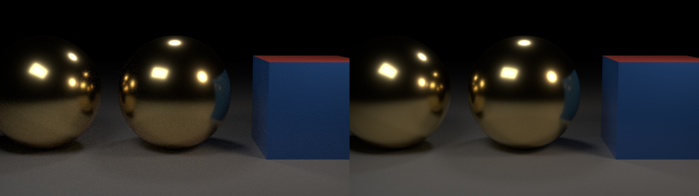

*MoonRay on the left, MoonLightIPR on the right: a rect, a disk and a sphere light. [moonlightipr/README.md](moonlightipr/README.md) has more pairs and the measured differences.*

## Currently implemented

- Native Windows rendering: CPU/AVX and NVIDIA XPU, with XPU → Vector → Scalar fallback.
- Interactive preview: dockable window, live updates, draft and region rendering, a colour probe, worker-tile/bucket overlays, the quick MoonRay LS engine, and the realtime MoonLightIPR GPU engine with playblasts.
- Materials: native MoonRay materials with their own forms, a visual node editor, material preview, and MaterialX import.
- Modo scene translation: standard and Principled materials, image textures, normal/bump maps, procedurals, lights, daylight, environments, subdivisions, instances, replicators, curves and hair—with the limits below.
- MoonRay items: lights, light filters, cameras, analytic shapes and volumes with their own properties.
- Render outputs: configurable AOVs, Cryptomatte surface categories, buffer switching, deep EXR, texture baking, a compositor over the finished buffers, and denoising (OptiX or Open Image Denoise) that survives a stopped render.
- Workflow tools: ACES/sRGB/OCIO view transforms and LUTs, animation output and recovery controls, an asset library with MoonRay's example scenes, and RDL scene import.

## Known issues in 0.4.1

The ones you are most likely to meet:

- Very smooth highlights (roughness under about 0.2) are dimmer than Modo's: about three quarters as bright under GTR, less under Blinn and Ashikhmin.
- Under Principled, Modo's diffuse gets brighter with roughness and MoonRay's does not.
- Hair in MoonLightIPR is close to MoonRay's but not exact.
- A glowing VDB volume, or a light with a cookie filter, renders in MoonRay's slower scalar mode; the plugin switches for you and says so.
- Smart Render and Important Parts First work on MoonRay renders in the preview window, not on Render EXR or animations.
- MoonLightIPR updates after you let go of a drag, not while you drag.

Every open issue is in the [issue tracker](https://github.com/Pbaroque20/MoonRayForModo/issues). Found something else? Please report it there.

## This Version's Current Limitations

- **Windows and Modo 16.1v9 only.** XPU and MoonLightIPR need an NVIDIA GPU; they have been exercised on an RTX 3090 only.
- **MoonLightIPR is an approximation.** It matches MoonRay closely on many scenes but not all; [moonlightipr/README.md](moonlightipr/README.md) says how closely, scene by scene, and what it leaves out.
- **Modo parity is partial.** Only Modo's own lights and standard/Principled materials are matched. Blinn and Ashikhmin highlights are matched to Modo's by measurement (the lobe, roughness and strength that came closest to Modo's own renders), closely once the roughness is 0.2 or more and loosely below that; a roughness driven by an image is not remapped. A Modo material's smoothing angle is followed, except on a mesh of more than 300,000 faces, which is smoothed all over and named in a notice. Under Principled, Modo's diffuse brightens with roughness and MoonRay's does not. Anisotropy is untested, rough environment reflections come out dimmer in MoonRay, and remaining Shader Tree effects and some masks are not translated. Modo's own group light linking is translated but experimental; check it against Modo.
- **MaterialX is a supported subset**: Standard Surface, OpenPBR and glTF surfaces made of images, arithmetic and UV transforms. Nodes outside that subset are not read.
- **RDL import leaves a few things out**, and names each in its report. This comes with the format: an RDL file is MoonRay's own description of a scene, and it can hold things Modo has nothing to turn them into. MoonRay item kinds with no Modo counterpart, ways of instancing Modo cannot express (instances read from a point file, some instancing methods), words that change from point to point (a Modo vertex map holds only numbers), and render outputs Modo's settings have no place for are left out and named, rather than turned into something that would render differently. Coming in 0.4.2: motion, values that differ face by face or point by point, subdivision creases and meshes filled with fog come in.
- **Geometry**: some instancing, motion, subdivision, UV-projection and normal-map cases differ from Modo. A mesh that mixes polygon kinds or needs per-polygon projection is read the slower way. A shadow a coarse mesh casts on itself, as a torus's on the inside of its hole, follows its faces, in MoonRay and MoonLightIPR alike; subdivision smooths it.
- **Cryptomatte**: ID previews are not an interactive matte-selection tool. Coming in 0.4.2: picking mattes in the preview, Cryptomatte names and IDs on objects and materials, a Cryptomatte node in the compositor, and fog with mattes of its own.
- **Preview**: some edits still need the whole scene read again; the compositor works on finished MoonRay renders, not on MoonLightIPR's. Safe Denoising and Continue are for the MoonRay engine.

### MoonRay's features in the plugin

Comparison audit between MoonRay 2026.29.1's source and the current plugin.

| MoonRay feature | Plugin | Notes |
|---|:---:|---|
| CPU rendering (scalar and vector) |  | AVX build |
| XPU rendering on the graphics card |  | NVIDIA only |
| Progressive rendering, and region rendering |  | The preview window, and the graph editor's MoonRay Widget. The widget under MoonRay LS, quicker, coming in 0.4.2 |
| Cameras: perspective, orthographic, fisheye, spherical, dome |  | MoonRay camera items, or Modo's camera. Coming in 0.4.2: a Modo camera converted to any of them in its place (animation kept), a Camera Sequence keying cameras to ranges of frames, and MoonRay cameras in the viewport's camera menu, looked through as they frame |
| Stereo cameras |  | Modo's camera Stereo: one eye, or both with a red/cyan picture in Render EXR; MoonLightIPR shows each eye. Coming in 0.4.2 |
| Overscan (rendering past the frame edge) |  | Modo's camera Overscan, or a MoonRay camera's own when it is rendered through, in final renders. Coming in 0.4.2 |
| Bake camera |  | Texture baking |
| Lights: rect, disk, sphere, spot, cylinder, distant, environment, mesh, portal |  | MoonRay light items, or Modo's lights |
| Light filters: barn door, colour ramp, combine, cookie, decay, intensity, rod, VDB |  | |
| Light, shadow and light filter linking |  | |
| Meshes, subdivision, curves, points, instancing |  | From Modo's geometry. Coming in 0.4.2: creases from Modo's Subdivision weights |
| Box and sphere shapes |  | |
| VDB volumes, base and cutout volumes |  | |
| Motion blur |  | Final renders, and MoonLightIPR previews. Coming in 0.4.2: on by default in MoonLightIPR, also while it follows edits, and moving lights |
| Depth of field |  | |
| DWA materials (base, metal, fabric, skin, layer, mix and the rest) |  | Coming in 0.4.2: Two Sided and Color Correct take the other DWA materials as their inputs, and a layer or two-sided material missing an input no longer crashes MoonRay |
| Hair, toon and USD Preview Surface materials |  | Toon edges smooth on coarse meshes, and toon renders that denoise cleanly, each a preference; a new toon brightest facing the light: coming in 0.4.2 |
| Maps, normal maps and displacement nodes |  | In the node editor |
| Switch displacement |  | In the node editor. Coming in 0.4.2, with its runtime |
| Display filters (colour correct, toon, halftone and the rest) |  | All 18, as MoonRay items; each a preview buffer and an EXR channel. Coming in 0.4.2, with its runtime |
| Uniform and adaptive sampling, light sampling, bounce limits, clamping |  | Render Settings |
| Volume quality and overlap settings |  | |
| Volume attenuation and contribution factors |  | Render Settings, Volumes, with the phase attenuation factor; MoonLightIPR follows them. Coming in 0.4.2 |
| Pixel filters: box, cubic and quadratic B-spline |  | |
| Global switches: displacement, subsurface, shadows, lights seen by the camera, geometry resolution, dicing camera |  | Render Settings, Global Switches. Coming in 0.4.2 |
| Presence quality, Cryptomatte multi-presence, optimised hair sampling switch |  | Coming in 0.4.2: in Render Settings |
| AOVs: light path expressions, material AOVs |  | Ready-made, or type your own expression. Coming in 0.4.2: the compositor adds the light passes or light groups and puts them back together, each with its own Grade; a probe shows each node's value at a pixel and keeps it as a note; the colour nodes take a mask |
| Time per pixel (where the render spent its time) |  | A preview buffer and an EXR channel. Coming in 0.4.2, with its runtime |
| Visibility outputs (how much of each light reaches a point) |  | Every light or one light group, in the Outputs window. Coming in 0.4.2 |
| Primitive attribute outputs |  | A number or a colour, by the attribute's name, in the Outputs window. Coming in 0.4.2 |
| Cryptomatte |  | Coming in 0.4.2: fog, from a VDB or in a MoonRay box or sphere, has mattes of its own, and each sample is counted once in vector and XPU modes; names and IDs given on objects and materials; picking in the preview; a Cryptomatte node in the compositor |
| Deep EXR |  | |
| Checkpoints and resuming a render |  | Recovery, Safe Denoising and Continue |
| EXR metadata |  | |
| Choice of EXR compression |  | All of MoonRay's, zip by default. Coming in 0.4.2 |
| Picture types besides OpenEXR |  | Coming in 0.4.2: PNG, JPEG, TIFF and Targa for a render to a file, animation frames and exported AOVs, the OpenEXR kept beside them |
| Denoising (OptiX, Open Image Denoise) |  | |
| Primitive attributes (values a shape carries for its materials) |  | Per item or instance, and per point or per face from Modo's weight and colour vertex maps; imported from MoonRay scenes. Per point and per face coming in 0.4.2 |
| RDL scene import |  | A few things left out, named in its report. Coming in 0.4.2: motion, creases, fog meshes, values by point or face, and instancers of any size |
| Arras: rendering spread over several machines |  | |
| Hydra render delegate and USD procedurals |  | For USD applications; not part of Modo |

### Where the plugin changes MoonRay (coming in 0.4.2)

Besides the patches that build MoonRay on Windows, 0.4.2 changes MoonRay's source where it renders something wrongly
for an artist: eleven MoonRay Source Overrides, each a checkbox in Preferences (MoonRay, MoonRay Source Overrides), on by
default; off renders as MoonRay's source does. Smooth toon edges on coarse meshes, toon materials that denoise cleanly,
blurred moving lights, fog in Cryptomatte, fog in front of see-through surfaces in alpha, each Cryptomatte sample
counted once, a stopped render finishing the tiles in hand, UsdPreviewSurface's specular colour, images without alpha
read as opaque, rough glass under a smooth surface, and Auto rendering on the graphics card first. What each changes, why, and how it was checked is in the [engineers' notes](patches/native-windows/README.md).

*Smooth toon edges on coarse meshes: MoonRay's toon steps along the faces of a coarse mesh, and still, more finely, on
a subdivided one (left); with the override, both are smooth (right).*

*Fog in Cryptomatte: the render, the fog's own matte, and the boxes' matte as MoonRay makes it, solid behind the fog
(bottom left), and with the override, faded where the fog hides the box (bottom right).*

## Still to implement

- Fur guides, and the fur vector and width maps.
- More of Modo's material: the Principled model's diffuse (which brightens with roughness in Modo) and smooth highlights under every model.
- The remaining Shader Tree effects and masks. (Motion blur while the preview follows edits is coming in 0.4.2.)
- Modo 17.1 on Windows, then macOS.
- Broader validation: other GPUs and drivers, clean-machine installs, very large scenes, recovery under load, and colour matching.

Each of these, and what MoonRay documents that the plugin has no control for yet (display filters, Alembic and USD procedurals, Arras and more), is in the [issue tracker](https://github.com/Pbaroque20/MoonRayForModo/issues).

**Production readiness:** this is an experimental development build, not a production-certified release. Some users have confirmed it works. Each release note says what was and was not checked.

Detailed implementation notes and recorded checks are in [docs](docs/). Plugin licensing is in [LICENSE](LICENSE); MoonRay and bundled assets retain their respective licenses. MoonLightIPR, the GPU preview engine, was created by Raphael Tobar and is under the same MIT License; it is not a DreamWorks Animation product and is not affiliated with or endorsed by DreamWorks Animation (see [moonlightipr/NOTICE.md](moonlightipr/NOTICE.md)).
