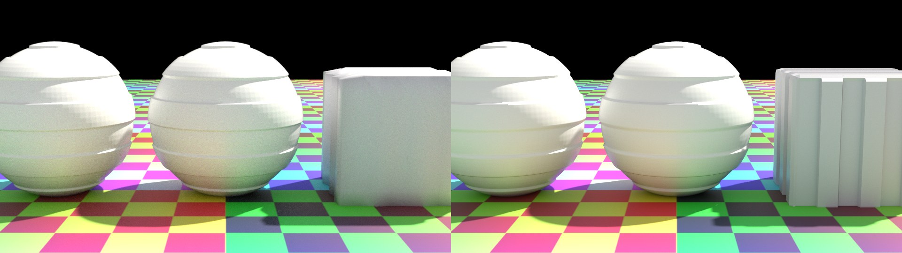
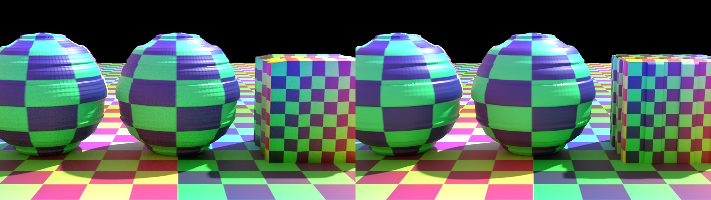
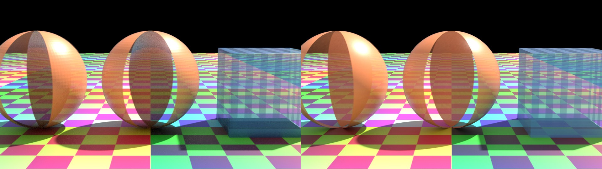
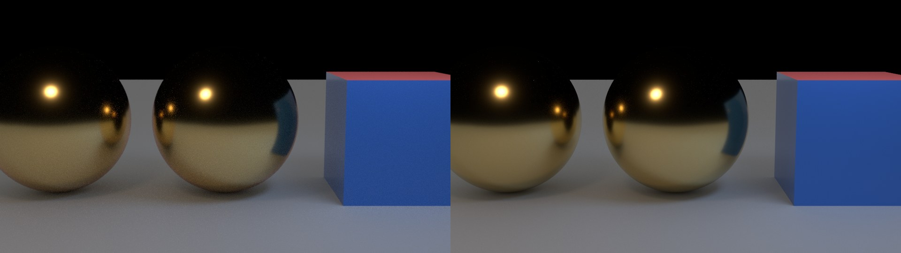
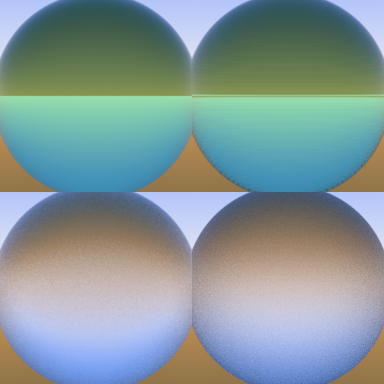

# MoonLightIPR

This is the development branch of [MoonRay for Modo](https://github.com/Pbaroque20/MoonRayForModo/tree/codex/native-avx-modo), where the next version is built and tried. For the plugin itself, its download and its installation, see the [main page](https://github.com/Pbaroque20/MoonRayForModo/tree/codex/native-avx-modo).

**MoonLightIPR** (echoing DreamWorks' earlier rasterizer MoonLight) is the plugin's fast GPU preview. It shows an approximation of what MoonRay will render and updates quickly after each edit. Final renders always come from MoonRay. What of a Modo scene it draws is in [its audit table](#modos-features-in-moonlightipr).

The current release is [0.5](https://github.com/Pbaroque20/MoonRayForModo/releases/tag/v0.5). **Built on MoonRay [2026.29.1](https://github.com/dreamworksanimation/openmoonray/releases/tag/v2026.29.1)** (OpenMoonRay's latest release; MoonRay 18.4), with the plugin's own patches for Windows and the preview.

## New in 0.5

0.5 is a **pre-production release**: the plugin is no longer experimental. In short: [What's new in 0.5](docs/WHATS_NEW_05.md).

### MoonRay XPU2

**XPU2** renders MoonRay previews with the processor and the graphics card on the same picture at once, neither
waiting for the other. Its pictures settle to MoonRay's own.

*XPU2: Asynchronous Monte Carlo Path Tracer designed by Raphael Tobar. Not affiliated with or endorsed by DreamWorks
Animation.*

- **The default GPU renderer**; MoonRay XPU is still a choice (Preferences > MoonRay > XPU2 > GPU renderer).
- **Compile XPU2 Shaders once** on the same page, in the background. Until then XPU2 does not render, and the preview says so.
- **Samples go where the picture is still noisy**, in generations; clean parts stop early. Settings in Render
  Settings > XPU2 Sampling; the line under the picture shows how it samples.
- **Realtime** takes up camera, object and light changes at once, with a quick denoised picture while things move.
- **Devices**: processor and graphics card together, or either alone.
- **The Denoiser** works with XPU2 previews; Smart Render and Safe Denoising, which XPU2 is quick enough not to need, are greyed under it. Final renders come from MoonRay, as before.

### Everything else

- **Realtime that keeps up**: camera moves no longer reload the scene, editing one object updates only that object, and heavy scenes are cut by their size on screen.
- **A Scene cache** (Preferences): prepared scenes and meshes are kept in a cache folder of your choice, so a scene opens faster the next time. The status says Caching scene... while it keeps, and Loading scene from cache... while it reads back. **Clear Cache** empties it.
- **N-gons triangulated cleanly**: flat polygons of any size, CAD outlines and outlines with holes among them, are cut along their outline, the same in MoonRay and MoonLightIPR. A MoonRay Source Override, on by default.
- **Area lights seen by the camera**: Modo's Visible to Camera, and a MoonRay light's visible in camera set to Force on, show the light (with its texture) in MoonRay and MoonLightIPR.
- **HDRIs the right way round in MoonLightIPR**, and at full sharpness when the image is the whole environment.
- **Textures keep their shape in MoonLightIPR**: a non-square image is no longer squeezed into a square.
- **Water drops and other thin glass on a surface** come out clear in MoonLightIPR, as in MoonRay.
- **Motion blur in MoonLightIPR is off by default** (Preview Preferences); Motion Blur shows at the foot of the picture while it is on.
- **The preview window**: its buttons wrap onto a second line in a narrow window instead of being cut; R, G and B in their colours, γ and α for gamma and alpha; EV and γ toggle between the plain value and yours, and are lit while yours is shown; the picture's details are never cut off.
- **Memory in the picture**: the renderer's, the machine's and the graphics card's memory at the bottom right of the picture, in colour when it runs short (Preview Preferences).
- **MoonRay's preferences in pages**: General, Renderer, XPU and Source Overrides, each in Modo's Preferences list.
- **The Terminal names MoonRay by its mode**: MoonRay Vector, Scalar, XPU or Auto.
- **Fixes**: Modo crashing when the Render layout's view was changed (likely fixed); "Texture conversion needs maketx.exe" with maketx in place.
- **The memory meter no longer makes the preview hesitate**: it reads the machine and the graphics card on a thread of its own, once a second, where Modo's own thread waited for the card's driver while a render kept the card busy.
- **MoonLightIPR's textures at most 1024 pixels a side** (they were up to 4096): sharp enough at the preview's sizes, with far less for the graphics card to hold and read. Textures are converted again the first time a scene opens.
- **MoonLightIPR follows an edit at once**: moving an object, the camera or a light, or changing a material, no longer holds Modo while the scene is read three times for motion blur when nothing in it moves and nothing moved has keys (a fur scene: 0.6 s to 0.2 s from letting go to the new picture, Modo held 0.4 s to a hundredth). With keys, motion blur is read as before.
- **Heavy scenes start much sooner**: Modo's geometry is handed to MoonRay as it comes, without a step of Python for every point and face. A car scene's reading before a render went from about three minutes to a little over one, most of what is left being Modo's own work. MoonRay is handed the very same scene.
- **Displacement follows Modo's Displacement Rate**: Displacement Tessellation in the render settings cuts displaced meshes finely where they are large on screen and coarsely where small, as Modo does, with far less geometry and a quicker start. Fixed dicing camera holds the cut at the Dicing Frame so it stays put while the camera moves (no shimmer in an animation); Uniform cuts by each mesh's resolution, as before. Adaptive Error Override sets the pixels in place of Modo's rate. Scenes with displacement render with less geometry where it is small on screen.
- **A memory meter in the preview window**: the renderer's RAM, the machine's free RAM and the graphics card's memory, amber then red as they run short.
- **A Shader Tree displacement that is black everywhere is left out**, where MoonRay still tessellated every mesh of its material for nothing (a car scene's 24 materials all had one).
- **Cleaner denoising**: Keep Fine Detail lets the render through only over fur, hair and curves, where it used to bring the render's noise back over every textured or bumpy surface; and Open Image Denoise cleans its albedo and normal guides first and trusts them, leaving less noise on textured, bumpy and see-through surfaces (a MoonRay Source Override in Preferences, on by default).
- **Smart Render or Safe Denoising, plainly**: in the render settings, Safe Denoising is greyed while Smart Render is Draft, Medium or Fine, and Smart Render while Safe Denoising is on.
- **MoonLightIPR starts sooner**: about 15 seconds the first time on a machine, then a second or so, where it sat a minute and a half at Preparing scene. It begins with the plainest kernel and compiles the bigger ones only for scenes that use fog, hair or subsurface, and keeps them in a cache of its own.
- **Enhance: Modo's textures, 145 of them**: every family whose texture draws a pattern, worked out through the object in MoonRay and MoonLightIPR with a Solid projection: Noise (22: fBm, Bozo, Granite, Ridged, Marble, Stucco, Strata and the rest), Organic (22: Cellular, Crackle, Membrane, Fire, Wood, Veins, Scatter and the rest), Tiles (31: bricks, tiles of every shape, planks, parquet, paving, mosaic, Basket's 26 weaves, Tiler's 26 layouts), Geometric (14 shapes cell by cell), Waveforms (16), Skins (11: Camo, DinoSkin, FrogSkin, Leather, Scratches and the rest), Space (14: planets, rings, clouds, hurricanes, flares, star fields, windows), Panels (6, with rivets, rust, peeling paint and smears), Water (6: drips, rain, ripples, surf and waves, following Time) and Display (counters showing the frame or time code, LED boards), with their noise types, Lower, Upper, Bias, Gain and Fore and Back colours. Tiles, Geometric, Panels and Display lie on the texture locator's XY plane, Water on its XZ plane, Waveforms along X. Each is written after its name and settings, not yet compared with Modo's renders. Process's two work on the layers beneath them: EasyGrad maps their brightness through its eight-colour gradient, RegionalHSV gives each region (each colour beneath, as a pattern's Regions give each cell its own grey) a colour at random within its hue, saturation and value limits. After the patterns their names come from; not yet compared with Modo's renders. The other families follow.
- **Modo's Gabor and Poisson noise, Curvature and Wireframe**: Gabor and Poisson noise are drawn through the object like the patterns above (Solid projection); Curvature reads how the surface bends, through Modo's own gradient (MoonRay's CurvatureMap; in MoonLightIPR, triangle by triangle from the mesh's normals); Wireframe draws the polygons' edges as wide as Modo's, in MoonRay (its WireframeMap) and in MoonLightIPR. Modo's Surface Probe, which reads the shading of another surface beneath, is not among them.
- **Shadow rays in Light Links, Emitters and Volumes**: an object can be set to cast no shadow, and given its own shadow ray and secondary ray offsets against shadow acne; a light can have shadows begin only some way from it or end beyond a distance, and say whether its shadows respect dissolved and cut-out surfaces.
- **Modo's procedural textures through the object, at render time**: Noise (simple, fractal, turbulence), Cellular, Checker, Grid, Dots, Wood, Weave and Ripples with Modo's Solid projection are worked out at each point in MoonRay (a new MoonRay map, ModoProceduralMap) and in MoonLightIPR, from one shared piece of code: no baking, no UVs, no resolution. Grid's and Dots' Cube and every Noise and Checker type now draw. After Modo's patterns, not yet compared with Modo's renders.
- **MoonLightIPR draws a Combine light filter**: the filters it holds, joined as it says (multiplied, the least, the most, added or the first less the rest), Intensity filters among them. MoonLightIPR already drew the Intensity, Decay, Color Ramp, Rod, Barn Door, VDB and Cookie (v2) filters.
- **MoonRay lights take the Scale tool**: a RectLight's width and height, a disk, spot or sphere light's radius, follow the scale once it is let go of, the scale going back to 1, in one undoable step.
- **MoonLightIPR matches MoonRay's brightness for lights that are not normalized**: their colour and intensity are their radiance, as in MoonRay, where they came out about three times too bright.
- **Light filters on MoonRay lights list at once**: a filter attached or detached shows in "attached light filters" straight away, not once the light is selected again; choosing one there says it detaches it, "(choose to detach)".
- **Image nodes show their picture** in the graph editor: the image file itself, made small, at once and without rendering (View > Previews on Texture Nodes).
- **Toon lines apart from the shading**: a Toon display filter's Output Mode gives its ink lines alone, white on black, or its shading without them; add one of each to composite the lines yourself. A MoonRay Source Override in Preferences, on by default.
- **Clearcoat Bump Strength** is followed, in MoonRay and in MoonLightIPR: at 0 the coat stays smooth over a bumpy or normal-mapped surface.
- **The graph editor's Image node has Invert**, as a Shader Tree image layer does.
- **Images in the scene are a click away** when choosing a texture file in the graph editor: the images Modo's Clip Browser lists come first, then Browse Files.
- **Drag a wire off its input** to disconnect it, or onto another input to move it, in the graph editor and the compositor.
- **Tab and Shift+Tab move between fields** in the graph editor's and the compositor's settings.
- **A render working space for every new scene** in MoonRay's Preferences (Renderer), for scenes that have not chosen one in the Assets window.
- **Textures convert side by side**: MoonRay's .tx and MoonLightIPR's conversions run several at a time, the first render of a scene with many textures in a fraction of the time.
- **A colour correction on an image is sharp in MoonLightIPR**: it is baked over one repeat of the image at 2048 pixels and laid on as the image is, where it was 512 pixels over the whole of the UVs.
- **Turning an environment image is followed at once**: the scene's meshes are no longer read again for it.
- **A Modo package (.lpk)** can be made of a release, kit and runtime in one file to drop onto Modo (tools/package_lpk.py).
- **Display filters no longer come out pink for want of an input.** Each starts on every picture MoonRay needs it to have (a Toon filter on Albedo, Camera depth, Direct diffuse, Direct glossy and Shading normal; Depth of Field on Camera depth; Over on Alpha). One left empty in a scene takes that picture, with a notice, and one that cannot be given what it needs is left out, said, rather than drawn pink. A MoonRay Source Override in Preferences ("Display filters given the inputs they need"), on by default.
- **Modo's light volumetrics and environment fog render**, in MoonRay and in MoonLightIPR. A point light with Volumetrics on lights a sphere of fog, a spot light its cone and a directional light a cylinder, sized by the light's volumetric Radius, Height and Base, and thick as its light material's Density, Scattering, Scattering Color, Attenuation and Shift say; only that light lights it. The Environment Material's fog is fog around the camera, lit by the environment: Exponential at its density, Linear from Fog Start and thick by Fog End, Layered up to its height. Not yet compared with Modo's own renders.

## New in 0.4.3.1

A hotfix: the kit alone changed (with its geometry adapter); the 0.4.3 runtime is the same.

- **Adding geometry while MoonLightIPR follows the scene no longer stops or freezes it.** Turning realtime on could wait on Modo without end (while Modo's colour picker was open, for one); it no longer goes through a Modo command to read the scene.
- **Modo's fur renders with Modo evaluated geometry**, where it stopped the render with "Polygon indices failed". Under motion blur in the preview, fur that cannot be followed through the shutter is shown still, with a notice, rather than the render refused.
- **Assign MoonRay Material on a whole mesh tags its polygons**, as Modo's Polygon Set Material does. Its item mask had every reading of the scene go through Modo's render cache: one material on one sphere slowed a large scene's preview to seconds an edit. Polygons made in the mesh later keep the tag they are made with.
- **Large scenes read faster**: planar, cubic, cylindrical and spherical texture projections are worked out several times faster and kept between readings while a mesh is unchanged (a test scene with fur and a 324,706-face mesh, 45 s to 13 s, then under 2 s an edit), and moving an item with fur on it is followed without reading the scene again.

## New in 0.4.3

A critical performance update, with a new runtime ZIP: scenes load far faster before a render starts, and MoonLightIPR draws more of Modo's scenes for less power. Install the kit and the runtime together.

### Faster to start a render

- **Scenes load far faster before a render starts**, in MoonRay and in MoonLightIPR. A mesh's long lists (points, faces, normals, UVs, vertex maps) go to MoonRay in its own binary scene format beside the scene text, which MoonRay reads in a fraction of the time; the geometry adapter joins the many pieces Modo's render cache hands over into one per surface; and what was read of the scene is kept from one reading to the next. On a test interior, getting MoonRay ready went from about 107 seconds to 18, and MoonLightIPR's packing from 6.9 seconds to 2.3, with the same pictures. Preferences: **Load geometry as binary**, on.
- **Low-latency rendering**: MoonRay runs below Modo's priority and leaves one processor thread free, so Modo stays quick to use while it renders. Preferences, on.
- **MoonLightIPR is not sent the scene again for a change of frame alone**, in a scene where nothing moves.

### MoonLightIPR and the rest

- **Shader Tree Displacement and Stencil layers render in MoonRay**: displacement layers raise the surface by their value times the material's Displacement Distance, and a Stencil takes the surface away where it is white, as Modo's do.
- **Principled sheen**: a Principled material's Sheen and Sheen Tint show in MoonRay, as a soft glow at grazing angles fitted to Modo's renders. Specular Tint and Flatness, which MoonRay's material has nothing like, are named in a notice.
- **Principled highlights keep their edge**: a Principled material with a low specular amount, Modo's default among them, brightens toward the edge in MoonRay as it does in Modo.
- **Anisotropy follows Modo's UV map, and its strength Modo's**: a material with Anisotropy but no UV map named for it renders a round highlight, as Modo draws it; with one, MoonRay's highlight stretches and spreads nearer Modo's (fitted against Modo's renders). A very strong anisotropy still draws a shorter streak than Modo's.
- **Shader Tree masks checked against Modo**: material, Part and Selection Set masks colour the same surfaces in MoonRay as in Modo; a layer or group placed above the Base Shader, which Modo applies to nothing, is left out too, with a notice.
- **Exporting RDLB writes only the RDLB**: the scene text MoonRay's converter reads goes through a temporary folder, rather than appearing beside the scene while it is converted.
- **Displacement and stencils in MoonLightIPR**: Shader Tree displacement layers, and a node graph's displacement nodes (Normal, Vector, Combine and Switch), raise the surface in the preview as in MoonRay, the mesh split finer for them and blurred when it moves; Shader Tree stencils cut it away where they are white. A displaced mesh takes a moment longer to load.

*Shader Tree displacement: the balls raised by a striped image, the cube by another. MoonRay (left), MoonLightIPR (right). MoonRay tessellates a polygon cube coarsely, so its ridges barely show there.*

*A node graph's displacement: on the balls, a Normal displacement combined with a Vector one in tangent space; on the cube, a Switch choosing the second of two. MoonRay (left), MoonLightIPR (right).*

*Shader Tree stencils cut the balls by sharp stripes and the cube by soft ones. MoonRay (left), MoonLightIPR (right).*

- **MoonLightIPR draws a material stack's rows with their own shine**: a dull print over shiny metal, as a can's label, shows the metal where the print lets it through, and a clear coat over it no longer brightens or mirrors it.
- **Light links in MoonLightIPR**: which lights reach each object, set in Object controls, a material's MoonRay links or Modo's own group light links, as MoonRay draws them (checked against MoonRay's renders). Shadows an object is set not to cast are still MoonRay's alone.

*Light links: the balls lit by a warm sphere light alone, the cube by a cool panel and the environment, the floor by both. MoonRay (left), MoonLightIPR (right).*

- **Replicators render with motion blur**: a replicator whose copies Modo gives a moment from the frame in a different number no longer stops the render (MoonLightIPR, which renders with motion blur by default, showed nothing); a copy missing at an end of the shutter is held still, with a notice.
- **Glass nearer Modo's**: a tinted glass solid takes Modo's colour once, as Modo does, rather than at each surface, which made it much darker; and a rough glass blurs as much as Modo's (its refraction roughness fitted to Modo's renders at four values). Checked on a glass ball against Modo's own renders.

*Glass in Modo (left) and MoonRay (right): a tinted ball (top) and a rough one (bottom), each in front of a gradient. The tint and the blur now come out as Modo's.*

- **MoonLightIPR rests once the picture is clean**: it judges the noise of each small square of the picture as it renders; a square that is clean takes no more samples, and the render stops once all are, so a simple scene stops after a few dozen samples a pixel, not the hundreds of Pixel samples, which is now the most it takes. A render is spread over about 8 seconds rather than run flat out, the first sample shown at once; the picture is shown less often once a render has settled; and the processor sleeps while it waits on the graphics card. The graphics card and the processor draw much less power, most on simple scenes.
- **A light's picture that cannot be found is left out**, with a notice, rather than drawn in MoonRay's pink for a missing file.
- **MoonRay's crest comes in once a Modo session**: a preview window opened after the first shows it at rest.

## New in 0.4.2.1

- **The graph editor's Live material preview renders again**: with Live on, the MoonRay Widget refused the scene ("Minimum adaptive samples must not exceed maximum samples").

## New in 0.4.2

More detail is in [What's new](docs/WHATS_NEW_04.md).

### MoonLightIPR

- **MoonLightIPR is faster on scenes without its heaviest materials**: a scene with no fog, hair, subsurface scattering, toon or velvet is drawn by a version of MoonLightIPR made without them, up to about 40% faster, and one with some of them by a version with only those. The picture is the same.
- **MoonLightIPR fits large texture sets on the graphics card**: pictures of high dynamic range are kept at half precision, half the memory, and where a scene's textures would still not fit, each is made smaller (halved, as light, until no side is longer than the largest size at which they all fit), which the status line says. A scene that runs out of graphics card memory all the same is said to have done so, with MoonRay offered, rather than rejected.
- **Velvet in MoonLightIPR**: MoonRay's velvet material and DwaBaseMaterial's fuzz show in MoonLightIPR with their grazing-angle sheen, dimming what is beneath them as MoonRay does, with their samples sent where the sheen is brightest so velvet clears up sooner; before, velvet showed as a plain stand-in.

*Velvet in MoonRay (left) and MoonLightIPR (right): two balls of MoonRay's velvet material and a cube of DwaBaseMaterial with its fuzz on. The sheen is brightest where the surface turns away from the view, and softens into the shadow.*

- **Motion blur in MoonLightIPR, on by default**: while the scene is followed too (an edit is shown blurred once it is let go; a drag is followed sharp), and moving lights blur, in MoonLightIPR and in MoonRay, which held them still before. MoonRay's own items (its lights and shapes) blur when they move, as Modo's do.
- **MoonLightIPR looks through MoonRay's own cameras** from their own place: perspective, orthographic and dome as well as fisheye and spherical. Modo's orthographic camera previews too.
- **MoonLightIPR draws MoonRay's hair toon material**: its hair colour under up to three toon highlights. A toon ramp that ends lit is now drawn right past its end.
- **MoonLightIPR draws a mesh filled with even fog**, and follows MoonRay's scene scale for lights and depth of field. A box of fog standing on the floor no longer shows stripes where it meets it.

### The preview window

- **The button greys while a render stops**: after Stop it says Stopping, greyed, while MoonRay finishes with what it has, and becomes Render (or Continue) again once it has.
- **MoonRay LS can sample uniformly**: Preview Preferences > MoonRay LS quality has a Sampling choice. Adaptive, as before, takes more samples where a pixel is still noisy, up to Most samples a pixel; Uniform gives every pixel the same samples (25, 64 or 121), for an even grain, with Adaptive error greyed.
- **Leaner notices**: they open only as tall as their text and two lines more, up to the height they had before, where a long list scrolls.
- **The size and samples beside the picture follow the engine chosen**: choosing MoonRay, MoonRay LS or MoonLightIPR says at once the size it renders at and its samples a pixel, before anything is rendered; a MoonLightIPR picture says its samples too.
- **Denoising... in the status line** while the denoised beauty is made from a finished render, until it is shown.
- **Closing a scene clears its render** from the preview window, and a render of it still going stops; closing another scene leaves the picture as it is. A render to files goes on to the end.
- **A MoonRay preview is always one render**, as MoonRay's own command makes it: it no longer starts over twice at 1 and 4 samples before the full render.
- **The preview shows MoonRay's wordmark** before anything is rendered.
- **The MoonRay mark moves**: it comes in as the preview opens, breathes while a render is on its way, and fades out over the first picture.

*The MoonRay mark as the preview opens: after a second the letters rise in from the left, then the crescent fades in from the right.*

### Rendering with MoonRay

- **Gaussian, Triangle and Blackman-Harris pixel filters** in Render Settings. They are not in MoonRay's source: the plugin adds them to MoonRay, built the way its own are. They never go negative, as MoonRay's sampling needs. Box and the two B-splines are MoonRay's own.
- **Global Switches** in Render Settings: displacement, subsurface scattering and shadows on or off, lights seen by the camera, a limit to geometry resolution, and a dicing camera for adaptive tessellation.
- **Volume attenuation, contribution and phase attenuation factors** in Render Settings, Volumes: with Volume bounces above 1, how much less each further bounce of light in fog is stopped, adds and keeps its direction (MoonRay's defaults 0.65, 0.65 and 0.5). MoonLightIPR follows them.
- **Presence quality, Cryptomatte multi-presence and Sample hair lobes separately** in Render Settings: how finely partly see-through surfaces are sampled (MoonRay's 0.75), Cryptomatte mattes that count each layer seen through a partly see-through surface, and hair that samples its lobes one by one in place of MoonRay's faster way.
- **Subdivision creases render**: a subdivided mesh's edge and point weights (Modo's Subdivision weight map) are MoonRay's creases, in MoonRay and MoonLightIPR; before, MoonRay rendered every subdivided mesh soft whatever its weights.

### Cameras

- **MoonRay's cameras are Modo cameras**: a perspective, orthographic, fisheye, spherical or dome camera from the MoonRay menu is Modo's own camera with its MoonRay settings in a tab of its own. Modo's viewport lists it in its camera menu and looks through it framed by its MoonRay focal length and film width, with Modo's resolution gate. A fisheye, spherical or dome camera shows as a perspective view as wide across, up to 150 degrees, as Modo's viewport cannot bend the picture; the preview shows its true picture. Made Modo's render camera, a MoonRay camera is the one MoonRay renders through, and it brings its own Overscan to a render to a file. MoonRay cameras in scenes saved before become Modo cameras when the scene is opened, keeping their settings.
- **Camera Sequence** (MoonRay menu): key cameras to ranges of frames, each the one rendered through from its first frame to its last, in the preview at the current frame, Render to a File, Render Animation and playblasts. A camera's own resolution goes with it, MoonRay's camera items can be keyed too, and frames no key covers use the render camera. A strip shows which camera covers which frames, and where keys overlap or leave gaps.
- **Convert a Modo camera to a MoonRay camera**: in the MoonRay menu, and in the Item List's right-click menu on a camera. A popup asks which kind (perspective, orthographic, fisheye, spherical or dome); the Modo camera becomes that MoonRay camera in its place, taking its lens, film offset and depth of field where the kind has them, and keeping its name, place, parent, children, animation and role as render camera; Camera Sequence keys that named it name the MoonRay camera.
- **Change to Modo Camera**: right-click a MoonRay camera in the Item List to make it Modo's own camera again, the same item in the same place, framing as it did (its focal length, film and depth of field). Each camera's right-click menu shows only the entry that applies: Convert to MoonRay Camera, or Change to Modo Camera.
- **Stereo cameras and overscan from Modo's camera**: a stereo render camera renders its eye in MoonRay and in MoonLightIPR; set to both eyes, Render EXR writes `_left` and `_right` files beside the one chosen, and Modo's anaglyph composite in it when one is chosen. The camera's Overscan renders that much past the frame in a render to a file, the frame kept as the EXR's display window; the preview shows the frame. MoonLightIPR now also follows a perspective camera's film offset.

### Materials and the node editor

- **The graph editor opens a material with only its Diffuse and Specular groups unfolded**; the rest start folded, and a group folded or unfolded is still kept that way for that kind of material.
- **Glitter in reference space works, and is where glitter starts**, as in MoonRay: each mesh is sent with its rest positions (MoonRay's ref_P), its points before Modo's deformers move them, so that the flakes stay on a deforming surface. Without them MoonRay drew such glitter pink or black. A mesh whose deformer adds or takes away points, or one taken from Modo's render cache (as a material mask can need), gives its points as rendered: its flakes then move with the deformer, as in object space, and never fail.
- **Add Node by name**: Tab in the compositor or the material editor opens a field over the list of every node; what you type picks the node it names, whole or in part, and Enter adds it.
- **Switch displacement in the node editor.** The switch colour, float and normal maps, the switch and mix materials, and the toon materials' per-point ramp multipliers and offsets now reach MoonRay: they were never passed on before. Scenes saved with them are carried over.
- **Materials made of others**: Two Sided and Color Correct take the other DWA materials as their inputs. A layer, two-sided or hair layer material missing one of its pair, or an empty Adjust or Color Correct plugged into another material, no longer crashes MoonRay: the plugin fills in or leaves out what is missing and says so in the notices.
- **Modo's weight and colour vertex maps reach MoonRay** for its materials to read by name (AttributeMap): a value at each point, or set apart on a face's corners so that each face keeps its own. MoonRay scenes with such values import as vertex maps.
- **Assign MoonRay Material** in the Item List's right-click menu on a mesh.
- **A whole mesh's MoonRay material covers what is made in it later**: Assign MoonRay Material on one mesh binds its material to the mesh, as Modo's item masks do, so new polygons take it too. Picked polygons, or several meshes sharing one material, are still tagged.
- **The graph editor's properties fold by group**: a MoonShine material's settings sit under its own groups (Diffuse, Specular, Clearcoat and the rest), each folded or unfolded with a click and kept that way for that kind of material.
- **The graph editor's MoonRay Widget is quicker**: it renders under MoonRay LS with more samples to a pixel, starts as the editor opens, and shows a material it has already rendered at once. It has one Refresh/Stop button, no bucket outlines, and the object sits higher in the picture.

### Toon materials

- **A new toon material is brightest facing the light**: its diffuse ramp starts bright where the surface faces the light and darkens towards the shadow side, as Modo's toon does. MoonRay's own default runs the other way; a toon material whose ramp was never set takes the new start, and a MoonRay scene's own materials keep MoonRay's.
- **Toon materials have smooth edges on coarse meshes**: the lit band no longer comes out in steps along the faces of a low-poly or subdivided mesh, in MoonRay and in MoonLightIPR. "Smooth toon edges on coarse meshes" under MoonRay Source Overrides in Preferences, on by default; off renders as MoonRay itself does.
- **Toon materials denoise cleanly**: MoonRay's albedo output, the denoiser's guide, was full of bright specks on toon surfaces, and a denoised toon stayed as noisy as it was rendered. "Denoise toon materials cleanly" under MoonRay Source Overrides, on by default.

### Outputs

- **MoonRay's display filters**: all 18 from MoonRay's source (colour correct, toon, halftone, blur, depth of field and the rest) as MoonRay items. Each takes in the beauty, an AOV or another filter, and is a buffer of the preview and a channel of the final EXR.
- **Time per pixel** as an output: where the render spends its time, shown with the average pixel at a quarter of white. Its timings are now fine-grained on Windows.
- **Primitive attribute outputs** in the Outputs window: a vertex map or other value the shapes carry, by its name, as a picture of the render, a number or a colour. MoonRay scenes with such outputs import with them.
- **Visibility outputs** in the Outputs window: how much of the light reaches each point, from every light or from one light group, 0 in shadow to 1. MoonRay scenes with such outputs import with them.

### Cryptomatte

- **Cryptomatte names and IDs**: a Cryptomatte tab on objects and on materials. Things given the same name share one matte (all of a car's parts as "car"); a number is the matte's ID itself, for a compositing setup that expects one.
- **Pick from the Cryptomatte in the preview**: over a Cryptomatte buffer the pointer says the name under it. A click selects what it is in Modo, Shift-click picks more and Ctrl-click takes one away, and the mattes picked show in orange over the picture.
- **A Cryptomatte node in the compositor**: the matte of any name or ID given in a Cryptomatte tab, chosen from a list, for a Merge's mask or a Grade of its own. It is made for the render's composite file too.
- **Fog in Cryptomatte**: fog, smoke and clouds, from a VDB or in a MoonRay box or sphere, have mattes of their own, as strong as the fog is thick, and what lies behind fog is covered only as much as shows through. Fog also no longer stops a render with Object, Material and Asset Cryptomatte together. A MoonRay Source Override in Preferences, on by default.

### The compositor

- **Compositor: Build from passes or light groups.** Build > From Light Passes adds MoonRay's light passes to the scene (emission, lights and sky seen, direct and indirect diffuse and glossy, mirror reflection, refraction, glossy transmission, translucency) and lays out a graph that puts them back together, each through a Grade of its own; From Light Groups does the same for the environment's light and each light-group label, to relight after the render. Build asks which passes or light groups to work on, none ticked to start. A Remainder pass holds whatever the chosen ones leave out, so with every Grade left alone the Composite is the beauty. A new **Sum** node adds any number of pictures.
- **Preview Composite and Send Composite to Preview Window** in the compositor: the first shows the Composite in a viewer of its own under the settings, as the preview window shows it, following each new Composite; the second chooses the Composite buffer in the preview window. The Colour node shows its colour as a chip, clicked to choose another.
- **A mask on the compositor's colour nodes**: Grade, Levels, Contrast, Invert, Clamp, Tone Map and Math take a mask, so the change is made in full where it is white, not at all where it is black, and as much as it is grey: a Brightness Matte, a Channel or a Cryptomatte node wired in changes only part of the picture.
- **The compositor's probe at the pointer**: with Probe on, the pointer over the preview shows each node's value there. Right-click for a note that keeps that pixel's values and follows the graph and the render.
- **The compositor runs on the graphics card**, or on the processor where there is none, giving the same picture either way; wide blurs and glows are now true full-size blurs.

### Saving pictures

- **Standard picture types**: Render to a File, each frame of an animation, and Export AOVs save as PNG (8 or 16-bit), JPEG, TIFF (8, 16 or 32-bit float), Targa or OpenEXR (16 or 32-bit). The picture types go through the view transform as the preview shows them; OpenEXR and 32-bit TIFF keep the render's linear values. A render saved in another type keeps its OpenEXR beside it, with every output.
- **A new Export AOVs window**: the outputs grouped as pictures, light, surface data, mattes, render statistics and denoiser guides, each group ticked as a whole or one by one; the type and JPEG quality, the folder chosen in the window, the files it will write named as you choose, and the folder opened when it is done. A Cryptomatte is offered only in OpenEXR, where its IDs survive.
- **EXR compression** for Render EXR and animations: zip, as before, or any of MoonRay's others, lossy ones included.

### Importing and exporting MoonRay scenes

- **Export as MoonRay Scene**, in the MoonRay menu and the preview window's Options: the scene written as MoonRay reads it, to render with MoonRay on its own or on a farm, from a window that asks for the file and the format: RDLA (one text file), RDLB (one binary file, about a third of the size and quicker to load) or both, as MoonRay's split scene (its settings as text, its geometry binary). It can leave out the AOVs, Cryptomatte and deep output, collect every texture into a folder beside the scene, and write one scene for each frame of the frame range. Each way renders the same picture.
- **More of a MoonRay scene comes in on import**: what moves over the shutter is keyed as Modo animation at the shutter's two ends, the camera's shutter and Motion Blur set to match, copies an instancer makes included; a shape that changes over the shutter comes in as a morph keyed the same way; semi-sharp creases come in as subdivision weights; a mesh MoonRay fills with fog comes in with its volume, as a MoonRay volume item its material holds; maps wired into a MoonRay item's values (a noise in a fog's colour) come in wired; instanced curves come in, a curve set for each copy; a vector at each point comes in as a vertex map that goes back out to MoonRay as a vector; words by point or by face are kept on the mesh and go back out; a mesh given no normals comes in shaded as MoonRay shades it, smooth unless it says otherwise, where Modo would have faceted it; and an instancer of more than 20,000 copies comes in whole, the first 20,000 as Modo instances and the rest merged into meshes.

### Preferences and MoonRay Source Overrides

- **New MoonRay lights start at an intensity of 10**, not 50: the MoonRay page of Preferences, New light intensity. A value set there before is kept.
- **Draft quick width is a choice of 320, 640 or 1280**, in the MoonRay page of Preferences; a width typed before is taken to the nearest.
- **MoonRay preferences in sections**: the MoonRay page of Modo's Preferences is laid out in sections that fold, Preview Window, Lighting, Assign Material, Renderer and MoonRay Source Overrides, with the overrides in order of what they touch.
- **More pixel samples for the realtime engines**, in the preview's Preferences: MoonLightIPR 128, 256, 512 or 1024 (32 and 64 are gone), and MoonRay LS 32, 64 or 128 (1, 4 and 16 are gone). A preview set to one that is gone takes the fewest there are now.
- **MoonRay Source Overrides**: the MoonRay page of Modo's Preferences, now named with the MoonRay release it renders with (MoonRay (2026.29.1)), gathers in a section that folds where the plugin changes how MoonRay itself renders: smooth toon edges, toon materials that denoise cleanly, blurred moving lights, fog in Cryptomatte, fog in front of see-through surfaces in alpha, each Cryptomatte sample counted once, a stopped render finishing the tiles in hand, UsdPreviewSurface's specular colour, images without alpha read as opaque, rough glass under a smooth surface, and Auto rendering on the graphics card first. Each is a checkbox of its own, on by default; off renders as MoonRay's source does. What each changes in MoonRay's source, why, and how it was checked is in the [engineers' notes](patches/native-windows/README.md).
- **Two more MoonRay Source Overrides**, on by default: fog in front of a partly see-through surface counts in the picture's alpha (MoonRay leaves it out there, so the picture composites thinner than it renders), and Cryptomatte counts each sample once in vector and XPU modes (MoonRay now and then counts a pixel twice).

### Working in Modo

- **MoonRay lights, light filters, shapes, volumes and the bake camera have a Transform section** in their Properties, laid out as Modo's: Position, Rotation with its order, and Scale as X, Y and Z, with the Reset, Freeze, Zero and Add menus. MoonRay's perspective, orthographic, fisheye, spherical and dome cameras are Modo cameras, with Modo's own camera Transform.
- **Terminal** in the MoonRay menu: every program the plugin runs (MoonRay, MoonLightIPR, the denoiser, the scene reader and the rest), with its command line, what it prints and how it ended, as it happens. It shows "ready" while nothing runs.

*The Terminal after a MoonRay render and a red/cyan stereo composite: each program's command, what it printed, and how it ended (green for success); "ready" while nothing runs.*

- **An image viewer in the asset library**: Open, or a double-click, shows a picture in a window of its own, zoomed with the wheel and moved by dragging, with Fit and Actual Size, and the arrow keys for the library's next picture. OpenEXR, HDR and .tx pictures are shown in sRGB from their linear values. Adding a picture to the scene stays on its Use button.
- **The About window** has MoonRay's current logo, and names the MoonRay version the plugin is compiled from.

### Fixes

- **A texture that cannot be found no longer stops the render**: a MoonRay material's image is rendered with an empty texture path in its place (the image node's own default, or a neutral grey), and a notice names each missing file. Shader Tree layers and environment images with a missing file were already left out with a notice.
- **HDRI environments reach MoonRay whole, and the right way round**: an HDRI layer as Modo makes one (its alpha set to Use, its corrections left alone) was taken for a layered environment and baked into a 512-pixel picture, every turn baked again; an image with no alpha of its own, with nothing to correct, is now sent itself, at full size, and an opaque one hides the environment's own material under it. Sent so, it showed half a turn from where Modo shows it: it now turns as in Modo (checked against Modo's renders at each eighth of a turn).
- **Turning a layered HDRI is quick**: an HDRI with anything more to it (a colour correction, less than full opacity, a layer under it) was baked into a new picture for every new rotation, five to seven seconds each. It is now baked once, unturned, and turned as the environment light, as a plain HDRI is: about a fifth of a second for each turn, in MoonRay and in MoonLightIPR. An HDRI turned by its texture's UV rotation, or under a gradient or a sky, is baked as before.
- **The Denoiser set to Off is off everywhere**: the denoised beauty chosen in the preview and Smart Render denoised all the same before. Denoise Preview, Save Denoised EXR, Keep Fine Detail and Smart Render are greyed while it is Off.
- **Pixel Samples is greyed under Adaptive sampling**, which does not use it.
- **The MoonRay Widget renders with the runtime the preview window uses** (the one chosen in Preferences): it took the kit's own first, and where that could not show a picture it said Rendered over the old one. It now says Rendered only when its new picture has come, and shows it; a render that ends without one says so.
- **The preview no longer stops when MoonRay's GPU mode fails**: now and then (about one preview render in ten here, whatever the scene) MoonRay's GPU tracing fails in the preview and the render ended with "Persistent MoonRay exited". The render is now begun again on the CPU, and the notices say so.
- **Modo's own light linking reaches MoonRay**: a light's Light Linking group, set to include or exclude, was passed over before, and every object took every light. Checked against Modo's own render in both modes. MoonLightIPR still lights every object alike.
- **Large MoonRay pictures the right way up**: a preview at 3840 x 2160 came out upside down in MoonRay, and now does not.
- **ACEScg scenes render and look right**: MoonRay no longer refuses them, and the preview no longer shows their colours washed out.
- **An ACES 2.0 view**: View Transform offers ACES 2.0 (sRGB display) beside ACES 1.3, ACES 2.0's own tone mapping from the ACES 2.0 configuration built into the plugin's OpenColorIO (2.5); ACES 1.3 stays as it was.
- **Less memory kept over a long session**: small leaks after each render and selection are gone.

## New in 0.4.1

- **MoonRay's toon material** starts as a toon material, and MoonLightIPR draws it.
- **Ramps are edited with the mouse**, and a material's ramp shows in the preview as you edit it.
- **The scene importer can import into a new scene**, and has a Close button.
- **Color management follows Modo's system preferences**, and what you choose in MoonRay is remembered.
- **MoonRay LS** shows and renders the beauty alone.

## New in 0.4

More detail and pictures are in [What's new in 0.4, 0.4.1 and 0.4.2](docs/WHATS_NEW_04.md).

**New**

- **Compositor**: a node graph over a finished render's buffers, in Options > Compositor: merge, colour correction, filters such as blur, glow, sharpen and vignette, and mattes. Nothing is rendered again.
- **MoonLightIPR Playblast**: renders an animation on the graphics card and plays it back. In the MoonRay menu and the preview's Options.
- **Three engines**: **MoonRay** for the full render; **MoonRay LS** for a quick low-sample render; **MoonLightIPR** updates after each edit once you press **RT Off** to switch realtime on.
- **Pixel samples for MoonRay LS and MoonLightIPR**, in the preview's Preferences.
- **Important Parts First**: MoonRay renders the buckets with the most detail before the plain ones, with or without Smart Render.
- **Smart Render**: MoonRay stops by itself once the picture is clean enough for the denoiser, and denoises it. Right-click the picture to choose Draft, Medium or Fine.
- **File > Open reads MoonRay scenes** (`.rdla`, `.rdlb`), as does File > Import.
- **Sampling shown beside the picture size**, such as "Uniform 16 ps", and new scenes start on uniform sampling.
- **The MoonRay menu is regrouped** by what each entry is for.
- **Modo fur without a limit**: every fibre Modo would grow, each as thick as the Fur material says. Remove Base Surface is followed.
- **Keep Fine Detail** when denoising: fur, hair and curves stay sharp over a denoised surface.
- **Cellular, Wood, Weave and Ripples** layers render.
- **The preview follows Modo's color management** by default, and names the view and LUT at the foot of the window.
- **Environment lighting preference**: always, or only with Modo's Global Illumination on.

**Faster**

- **Dragging with realtime on is much smoother**: MoonLightIPR updates quickly after drag.
- **Draft** redraws in about a third of a second after a move, where it took over a second, and follows the scene by itself.
- **Stop keeps a whole picture**: MoonRay finishes the tiles it is on, so nothing is left dark or blocky.
- **One pass, not three**: a MoonRay preview no longer starts over twice, and is about a third shorter.
- **A steadier time-left estimate**: one countdown for the whole render.
- **An idle MoonRay uses no processor.**

**Better pictures**

- **Denoised Beauty just works**: choose it in the list, with nothing to set up.
- **Safe Denoising** is on the picture's right-click menu and shows the render as it goes.
- **Reduced dark blocks** while MoonRay renders.
- **MoonLightIPR is much closer to MoonRay** on layered materials, glass, coats, subsurface and see-through shadows.
- **Rough Principled materials** are no longer dark at low angles.
- **Hidden items stay hidden**: an item with its eye off does not render, and a Shader's Cast Shadows switch is followed.
- **Imported MoonRay lights** are no longer far too bright.
- **Bump and normal images show on subdivision surfaces** in MoonRay.
- **An image layer's Low Value and High Value** are followed.
- **The Notices button is coloured** when there is something to read: yellow for notices, red for errors.

0.4 comes with a new runtime ZIP: install it together with the kit.

*MoonLightIPR chosen, RT On.*

*The compositor: the beauty graded, given a vignette and sharpened, with the nodes to add listed on the left.*

## Released in 0.3.51

**The preview window**

- **Draft**: the scene as clean outlines, with nothing rendered until you drag a **Region**. Then only that part is rendered, among the lines.
- **Region** is a button: press it and drag a rectangle in the picture.
- **R, G, B, A** channel buttons, a **colour probe** under the pointer, and **EV** and **Gamma** with one-click resets.
- **Export AOVs as Images** from the picture's right-click menu.
- **MoonRay's crest** in the window before the first render; click it to start one.

*Draft, with a region rendered among the lines.*

**Rendering with MoonRay**

- **Safe Denoising**: stop a MoonRay render at any time after a first pass and keep it, denoised. **Continue** then takes it up where it stood.

*Stopped part way, kept and denoised, with Continue on offer.*

**In the MoonLightIPR preview**

- **Hair** shaded as hair, with MoonRay's hair material.
- **Skin** with MoonRay's skin material, including light glowing through thin parts.
- **Curves** drawn as real strands, as ribbons or round tubes.
- **Fog** inside a MoonRay box or sphere, and **VDB clouds and smoke** from a file, with their own glow. VDB volumes can overlap.
- **Rod, barn door, cookie and VDB light filters**, on MoonRay lights and on Modo lights.
- **Textures on every kind of light**, not only rect lights.
- **Render region**, and **mesh lights seen glowing**, clean in MoonRay too.

*Hair in MoonRay (left) and in the MoonLightIPR preview (right).*

*A cloud from a VDB file, MoonRay (left) and MoonLightIPR (right).*

**Closer to Modo**

- **Blinn and Ashikhmin materials** now match Modo's highlights, also where an image drives the roughness (in MoonRay).
- **The sun's disc** in a physical sky has Modo's colour and follows Disc In-Scatter.

**Working faster**

- **Assign a MoonRay material to selected polygons**, with a name, type, colour and smoothing angle.
- **MoonRay's materials in the Shader Tree's Add Layer list**, under Custom Materials.
- **A MoonRay page in Modo's Preferences**, including having the M key open MoonRay's Assign Material.
- **The asset library shows pictures** of saved materials, models, scenes and textures, each with one button for what it is for.
- **MoonRay Content**: MoonRay's example scenes as a third ZIP of the release, merged into the kit folder.
- **Graph editor**: big graphs open on the output node and zoom freely.
- **Ramps** open in the ramp editor straight from a material's properties.
- **Light Path Expressions** has its own entry in the MoonRay menu and under Advanced in the render settings.
- **Dragging the sun or an environment light** updates the preview when you let go.
- **Dense hair** grows and re-renders several times faster.
- **Smoothing** follows Modo's smoothing angle, and can be changed in a MoonRay material's properties.
- **Opening a large MoonRay scene** shows how far it has come.
- **A material that is on nothing says so** in Notices, with the polygon tag to set.

**More of MoonRay**

- **Bake Selected Mesh to Texture** in the MoonRay menu.
- **Deep EXR** output, saved beside the render.
- **More render settings**: volume, hair and presence bounces, a Volumes group, clamping, pixel filter and texture blur.
- **More one-click outputs**: indirect diffuse and glossy, reflections, subsurface, diffuse without shadows, albedo, motion vectors.
- **Light path presets**, and a plain message when an expression is mistyped.
- **Cast no shadow onto chosen objects**, per object, in Light Links, Emitters and Volumes.
- **Width and height of a MoonRay light scale together**, with Modo's own link button.
- **MoonRay light items can be linked**, and imported MoonRay scenes keep their light, shadow and shadow receiver sets.
- **Subsurface Neighbours** in a material's properties: the objects that share its subsurface light, so no seam shows where they meet.
- **OpenPBR and glTF materials** import from MaterialX files.
- **Modo's Fur material** grows fur in MoonRay and in the preview, with its curls, clumps, kink, frizz, strays and weight maps. Guides are not read yet.

*Modo's Fur material in MoonRay: curls, clumps with kink, and fur thinned by a weight map.*

## Modo's features in MoonLightIPR

Comparison audit between Modo 16.1v9 and MoonLightIPR, the realtime preview: what of a Modo scene MoonLightIPR draws. It draws what the plugin gives MoonRay, so a feature the plugin leaves out for MoonRay is left out here too. How closely it matches MoonRay is in [its own notes](moonlightipr/README.md).

| Modo feature | MoonLightIPR | Notes |
|---|:---:|---|
| **Lights** |  |  |
| Directional light, with the physical sun |  | The sun's disc in Modo's colour |
| Point, spot and area lights |  | Within about 1% of MoonRay's brightness; Visible to Camera shows the light |
| Cylinder, dome and photometric (IES) lights |  | Left out by the plugin for MoonRay too; MoonRay's own cylinder and environment lights are drawn |
| Light linking (Modo's groups, include or exclude) |  | Which lights reach each object, from Object controls, a material's links or Modo's groups, compared with MoonRay at 0.96 to 1.01 of its brightness. Objects set not to cast some shadows, or not onto some objects, cast them all; said in Notices |
| Light volumetrics, and fog |  | Point, spot and directional lights' volumetrics as fog lit by that light alone; the Environment Material's fog (Linear and Layered approximated); not yet compared with Modo's renders. Area, cylinder and dome lights' volumetrics and the Shader's fog are named in Notices |
| **Environment** |  |  |
| Gradients, constant colours and HDRI image layers |  | An HDRI that is the whole environment at full detail; layered environments and physical skies at 256 x 128; a third environment image shows as grey |
| **Cameras** |  |  |
| Perspective and orthographic cameras |  | With depth of field, motion blur and stereo (a camera set to both eyes shows the left) |
| Other camera projections |  | MoonRay's fisheye, spherical and dome cameras are drawn in their place |
| **Materials** |  |  |
| Standard material: GTR, Blinn and Ashikhmin |  | Highlights fitted to Modo's as for MoonRay; very smooth ones come out dimmer |
| Principled model |  | Its diffuse does not brighten with roughness as Modo's does; sheen is drawn as MoonRay's fuzz |
| Transparency, refraction and dispersion |  | Tint and rough glass as Modo's, as for MoonRay; glass casts a solid shadow to direct light, as in MoonRay. Looser on glass than on plain materials |
| Subsurface scattering, clearcoat, metallic, luminosity, dissolve |  | The random walk subsurface model comes out about 9% brighter than MoonRay's |
| Anisotropy |  | Along the first UV map |
| Specular Tint, Flatness, and a reflection amount apart from specular |  | As for MoonRay; named in a notice |
| Unreal, Unity, glTF and AxF materials |  |  |
| **Shader Tree** |  |  |
| Image maps: UV and projections, UDIMs, Low and High values |  | Up to 8 UV sets a scene; images at most 1024 pixels a side, their shape kept |
| Procedural textures |  | Modo's eight built-in patterns with a Solid projection, through the object as MoonRay draws them; other projections baked flat; Enhance: Modo's patterns not yet |
| Layer blend modes |  | All of them, with normal map blending |
| Bump and normal maps |  |  |
| Displacement and Stencil layers |  | Displacement layers, and a node graph's Normal, Vector, Combine and Switch displacement nodes, as MoonRay's, a displaced mesh split evenly up to 400,000 triangles; stencils cut the surface as MoonRay's do |
| Other texture effects (Modo has 218) |  | The ones a standard or Principled material uses; others named in Notices |
| Group masks by material, Part and Selection Set |  | As MoonRay draws them |
| Group masks by item |  | As MoonRay draws them |
| **Geometry** |  |  |
| Meshes, subdivision and creases |  | UVs carried straight across subdivided faces; up to 3,000,000 quads; n-gons cut along their outline |
| Instances and replicators |  |  |
| Deformed and animated meshes |  | With motion blur |
| Curves, hair and Modo's Fur material |  | Hair close to MoonRay's but not exact; fur guides and the fur vector and width maps are not read |
| Weight and colour vertex maps |  | Shown in MoonRay |
| Modo's volume items |  | Drawn from a VDB file attached in the MoonRay controls; no motion from a velocity grid |
| Blobs and particles |  |  |

## Known issues

The ones you are most likely to meet:

- Very smooth highlights are dimmer than Modo's, though closer than before under GTR.
- Under Principled, Modo's diffuse gets brighter with roughness and MoonRay's does not.
- A very strong anisotropy draws a shorter streak than Modo's.
- Glass under Blinn and Ashikhmin lets through about 8% less light than Modo's.
- Hair in MoonLightIPR is close to MoonRay's but not exact.
- A glowing VDB volume, or a light with a cookie filter, renders in MoonRay's slower scalar mode. The faster modes do not draw them rightly in this build.
- Now and then, a preview with glitter in the GPU (XPU) mode fails on the graphics card; it is rendered on the CPU instead, with a notice.
- Tested on one machine (RTX 3090) only.

Every known issue, and what is still to implement, is in the [issue tracker](https://github.com/Pbaroque20/MoonRayForModo/issues). Found something else? Please report it there.

## More

- [How MoonLightIPR works, what it draws and how closely it matches MoonRay](moonlightipr/README.md)
- [The plugin's main page](https://github.com/Pbaroque20/MoonRayForModo/tree/codex/native-avx-modo), with the full feature list, limitations and installation
- [What's new in 0.4](docs/WHATS_NEW_04.md)
- [What was new in 0.3.51](docs/WHATS_NEW_0351.md)
- [What was new in 0.3.50](docs/WHATS_NEW_0350.md)

Developed by Raphael Tobar with AI assistance. MoonLightIPR is under the [MIT License](moonlightipr/LICENSE) and is not affiliated with DreamWorks Animation; see [moonlightipr/NOTICE.md](moonlightipr/NOTICE.md). Plugin licensing is in [LICENSE](LICENSE).
