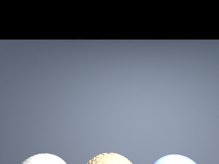
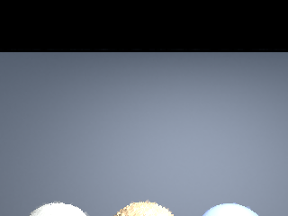
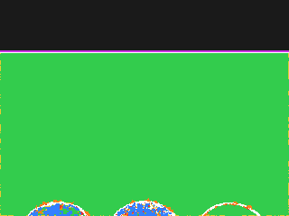
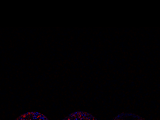
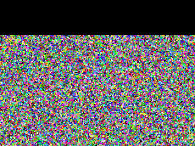
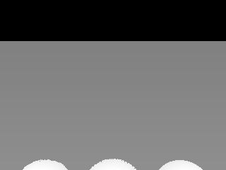
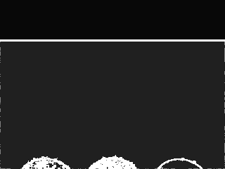
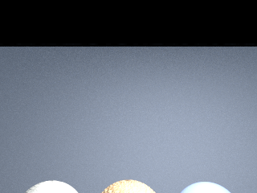
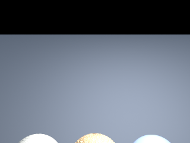

# Bregman (working name): results

Machine: RTX 3090, i7-4930K (6 cores, 12 threads), 64 GB. Nothing else rendering during timed runs. All runs 2026-11-19.

## In short

The prototype works end to end on XPU2's unchanged CPU and GPU lanes. **On the overflow test scene it does not beat
XPU2 at equal time:**

| Scene | Engine | XPU2 at the same error | Engine's bias |
|---|---|---|---|
| overflow (no diffuse bounces) | 0.26 s, relative MSE 6.3e-5 | about 0.23 s (27 spp, interpolated) | mean ratio 1.0000 |
| overflow, `max_diffuse_depth` 2 | 0.38 s, relative MSE 1.43e-3 | about 0.22 s (8 spp, interpolated) | mean ratio 1.0001 |

What works: where the region buffer trusts phase 1 (73% of the pixels) its reconstruction of the direct light is as
good as XPU2 at 36 to 64 samples a pixel, and phase 2 removes the bias on average. What loses: the overhead of two
sparse frames on XPU2's grid, and, with diffuse bounces, the indirect light's noise, which phase 1 does nothing for
(section 4).

The second step (section 5) made phase 1 a cache for phase 2's bounces, unbiased by Russian roulette, and added OpenQMC
past the first hit. Both work and stay unbiased, but each takes about 1% off the error on this scene: few bounces land on
what the camera sees, XPU2 already stratifies the dimensions that matter most, and the cache's lookup costs the GPU 18%.

## 1. How it was measured

- Scene: `MoonRayForModo-xpu2/test-results/overflow/scene.rdla`, 320 x 240. Its `pixel_samples` 8 is MoonRay's square
  root: **64 samples a pixel**. Exact uniform sampling (`XPU2_SESSION_UNIFORM_BUDGET=0`).
- **Reference**: XPU2 at the scene's own 64 samples a pixel, 16 seeds averaged (`tools/make_reference.py`). Not a
  1024-sample render: MoonRay and XPU2 narrow a texture's filter as the samples a pixel grow, so a 1024-sample frame is
  sharper than the converged 64-sample one.
- **Engine and XPU2 in one process** (`bregman_engine.exe ... xpu2_spp=4,9,16,36,64`, driven by `tools/run_bregman.py`):
  the same lanes, the same clock (configuration upload, renderer, frame), one warm-up run then three timed, medians
  reported. XPU2's frames carry the engine's two light path outputs too, so they pay the same AOV cost.
- Errors against the reference: relative MSE (MoonRay's: (t - r)^2 / (r^2 + 0.01)), 8 x 8 block error (bias shows
  here), mean ratio of the image sums.
- Phase 1 renders on the GPU alone while the CPU traces the probes and scans (`p1mode=1`, `overlap=1`); phase 2 on both.

XPU2's own benchmark worker, for the record: 64 spp in 0.36 to 0.47 s of sampling, 1.21 s preparation, the GPU taking 90%
of 4.9 M samples (`tools/run_xpu2_baseline.py`; one run of the worker ended with "terminate called without an active
exception" after printing its report, in teardown).

## 2. Overflow scene, no diffuse bounces

XPU2 in the engine's process: 4 spp 0.048 s (relative MSE 9.4e-4), 9 spp 0.080 s (3.5e-4), 16 spp 0.14 to 0.18 s
(1.2e-4), 36 spp 0.29 s (4.8e-5), 64 spp 0.41 s (2.1e-5). About 25 ms a frame fixed plus 5.5 ms a sample a pixel.

| Engine settings | Time | Phase 1 / 2 | Phase 2 spp | Relative MSE | Block error | Mean ratio |
|---|---|---|---|---|---|---|
| stride 4, 64 spp a probe, phase 2 4/16/64 (first run, before the silhouette rule) | 0.238 s | 0.066 / 0.150 | 6.0 | 4.8e-4 | 1.1e-3 | 0.9971 |
| stride 4, 64, phase 2 4/16/64, silhouettes | 0.284 s | 0.068 / 0.189 | 6.6 | 9.8e-5 | 4.6e-4 | 0.9994 |
| stride 4, 64, phase 2 4/8/16 | 0.177 s | 0.073 / 0.075 | 4.0 | 1.8e-4 | 5.4e-4 | 0.9992 |
| stride 2, 16, phase 2 4/8/16 | 0.182 s | 0.061 / 0.081 | 3.7 | 1.25e-4 | 5.6e-4 | 0.9999 |
| stride 2, 16, phase 2 2/8/16 | 0.176 s | 0.060 / 0.077 | 2.3 | 1.29e-4 | 5.7e-4 | 0.9999 |
| **stride 2, 32, phase 2 4/16/32** | **0.260 s** | 0.094 / 0.122 | 4.3 | **6.3e-5** | 4.0e-4 | 1.0000 |
| stride 4, 64, phase 2 8/16/32 | 0.239 s | 0.068 / 0.143 | 7.8 | 1.06e-4 | 4.5e-4 | 0.9994 |

(Phase 2's samples: trusted / cell only / everything phase 1 does not trust; background 1. Phase 1 counts as m0 = 64
samples where trusted.)

Where the best run's error lies (`tools/class_errors.py`):

| Region class | Pixels | Phase 1's mean signed error | Share of the final relative MSE |
|---|---|---|---|
| trusted | 55,908 (73%) | -0.00016 | 3.1e-5 |
| cell only (no Delaunay triangle of connected probes) | 307 | +0.0014 | 1.4e-5 |
| silhouette | 829 | -0.044 | 7.8e-6 |
| saddle | 818 | +0.017 | 5.2e-6 |
| radiance edge | 303 | +0.011 | 1.8e-6 |
| uncovered by any patch | 640 | -0.0027 | 1.8e-6 |
| background | 17,920 | 0.00003 | 9e-7 |

The silhouette rule (a pixel next to another mesh, no surface or a depth its cell's plane does not predict, read from the
scans' depth buffer) took the first run's error from 4.8e-4 to 9.8e-5: 93% of that error had been in 3% of the pixels,
silhouette pixels whose footprints blend a ball with the wall behind it while the reconstruction gave them the ball's
probe alone.

Scans in the best run: 19,200 probes, 14,560 on a mesh; patches of 6.3 triangles on average (the displaced balls are
150,146 triangles), up to the 64-ring limit, none cut by the triangle limit; 70 vertices welded across seams, no
non-manifold edge; 162,971 Bregman Delaunay faces made, 301 saddle windows. Host time: probe rays 6 ms, scans 14 ms
(under phase 1's GPU frame), region buffer 37 ms.

| Engine (stride 2, 32, 4/16/32) | Phase 1 reconstruction | Region classes | XPU2, 36 spp | Reference |
|---|---|---|---|---|
|  |  |  |  |  |

| Engine's error (x10, red brighter, blue darker) | Bregman Voronoi cells | Region buffer (scans' inverse depth) | Phase 2's samples |
|---|---|---|---|
|  |  |  |  |

Region colours: green trusted, yellow cell only, white silhouette, blue saddle, orange radiance edge, purple uncovered,
red untrusted, dark grey background. On the wall every tangent plane is the same plane, so the cells are the probes'
Euclidean Voronoi cells (the tie rule); on the balls they follow the facets.

## 3. Overflow scene, two diffuse bounces

`SceneVariables { ["max_diffuse_depth"]=2 }` over the scene; its own 16-seed reference.

XPU2: 4 spp 0.12 s (3.07e-3), 9 spp 0.25 s (1.24e-3), 16 spp 0.44 s (5.9e-4), 36 spp 0.90 s (2.4e-4), 64 spp 1.51 s
(1.25e-4).

| Engine settings | Time | Phase 1 / 2 | Phase 2 spp | Relative MSE (phase 2's own beauty) | Mean ratio |
|---|---|---|---|---|---|
| stride 2, 32, phase 2 4/16/32 | 0.408 s | 0.102 / 0.270 | 4.3 | 3.3e-3 (2.7e-3) | 1.0001 |
| stride 2, 16, phase 2 8/16/32 | 0.382 s | 0.058 / 0.284 | 7.2 | 1.43e-3 (1.24e-3) | 1.0001 |
| stride 4, 64, phase 2 8/16/32 | 0.387 s | 0.067 / 0.294 | 7.8 | 1.44e-3 (1.23e-3) | 0.9995 |

| Engine (stride 2, 16, 8/16/32) | XPU2, 9 spp | Reference |
|---|---|---|
|  |  |  |

## 4. What the numbers say

1. **The reconstruction is good where the region buffer trusts it.** 73% of the pixels, error at XPU2's 36 to 64 spp
   level, from 0.5 to 4 probe samples a pixel. The scans' depths decide trust well: the silhouette rule alone removed
   four fifths of the error.
2. **The bias does vanish.** With phase 1 weighted m / (m + n), every run's mean ratio is within 0.06% of the reference,
   and 0.01% at stride 2.
3. **Sparse frames cost XPU2 a lot.** A probe frame at 1 pixel in 4 or 16 takes longer than a dense 4-spp XPU2 frame:
   the grid hands out every pixel's sample indices up to the frame's largest count and the skipped ones still pass
   through launches; a warp's neighbouring threads take neighbouring pixels, so 3 in 4 or 15 in 16 idle. Phase 2 has the
   same cost: a few pixels at 32 make the whole grid 32 deep. And each frame has its ~25 ms fixed cost; the engine pays
   two, plus 37 ms of host region work, at a resolution where XPU2's whole 16-spp frame is 140 ms.
4. **With indirect light the split costs variance.** The engine's final image is noisier than phase 2's own beauty
   (1.43e-3 against 1.24e-3). A path's first-hit BSDF sample either reaches a light (direct) or bounces (indirect), so
   within a sample the two are anti-correlated and the beauty's noise is less than their sum's; replacing the direct
   part with phase 1's smooth estimate leaves the indirect part's whole noise. Phase 1 saves light samples, and on this
   scene they are not where the noise is.

## 5. Second step: phase 1 as a cache for phase 2's bounces, and OpenQMC (2026-11-19)

What was built is in DESIGN.md (the "second step"): a bounce landing on a surface phase 1 reconstructed takes phase 1's
radiance and stops with probability 1 - p, else goes on carrying 1 / p less C (1 - p) / p (unbiased for any C); and
OpenQMC's Owen-scrambled Sobol sampler for the light and BSDF samples past the first hit. Both in XPU2's shared
integrator, off unless the engine sets them. The GPU program is the engine's own build (`build_bregman.py --gpu`,
`XPU2_OPENQMC`), compiled by OptiX once (about 13 minutes) into a cache of its own (`OPTIX_CACHE_PATH`, 93 MB); the
kit's shared OptiX cache was not written. With both switches off it gives the earlier numbers exactly.

Overflow scene with `max_diffuse_depth` 2; engine at stride 2, 16 samples a probe, phase 2 8/16/32; CPU and GPU:

| Phase 2 | Phase 2 time | Engine time | Relative MSE (phase 2's own) | Mean ratio |
|---|---|---|---|---|
| neither | 0.285 s | 0.383 s | 1.428e-3 (1.243e-3) | 1.00007 |
| frame cache, p = 0.25 | 0.337 s | 0.447 s | 1.409e-3 (1.221e-3) | 1.00005 |
| OpenQMC, nonMirrorDepth 1 to 3 | 0.284 s | 0.378 s | 1.412e-3 (1.230e-3) | 0.99992 |
| both | 0.338 s | 0.431 s | 1.394e-3 (1.211e-3) | 0.99988 |
| frame cache, p = 1 (looks up, never stops) | 0.351 s | 0.444 s | 1.428e-3, the same image as neither | 1.00007 |
| frame cache, p = 0.05 | 0.333 s | 0.426 s | 1.533e-3 (1.351e-3) | 0.99973 |

XPU2 in the same process: 4, 9, 16 spp in 0.119, 0.248, 0.421 s at 3.07e-3, 1.24e-3, 5.93e-4; with OpenQMC past the
first hit 0.117, 0.247, 0.423 s at 3.04e-3, 1.23e-3, 5.85e-4.

1. **Both are unbiased,** as built: every mean ratio within 0.03%, and the cache's p = 1 run is the plain image exactly.
2. **OpenQMC gains about 1%,** in the engine and in XPU2 alike, at no cost. XPU2 already stratifies the camera and the
   first hit's light and BSDF samples (its own Owen-scrambled Sobol); what is left to OpenQMC is the secondary bounces,
   whose integrands are high-dimensional at 8 samples a pixel. MoonLightIPR's 35-40% came from the dimensions XPU2 already
   has.
3. **The frame cache seldom applies on this scene.** On the CPU alone (where the time is the work), stopping 95% of the
   cache's hits (p = 0.05) saved 6% of phase 2. The camera sees the wall and the balls' tops; bounces from the wall reach
   the balls' backs, bounces from the balls go to the sky or the floor below the frame. Only ball-to-wall bounces land on
   what phase 1 reconstructed. The cache also holds phase 1's direct light only, so the stopped paths' missing indirect
   light comes back through the 1 / p correction as variance.
4. **The lookup costs the GPU 18% of phase 2's sampling** even when every lookup fails (GPU alone: 0.320 s without,
   0.378 s with every lookup rejected at its depth test, 0.396 s with lookups that go on). Not yet explained: the lookup
   is a few divisions and one read of a 1.2 MB table per bounce. It needs a GPU profile.

## 6. Open

- **The frame cache where the camera sees what bounces reach.** An interior (a room, the camera inside) is where it
  should pay; this scene is close to its worst case. Its content should also carry indirect light (a previous frame's
  result, as a realtime preview has one), and its GPU lookup cost needs a profile (section 5).
- **Dense launches.** Probes as their own launch (a probe list, or a camera at 1/s the resolution with a 1-pixel filter
  on a second GPU lane), and phase 2's refine pixels as a pixel list, instead of per-pixel counts on the full grid.
- **Skip what phase 1 knows.** Phase 2 still computes the first hit's direct light it then discards in trusted pixels.
- **One frame, not two.** Per cell, phase 2 may start once its 3 x 3 window's probes are in (DESIGN.md section 6).
- **The region buffer on the GPU** (37 ms on the host at stride 2).
- **Bigger, heavier scenes.** 320 x 240 with two lights is where fixed costs weigh most and light samples are cheapest;
  Sponza (23 lights, 69% of the GPU's time in shadow rays) is where light sample reuse has the most to save.
- The lift assumes a still perspective camera without depth of field; patches lose triangles crossing the near plane.

## 7. Reproduce

```bash
python bregman/build_bregman.py --gpu --source . --runtime <MoonRayForModo-xpu2>/test-results/interactive-reference-042 --output test-results/bregman/build-N
cd bregman/tools
python make_reference.py --build <MoonRayForModo-xpu2>/test-results/async-build-handoff1 --scene <overflow>/scene.rdla --output <new folder> [--extra <.rdla>]
python run_bregman.py --engine <build-N> --ptx-build <build-N> --scene <overflow>/scene.rdla --output <new folder> --reference <reference.rgba> stride=2 probe_spp=32 n_lo=4 n_mid=16 n_hi=32 cache=1 cache_p=0.25 qmc_depth=4 xpu2_spp=9,16,36
python class_errors.py <that folder> <reference.rgba>
python summarize.py <run folders...>
```

`python` is `pythoncore-3.15` (not the Store one). The worktree needs `toolchain`, `build` and `upstream` junctioned from
the main checkout. `--gpu` builds the engine's own GPU program (with OpenQMC); its first run compiles it with OptiX
(about 13 minutes), into the `optix-cache` folder beside the run folders (`run_bregman.py` sets `OPTIX_CACHE_PATH`), never
into the kit's. Without `--gpu`, `--ptx-build` must be an XPU2 build whose GPU program sources match this tree's, and the
frame cache and OpenQMC are then not in the GPU program (sections 2 to 4 were measured that way, with
`async-build-handoff1`). The engine's options: `cache` (default off), `cache_p` (0.25), `cache_tol` (0.02), `qmc_depth`
(0: off), `xpu2_qmc` (XPU2's comparison frames with OpenQMC).
