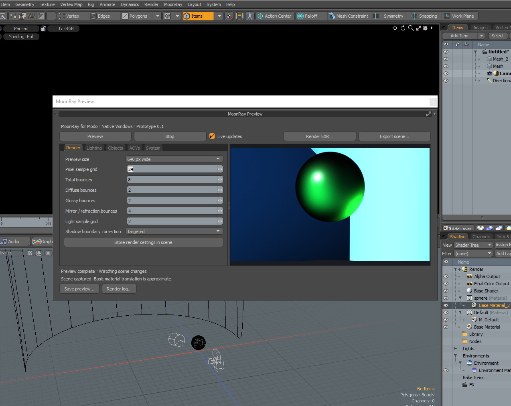

# How it works: MoonRay on Windows, and the C++ adapter

*For developers. Written November 27, 2026, for 0.5.6.3. Artists need none of this: the kit and its runtime install as
they are.*

*Where it started: the first stable prototype, September 30, 2026 ("Native Windows · Prototype 0.1"). MoonRay, built
natively for Windows, renders a sphere and a wall from Modo's scene into a floating preview window, with live updates,
a few render settings, Render EXR and Export scene; its status line still called the material translation
"approximate".*

MoonRay is DreamWorks' production renderer, released as OpenMoonRay for Linux. MoonRay for Modo runs it natively on
Windows, inside a Modo session, without USD or Hydra. Three pieces make that work:

1. **MoonRay built for Windows** from OpenMoonRay's own source, with a set of pinned patches.
2. **The kit's own scene writer**, which turns Modo's scene into MoonRay's scene format and talks to the renderer as a
   separate process.
3. **The C++ adapter** (`MoonRayGeometry.lx`), a native Modo plugin the kit calls for everything that would be too slow
   in Python: reading meshes, Modo's evaluated geometry, the Shader Tree, environments.

## 1. MoonRay built for Windows

### The toolchain: GCC, not MSVC

OpenMoonRay is written for GCC and Clang on Linux. Rather than rewrite it for Microsoft's compiler, it is built with
**MinGW-w64 GCC (MSYS2's UCRT64 environment)**, which keeps the compiler dialect, intrinsics and build rules the code
expects while producing ordinary Windows executables and DLLs. Nothing runs under WSL, Cygwin or a Linux VM.

- The toolchain lives in the repository folder (`toolchain/msys64`), with CMake, Ninja and ISPC 1.31.
- The libraries MoonRay needs come from MSYS2's packages: Boost, TBB, Embree 4, OpenVDB, OpenImageIO, OpenEXR, Lua,
  jemalloc. Their exact versions are recorded in `patches/native-windows/installed-packages.txt`.
- Two shims cover most of MoonRay's POSIX assumptions without touching its source: **winpthreads** for pthreads and
  **dlfcn-win32** for `dlopen`/`dlsym`.
- Compiler settings: GCC `-march=ivybridge -mno-avx2 -mno-fma -ffp-contract=off`, ISPC `avx1-i32x8`. AVX1 keeps it
  running on older processors, and no contraction of multiply-adds keeps results the same on every machine.

`tools/build_native.py --renderer --dsos` configures, builds and tests; `tools/stage_runtime.py` gathers the binaries
and every DLL they load into the runtime folder, with checksums. [AVX_BUILD.md](AVX_BUILD.md) has the commands.

### The patches

The source is OpenMoonRay at pinned commits. `patches/native-windows/sources.json` names each repository, its commit,
its patch and the patch's SHA-256, so the build can be reproduced:

| Repository | Patch | Size |
|---|---|---|
| moonray | `moonray.patch` | 126 files, about 3,500 lines added |
| scene_rdl2 | `scene_rdl2.patch` | 51 files, about 600 lines |
| moonshine | `moonshine.patch` | 5 files, about 330 lines |
| mcrt_denoise | `mcrt_denoise.patch` | 5 files |
| cmake_modules | `cmake_modules.patch` | 3 files |

Most of the changes are portability:

- **Memory.** Linux's aligned allocation (`posix_memalign`, aligned `new`) goes through scene_rdl2's own
  `alignedMalloc`/`alignedFree`. A frame buffer keeps its aligned deleter when it is shared. Windows gives a thread a
  1 MB stack where Linux gives 8 MB, and some of MoonRay's per-thread buffers (about 2.8 MB) moved to the heap,
  allocated once and 64-byte aligned. NUMA allocation and thread affinity use Windows' calls (one processor group, up
  to 64 logical processors, in MoonRay itself; XPU2 uses every group).
- **Loading shaders.** MoonRay loads each material, light and map as a DSO named for its scene class. On Windows each is
  a DLL built with the `.so.proxy` name MoonRay's loader looks for, and `rdl2_json_exporter` writes its class
  description at build time. C++ and ISPC shading code share one DLL, ray tracing, path tracing and render control
  another, so their dependencies resolve without Unix's lazy symbol lookup.
- **ISPC on Win64.** The Windows calling convention passed a vector mask through a 16-byte-aligned temporary, which
  faulted on ISPC's aligned AVX load; the mask is passed by an explicitly 32-byte-aligned pointer. ISPC's stack probe
  delegates to the GNU Windows guard-page probe.
- **The rest:** Windows paths and Unicode file names, endianness and fixed 64-bit sizes in the scene format, Lua's
  binary bytecode, a monotonic clock (the heat map's clock), process statistics, file-change polling, checkpoint file
  operations, and shutting worker threads down before Windows unloads the DLLs.
- **Left out:** Linux-only farm pieces (farm allocation, shared-memory farm transport, telnet debugging, Athena
  telemetry). Rendering across machines is the plugin's own Rhizome instead.

`patches/native-windows/README.md` explains each change whose reason is not plain from its diff.

### Fixes to MoonRay itself: Source Overrides

Separately from portability, the plugin fixes things in MoonRay that look wrong in a Modo scene, or adds what Modo has
and MoonRay lacks: mirrored meshes facing outward, VDB fire from temperature grids, a tilt-shift camera, displaced hard
edges staying sharp, and more (twenty-eight so far). Each is a patch script (`tools/port_*.py`) behind a switch that
MoonRay reads at run time, and each is a checkbox under Preferences > MoonRay Source Overrides, on by default. Turned
off, MoonRay renders as its own source does, so plain upstream behaviour is always one click away.

## 2. From Modo to MoonRay without Hydra

USD's Hydra is a common way to hand a scene to a renderer. Modo has no Hydra host, so the plugin talks to MoonRay
directly, in MoonRay's own terms:

- **Reading the scene.** The kit reads Modo's scene in Python (`moonray_modo`): items, cameras, lights, the Shader
  Tree, Render Settings. Geometry and anything heavy comes through the C++ adapter (below).
- **Writing it.** `rdla.py` writes the scene in MoonRay's own format: RDLA, its Lua scene text, and RDLB, the binary
  arrays of points, normals and UVs beside it. Materials become MoonRay's shaders (DwaBaseMaterial and the rest, or a
  MoonShine graph); Modo's layers and procedurals become MoonRay maps, some of them the plugin's own.
- **Rendering it.** MoonRay runs as its own process, `moonray.exe`, MoonRay's command-line renderer. A patch adds a
  persistent mode (`MOONRAY_MODO_SESSION`, `native-port/persistent_session.inc`): the process stays up, takes each edit
  as a small delta of the scene rather than the whole scene again, and renders progressively.
- **Seeing it.** Frames come back through shared memory to the MoonRay Preview, a Qt panel in Modo (Modo's CustomView,
  [CUSTOM_VIEW.md](CUSTOM_VIEW.md)), with line messages (`@@MODO_SESSION`) for progress and events. A render to a file
  writes EXRs as MoonRay does.

The plugin's two other engines take the same scene data the same way: **XPU2** (`moonray_xpu2.exe`, the plugin's own
GPU and processor renderer, which falls back to MoonRay's XPU when a scene needs what it lacks) and **MoonLightIPR**
(`moonlightipr_session.exe`, a small OptiX path tracer for previews). Each is a separate process; none runs inside
Modo's own memory, so a renderer that fails does not take Modo with it.

## 3. The C++ adapter (`MoonRayGeometry.lx`)

Python is fine for a scene's structure, and too slow for its geometry: reading a 200,000-polygon mesh a polygon at a
time through Modo's Python API took seconds. The adapter is a native Modo plugin, in `native-modo/`, that does that
work in C++ inside Modo's process.

### How it is loaded

- It is an ordinary Modo plugin (`.lx`, a DLL), built with the project's GCC against the Modo SDK (build 661446;
  the SDK is not in the repository, see `native-modo/README.md`). It lives in the kit's `bin` folder, so Modo loads it
  at start-up and gives it its SDK services. It registers no servers: `initialize()` is empty.
- The kit's Python then loads the same file with `ctypes` (`evaluated.py`, `native.py`). Windows hands back the module
  already loaded, with Modo's services already in it, and Python calls its exported C functions directly.
- It exports about sixty `MR_*` functions. Each takes plain arguments (strings, numbers, file paths) and returns JSON
  text or long rows of binary numbers. Nothing of Modo's C++ objects crosses into Python.
- Every export is optional to the kit: where an adapter is older or missing, the kit falls back to its Python code and
  says so. Each feature that changes what an export returns carries a version (for example
  `MR_environment_projections_version`), so the kit knows which it is talking to.

### What it does

| Area | Exports | What for |
|---|---|---|
| Meshes | `MR_mesh_file`, `MR_mesh_surfaces`, `MR_triangulate`, `MR_vertex_maps`, `MR_subdivision_creases`, `MR_smooth_normals`, `MR_corner_normals` | A whole mesh in one call: points, polygons, UV and weight maps, creases, normals. A 139,000-polygon mesh went from 4.8 s to 1.4 s. |
| Evaluated geometry | `MR_geometry_snapshot_binary` and the other `MR_geometry_*` | Modo's render cache, the geometry as Modo's own renderer sees it after deformers, replicators, Scene Proxies and displacement: a small JSON naming the surfaces, and their numbers as binary rows the JSON points into. |
| Shading | `MR_shader_stacks`, `MR_procedural_bake` | The Shader Tree's layers for each surface, and Modo's procedural textures baked where MoonRay has no counterpart. |
| Environments | `MR_environment_layers`, `MR_environment_blend`, `MR_environment_projected` | Gradients, physical skies, procedurals and images in any projection, laid out as the latitude-longitude picture MoonRay lights with. |
| Displacement | `MR_smooth_split*` | A displaced cage split onto Modo's Smooth Positions surface. |
| Curves and fur | `MR_curve_*`, `MR_fur_surface` | Curves, splines and Modo's fur as MoonRay strands. |
| Viewport | `MR_ocean_preview_*`, `MR_vdb_preview_*` | Points and outlines drawn in Modo's own viewport (an Ocean Plane's waves, a VDB's bounds). |
| Arithmetic | `MR_uv_transform`, `MR_gather`, `MR_least`, `MR_most` and others | Work on the binary rows in the same order of operations as the kit's Python, built without multiply-add contraction, so a scene comes out byte for byte the same whichever does the work. |

### Other native tools

A few jobs run as small programs of their own in the runtime, called by the kit when needed: `modo_particles` (Blob and
Sprite shapes), `modo_vdb_grid` (a VDB read into a block for MoonLightIPR), the ocean's wave tiles, `lxo2rdl` (Convert
LXO to RDL without Modo), the Alembic, fur and hair readers. Each is built with the same toolchain and staged with
the runtime.

## 4. The C++ adapter in depth

### Building it

`tools/build_modo_bridge.py` compiles every file in `native-modo/` into one DLL with the project's g++:
`-std=c++17 -shared -O2 -ffp-contract=off`, against the Modo SDK's headers and its `common` wrappers (`cwrap.cpp`,
`util.cpp`), plus meshoptimizer's simplifier (MIT, v0.22) for `simplify.cpp`. It links `libgcc` and `libstdc++`
statically, so the `.lx` needs no MinGW DLLs beside it and cannot pick up another C++ runtime from Modo's folder. The
script writes `build.json` next to the binary with the SDK build, the SHA-256 of the SDK's version header and of the
plugin itself, so a staged adapter can always be traced to what made it. The adapter only ever talks to Modo, never to
MoonRay; the renderer's build (section 1) is separate.

### Living in Modo's process

- **Two loads, one module.** Modo loads `bin/MoonRayGeometry.lx` at start-up like any plugin and calls its
  `initialize()`, which does nothing: the load itself is what connects the SDK's wrappers to Modo's global services.
  When the kit's Python then opens the same path with `ctypes.CDLL`, Windows returns the module already in memory, so
  every export finds Modo's services ready. Loaded by Python alone, outside Modo's plugin loader, they would not be there.
- **Modo's objects cross as addresses.** Python passes an SDK object it already holds (a mesh, an item, a scene) as the
  raw address from `__peekobj__()`, and the C++ side wraps that address in the SDK's own `CLxUser_*` class. Python
  keeps the object alive for the length of the call; the C++ side never keeps it beyond.
- **Modo's main thread.** Every export that touches Modo's objects runs on the thread Python called it from, Modo's
  main thread, since Modo's scene is not safe to read from elsewhere. Exports that only work on numbers (`MR_gather`,
  `MR_finite`, `MR_uv_transform`) touch nothing of Modo's.
- **Python's lock.** `ctypes.CDLL` lets go of Python's global lock during each call, so a long native step (a big mesh,
  a render cache) does not stop the kit's Python threads.
- **Quitting.** `cleanup()`, which Modo calls as it unloads plugins, releases anything still held from Modo (the live
  render cache, below) while Modo's services still stand.

### The calling rules

Every export is plain C (`extern "C" __declspec(dllexport)`), so `ctypes` calls it with no binding layer:

- **Arguments** are numbers, pointers to arrays the caller owns, and UTF-8 strings (paths, lists of item names joined
  by newlines).
- **Errors** come back as a string: null when the call worked, else a pointer to what went wrong, held in a
  `static thread_local std::string` that stays valid until that thread's next call. C++ exceptions never cross the
  boundary; each export catches them and turns them into that message, which the kit raises and shows in its notices.
- **Small answers** come back the same way, as JSON text.
- **Large answers** go to a file whose path Python chose, or into buffers Python allocated after asking for the sizes.
- **Answers in several parts** use a handle: `MR_smooth_split` returns a pointer to its result, `MR_smooth_split_sizes`
  gives each part's size, Python allocates arrays of those sizes, `MR_smooth_split_geometry` fills them, and
  `MR_smooth_split_free` deletes the result. Nothing allocated on one side is freed on the other.

### Handing geometry over

Building a Python object for every point of a heavy scene was the slowest part of a reading and cost gigabytes of
Modo's memory (on a car: 47 s of a 190 s preview start). So geometry comes back as **rows**, long runs of 32-bit
numbers written as they are:

- `MR_geometry_snapshot_binary(time, displaced, json_path, rows_path)` writes two files. The JSON names each surface,
  its item, material and part, its instances and their matrices, and for each segment (points, polygons, UV sets,
  normals, motion) an offset and a length into the rows file.
- Python reads the rows file once, and the kit's `Rows` and `Faces` (`rows.py`) are views onto slices of it. Whatever
  only passes the data on (the binary scene file, the scene's digest, MoonLightIPR's packer) passes the slice as it
  is; lists are made only where something walks the values one by one, and then once.
- The older all-JSON `MR_geometry_snapshot_file` is still exported for an adapter that has nothing newer.

`MR_mesh_file` does the same for a mesh read directly rather than through the render cache: from the `lx.object.Mesh`
Python holds, one file of points, surface polygons with their material tags, and every corner's UV values and first
vertex normal.

### Evaluated geometry: Modo's render cache

Deformers, replicators, Scene Proxies, generated surfaces and Modo's own displacement exist only as Modo's renderer
sees them. The adapter reads them from **Modo's render cache** (`render_cache.cpp`):

- **A cache made for each reading,** with Modo's full update, evaluates the scene at its current time. For motion blur
  the same cache is updated, unforced, to each end of the shutter, which evaluates only what time changes. A cache made
  without the full update crashed now and then; forcing the second update evaluated the whole scene again.
- **Borrowed references.** The cache's accessors return objects it still owns. The adapter wraps them without taking
  ownership (`take()` released references the cache still needed), and keeps each prototype's own object rather than
  an instance's wrapper, which can carry the same ID without the segments.
- **Partial readings.** After an edit, `MR_geometry_snapshot_some` loads segments only for the items named. Every other
  surface comes back marked `kept`, with only its item, material and part, and the kit takes its data from the reading
  before. Loading every surface had been most of a reading after one mesh changed (1.24 s of 2.15 s on an interior of
  25 meshes).
- **Scene Proxies.** A proxy's surfaces are shaded from the scene the proxy loads, whose Shader Tree Python cannot list.
  The adapter notes, for each such surface, which scene its shading comes from, and hands that scene to a listener the
  kit registered (`MR_geometry_foreign_catcher`), from the same render cache: asking with a second render cache, made
  and released, left Modo crashing as it quit.
- **The live cache** (`MR_geometry_live_*`) is an experiment, off unless `MOONRAY_MODO_LIVE_CACHE=1`: one render cache
  kept between readings and updated by Modo, with a listener noting which items changed. It is read only when the
  listener has seen every item asked for change and Modo is not mid-update; anything else falls back to a cache made
  anew, so a render never fails on its account. Modo did not hand back an edited mesh's segments from it, which is why
  it stays off.

### Keeping meshes between readings

`MR_mesh_digest` fingerprints a mesh: its points, its polygons (kind, corners, every tag) and the values of every map,
on points, corners and edges. The kit's geometry cache (`geometry_cache.py`) keeps surfaces on disk from earlier
readings and takes one again only while its mesh still digests the same, so an unchanged mesh is not evaluated again.

### The same numbers either way

Some exports duplicate work the kit's Python can also do, such as a texture layer's UV transform and the binary
scene's number encoding (`rows_math.cpp`). They do it in the same order of operations as the Python, built without
fused multiply-adds, so a scene written with the adapter is byte for byte the scene written without it. Every cache and
digest stays valid whichever path made it, and tests can compare the two exactly.

### Versions and fallbacks

The kit never assumes which adapter it has:

- Before calling an export, Python looks it up. A missing one means an older adapter, and the kit takes its Python path
  or an older export, which every feature has; the notices say when the adapter is why something is slower or left out.
- Where an export's meaning changes, it carries a version export (for example `MR_environment_projections_version`),
  and the kit checks the number before trusting the result.
- Staged builds are recorded by hash, so a test or a bug report can say exactly which adapter was running.

### Drawing in the viewport

The Ocean Plane's waves and a VDB's outline are drawn in Modo's own viewport by the adapter. The kit loads the data once
under a name (`MR_ocean_preview_load`), and on each redraw passes Modo's stroke-drawing object to
`MR_ocean_preview_draw`, which only borrows it for that call. Points get sparser with distance and stop past a set
range, so a sea to the horizon costs the same to draw as a small one.

### What it was built around

- An external-render adapter for Modo's PView was built first and removed in 0.3.50: Modo would not show an external
  renderer's pixels there. The preview is the kit's own Qt panel.
- Everything about a reading comes from that reading's one render cache; a second cache made to ask one question
  crashed Modo at quit on scenes with proxies.
- Whatever is kept between calls is released in `cleanup()`, before Modo's services go.
