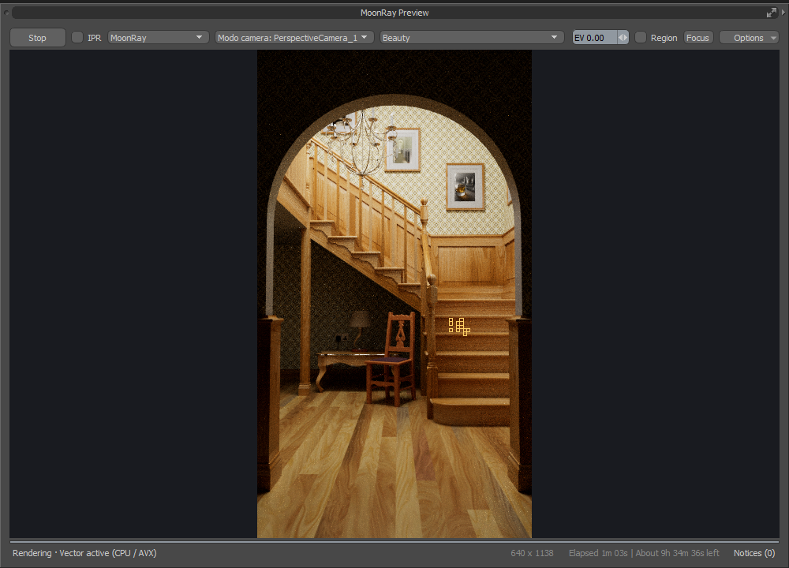

# Installing MoonRay for Modo

These instructions are for **0.5.4.3.1**, **Modo 16.1v9**, and **Windows x64**. The runtime is MoonRay [2026.29.1](https://github.com/dreamworksanimation/openmoonray/releases/tag/v2026.29.1) (MoonRay 18.4), built for Windows with the plugin's own patches. This is a pre-production release, not a production-certified build.

## Requirements

- An installed copy of Modo 16.1v9. The supported executable is `C:\Program Files\Modo16.1v9\modo\modo.exe`.
- An AVX-capable x64 CPU for the bundled CPU runtime.
- Optional: a compatible NVIDIA GPU and installed NVIDIA driver for XPU, XPU2 and OptiX. The runtime includes CUDA runtime libraries; a CUDA development toolkit is not required. XPU has been exercised on an RTX 3090; compatibility with every GPU/driver combination is not established.

## Download and install

1. Open the [0.5.4.3.1 release](https://github.com/Pbaroque20/MoonRayForModo/releases/tag/v0.5.4.3.1). Download **MoonRayForModo-0.5.4.3.1-kit.zip** and **MoonRayForModo-0.5.4.3.1-windows-runtime.zip** from Assets, and, if you want MoonRay's ten example scenes in the asset library, **MoonRayForModo-0.5.4.3.1-content.zip** (about 300 MB). GitHub's automatic Source code ZIP does not include the runtime.
2. Save your scene and close all Modo instances.
3. Extract the ZIPs into the **same temporary folder**. Merge their `MoonRayForModo` folders (the content ZIP adds to `assets/library`). The resulting folder must contain `index.cfg`, `bin/MoonRayGeometry.lx`, `runtime/moonray.exe` and `runtime-xpu2`.
4. In Windows Explorer, enter `%APPDATA%\Luxology\Kits`. Create the `Kits` folder if needed. If a `MoonRayForModo` folder already exists, move it to a backup location **outside Kits**; do not merge a new release into the old installation.
5. Copy the combined `MoonRayForModo` folder into `Kits`. Avoid an extra nested folder: `index.cfg` should be directly inside `Kits\MoonRayForModo`.
6. Start **Modo 16.1v9**. Open **MoonRay > Open Preview** (or enter `moonray.open`). The plugin discovers its bundled `runtime` folder automatically. For XPU2, the default GPU renderer for previews, choose **Compile XPU2 Shaders** once in System > Preferences > MoonRay > XPU2; until then the preview says so instead of rendering, or choose MoonRay XPU on that page.
7. If upgrading from a development installation, check the runtime path in MoonRay settings. If it still points to an older folder, select `%APPDATA%\Luxology\Kits\MoonRayForModo\runtime`. Use Auto execution for XPU → Vector → Scalar fallback, or choose a CPU mode explicitly.

Do not install the runtime ZIP alone: the kit ZIP contains the Modo integration and geometry adapter. Keep the runtime files, shaders, and licenses together. Do not install or copy the Modo SDK.

## Using the plugin



- Open **MoonRay > Open Preview**. **Render** starts a MoonRay render. The preview can dock as a Modo custom viewport; it does not populate Modo's built-in Render View slots.
- Choose the engine in the preview's toolbar: **MoonRay** for the full render, **MoonRay LS** for a quick low-sample one, or **MoonLightIPR** for an approximate GPU preview (NVIDIA GPU required). With MoonLightIPR, press **RT Off** to switch realtime on; it then updates after each edit. Output renders always use MoonRay.
- Render settings are on the Render item's **MoonRay** tab and under **MoonRay > Render Settings**: sampling, depths, denoising, view transform (ACES by default) and outputs.
- To give a mesh a MoonRay material, select it and choose **MoonRay > Assign MoonShine Material to Mesh**, or add one from the Shader Tree's **Add Layer** list. Its form has **Open Graph**.
- **MoonRay > Import MaterialX Material...** and **MoonRay > Import MoonRay Scene (RDL)...** bring in materials and whole MoonRay scenes. For a scene kept as `scene.rdlb` and `scene.rdla`, choose either file.
- **MoonRay > Add MoonRay Item** adds MoonRay's own lights, light filters, cameras, shapes and volumes.
- **MoonRay > Asset Library** shows saved materials, models and scenes as pictures; double-click one to use it. **Draft** in the preview window shows the scene as outlines until you drag a **Region** to render.
- **System > Preferences > MoonRay** holds the plugin's own options, among them having the M key open MoonRay's Assign Material.
- Choose **Denoised Beauty** in the buffer list to see the picture denoised; **Beauty** is the default. Right-click the picture for **Smart Render**, which stops a MoonRay render once it is clean enough and denoises it, or **Safe Denoising**, with which a render stopped part way is kept and denoised and **Continue** takes it up again.
- **Options > Compositor** in the preview window grades and filters a finished render; **MoonRay > MoonLightIPR Playblast** renders a quick animation on the graphics card.

## Checksums and troubleshooting

`SHA256SUMS.txt` contains checksums for the ZIPs and the installation guide. Compare a download with PowerShell `Get-FileHash -Algorithm SHA256 'path-to-download.zip'` if needed.

If the MoonRay menu is missing, check the folder nesting and restart Modo. If the runtime cannot be found, select the folder containing `moonray.exe`. For render errors, open Render Log; avoid replacing individual DLLs with files from other runtime versions.

If every preview and every `.rdla` fails at once with "filesystem error: directory iterator cannot open directory: Not a directory [...]", your Windows PATH names a file where it should name a folder (often `c:\Windows\System32\cmd.exe`). Releases up to 0.5.2 stop on it; 0.5.2.1 and later start anyway. On an older release, remove that entry from PATH (System Properties > Environment Variables, in both lists) and restart Modo.

To roll back, close Modo, move the new kit outside `Kits`, and restore your backed-up kit. If you changed the runtime path, restore that path too. Only one MoonRay kit should remain under `Kits`.

See the [README](../README.md) for current limitations. This release was packaged with file-integrity checks, and the packaged files were unpacked into an empty folder and rendered from there with no environment set; it has been run on one machine only, and no clean-machine install was tested.

## Rendering headless (no Modo window)

A headless render takes two steps: write the Modo scene as a MoonRay scene, then render that file with the kit's `moonray.exe`. Neither step needs Modo's window, so both can run on a farm.

### 1. Write the MoonRay scene

From Modo: **MoonRay > Export as MoonRay Scene** (RDLA, RDLB or both; one scene per frame if you like).

Without a window, from Modo's command-line version `modo_cl.exe` and the kit's `scripts/export_moonray.py`. Put the commands in a text file and give it to `modo_cl` as its input. A plain PowerShell pipe does not work: `modo_cl` misreads its first line. Put quotes, not braces, around the two paths. In PowerShell, adjust these paths:

```powershell
Set-Content -Encoding ascii "$env:TEMP\export.txt" '@{kit_MoonRayForModo:scripts/export_moonray.py} "C:\scenes\shot.lxo" "C:\scenes\shot.rdlb"', 'app.quit'
Start-Process -Wait -NoNewWindow 'C:\Program Files\Modo16.1v9\modo\modo_cl.exe' -RedirectStandardInput "$env:TEMP\export.txt"
```

The script writes RDLB if the name ends in `.rdlb` and RDLA otherwise. Add `"frames"` after the two paths to write one scene for each frame of the frame range (`shot.0001.rdlb`, `shot.0002.rdlb`...). Each scene uses the Modo scene's own MoonRay render settings and keeps its render outputs.

### 2. Render it with MoonRay

```powershell
& 'C:\path\MoonRayForModo\runtime\moonray.exe' -in 'C:\scenes\shot.rdlb' -out 'C:\renders\shot.exr' -exec_mode xpu 2>&1 | Tee-Object "$env:USERPROFILE\Desktop\moonray-log.txt"
```

`-exec_mode` is `xpu` (graphics card and processor), `vector` or `scalar` (processor only). A glowing VDB volume, or a light with a cookie filter, needs `scalar` in this build. For a sequence, render each frame's scene:

```powershell
Get-ChildItem 'C:\scenes\shot.*.rdlb' | ForEach-Object { & 'C:\path\MoonRayForModo\runtime\moonray.exe' -in $_.FullName -out ('C:\renders\' + $_.BaseName + '.exr') -exec_mode xpu }
```

The runtime finds `shaders/OptixGPUPrograms.ptx` and the shader libraries in the folder that holds `moonray.exe`, so keep the runtime folder whole. The bundled layout needs no environment setup. If `REZ_MOONRAY_ROOT`, `RDL2_DSO_PATH` or `TMPDIR` is already set, it takes precedence; clear it if it points to another installation.

### Render it with XPU2

`runtime-xpu2\moonray_xpu2.exe render` renders the same scene with XPU2, without Modo. It renders one frame at the full
samples of the scene's XPU2 Sampling settings, as a Render in the preview does. It writes the scene's render outputs as
the scene names them, and `-out` also writes the beauty with its alpha:

```powershell
& 'C:\path\MoonRayForModo\runtime-xpu2\moonray_xpu2.exe' render -in 'C:\scenes\shot.rdlb' -out 'C:\renders\shot.exr'
```

`--mode 0` renders on the processor alone, `--mode 1` on the graphics cards alone, and `--mode 2` (the default) on both.
`-threads <n>` sets the processor threads. A scene XPU2 cannot render (deep outputs, for one) is rendered by MoonRay
instead, from the same command line, as a preview falls back. The exit code is 0 when the picture is written and 1
otherwise. Keep `runtime-xpu2` beside `runtime`, as the kit installs them: XPU2 takes MoonRay from there. Its shaders
must have been compiled once on the machine (Preferences > MoonRay > XPU2 > Compile XPU2 Shaders, or
`moonray_xpu2.exe --compile-shaders`); until then it renders on the processor. `moonray_xpu2.exe render --help` lists
the options.

For a sequence, render each frame's scene the same way.

To render across several machines, see [Rendering across machines with Rhizome](#rendering-across-machines-with-rhizome).

A GPU render with many outputs has four times the room it had for what each ray owes them; `MOONRAY_MODO_CL1_POOL_SCALE` (1 to 8, default 4) sets another size if a render still reports that it could not allocate a CacheLine1.

If OptiX still fails, report the complete log and NVIDIA driver version. Automatic file discovery does not resolve an incompatible driver or invalid PTX program.

## Rendering across machines with Rhizome

Rhizome renders a frame, or a range of frames, with XPU2 on several Windows machines at once. One machine is the
**head**: it has the scene, finds the other machines, hands out the work and writes the pictures. Every other machine
is a **node** that renders its share. There is no render server to set up.

There are two ways to set it up, and they mix freely: a head in Modo can use headless nodes and nodes in Modo alike.

- **[Option 1: with the kit installed](#option-1-with-the-kit-installed)**: every machine has Modo and the kit.
  Everything is done in **MoonRay > Rhizome: Decentralized Rendering**.
- **[Option 2: head to headless nodes](#option-2-head-to-headless-nodes)**: the nodes have no Modo, only the XPU2
  runtime folder, and are started from a command prompt. The head is Modo with the kit, or a command prompt too.

### How the machines connect

The same in both options:

1. **Nodes start first and wait.** Each node listens on its network for a head. It needs no address and does
   nothing until one is found.
2. **The head looks for them.** When a render starts, the head sends a short call about once a second on every
   network it is on, a direct cable between two machines too.
3. **Only nodes with the same key are taken.** A node that hears the call answers with proof that it has the
   **Rhizome key**, without sending the key itself. The head ignores any answer whose proof does not match its own
   key, so machines with another key never join.
4. **The handshake.** The head connects to each node that answered. Both prove the key again and agree an encryption
   key for this render, and from then on everything between them is encrypted. With approvals on, a new node waits
   here until you approve it.
5. **Rendering.** The head sends each node the scene and the share it is to render, and keeps sending more until the
   frame is done. Nodes need neither the scene nor its textures beforehand. A node that joins late, or drops out,
   simply takes or leaves its share. When the render ends, the nodes go back to waiting for the next one.

Ports: 47100 (node) and 47110 (head) over TCP, and 47101 to 47104 over UDP to find the nodes. The firewall rule in
each option covers them.

### Option 1: with the kit installed

#### On every machine, once

1. Install the **same release** of the kit and runtime on every machine (the machines only talk to the same XPU2
   build), and run **Compile XPU2 Shaders** once on each (System > Preferences > MoonRay > XPU2 > Device Management).
2. Open the Rhizome window and type the **Rhizome key** at the top: any words you choose, the same on every machine.
   Machines with another key never meet. The key stays on the machine and is never sent over the network.
3. On the **Approvals and Firewall** page, click **Add Rule...** and say yes to Windows' administrator prompt. The
   rule lets the other machines reach this one on private and domain networks, so Windows must not see your network
   as a public one.

#### On each node

On **This Machine as a Node**, click **Start Node**. The node renders for whichever machine starts a render, with the
devices Device Management chooses. It keeps running after Modo is closed; come back to this page and click
**Stop Node** to end it. If its graphics card cannot render (GPU programs not compiled yet, a failed compile, an old
card), the node renders on its processor by itself: see
[When a node cannot use its graphics card](#when-a-node-cannot-use-its-graphics-card). For a workstation someone uses during the day:

- **Render**: only after so many seconds without keyboard or mouse.
- **Hours**: only between two hours, for example 19:00 to 8:00.
- **While in use**: step back (its work goes to the others), or go on with a few threads.

#### On the head

1. Open the scene, then the **Render** page of the Rhizome window.
2. Choose **This frame** or **Frames** (first, last, every), and the folder the pictures go to (**Pictures in**).
3. Click **Render on the Swarm**. The scene is exported, and this machine leads the render with every node it finds.
   The bar shows the frame's progress, and the log below it each machine's share.
4. The pictures are written as `<scene>.exr` (or `<scene>.####.exr` for a range); **Open Pictures Folder** shows them.

**Stop** ends the render. Started again on the same frames, it picks up where it stopped. The **Swarm** page lists
every machine taking part, its speed and its share.

#### When nodes are not found

Nodes on the same local network are found on their own. When they are not:

- Check that each node shows *running* on its **This Machine as a Node** page, that its key is the same, and that
  its firewall rule is in (Approvals and Firewall).
- Behind a router or over a VPN, give the node's address under **Nodes by address** (`host:47100`, several separated
  by commas), or a range under **Look for nodes in** (`10.8.0.0/24`, or `*` for each of this machine's networks). A
  machine found once is remembered.
- **Wait for** sets how many nodes to wait for before starting, and **At most** how long to wait; then the render
  starts with the nodes that are ready.

#### Only machines you approve

Tick **Only machines approved** on the Render page to keep unknown machines out. A new machine then waits on the
**Approvals and Firewall** page until you select it and click **Approve**. **Revoke** shuts one out again, by its
hash: the 64 characters shown under **This machine** on it.

### Option 2: head to headless nodes

A headless node is a render machine with no Modo and no kit: only the **runtime-xpu2** folder, started from a command
prompt. The head is either Modo with the kit (**Render on the Swarm**, as in Option 1) or a command prompt running
`moonray_xpu2.exe rhizome master`.

| | What you run | What it needs |
| --- | --- | --- |
| **Head, from Modo** | Rhizome window, type the key, click **Render on the Swarm** | Modo with the kit and the scene open |
| **Head, from a command prompt** | `moonray_xpu2.exe rhizome master --key "blue heron" -in D:\Shots\city\job\city.rdla -in D:\Shots\city\job\city.rdlb -out D:\Shots\city\city.pfm` | The runtime-xpu2 folder and the exported scene |
| **Each headless node** | `moonray_xpu2.exe rhizome node --key "blue heron"` | The runtime-xpu2 folder and the key, nothing else |

What the parts of these commands mean:

- `--key "blue heron"`: the Rhizome key, any words you choose. It must be the same on the head and every node.
- `-in`: the scene the head renders. Modo's Render page exports it into `<Pictures in>\job`: the scene file
  (`.rdla`) and, beside it, its geometry file (`.rdlb`) when there is one. Give each file with its own `-in`.
- `-out`: where the head writes the picture. Only the head writes files; nodes send their share back to it.
- Every other option (such as `--nodes`, `--frames` or `--scan`) is optional; the examples below show them.

#### Set up each headless node, once

1. Copy the **runtime-xpu2** folder out of the release's Windows runtime zip (`MoonRayForModo\runtime-xpu2`) to any
   folder, for example `C:\Rhizome\runtime-xpu2`. It must be the same release as the head's.
2. Open a command prompt in that folder and add the firewall rule (say yes to Windows' administrator prompt):

   ```
   moonray_xpu2.exe rhizome firewall
   ```

#### Start each headless node

```
moonray_xpu2.exe rhizome node --key "blue heron" --shaders compile
```

The node starts and waits for a head. The first time, it compiles its GPU programs in the background and renders on
the processor until they are ready. It runs until its window is closed. In another prompt,
`moonray_xpu2.exe rhizome status` shows what it sees and `moonray_xpu2.exe rhizome id` its hash (for approvals).
`moonray_xpu2.exe rhizome node --help` lists every option.

#### When a node cannot use its graphics card

A headless node never sits a render out because of its graphics card: it renders its share on its **processor**
instead, by itself, and says so in its window and in `rhizome status` (shown on the head too). This happens when:

- its GPU programs are **not compiled** (started with `--shaders skip`, or the compile was declined),
- they are **still compiling** (the first time, about an hour): the cards join from the next job once they are done,
- the **compile failed**,
- its cards are **too old** for XPU2, or it has none,
- a card **cannot take the job** (its programs would not load, a driver refusing them).

It does this in every device mode, `--mode 1` (graphics cards only) included, so a machine with a processor always
helps. `--mode 0` renders on the processor from the start. A node on the processor is slower, so it is given less
of the frame; the picture is the same. To have its cards join, compile its programs once
(`moonray_xpu2.exe --compile-shaders`, or start it with `--shaders compile`).

#### Start the head

- **From Modo**: type the same key in the Rhizome window and click **Render on the Swarm** (Option 1, *On the head*).
  The headless nodes are found like any other.
- **From a command prompt**: give it the scene. Modo's Render page writes the exported scene into
  `<Pictures in>\job`; any MoonRay scene (`.rdla`, with its `.rdlb`) renders the same way.

  ```
  moonray_xpu2.exe rhizome master --key "blue heron" -in D:\Shots\city\job\city.rdla -in D:\Shots\city\job\city.rdlb -out D:\Shots\city\city.pfm --nodes 3 --wait 30
  ```

  `--nodes 3 --wait 30`: start once three nodes are ready, or after 30 seconds with those found by then.

#### Examples

The paths are examples: `D:\Shots\city` holds the scene.

**A workstation that renders at night**, as a headless node:

```
moonray_xpu2.exe rhizome node --key "blue heron" --hours 19-8 --when-idle 300 --busy-threads 4
```

Only between 19:00 and 8:00. In those hours it renders on 4 threads while someone is using the machine, and on all
of them once nobody has touched the keyboard or mouse for 5 minutes. Without `--busy-threads 4` it waits for those 5
minutes instead, and steps back (its work going to the others) as soon as someone comes back.

**A frame range** from a command-prompt head:

```
moonray_xpu2.exe rhizome master --key "blue heron" --frames 1-120 -in D:\Shots\city\job\city.####.rdla -in D:\Shots\city\job\city.####.rdlb -out D:\Shots\city\city.####.pfm
```

The nodes stay connected between frames; files that did not change are not sent again. Stopped and started again
with the same line, the head picks up where it was.

**Across a router or VPN**, where the head's call does not reach. Either the node goes to the head:

```
moonray_xpu2.exe rhizome node --key "blue heron" --master 10.8.0.5:47110
```

or the head goes to the nodes, by address or by searching a range:

```
moonray_xpu2.exe rhizome master --key "blue heron" -in D:\Shots\city\job\city.rdla -in D:\Shots\city\job\city.rdlb -out D:\Shots\city\city.pfm --node 10.9.0.21:47100 --node 10.9.0.22:47100
moonray_xpu2.exe rhizome master --key "blue heron" -in D:\Shots\city\job\city.rdla -in D:\Shots\city\job\city.rdlb -out D:\Shots\city\city.pfm --scan 10.9.0.0/24
```

(A head in Modo: **Nodes by address** and **Look for nodes in**.) Machines reached once are remembered and found
again on their own.

**Only machines you approve.** Start the head with `--approve` (in Modo: **Only machines approved**). A new node
waits and its hash appears on the head (its log, `rhizome status`, or the **Approvals and Firewall** page). Approve
it on the head, giving the head's folder:

```
moonray_xpu2.exe rhizome master --key "blue heron" -in D:\Shots\city\job\city.rdla -in D:\Shots\city\job\city.rdlb -out D:\Shots\city\city.pfm --approve --folder C:\Rhizome\head
moonray_xpu2.exe rhizome approve <node hash> --folder C:\Rhizome\head
```

The node is let in within a second, and stays approved for later renders.

**A queue of shots for one head.** The head renders the jobs in a folder one after another and waits for more;
anyone adds jobs to it:

```
:: on the head
moonray_xpu2.exe rhizome master --key "blue heron" --queue \\server\rhizome\jobs --queue-watch

:: from any machine
moonray_xpu2.exe rhizome submit --queue \\server\rhizome\jobs -in \\server\shots\city\job\city.rdla -in \\server\shots\city\job\city.rdlb -out \\server\shots\city\city.pfm --name city
```

The head must reach a job's paths the same way, so use a shared folder.

#### When headless nodes are not found

- Check the node's window says it is waiting, that its key is the same as the head's, and that
  `moonray_xpu2.exe rhizome firewall --check` finds the rule.
- Check it is the same release as the head: the machines only talk to the same XPU2 build.
- Behind a router or over a VPN, use `--master` on the node or `--node` / `--scan` on the head (Examples above).
