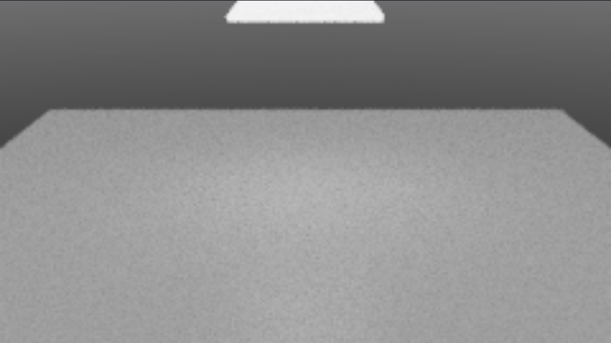

# What's new in 0.3.51

What changed since 0.3.50.2. Most of it was checked two ways: MoonLightIPR's picture set beside MoonRay's on small test scenes, and the plugin driven by scripts in a separate test copy of Modo 16.1v9. All of it was done on one machine (RTX 3090).

The GPU preview engine is called **MoonLightIPR** from this version on (it was shown as "MoonLight" in 0.3.50), echoing DreamWorks' earlier rasterizer MoonLight.

## The preview window

- **Draft** shows the scene as clean outlines on paper and renders nothing. Press **Region** and drag: only that part is rendered, by the engine you chose, among the lines. The outlines are drawn by MoonLightIPR on the graphics card, so a heavy scene costs no more than a light one, and nothing behind the nearest surface is drawn.
- **Region** is a button: press it, then drag a rectangle in the picture. Its size in pixels is shown by the pointer as you drag, and the view fits itself to the region. Press it again and the region is cleared. MoonLightIPR now renders the region alone, as MoonRay does.
- Switching Region or Draft off puts the last whole picture back and renders nothing.
- **R, G, B and A** buttons show one channel; press one again for the whole picture.
- **A colour probe** at the bottom left shows the place and the red, green and blue values under the pointer, with a small square of the colour.
- **EV** and **Gamma** each have their value beside them, and a click on the name puts it back.
- **Export AOVs as Images**, on the picture's right-click menu, saves chosen outputs of a finished MoonRay preview as PNG or OpenEXR.
- The render buffers are listed in a more useful order, starting with albedo, diffuse and glossy.
- The tick that keeps the preview following your edits is called **Live**.
- The top row's controls are one size and stand in groups; the bottom row keeps the probe, the status and the picture's details in their own places.

*Draft, with a region rendered among the lines.*

## In the MoonLightIPR preview

- **Hair** is shaded as hair, with MoonRay's hair material: its four lobes, glints, cuticle layers and saturation.
- **Skin** uses MoonRay's skin material, with light coming through thin parts.
- **Curves** are real strands, as ribbons or round tubes, with motion blur and presence.
- **Fog** in a MoonRay box or sphere, and **VDB clouds and smoke** from a file, with the light they give off. VDB volumes may overlap, and the camera or a light may stand inside one.
- **Volume bounces** in the render settings are followed, so a thick cloud brightens from inside as it does in MoonRay.
- **Rod, barn door, cookie and VDB light filters** are drawn, on MoonRay lights and on Modo lights. A rod's falloff ramp, a cookie's blur, a cookie thrown from a camera item, and a VDB filter's blur and density remap are followed.
- **Render region**: only the region is rendered, and the rest is left black.
- **Textures on every kind of light**, and distant lights that are not normalized.

How closely each matches MoonRay is in [moonlightipr/README.md](../moonlightipr/README.md).

## Closer to Modo

- **Blinn and Ashikhmin materials** match Modo's highlights from a roughness of about 0.2 up.
- **Smoothing** follows a Modo material's smoothing angle, so a box keeps its hard edges. A MoonRay material has its own Smoothing control in its properties.
- **Modo's Fur material** grows fur: its spacing, length, width, taper, bend and jitter are read, and so are its curls and waves, clumps, kink, frizz and strays. Weight maps for density, length, clumping, curling and bending are followed. Fur also grows where the material group is tied to an item rather than to a material tag. Guides, the vector map and the width map are not read yet, and a scene that uses them is told so.

*Modo's Fur material in MoonRay: curls, clumps with kink, and fur thinned by a weight map with frizz.*

- **The sun's disc** in a physical sky has Modo's colour and follows Disc In-Scatter.

## Hair

- Hair switched on with nothing else set now looks like hair: clusters are sized from the guides, and strands are thin enough to stay apart.
- Dense hair is several times faster. With 30,000 strands, a re-render that changes nothing about the hair went from about 3.5 seconds of waiting to under half a second, and growing the hair in the first place from about 12 seconds to under 3.
- The notice about hair that starts off the scalp counts guides, not strands.

## More of MoonRay

- **Bake Selected Mesh to Texture** in the MoonRay menu renders the lighting on a mesh into a picture laid out by its UVs.
- **Deep EXR**: Save a Deep EXR, under Output Renders, writes `name.deep.exr` beside a render.
- **Render settings** gain volume, hair, presence and subsurface bounces, a Volumes group, and a Noise and Filtering group (clamping, pixel filter, texture blur and more).
- **One-click outputs** gain indirect diffuse and glossy, mirror reflections, subsurface, diffuse without shadows, albedo and motion vectors.
- **Light path expressions** have presets, and an expression typed wrong is marked as you type, with what is wrong.
- **Cast no shadow onto chosen objects**: for each object, in Light Links, Emitters and Volumes.
- **OpenPBR and glTF surfaces** import from MaterialX files.
- **A BakeCamera item** can bake a Modo mesh.
- **A mesh light is seen glowing.** The mesh a MeshLight item names shows as a lit surface as well as lighting the scene, unless the item's Visible in Camera is forced off. A mesh light with no mesh chosen says so in Notices.

*A slab chosen as a mesh light, in MoonRay's live preview.*

## Working faster

- Assign a MoonRay material to **selected polygons**, with a name, type, colour and smoothing angle.
- Direction inputs of a material (shading tangent, thread direction) are **number fields**.
- **Ramps** open in the ramp editor from a material's properties.
- Large material graphs open on their output node and zoom freely.
- Dragging the sun or an environment light updates the preview when you let go.
- **Opening a large MoonRay scene** shows how far it has come.

## Known in this build

- A VDB volume that gives off light, and a light with a cookie filter, render in MoonRay's slower scalar mode. MoonRay's vector and GPU modes do not draw them rightly in this Windows build; the plugin switches for you and says so.
- Very smooth highlights (roughness under about 0.2) are dimmer than Modo's.
- Hair in MoonLightIPR is close to MoonRay's but not exact.
- Draft shows meshes and curves as the camera sees them through an ordinary lens; a fisheye or spherical camera's draft does not line up with its render.
- A MeshLight item added from Modo's own Add Item list starts at an intensity of 1, which is nearly dark. Added from MoonRay > Add MoonRay Item it starts at 50.

The rest of what is open is in the [issue tracker](https://github.com/Pbaroque20/MoonRayForModo/issues).
