# What's new in 0.4, 0.4.1 and the coming 0.4.2

## Coming in 0.4.2

Not released yet: on the MoonLightIPR branch.

0.4.2 brings a new runtime ZIP: the pixel filters, the display filters, time per pixel's finer timings and the colour fixes are in MoonRay and its display program.

- **Large MoonRay pictures the right way up**: a preview at 3840 x 2160 came out upside down in MoonRay, and now does not.
- **MoonRay lights, cameras, light filters, shapes and volumes have a Transform section** in their Properties, laid out as Modo's: Position, Rotation with its order, and Scale as X, Y and Z, with the Reset, Freeze, Zero and Add menus.
- **MoonLightIPR looks through MoonRay's own cameras** from their own place: perspective, orthographic and dome as well as fisheye and spherical. Modo's orthographic camera previews too.

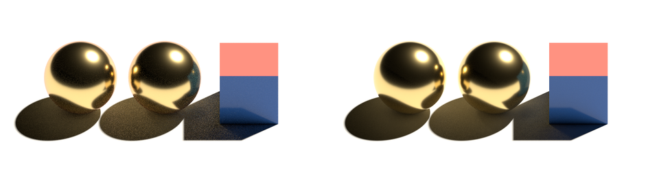

*A MoonRay orthographic camera: MoonRay (left), MoonLightIPR (right).*

- **Less memory kept over a long session**: small leaks after each render and selection are gone.
- **Gaussian, Triangle and Blackman-Harris pixel filters** in Render Settings. They are not in MoonRay's source: the plugin adds them to MoonRay, built the way its own are. They never go negative, as MoonRay's sampling needs. Box and the two B-splines are MoonRay's own.

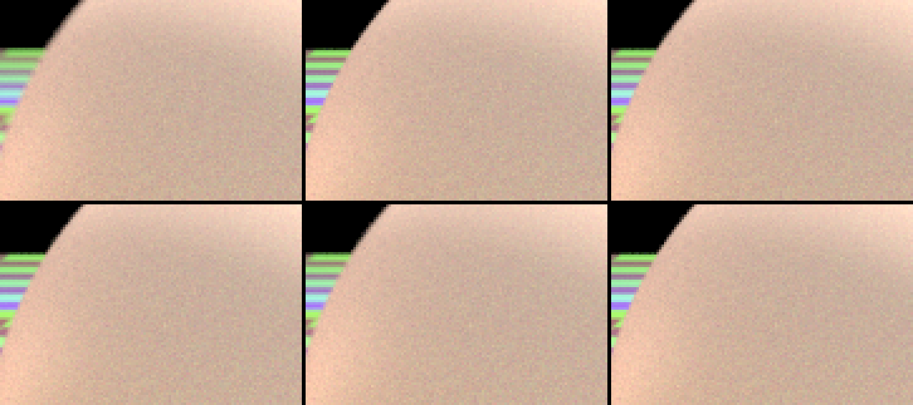

*Pixel filters at width 3. Top, from MoonRay's source: Box, Cubic B-spline, Quadratic B-spline. Bottom, added and MoonRay-compatible: Gaussian, Triangle, Blackman-Harris.*

- **MoonRay's display filters**: all 18 from MoonRay's source (colour correct, toon, halftone, blur, depth of field and the rest) as MoonRay items. Each takes in the beauty, an AOV or another filter, and is a buffer of the preview and a channel of the final EXR.

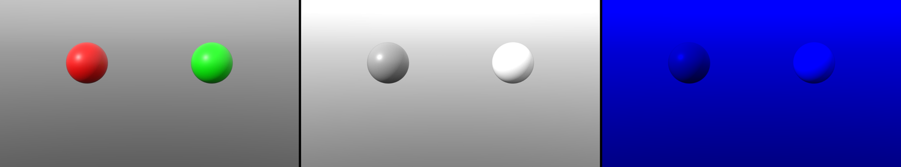

*Display filters in the preview's buffer list. Left, the beauty. Middle, a colour correct filter named Grey: no saturation, one stop up. Right, a second colour correct filter that takes Grey in and multiplies it by blue.*

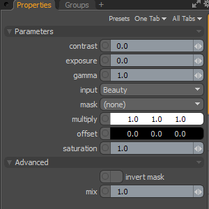

*A display filter's Properties: MoonRay's own settings, and its input picked from the render's outputs and the other filters.*

- **Switch displacement in the node editor.** The switch colour, float and normal maps, the switch and mix materials, and the toon materials' per-point ramp multipliers and offsets now reach MoonRay: they were never passed on before. Scenes saved with them are carried over.
- **MoonLightIPR draws MoonRay's hair toon material**: its hair colour under up to three toon highlights. A toon ramp that ends lit is now drawn right past its end.

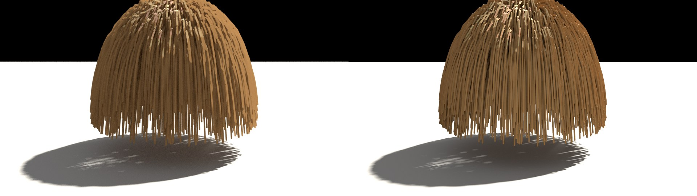

*MoonRay's hair toon material with three highlights, tinted red, green and blue: MoonRay (left), MoonLightIPR (right).*

- **Time per pixel** as an output: where the render spends its time, shown with the average pixel at a quarter of white. Its timings are now fine-grained on Windows.
- **EXR compression** for Render EXR and animations: zip, as before, or any of MoonRay's others, lossy ones included.
- **Modo's weight and colour vertex maps reach MoonRay** for its materials to read by name (AttributeMap): a value at each point, or set apart on a face's corners so that each face keeps its own. MoonRay scenes with such values import as vertex maps.
- **Primitive attribute outputs** in the Outputs window: a vertex map or other value the shapes carry, by its name, as a picture of the render, a number or a colour. MoonRay scenes with such outputs import with them.
- **Global Switches** in Render Settings: displacement, subsurface scattering and shadows on or off, lights seen by the camera, a limit to geometry resolution, and a dicing camera for adaptive tessellation.
- **Visibility outputs** in the Outputs window: how much of the light reaches each point, from every light or from one light group, 0 in shadow to 1. MoonRay scenes with such outputs import with them.
- **The graph editor's properties fold by group**: a MoonShine material's settings sit under its own groups (Diffuse, Specular, Clearcoat and the rest), each folded or unfolded with a click and kept that way for that kind of material.
- **The graph editor's MoonRay Widget is quicker**: it renders under MoonRay LS with more samples to a pixel, starts as the editor opens, and shows a material it has already rendered at once. It has one Refresh/Stop button, no bucket outlines, and the object sits higher in the picture.

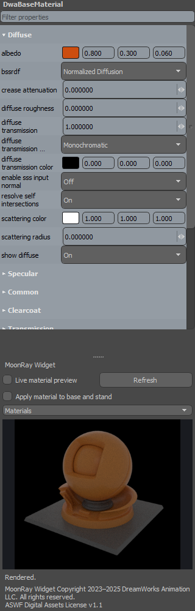

*The graph editor's right side: a material's Diffuse group open, the others folded, and the MoonRay Widget's picture of it under MoonRay LS.*

- **A MoonRay preview is always one render**, as MoonRay's own command makes it: it no longer starts over twice at 1 and 4 samples before the full render.
- **Toon materials have smooth edges on coarse meshes**: the lit band no longer comes out in steps along the faces of a low-poly or subdivided mesh, in MoonRay and in MoonLightIPR. "Smooth toon edges on coarse meshes" under MoonRay Source Overrides in Preferences, on by default; off renders as MoonRay itself does.

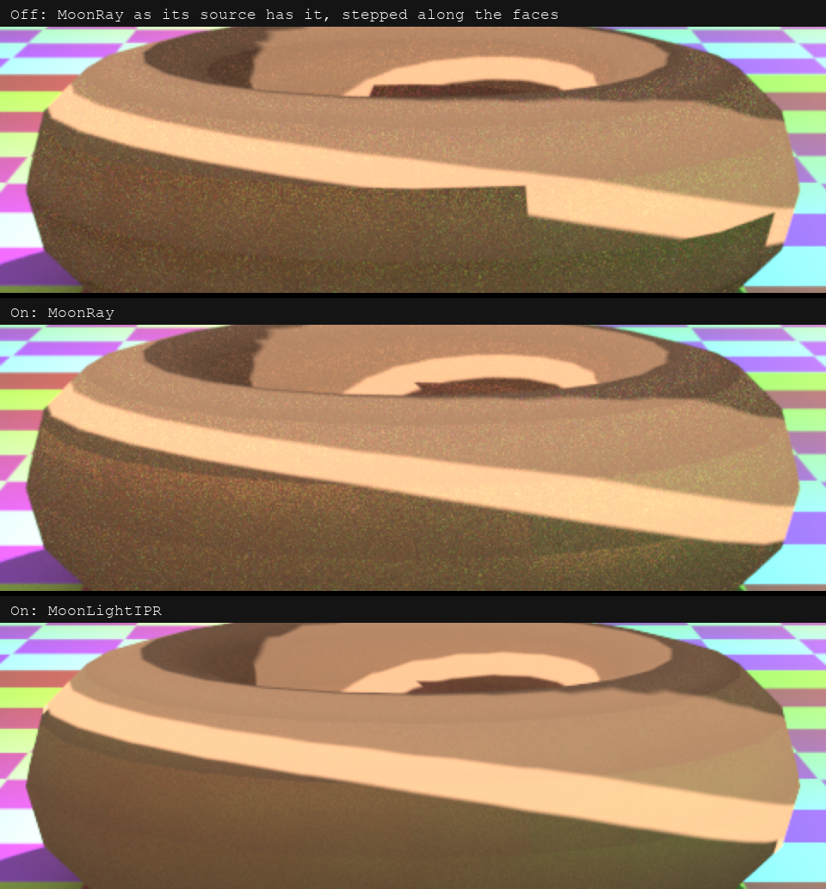

*"Smooth toon edges on coarse meshes" in MoonRay Source Overrides: a 24 × 12 torus with MoonRay's toon material. Off, as MoonRay's source has it, the lit band is stepped along the faces; on, it is smooth in MoonRay and in MoonLightIPR.*

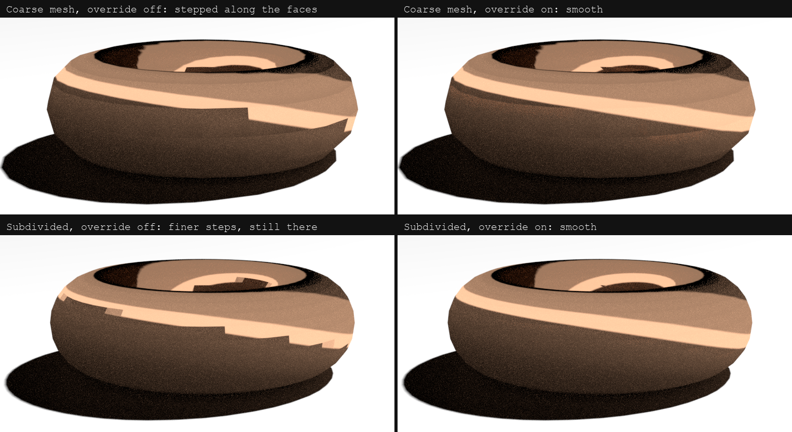

*The same in MoonRay, coarse and subdivided. Subdividing makes MoonRay's steps smaller but leaves them; with the override on, both are smooth.*

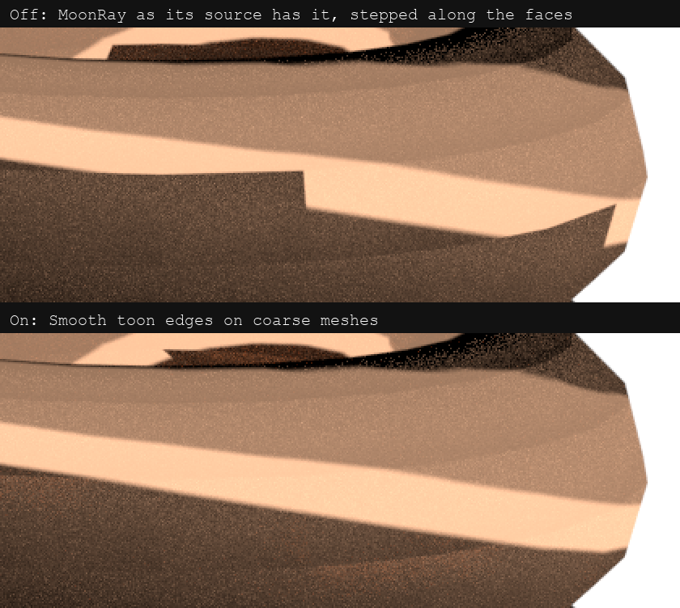

*Close up on the coarse torus.*

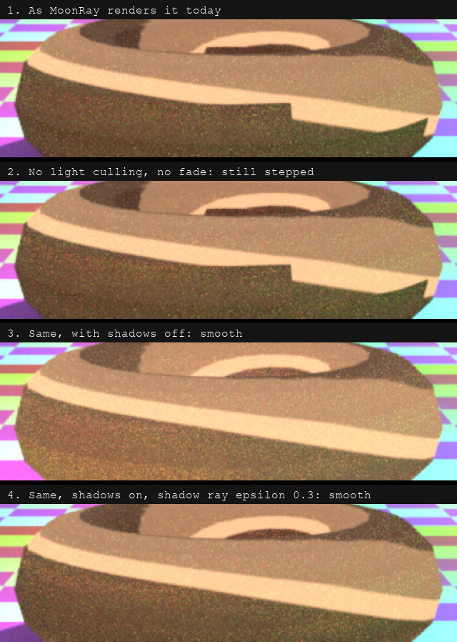

*Why it steps: a toon is lit to the very edge of its ramp, and MoonRay starts its shadow rays on the flat faces under the smooth shading, so near the edge they hit the next face. Turning off MoonRay's light culling and fade leaves the steps (2); turning off shadows (3), or starting shadow rays further out (4), removes them. The override starts a toon's shadow rays from the smooth surface instead, and lights it by its shading normal, so shadows stay on. The [engineers' notes](../patches/native-windows/README.md) give the changes file by file.*

- **Toon materials denoise cleanly**: MoonRay's albedo output, the denoiser's guide, was full of bright specks on toon surfaces, and a denoised toon stayed as noisy as it was rendered. "Denoise toon materials cleanly" under MoonRay Source Overrides, on by default.

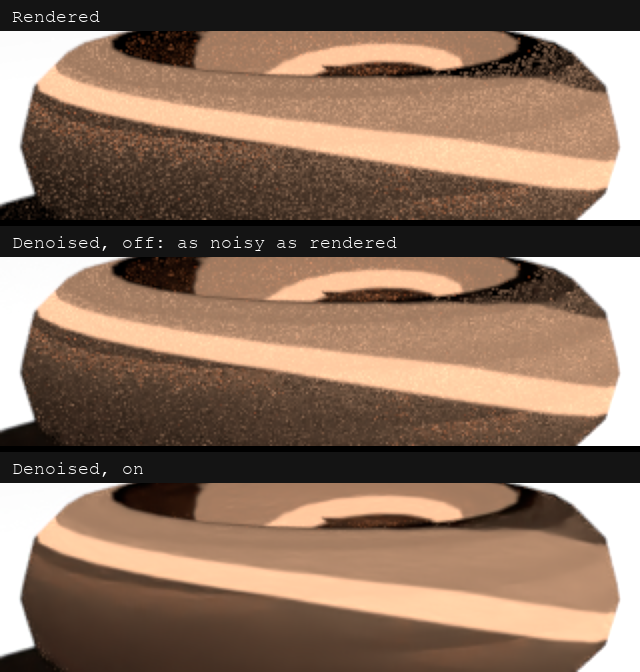

*"Denoise toon materials cleanly" in MoonRay Source Overrides: the render, then denoised with it off (as noisy as rendered) and on.*

- **A new toon material is brightest facing the light**: its diffuse ramp starts bright where the surface faces the light and darkens towards the shadow side, as Modo's toon does. MoonRay's own default runs the other way; a toon material whose ramp was never set takes the new start, and a MoonRay scene's own materials keep MoonRay's.

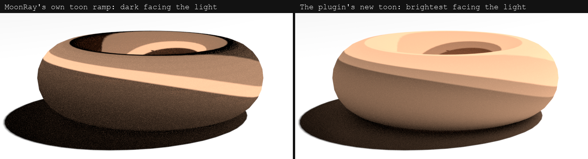

*A new toon material is brightest facing the light: MoonRay's own ramp, dark facing the light with its brightest band near the shadow side (left), and the plugin's starting ramp, brightest facing the light and darkening towards the shadow side (right). A toon material from a MoonRay scene keeps MoonRay's ramp.*

- **Motion blur in MoonLightIPR, on by default**: while the scene is followed too (an edit is shown blurred once it is let go; a drag is followed sharp), and moving lights blur, in MoonLightIPR and in MoonRay, which held them still before. MoonRay's own items (its lights and shapes) blur when they move, as Modo's do.

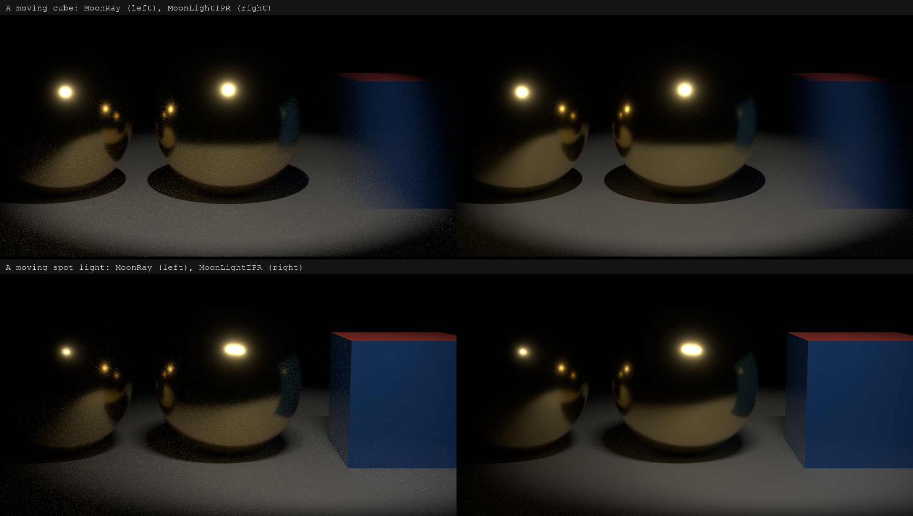

*Motion blur: a cube moving during the shutter, then a spot light moving, in MoonRay (left) and MoonLightIPR (right). A moving light blurs its highlights and the edges of its shadows.*

- **MoonRay Source Overrides**: the MoonRay page of Modo's Preferences, now named with the MoonRay release it renders with (MoonRay (2026.29.1)), gathers in a section that folds where the plugin changes how MoonRay itself renders: smooth toon edges, toon materials that denoise cleanly, blurred moving lights, fog in Cryptomatte, fog in front of see-through surfaces in alpha, each Cryptomatte sample counted once, a stopped render finishing the tiles in hand, UsdPreviewSurface's specular colour, images without alpha read as opaque, rough glass under a smooth surface, and Auto rendering on the graphics card first. Each is a checkbox of its own, on by default; off renders as MoonRay's source does. What each changes in MoonRay's source, why, and how it was checked is in the [engineers' notes](../patches/native-windows/README.md).

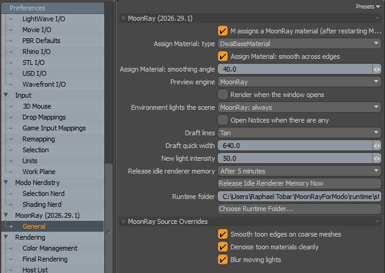

*The MoonRay page of Modo's Preferences, in sections that fold: Preview Window, Lighting, Assign Material, Renderer, and MoonRay Source Overrides, the places where the plugin changes how MoonRay itself renders, each on by default. The [engineers' notes](../patches/native-windows/README.md) say what each changes.*

- **Volume attenuation, contribution and phase attenuation factors** in Render Settings, Volumes: with Volume bounces above 1, how much less each further bounce of light in fog is stopped, adds and keeps its direction (MoonRay's defaults 0.65, 0.65 and 0.5). MoonLightIPR follows them.

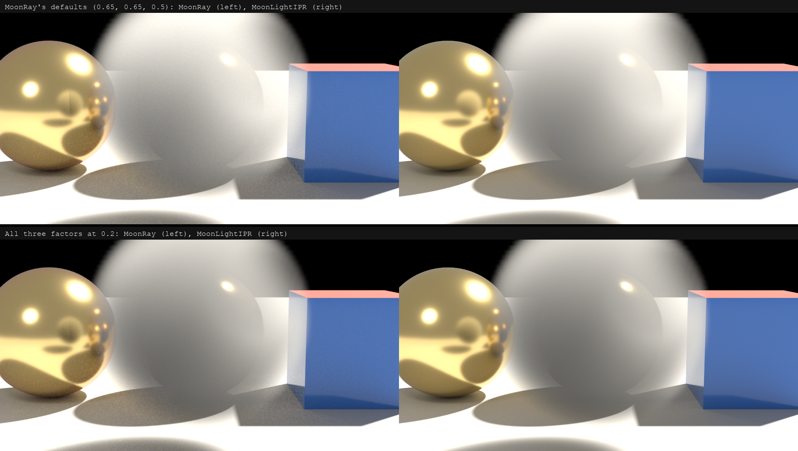

*Volume factors on a cloud at four volume bounces, MoonRay (left) and MoonLightIPR (right): MoonRay's defaults above; all three at 0.2 below, where each further bounce counts for much less and the cloud is darker.*

- **Presence quality, Cryptomatte multi-presence and Sample hair lobes separately** in Render Settings: how finely partly see-through surfaces are sampled (MoonRay's 0.75), Cryptomatte mattes that count each layer seen through a partly see-through surface, and hair that samples its lobes one by one in place of MoonRay's faster way.

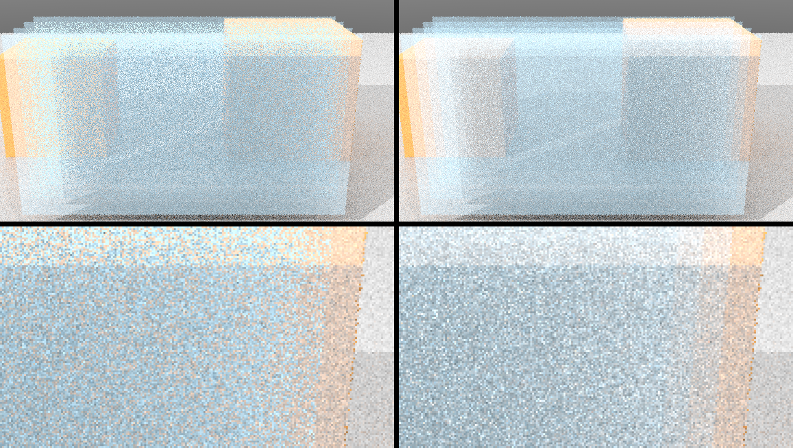

*Presence Quality: four partly see-through panes in front of the orange boxes, at 16 samples a pixel. At 0 (left) chance picks which pane a ray stops on, and the boxes behind break into orange and blue speckle (enlarged below); at 1 (right) every pane is followed and only the usual grain is left. Here 1 took two and a half times as long.*

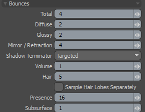

*Sample Hair Lobes Separately sits under the Hair bounces. Presence Quality and Cryptomatte Multi-Presence are further down, after Presence Shadows.*

- **Fog in Cryptomatte**: fog, smoke and clouds, from a VDB or in a MoonRay box or sphere, have mattes of their own, as strong as the fog is thick, and what lies behind fog is covered only as much as shows through. Fog also no longer stops a render with Object, Material and Asset Cryptomatte together. A MoonRay Source Override in Preferences, on by default.

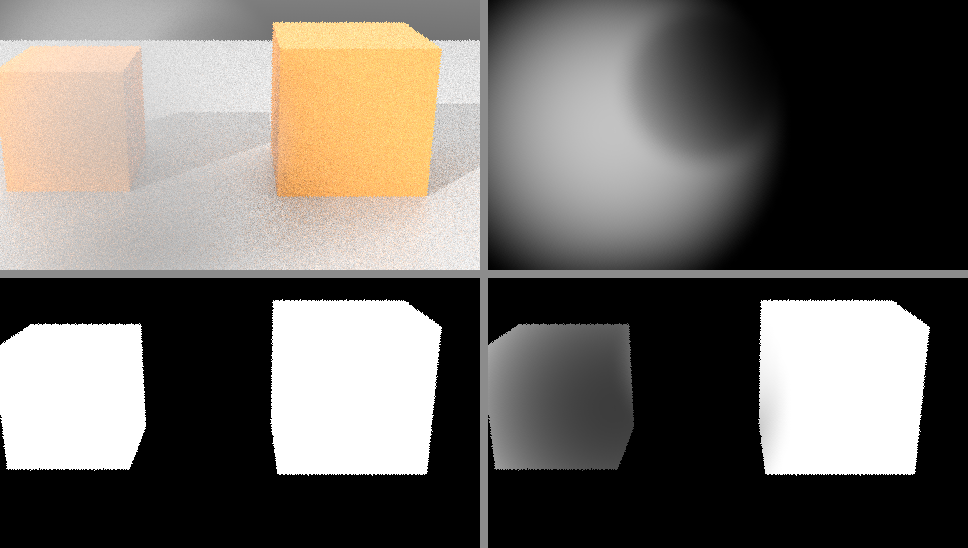

*Fog in Cryptomatte: a ball of fog with a hole in it, in front of the left box (top left). The fog's own matte (top right). The boxes' matte as MoonRay makes it, solid behind the fog (bottom left), and with fog in Cryptomatte, faded where the fog hides the box (bottom right).*

- **Two more MoonRay Source Overrides**, on by default: fog in front of a partly see-through surface counts in the picture's alpha (MoonRay leaves it out there, so the picture composites thinner than it renders), and Cryptomatte counts each sample once in vector and XPU modes (MoonRay now and then counts a pixel twice).

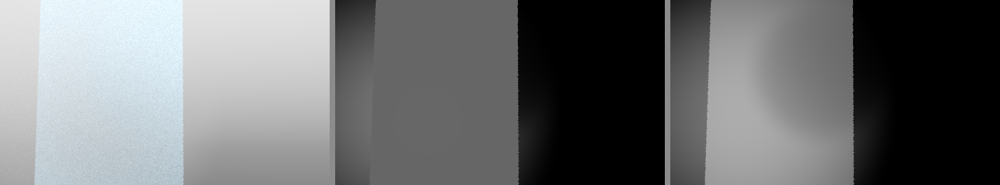

*Fog in front of see-through surfaces in alpha: a pane of presence 0.4 (the tall strip) with fog in front of it and the sky behind (left). Its alpha as MoonRay makes it: the pane alone, as if the fog were not there (middle). With the override: the fog counts in front of the pane as it does against the open sky (right).*

- **Convert a Modo camera to a MoonRay camera**: in the MoonRay menu, and in the Item List's right-click menu on a camera. A popup asks which kind (perspective, orthographic, fisheye, spherical or dome); the new camera stands where the Modo camera does, with its lens, film offset and depth of field where the kind has them.

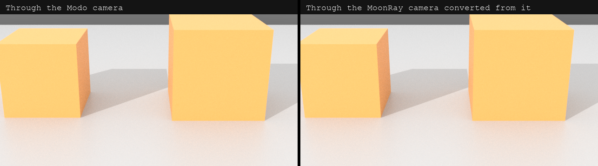

*A Modo camera converted to a MoonRay camera renders the same view in MoonRay. Both boxes are one mesh given an orange MoonRay material whole: the right one was made in it afterwards and takes the material too.*

- **Stereo cameras and overscan from Modo's camera**: a stereo render camera renders its eye in MoonRay and in MoonLightIPR; set to both eyes, Render EXR writes `_left` and `_right` files beside the one chosen, and Modo's anaglyph composite in it when one is chosen. The camera's Overscan renders that much past the frame in a render to a file, the frame kept as the EXR's display window; the preview shows the frame. MoonLightIPR now also follows a perspective camera's film offset.

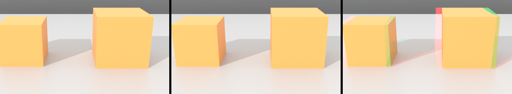

*A stereo render camera set to both eyes: the left eye, the right eye, and Modo's red/cyan composite of the two, all from one Render EXR.*

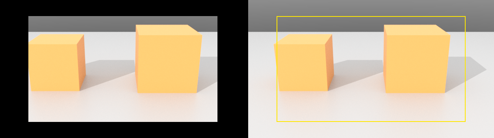

*Overscan 1.3: the frame as the preview shows it (left), and the render to a file, which goes past the frame on every side (right; the frame is outlined in yellow).*

- **Subdivision creases render**: a subdivided mesh's edge and point weights (Modo's Subdivision weight map) are MoonRay's creases, in MoonRay and MoonLightIPR; before, MoonRay rendered every subdivided mesh soft whatever its weights.

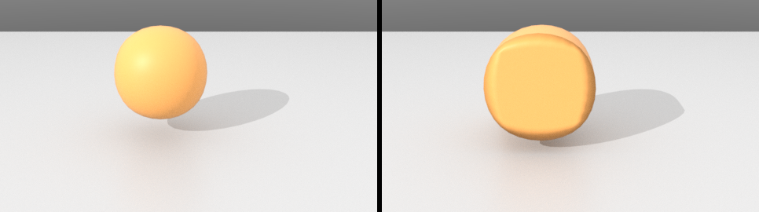

*A subdivided cube: without weights it renders as a ball (left); with four edges and one corner weighted in Modo's Subdivision map, MoonRay keeps them sharp (right).*

- **More of a MoonRay scene comes in on import**: what moves over the shutter is keyed as Modo animation at the shutter's two ends, the camera's shutter and Motion Blur set to match, copies an instancer makes included; a shape that changes over the shutter comes in as a morph keyed the same way; semi-sharp creases come in as subdivision weights; a mesh MoonRay fills with fog comes in with its volume, as a MoonRay volume item its material holds; maps wired into a MoonRay item's values (a noise in a fog's colour) come in wired; instanced curves come in, a curve set for each copy; a vector at each point comes in as a vertex map that goes back out to MoonRay as a vector; words by point or by face are kept on the mesh and go back out; a mesh given no normals comes in shaded as MoonRay shades it, smooth unless it says otherwise, where Modo would have faceted it; and an instancer of more than 20,000 copies comes in whole, the first 20,000 as Modo instances and the rest merged into meshes.
- **Velvet in MoonLightIPR**: MoonRay's velvet material and DwaBaseMaterial's fuzz show in MoonLightIPR with their grazing-angle sheen, dimming what is beneath them as MoonRay does, with their samples sent where the sheen is brightest so velvet clears up sooner; before, velvet showed as a plain stand-in.
- **MoonLightIPR fits large texture sets on the graphics card**: pictures of high dynamic range are kept at half precision, half the memory, and where a scene's textures would still not fit, each is made smaller (halved, as light, until no side is longer than the largest size at which they all fit), which the status line says. A scene that runs out of graphics card memory all the same is said to have done so, with MoonRay offered, rather than rejected.

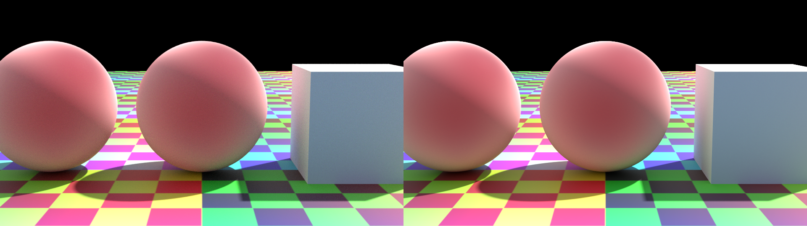

*Velvet in MoonRay (left) and MoonLightIPR (right): two balls of MoonRay's velvet material and a cube of DwaBaseMaterial with its fuzz on. The sheen is brightest where the surface turns away from the view, and softens into the shadow.*

- **Materials made of others**: Two Sided and Color Correct take the other DWA materials as their inputs. A layer, two-sided or hair layer material missing one of its pair, or an empty Adjust or Color Correct plugged into another material, no longer crashes MoonRay: the plugin fills in or leaves out what is missing and says so in the notices.
- **MoonRay preferences in sections**: the MoonRay page of Modo's Preferences is laid out in sections that fold, Preview Window, Lighting, Assign Material, Renderer and MoonRay Source Overrides, with the overrides in order of what they touch.
- **Closing a scene clears its render** from the preview window, and a render of it still going stops; closing another scene leaves the picture as it is. A render to files goes on to the end.
- **Denoising... in the status line** while the denoised beauty is made from a finished render, until it is shown.
- **More pixel samples for the realtime engines**, in the preview's Preferences: MoonLightIPR 128, 256, 512 or 1024 (32 and 64 are gone), and MoonRay LS 32, 64 or 128 (1, 4 and 16 are gone). A preview set to one that is gone takes the fewest there are now.
- **The size and samples beside the picture follow the engine chosen**: choosing MoonRay, MoonRay LS or MoonLightIPR says at once the size it renders at and its samples a pixel, before anything is rendered; a MoonLightIPR picture says its samples too.
- **Cryptomatte names and IDs**: a Cryptomatte tab on objects and on materials. Things given the same name share one matte (all of a car's parts as "car"); a number is the matte's ID itself, for a compositing setup that expects one.
- **Pick from the Cryptomatte in the preview**: over a Cryptomatte buffer the pointer says the name under it. A click selects what it is in Modo, Shift-click picks more and Ctrl-click takes one away, and the mattes picked show in orange over the picture.
- **A Cryptomatte node in the compositor**: the matte of any name or ID given in a Cryptomatte tab, chosen from a list, for a Merge's mask or a Grade of its own. It is made for the render's composite file too.
- **A mask on the compositor's colour nodes**: Grade, Levels, Contrast, Invert, Clamp, Tone Map and Math take a mask, so the change is made in full where it is white, not at all where it is black, and as much as it is grey: a Brightness Matte, a Channel or a Cryptomatte node wired in changes only part of the picture.
- **Preview Composite and Send Composite to Preview Window** in the compositor: the first shows the Composite in a viewer of its own under the settings, as the preview window shows it, following each new Composite; the second chooses the Composite buffer in the preview window. The Colour node shows its colour as a chip, clicked to choose another.
- **Add Node by name**: Tab in the compositor or the material editor opens a field over the list of every node; what you type picks the node it names, whole or in part, and Enter adds it.
- **The compositor's probe at the pointer**: with Probe on, the pointer over the preview shows each node's value there. Right-click for a note that keeps that pixel's values and follows the graph and the render.
- **Standard picture types**: Render to a File, each frame of an animation, and Export AOVs save as PNG (8 or 16-bit), JPEG, TIFF (8, 16 or 32-bit float), Targa or OpenEXR (16 or 32-bit). The picture types go through the view transform as the preview shows them; OpenEXR and 32-bit TIFF keep the render's linear values. A render saved in another type keeps its OpenEXR beside it, with every output.
- **A new Export AOVs window**: the outputs grouped as pictures, light, surface data, mattes, render statistics and denoiser guides, each group ticked as a whole or one by one; the type and JPEG quality, the folder chosen in the window, the files it will write named as you choose, and the folder opened when it is done. A Cryptomatte is offered only in OpenEXR, where its IDs survive.
- **Camera Sequence** (MoonRay menu): key cameras to ranges of frames, each the one rendered through from its first frame to its last, in the preview at the current frame, Render to a File, Render Animation and playblasts. A camera's own resolution goes with it, MoonRay's camera items can be keyed too, and frames no key covers use the render camera. A strip shows which camera covers which frames, and where keys overlap or leave gaps.
- **An image viewer in the asset library**: Open, or a double-click, shows a picture in a window of its own, zoomed with the wheel and moved by dragging, with Fit and Actual Size, and the arrow keys for the library's next picture. OpenEXR, HDR and .tx pictures are shown in sRGB from their linear values. Adding a picture to the scene stays on its Use button.
- **MoonLightIPR draws a mesh filled with even fog**, and follows MoonRay's scene scale for lights and depth of field. A box of fog standing on the floor no longer shows stripes where it meets it.

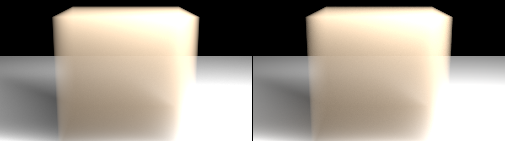

*A mesh filled with fog, imported from a MoonRay scene: MoonRay (left), MoonLightIPR (right).*

- **Terminal** in the MoonRay menu: every program the plugin runs (MoonRay, MoonLightIPR, the denoiser, the scene reader and the rest), with its command line, what it prints and how it ended, as it happens. It shows "ready" while nothing runs.

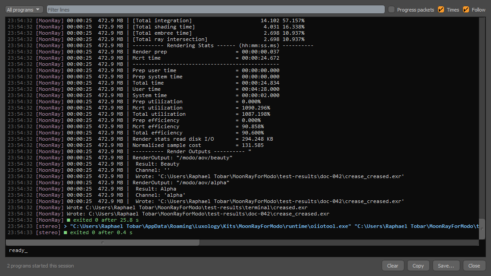

*The Terminal after a MoonRay render and a red/cyan stereo composite: each program's command, what it printed, and how it ended (green for success); "ready" while nothing runs.*

- **Assign MoonRay Material** in the Item List's right-click menu on a mesh.
- **A whole mesh's MoonRay material covers what is made in it later**: Assign MoonRay Material on one mesh binds its material to the mesh, as Modo's item masks do, so new polygons take it too. Picked polygons, or several meshes sharing one material, are still tagged.
- **Compositor: Build from passes or light groups.** Build > From Light Passes adds MoonRay's light passes to the scene (emission, lights and sky seen, direct and indirect diffuse and glossy, mirror reflection, refraction, glossy transmission, translucency) and lays out a graph that puts them back together, each through a Grade of its own; From Light Groups does the same for the environment's light and each light-group label, to relight after the render. Build asks which passes or light groups to work on, none ticked to start. A Remainder pass holds whatever the chosen ones leave out, so with every Grade left alone the Composite is the beauty. A new **Sum** node adds any number of pictures.

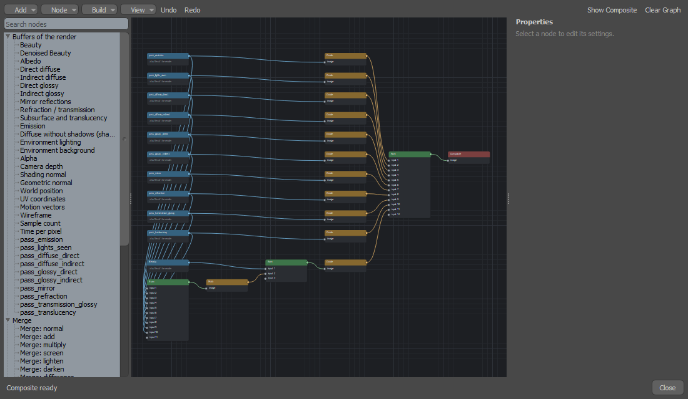

*Build > From Light Passes: each pass through a Grade into a Sum, the Remainder below them; after the render the Composite matches the beauty until a Grade is changed.*

- **The compositor runs on the graphics card**, or on the processor where there is none, giving the same picture either way; wide blurs and glows are now true full-size blurs.
- **ACEScg scenes render and look right**: MoonRay no longer refuses them, and the preview no longer shows their colours washed out.
- **The About window** has MoonRay's current logo, and names the MoonRay version the plugin is compiled from.
- **The preview shows MoonRay's wordmark** before anything is rendered.

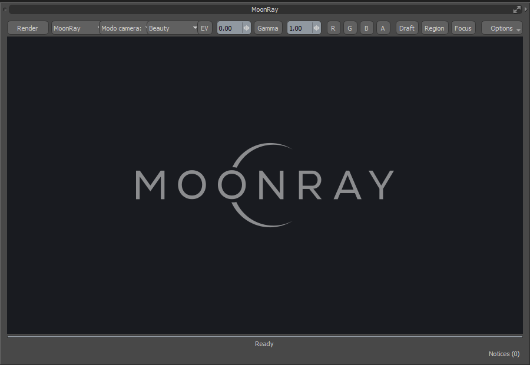

*The preview before anything is rendered.*

- **The MoonRay mark moves**: it comes in as the preview opens, breathes while a render is on its way, and fades out over the first picture.

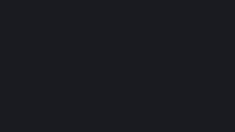

*The MoonRay mark as the preview opens: after a second the letters rise in from the left, then the crescent fades in from the right.*

## New in 0.4.1

- **MoonRay's toon material starts as a toon material**: its diffuse ramp and toon highlight are on as soon as it is added.
- **MoonLightIPR draws the toon material**, ramp and highlight.
- **Ramps are edited with the mouse**: drag a stop's handle, click the ramp to add one, double-click a handle for its color, right-click to remove it.
- **A material's ramp shows in the preview as you edit it**, with MoonLightIPR and RT On. OK keeps the change; Cancel drops it.
- **The scene importer can import into a new scene**, and has a Close button.
- **Color management follows Modo's system preferences**, and what you choose in MoonRay's render settings is remembered for new scenes and the next time Modo opens.
- **MoonRay LS shows and renders the beauty alone.**

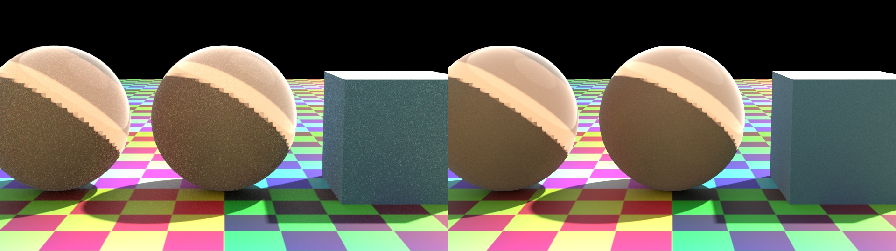

*A toon material: MoonRay (left), MoonLightIPR (right).*

0.4.1 needs its own runtime ZIP, as 0.4 did: install the kit and the runtime together.

## New in 0.4

New since 0.3.51.3. 0.4 comes with a new runtime ZIP: install it together with the kit. Items marked *(0.4 runtime)* are the ones that need it.

## The preview window

- **Three engines.** **MoonRay** renders the full picture once. **MoonRay LS** (low sample) renders a quick, smaller picture when you press Render; it is not denoised. **MoonLightIPR** is realtime: it updates after each edit.
- **RT Off / RT On.** MoonLightIPR starts switched off, so nothing renders by accident. Press the button to follow the scene; press again to stop.
- **Opens on MoonRay, with the crest**, and renders nothing until asked.
- **Each engine has its own size.** MoonRay renders at the camera's resolution; MoonRay LS and MoonLightIPR at the preview size (640 px unless changed).
- **Sampling beside the picture size.** A MoonRay render says how it was sampled, such as "Uniform 16 ps" or "Adaptive 4-12 ps" (fewest to most pixel samples).
- **Pixel samples for MoonRay LS and MoonLightIPR**, in Options > Preview Preferences: MoonLightIPR 32 to 256, MoonRay LS 1 to 64.
- **The preview follows Modo's color management by default**: the OCIO configuration and color spaces set in Modo's system preferences, as they stand now. What you choose in MoonRay's render settings is followed in their place, and is remembered for new scenes and the next time Modo opens. View Transform in the render settings chooses between that, ACES, sRGB, raw, or an OCIO display and view of your own.
- **The view transform and LUT are named at the foot of the window**, bottom right, such as "Modo: nuke-default, sRGB" or "ACES + LUT film.cube".
- **Beauty is what every engine shows by default.** Denoised Beauty is in the buffer list to choose; only Smart Render switches to it by itself.
- **Denoised Beauty just works.** Choose it in the buffer list and the picture is denoised (OptiX, or Open Image Denoise if OptiX is unavailable). No denoiser to set up first.
- **Smart Render and Safe Denoising on the picture's right-click menu.** Safe Denoising is Off, OptiX or Open Image Denoise; while it is on, the foot of the picture says Safe Denoiser. Smart Render is described under Rendering with MoonRay.
- **Dragging with realtime on is much smoother.** MoonLightIPR updates quickly after drag, taking far less of Modo's time.
- **Realtime waits while an animation plays**, then renders the frame it stops on.
- **The Notices button is coloured when there is something to read**: pastel yellow for notices, red for an error or a failed render.
- **The status names what the render is running on**, such as "XPU active (RTX 3090 + i7-4930K)" for MoonRay or "MoonLightIPR active (RTX 3090, approximate)": the first NVIDIA card and, for MoonRay, the processor.
- **Status on its own line**, so long messages are not cut off.
- **Tile outlines** are pastel blue, move evenly and fade when a tile is done *(0.4 runtime)*.
- **Titled "MoonRay"** when docked in Modo's layout; "MoonRay Preview" as its own window.
- **The MoonRay menu is regrouped**: preview, rendering to files, settings, creating, import and export, scene files.

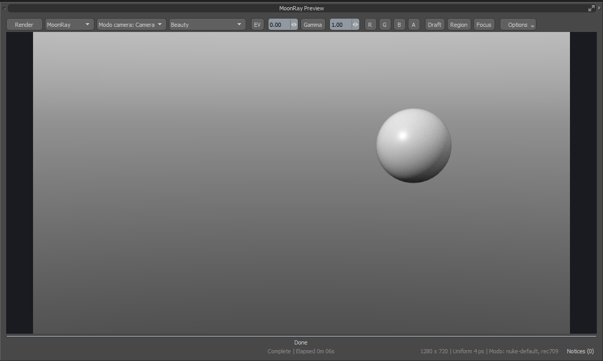

*Bottom right: the size, the sampling, and the view the picture is shown through.*

*MoonLightIPR chosen, RT On.*

## Draft

- **Much faster.** After moving the camera or an object, the lines are back in about a third of a second on a 266-mesh scene. It used to take over a second.
- **Follows the scene by itself**, with any engine: a quick picture first, then a sharp one.
- **Black outside the camera's frame.**
- **Render and RT switch Draft off** and give you the picture.
- **Nothing stale when switched off.** If the scene changed, the view is cleared instead of showing an old render.
- **Region no longer zooms the view.**
- **A region is marked, then rendered when you ask.** Drag a region and it gets a moving dotted outline; nothing renders until you press Render or RT.
- **The Region tool switches realtime off**, so marking a region never forces a render.
- **Draft and realtime are one or the other.** Choosing an engine never switches realtime on, and Draft switched on takes realtime off.

*A region marked on the Draft: press Render to render it.*

*Draft, with black outside the camera's frame.*

## MoonLightIPR Playblast

- **MoonRay > MoonLightIPR Playblast**, or Options in the preview window.
- Renders the animation on the graphics card, one PNG per frame, with its own width and samples.
- **Plays back when done**, looping, with Pause and a slider.
- Denoised if Denoised Beauty is the chosen buffer.
- A quick look, not an output: existing frames are overwritten and there is no motion blur. Use Render Animation for finals.

## The compositor

- **Options > Compositor**: a node graph over the buffers of a finished render. Nodes to add are listed on the left:
  - **Buffers** of the render, and **Merge** in seven modes, with a mix amount and an optional mask.
  - **Colour**: Grade, Levels, Contrast, Invert, Clamp, Tone Map, Math.
  - **Filters**: Blur, Glow, Sharpen, Median, Grow / Shrink, Edges, Grain, Vignette, Flip.
  - **Mattes**: Brightness Matte and Channel, to wire into a Merge's mask.
  - **Make**: a plain Colour and a Ramp.
- **The result is the Composite buffer**, always in the buffer list. Editing the graph updates it without rendering again. Chosen before a graph is built, it says to build one.
- **Saved with the scene**, with undo.
- **Render EXR and animations write `name.composite.exr`** beside the EXR.
- Not yet: compositing during a render, Cryptomatte mattes, MoonLightIPR renders.

*The nodes to add on the left, a graph of Grade, Vignette and Sharpen, and the selected node's settings.*

## Rendering with MoonRay

- **Smart Render.** MoonRay stops by itself once the picture is clean enough for the denoiser, and denoises it.
  - **Right-click the picture > Smart Render**: Off, Draft, Medium or Fine. The same setting is in the render settings under Denoising.
  - **Smart Render or Safe Denoising, not both**: switching one on switches the other off.
  - The foot of the picture shows the noise falling and where it will stop, such as "noise 5.6%, stops at 3.0%".
  - The noise is read where the detail is, so a plain floor or wall does not stop a render whose subject is still noisy.
  - Your Bucket Order is kept.

*Smart Render at Fine, 18 seconds in: the noise reads 5.6% and the render will stop at 3.0%.*

*Right-click the picture: Smart Render, with Safe Denoising below it.*

- **Keep Fine Detail**, in the render settings under Denoising: Off, Some (the default) or More. Hair, fur and other things about a pixel wide, which the denoiser smooths away, are let through from the render.
- **Fur, hair and curves have a matte of their own for the denoiser**: the surface under them is denoised, and the fibres are laid back over it as rendered.

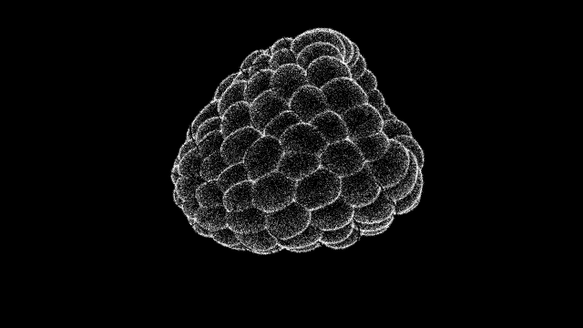

*The fur matte. Scene provided by tester.*

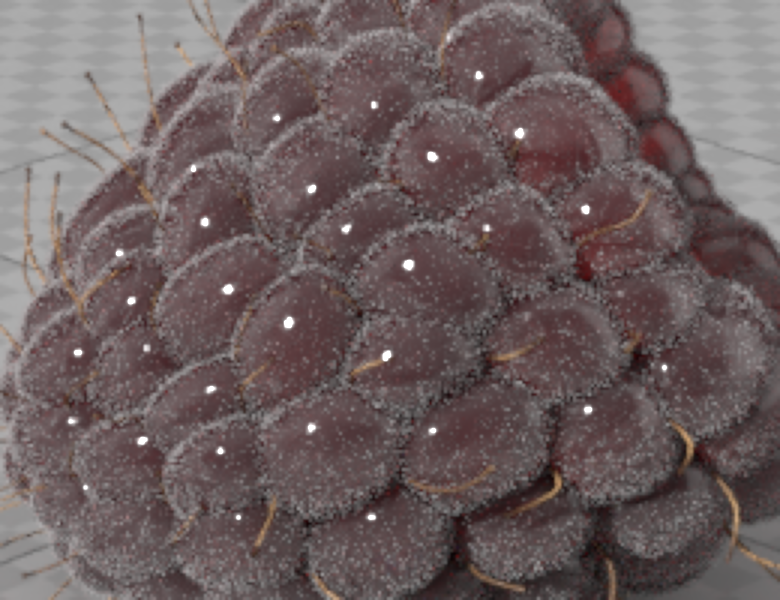

*The result: the surface denoised, the fibres as rendered. Scene provided by tester.*

- **Important Parts First** *(0.4 runtime)*. Tick it in the render settings under System: MoonRay looks over the whole picture first, then renders the buckets with the most detail before the plain ones, in the Bucket Order you chose. The finished picture is the same; you see what matters sooner. It works with or without Smart Render.

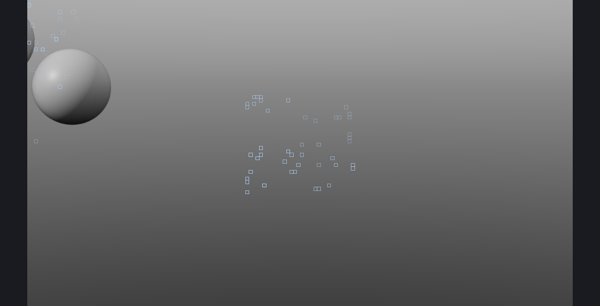

*On: the ball is finished while the plain floor waits.*

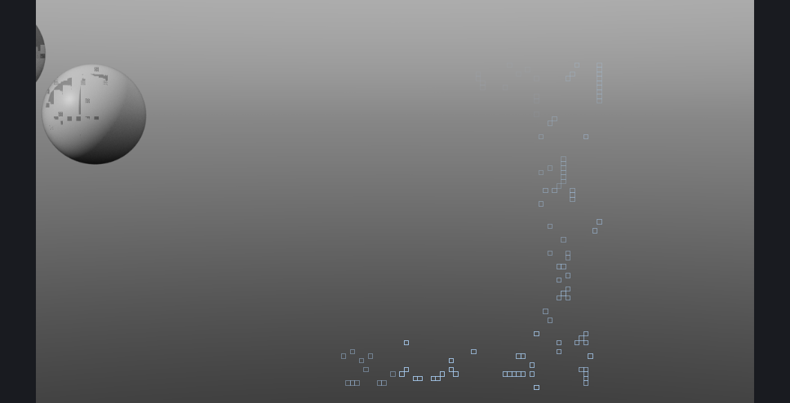

*Off, at the same moment: the ball is still rough.*

- **New sampling defaults** for new scenes: Uniform at 4 x 4 pixel samples, with uniform lights. Switched to Adaptive, it starts at 16 to 4096 samples and a target error of 10.
- **One pass, not three.** A MoonRay preview no longer renders twice quickly before the real render, starting over each time: the picture comes in once, and the render is about a third shorter.
- **A steadier time left.** One countdown for the whole render, where it used to start over with each of MoonRay's passes and jump about. With adaptive sampling a time is shown only when MoonRay's own figure can be trusted; otherwise the window says how many tiles have finished.
- **Stop keeps a whole picture.** MoonRay finishes the tiles it is working on before it stops, so nothing is left dark or blocky, and every buffer is kept, not only the beauty. It takes a few seconds *(0.4 runtime)*.

*Stopped at once, as before: the tiles in progress are left dark and patterned.*

*Stopped the new way: MoonRay finishes those tiles first.*

- **Safe Denoising shows the render as it goes**, like any other render *(0.4 runtime)*. A stop tells you how far behind the kept picture is.
- **Reduced dark blocks** in the live picture *(0.4 runtime)*.
- **An idle MoonRay uses no processor**, and closes itself if Modo goes away *(0.4 runtime)*.

*Stopped after 25 seconds: kept and denoised.*

*Stopped under Safe Denoising: the status says the picture is the last save.*

## MoonLightIPR closer to MoonRay

- **Shiny surfaces in bounced light**, **tinted glass** and **clearcoats** now match MoonRay's brightness far better.
- **Shadows of see-through surfaces** follow the scene's Presence Shadows setting.
- **Subsurface on small, thin and backlit shapes matches MoonRay.** Light is now looked for across the surface and through the solid as MoonRay does, and small shapes keep their light. On test scenes the share of the picture within 10% of MoonRay went from 68-75% to 91-94%.

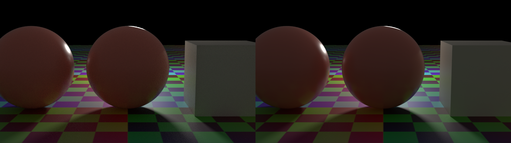

*Lit from behind, before: MoonRay (left), MoonLightIPR (right).*

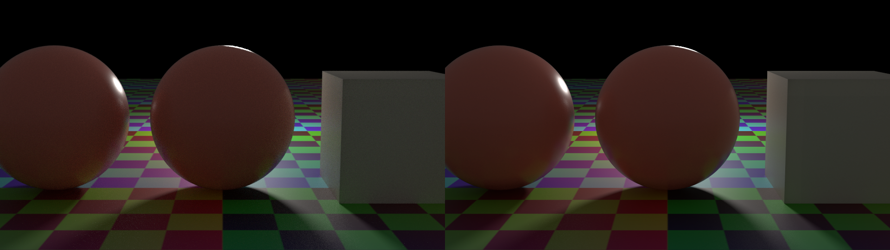

*After.*

- **Random walk subsurface is a real random walk.** It used to be drawn with the default model, which came out darker and less translucent than MoonRay. It now has MoonRay's look, and is about 9% brighter than MoonRay.

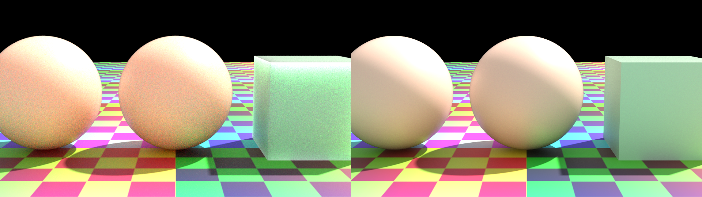

*Before: MoonRay (left), MoonLightIPR (right).*

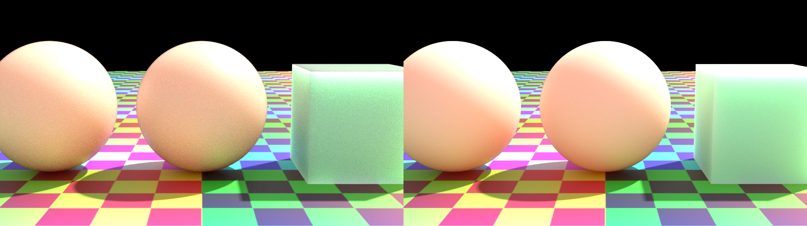

*After.*

- **Sample Clamp** settings are followed.
- **Blinn, Ashikhmin and GTR roughness** are drawn as MoonRay draws them.
- **Draft outlines line up** under fisheye and spherical cameras.

## Closer to Modo's look

- **Rough Principled materials are no longer dark at low angles**, such as a floor running to the horizon.
- **Image-driven roughness** keeps the right highlight strength on Blinn, Ashikhmin and GTR materials.
- **An image layer's Low Value and High Value are followed**, in MoonRay and MoonLightIPR. They used to be ignored.
- **Cellular, Wood, Weave and Ripples layers render**, in MoonRay and MoonLightIPR, with their Value 1 / Value 2 (or colours), bias and gain. They are flat patterns after Modo's, not Modo's own.
- **A procedural layer left on Solid projection renders**, laid on as Cubic. Notices says so.

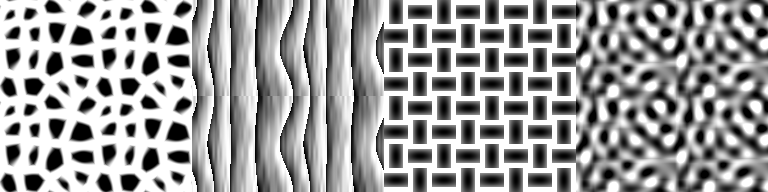

*Cellular, Wood, Weave and Ripples at their default settings.*

- **A texture layer under the Render item shows on polygons with no material set.** MoonRay left it out.
- **Bump and normal images show on subdivision surfaces in MoonRay** *(0.4 runtime)*. They were left out, so MoonRay rendered such a surface smooth where MoonLightIPR showed the bump. A heavily tiled bump image is also read finely enough to show.
- **Modo fur without a limit** *(0.4 runtime)*. Every fibre Modo would grow is grown, each as thick as the Fur material says; the 60,000-fibre limit and the widening are gone. A test scene with 1.26 million fibres was read in about nine seconds.
- **A Fur material's Remove Base Surface is followed**: the fur renders without the surface it grows from.
- **Notices says when a Fur material grows nothing**, which is usually a mesh that is hidden or set to Render: Off.

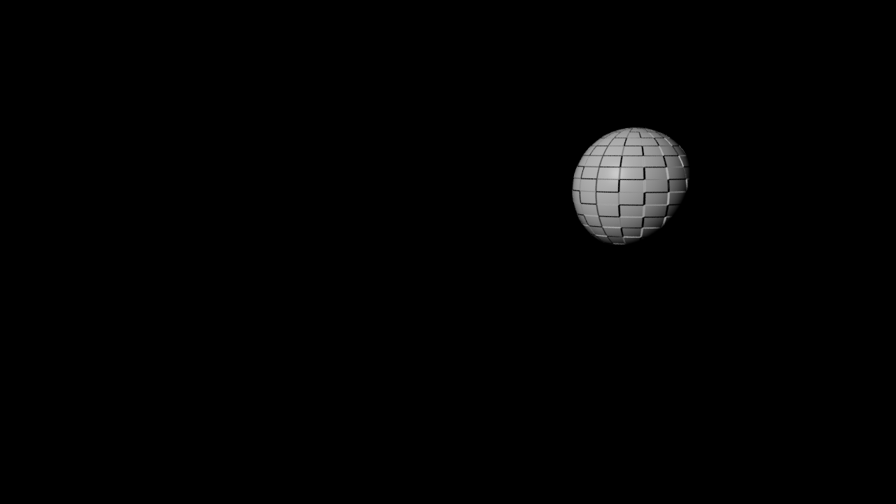

*A chequered bump image on a subdivision surface, in MoonRay.*

## Visibility

- **An item with its eye off does not render.** Render: Yes or No still overrides.
- **The environment lights the scene** whether or not Modo's Global Illumination is on. With every light hidden, Notices says the scene is lit by the environment.
- **A physical sky goes dark when its sun is hidden.** Notices says so.
- **Or have it follow Modo**: in System > Preferences > MoonRay, set Environment lights the scene to Follow Modo, and it lights the scene only with Global Illumination on.

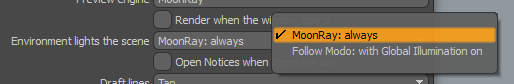

*System > Preferences > MoonRay: Environment lights the scene.*

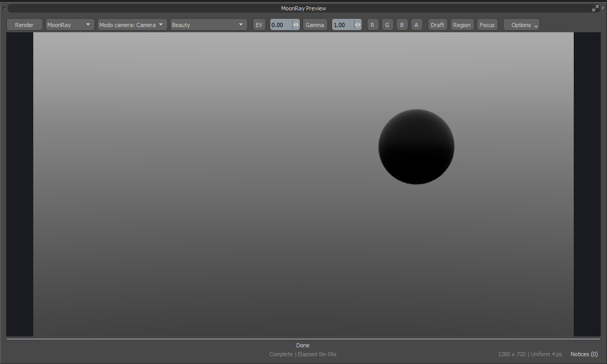

*Follow Modo, Global Illumination off, the light's eye off: the backdrop shows and the ball is unlit.*

- **MoonLightIPR follows per-ray visibility**: camera, indirect light, reflections, refractions and shadows.
- **A light whose light material has its eye off in the Shader Tree gives no light**, as in Modo. Notices names it.
- **A Shader's Cast Shadows switch is followed.**

*The second cube has its eye off and the third is Render: No. The fourth has its eye off but Render: Yes.*

*Shadow-only objects: MoonRay (left), MoonLightIPR (right).*

## Importing MoonRay scenes

- **File > Open reads MoonRay scenes.** Choose an `.rdla` or `.rdlb` file in Modo's own Open (or Import) and the importer brings it in, showing how far it has come. Modo adds one empty mesh to a scene opened this way.
- **Large scenes render.** The bedroom example scene (1.5 million polygons) stopped with "Scene text exceeds the 256 MB shared-scene limit"; a scene of any size is now handed to MoonRay.

*The bedroom example scene, part way through its render.*

- **Imported lights are no longer far too bright.** Lights left at MoonRay's defaults came in fifty times brighter (seen on the Veach scenes in the asset library). Re-import scenes brought in before this fix.

## Known gaps

What you may run into:

- **Time left:** an adaptive render often shows no time-left figure, only how many tiles have finished.
- **MoonLightIPR** updates after you let go of a drag, not while you drag.
- **Smart Render** and **Important Parts First** work on MoonRay renders in the preview window, not Render EXR, animations or MoonRay LS.
- **Smart Render:** a picture full of fine texture may not read as clean and then renders to its end.
- **Stop** takes a few seconds, since MoonRay finishes its tiles first.
- **Safe Denoising:** a small dark tile can still flash in the live picture now and then.
- **Compositor:** no matte from a Cryptomatte, no transform or crop, and it does not run while a render is going.
- **Playblast:** PNG frames only, no movie file and no motion blur.
- **File > Open** of a MoonRay scene leaves one empty mesh in it and keeps the `.rdla` file's name.
- **Heavy scenes with instances, replicators or deformers** update more slowly when an item is moved.
- **Procedural layers** are flat patterns laid on by UV or from six sides, not solid textures running through the object.
- **Smoothing angle:** a mesh of more than 300,000 polygons is smoothed all over, and Notices names it. (The limit was 50,000.)
- **Highlights:** very smooth ones, and rough Principled ones, are still dimmer than Modo's.
- **Hair in MoonLightIPR** is close to MoonRay's, a little brighter at the top of a tuft.

What has and has not been tested is on the [issue tracker](https://github.com/Pbaroque20/MoonRayForModo/issues). Tested on one machine (RTX 3090).

How things were measured is in the [MoonLightIPR notes](../moonlightipr/README.md) and the project history.
