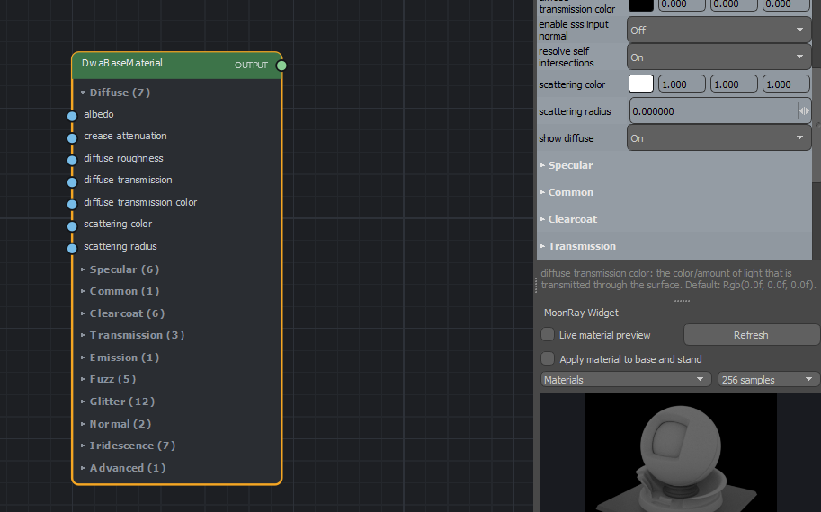
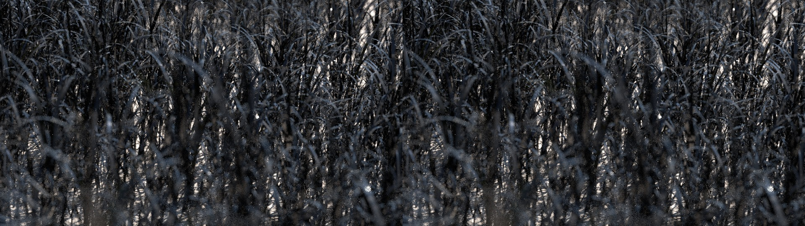
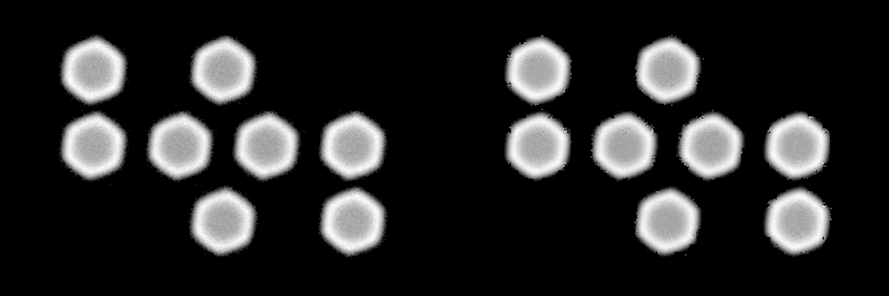
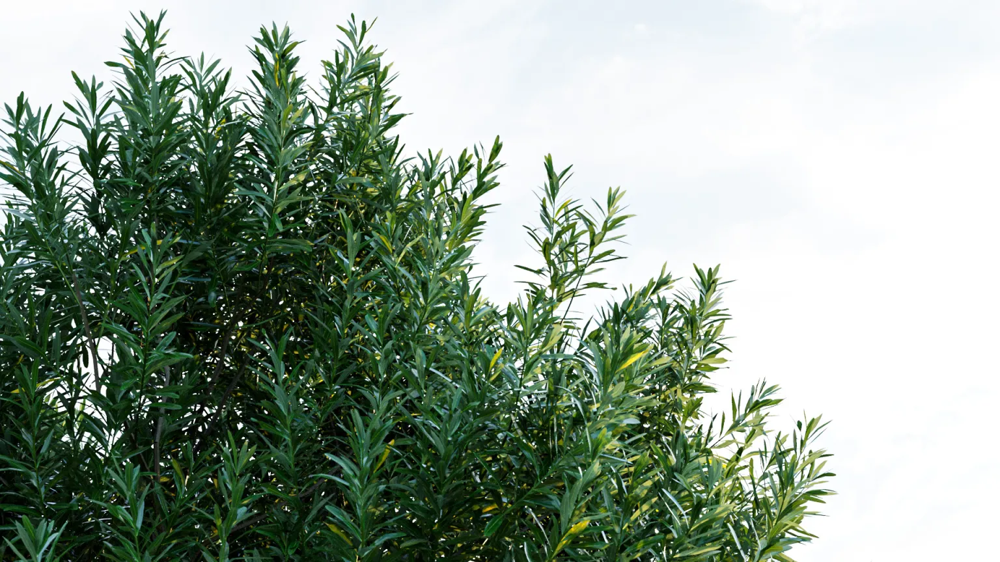

# What's new in 0.5

0.5 is a **pre-production release**: the plugin is no longer experimental, and it brings a new GPU renderer, MoonRay XPU2.

## Coming in 0.5.2.3

The next hotfix, with a new XPU2 runtime (runtime-xpu2): install it, and **Compile XPU2 Shaders once more**.

- **Look-dev is lighter on Modo**: a change in the graph editor is a material's edit, not a reading of the whole scene with its meshes; values stepping in the graph editor are written at most every 150 ms; the Shader Tree is walked once for a reading, not once for each material; and the check of the scene's texture files runs beside Modo, not on its thread once a second.
- **Hidden meshes' materials are left alone**: a material worn only by hidden meshes is not read at each edit of another, and its images are not made ready for rendering.
- **Low Value, High Value and the texture corrections change without a reload**: gamma, brightness, contrast and Low and High Value are the same nodes whatever their values, so a change is a value MoonRay's session takes as it is, where moving one to or from its default loaded the whole scene again (twenty seconds on a heavy one).
- **An input wired in the graph editor is locked in Properties**: it is greyed there, and setting it can no longer cut the wire.
- **A material node's inputs in folding groups**: Diffuse, Specular, Clearcoat, Fuzz, Glitter and the rest, as Properties has them; click a group to open or fold it; connected inputs always show.

  

- **A material's lists come up quicker**: the Properties panel reads each material once for all of its controls (a DwaBaseMaterial's refresh 60 ms to 15 ms), and the graph editor's property table makes the fields of a folded group only when it is opened or searched into (0.9 s to 0.3 s).
- **Switching networks in the graph editor keeps the window**: choosing another material in its list closed the editor altogether when it had been opened from another one.
- **Remove Network**: Graph > Remove Network removes another material's whole node network, offered only while the scene has more than one and never the one open; right-click a node > Remove Network removes the loose network it belongs to, beside the material's own. Each asks first, and undoes.
- **A cookie light filter renders in XPU2**: XPU2 draws it as MoonRay's scalar mode does, so a light with a cookie no longer sends the whole render to scalar mode. Should XPU2 hand the scene back, MoonRay renders it in scalar, as MoonRay's vector and XPU modes leave the picture blank.
- **XPU2 needs a third of the texture memory**: float textures are held in half floats (each value within 1/2048 of itself; a tile with a value past their range, such as a sun, stays in floats), grey images in one channel (the kit makes them so, and converts textures again once), a tile of one colour as that colour alone, and the graphics card's texture cache gives each texture slots of its own size. A grass scene with 8K ground maps went from 4 GB of textures on the card to 1.4 GB, out of texture overflow mode, with the same picture. Set `XPU2_SESSION_FLOAT_TEXTURES=1` to keep floats.
- **XPU2 holds less of the graphics card**: the queue for samples waiting on texture tiles is made only where a frame can use it, the subsurface stack only where a material scatters under its surface (any DwaBase material kept it, some 3.5 GB of a 24 GB card), and the texture cache grows as tiles are read. A scene with grass peaked at 9.7 GB rather than 10.9 GB, 8.7 GB without subsurface, with the same picture.

  

- **A sliver triangle no longer sends an XPU2 frame to MoonRay**: a hit on a triangle too thin for its normal in single precision failed the sample, and with it the whole frame. The grass scene fell back to MoonRay every time on the processor alone and now and then with the graphics card. The normal is worked out again in double precision, else facing the ray. A fallback now names the sample that failed (its status and pixel); `XPU2_SESSION_DEBUG_FAILURES=1` says why.
- **A bokeh image turns bokeh on**: with the switch to use the Modo camera's lens on, choosing a bokeh image on a dw camera uses it whatever Modo's iris blades say. The dw camera's fields that Modo's camera drives (focal length, film, offsets, depth of field, blades, stereo, shutter) are greyed while the switch is on.

  

## New in 0.5.2.2

A hotfix to 0.5.2.1, to the kit alone: the runtime of 0.5.2.1 stays.

- **Smart Render and Safe Denoising follow the renderer chosen**: switching Preferences > MoonRay > XPU2 to MoonRay XPU makes them editable in the Render item at once, and they work in Vector and Scalar mode whichever renderer is chosen. Smart Render chosen from the picture's menu with the Denoiser off sets one, OptiX with an NVIDIA graphics card and Open Image Denoise without, and the foot of the picture says when Smart Render is not applied.
- **Render over a draft renders at the first press**: pressed while Draft is still drawing its lines, it stopped the draft and had to be pressed again; now the draft stops and the region renders, with MoonRay XPU and XPU2.

## New in 0.5.2.1

A hotfix to 0.5.2, with a new runtime ZIP: install both, and **Compile XPU2 Shaders once more**.

- **XPU2 needs about half the graphics card's memory**: a simple scene went from about 11 GB to 4.5 GB, at the same speed and
  with the same picture, so XPU2 runs on smaller graphics cards. A leafy scene that filled 32 GB of graphics memory and
  crashed now renders in 20 GB.

  

- **Moving subdivision surfaces render in XPU2**: a moving mesh with adaptive subdivision, and copies of a subdivision mesh
  that changes shape during the shutter, no longer send the scene to MoonRay XPU, nor does a still mesh taken for a moving one.
- **Playblasts render flat out**: each frame gathers all its samples as fast as the graphics card can, without the 8 seconds a preview spreads a render over, and previews keep that pacing for drags.
- **dw Perspective and Orthographic cameras use the Modo camera's lens**: focal length, film, offsets, depth of field, F-stop, focus distance, iris blades, stereo eye and shutter are edited in the camera's own Camera and Camera Effects tabs. The switch heads the dwPerspectiveCamera tab; turn it off to use the MoonRay values there, as scenes from before do.
- **Saved pictures keep their alpha**: with Alpha among the render's outputs, Save Image and Export AOVs save the Beauty and the Denoised Beauty with it, as PNG, TIFF, Targa or OpenEXR. Export AOVs can also save every output ticked as one multilayer OpenEXR, and a group's own checkbox (Pictures, Light and the rest) ticks and unticks what is under it.
- **MoonRay starts whatever is in the Windows PATH**: with a file in it, such as `cmd.exe`, every preview and scene load stopped with "directory iterator cannot open directory: Not a directory". The kit now hands MoonRay only PATH's folders, and MoonRay's own look passes over such entries (Start with any PATH, among the Source Overrides).

## New in 0.5.2

A hotfix to 0.5.1, with a new runtime ZIP: install both, and **Compile XPU2 Shaders once more**.

- **XPU2 renders Modo's procedural textures worked out through the object**, Enhance: Modo's patterns among them, with the patterns MoonRay and MoonLightIPR share. Such a scene used to go to MoonRay XPU.
- **Scenes with Modo's fur render in XPU2**: they stopped with "No Attribute named 'vertex_list_1'" and went to MoonRay XPU.
- **Render Animation renders with XPU2** where XPU2 is chosen, and so does Render to a File, with each picture shown in the
  preview as it comes. Deep images and checkpoints stay with MoonRay. Under MoonRay XPU, each frame appears as it finishes.
- **Render with MoonRay has motion blur**: Motion Blur in Render Settings, or on the Modo camera, now applies to the Render button,
  so a still no longer needs Render Animation.
- **Motion blur in MoonRay XPU2 realtime** is a Preview Preference, off by default. Updates stay sharp while you drag, and the wait
  is longer once something moves during the shutter.
- **The Render Animation window opens with the scene's settings**: its frames, step, frame rate and Motion Blur, and it keeps
  what you last rendered with, in the scene.
- **Alpha reaches every file that can hold it**: a denoised EXR, and a PNG, TIFF or Targa saved from a render, now have the render's
  alpha while Alpha is on in Render Settings. Where the alpha is 0, as on a visible background, those pictures are transparent.
- **Realtime Sample % starts at 30%**, so realtime settles sooner. A value you set is saved with the scene, and a scene that already has one keeps it.
- **The graph editor's marquee starts at once**: it draws from the first pixel, and the property list fills when you let go, so clicking and marquee selecting no longer pause.
- **Playblasts show motion blur**: when Motion Blur is on in the scene or its camera, or in MoonLightIPR's Preview Preferences.
- **Hues and angles have a slider in the graph editor**: hue shift, rotation and the other values that go round a circle, beside their number.
- **The Toon filter's form** has Close Line Gaps, which it was missing, and its later controls change the right settings again.
- **Sliders in the compositor**: Blur, Glow, Sharpen and Median radius and Vignette have a slider beside their number.
- **Bokeh settings say what they do**: the two bokeh weight settings, which MoonRay does not use, are marked as having no effect, and Modo's Edge Weighting gets a notice.
- **A clearer notice for a texture with nowhere to go**: it names the material and the effect, and says where to move the texture.
- **A round light says when it stays round**: an uneven scale on a dwDiskLight, or another round MoonRay light, is averaged, and a notice now says so. dwRectLight has Width and Height.
- **Notices name more of what is left out**: Modo's other material kinds, Principled sheen, shadow distances and fog in MoonLightIPR, and weight maps in scenes with replicators or some masks. A group mask set to Normal Multiply no longer stops a scene reading; it is drawn as Normal.
- **Frames as JPEG, PNG, TIFF or Targa alone**: Render Animation can save just those, with no EXR left beside them. Those frames are denoised when the render is.
- **Denoised and composite frames keep their number last**: `frame.denoised.0001.exr` and `frame.composite.0001.exr`, so other programs read them as sequences.
- **Frame digits**: choose how many digits frame numbers have, so 4 gives `frame.0001.exr`.
- **Several sequences in one folder**, each under its own file prefix.
- **RT and Render come back after an output render**, with no need to switch engine and back.
- **XPU2 no longer stalls on a second motion-blurred picture**: from the second frame in a session, a scene with motion blur or a
  volume only the CPU renders waited for good.
- **XPU2 renders moving objects on the GPU**: moving meshes, subdivision surfaces, instances, curves, fog and any number of moving
  lights, and points whether moving or still, no longer send their samples, or the whole scene, to the CPU. Test scenes finished
  about 2.6 to 8.5 times sooner; a scene with nothing moving takes about 2 to 3% longer.
- **Fog no longer goes missing from XPU2's CPU samples**: a volume on a mesh with no material of its own was left out of what the
  CPU renders, which could thin it where the CPU and GPU render together.
- **MoonRay cameras no longer render black up close**: a dwPerspectiveCamera or another MoonRay camera kept MoonRay's near clip of 1 m,
  so within a metre of a surface it looked at the surface's dark inside. It now sees as near as a Modo camera, unless you set Near yourself.
  A new MoonRay camera also starts where the render camera stands, not at the origin, inside whatever stands there.
- **Soft edges no longer flare in PNG, TIFF and Targa**: with alpha and a visible environment, soft edges such as motion blur came
  out too bright, because the environment was divided by the alpha along with the surface. Measured on motion blur. It is now taken out first. Needs the new runtime.
- **The Environment background output has its picture**: MoonRay lost a light seen past every surface from light outputs, so this output was black.
  Lights seen by the camera in light outputs, in MoonRay Source Overrides, is on by default. EXRs with alpha now hold this channel too.
- **Round lights under an unevenly scaled parent stay on**: a disk, sphere, spot or cylinder light there now renders round, at the mean of
  its scales, in every engine. MoonRay would have switched it off, and XPU2 refused the scene.

## New in 0.5.1

A hotfix to 0.5, with a new runtime ZIP: install both, and **Compile XPU2 Shaders once more**.

- **Realtime Sample %** in the preview's preferences as well as Render Settings, its new name.
- **The About window gives a build number** after the version.
- **Automatic Presence Shadows** (Preferences > MoonRay > Renderer, off unless chosen): a label or other surface cut out
  by a Stencil layer or a map in its presence no longer shades what lies under its cut-out parts. Off where nothing is cut
  out, which is quicker. While it is on, Presence Shadows in Render Settings and on lights are greyed.
- **Samples for the material widget**: 32, 64, 128 or 256 in the graph editor, for a cleaner picture of the material.
- **Graph editor presets**: the Presets menu saves the selected nodes or a whole network, to load into any material.
- **A Car paint material in the library**: a dark metal with a sharp clearcoat and fine flakes, to start a metallic paint from.
- **Multi-part EXRs** (Render settings > Output Renders > Multi-Part EXR): each output in a part of its own, for a compositor to read one at a time.
- **EXR channels by standard names**: the beauty's alpha is `A`, so it comes in as the beauty's alpha, and depth is `depth.Z`.
- **A graph's new output reaches Modo's form**: changing a material's output shows the new material's form, selected and ready to edit, and the new output starts on its own colour.
- **Glitter no longer turns a material pink**, turned on or off again, in MoonRay, MoonRay XPU and XPU2.
- **MoonLightIPR follows a material's chosen subsurface model**: a Random Walk material rendered as Normalized Diffusion there, which could leave a dark brown patch where one part of a mesh passes close over another.
- **MoonLightIPR's subsurface colour is much closer to MoonRay's**: diffuse transmission now changes the colour light scatters by, as in MoonRay, rather than only dimming the result; a path scatters only as often as Subsurface per path allows; and a random walk also starts from the inside of a surface.
- **Glitter's flakes start at 3 centimetres**, not MoonRay's default of 1, which is a metre across in Modo's scenes and covered a surface in shards. A size you set is kept, and so is a scene imported from MoonRay.
- **The graph editor's colour numbers and swatches match Modo's form**: both show sRGB for the same stored colour.
- **The graph editor's Samples field shows its whole text.**
- **A MoonRay material's colour and Modo's diffuse follow each other**, under Traditional and Principled, so the viewport
  shows the material's colour. A new material starts on its diffuse.
- **Weight Map Texture layers render**, in MoonRay, XPU2 and MoonLightIPR, with their Low, High, Bias and Gain, matching Modo's own render:
  a weight map in the Shader Tree can drive a material's colour, reflections, roughness and more.
- **Toon lines come out whole**: no more broken gap showing the surface down the middle of a line. A MoonRay Source Override,
  on by default.
- **The Toon filter's Output Mode works under XPU2**, for its Lines and Shading passes: it always gave the shading with its
  lines.
- **A missing normal map texture leaves the surface flat**, where it darkened and streaked the surface's reflections in MoonRay.
- **Gradient and Curvature layers no longer stop halfway**: MoonRay kept only the first half of a gradient, holding its
  last colour from there on.
- **A scene XPU2 hands to MoonRay XPU keeps its geometry.** Its meshes could come out empty, leaving a white picture or
  none of the scene's objects.
- **Texture overflow mode:** where a scene runs out of memory as it loads, on the computer or the graphics card, XPU2
  compresses its textures, then makes them smaller if it still does not fit, and a notice in the preview says how far.
- **XPU2's Render gives the samples you set.** On a scene with heavy textures it could stop at about two thirds of them, its
  progress sitting at 100% for half the render. Progress now climbs steadily to the end. Such a scene takes longer than it
  did, with a cleaner picture: lower Generation Samples for the old speed.
- **A texture that cannot be read no longer ends XPU2 with no reason given.** The Terminal names the file, and MoonRay XPU
  renders the preview instead.
- **Compile XPU2 Shaders says whether the shaders are up to date**, or why they are out of date, where it only said they
  were compiled.
- **An environment image not yet cached no longer stops the render** with a "file not found" error.
- **The MoonRay Terminal reports XPU2's texture memory**: what the textures take in RAM and on the graphics card.
- **XPU2 takes Gaussian, Triangle and Blackman-Harris pixel filters**, and Material Samples of any count. Subsurface
  Samples above 4 render too, at 4 x 4 a hit: raise Pixel Samples for less noise.
- **Realtime on a heavy scene:** after a mesh's detail is cut anew the picture comes back in under a second, not several.
  A scene with much displacement or subdivision shows a first picture in seconds, and follows the camera while its full
  geometry is made.
- **Subdivided meshes no longer stretch textures in MoonLightIPR**: texture coordinates follow the smoothed surface.

## MoonRay XPU2

**XPU2** is a new way of rendering MoonRay previews: the processor and the graphics card work on the same picture at
once, each taking its own share, neither waiting for the other. Its pictures settle to MoonRay's own.

*XPU2: Asynchronous Monte Carlo Path Tracer designed by Raphael Tobar. Not affiliated with or endorsed by DreamWorks
Animation.*

- **The default GPU renderer.** Where MoonRay would render the preview on the graphics card, XPU2 does. To go back to
  MoonRay XPU: System > Preferences > MoonRay > XPU2 > GPU renderer.
- **Compile XPU2 Shaders once**, on the same page. It runs in the background while Modo stays usable, and the page
  shows how far it has come. Until it is done, XPU2 does not render, and the preview says so.
- **Samples go where the picture needs them.** XPU2 renders in generations: every pixel gets a first look, then each
  generation sends more samples to the parts still noisy, and clean parts stop. Plain walls and skies finish quickly;
  glossy reflections, soft shadows and glass get more.
- **XPU2 Sampling** in Render Settings: Generation Samples (16), Halting Rule (Time or Exact), Halt at Noise (10),
  First Look (4), Most Samples (16 times the average) and CPU Workers (on). While XPU2 renders the preview, MoonRay's
  own sampling fields are greyed and show what XPU2 takes; final renders use them as always.
- **The line under the picture** says how XPU2 samples: *XPU2 Gen. 16 ps avg (4-256), noise 10* is 16 samples a pixel
  on average, 4 to 256 in any one pixel, each part stopping at noise 10.
- **Devices** (Preferences > MoonRay > XPU2): the processor and the graphics card together, or either one alone.
- **Realtime**: camera moves, object moves and light changes are taken up at once, without preparing the scene again.
  While things move, the picture comes at the Realtime preview size, every pixel from the start, and is not denoised.
  **Realtime Sample %** sets how much of the render realtime makes (100% by default), in Render Settings and the preview's
  preferences.
- **Denoising**: the Denoiser works with XPU2 previews. Smart Render and Safe Denoising are MoonRay's own, and are
  greyed while XPU2 renders the preview: it is quick enough to need neither.
- **Final renders come from MoonRay**, as before. A scene XPU2 cannot render yet goes to MoonRay XPU.
- **The MoonRay Terminal** names the renderer (MoonRay XPU2, Vector, Scalar, XPU) and shows XPU2's generations as they go.

## Realtime and large scenes

- **Realtime keeps up**: after the first reading the scene is never read whole again. Moving an item reads only where
  it stands, editing a mesh reads only that mesh, and camera moves no longer reload the scene.
- **Heavy scenes start much sooner**: Modo's geometry goes to MoonRay as it comes, and realtime previews cut heavy
  scenes by their size on screen.
- **A Scene cache** (Preferences): a prepared scene is kept in a cache folder of your choice and opens faster the next
  time. **Clear Cache** empties it.
- **Displacement follows Modo's Displacement Rate**: Displacement Tessellation in the render settings dices finely
  where a mesh is large on screen and coarsely where it is small. A displacement that is black everywhere is left out.
- **MoonLightIPR starts in seconds**: about 15 seconds the first time on a machine, then a second or so.
- **MoonLightIPR follows an edit at once**, and its motion blur is off by default (Preview Preferences).
- **N-gons triangulated cleanly**, the same in MoonRay and MoonLightIPR, CAD outlines and outlines with holes among
  them. A MoonRay Source Override, on by default.

## Textures

- **Modo's procedural textures through the object**: Noise, Cellular, Checker, Grid, Dots, Wood, Weave, Ripples, Gabor
  and Poisson noise with a Solid projection are worked out at render time, with no baking and no UVs, in MoonRay and
  MoonLightIPR.
- **Enhance: Modo's textures, 145 of them**: Noise, Organic, Tiles, Geometric, Waveforms, Skins, Space, Panels, Water
  and Display, plus EasyGrad and RegionalHSV, which work on the layers beneath them.
- **Curvature and Wireframe** render in MoonRay and MoonLightIPR.
- **Textures convert side by side**: a scene with many textures starts in a fraction of the time.
- **In MoonLightIPR**: HDRIs the right way round and at full sharpness, textures that keep their shape, sharp colour
  corrections on images, and water drops and thin glass that come out clear.

## Lights and shadows

- **Light volumetrics and environment fog**: Modo's point, spot and directional light volumetrics, and its
  environment fog, render in MoonRay and MoonLightIPR.
- **Shadow rays** in Light Links, Emitters and Volumes: an object can cast no shadow; a light's shadows can start or
  end at a distance.
- **Area lights seen by the camera**, with their texture, as Modo's Visible to Camera has them.
- **Light filters**: attaching or detaching shows at once, and MoonLightIPR draws a Combine filter.
- **MoonRay lights take the Scale tool**: a RectLight's width and height, a disk or sphere light's radius, follow the
  scale and keep it, in one undoable step.
- **MoonLightIPR matches MoonRay's brightness** for lights that are not normalized.

## Materials, graph editor and compositor

- **Clearcoat Bump Strength** is followed: at 0 the coat stays smooth over a bumpy surface.
- **Image nodes show their picture** in the graph editor, at once and without rendering.
- **Images in the scene are a click away** when choosing a texture file; the Image node has **Invert**.
- **Drag a wire off its input** to disconnect it, or onto another input to move it; **Tab** moves between fields.
- **A render working space for every new scene** in MoonRay's Preferences.

## Denoising and outputs

- **Cleaner denoising**: Keep Fine Detail now works only over fur, hair and curves, so textured and bumpy surfaces stay
  clean.
- **Smart Render or Safe Denoising**: each is greyed in the render settings while the other is on.
- **Toon lines apart from the shading**: a Toon display filter can give its ink lines alone, or its shading without
  them. A MoonRay Source Override, on by default.
- **Display filters no longer come out pink** for want of an input.

## The preview window and preferences

- **Memory in the picture**: the renderer's, the machine's and the graphics card's memory, in colour when it runs short.
- **The top row wraps** onto a second line in a narrow window; R, G and B in their colours.
- **MoonRay's preferences in pages**: General, Renderer, XPU, XPU2 and Source Overrides.
- **Fixes**: Modo crashing when the Render layout's view was changed (likely fixed); "Texture conversion needs
  maketx.exe" with maketx in place.
