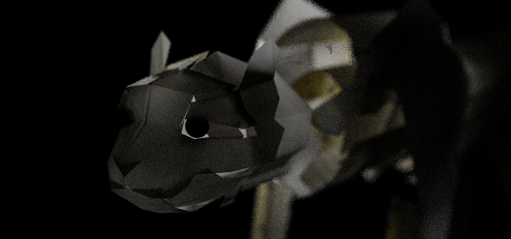

# What's next

Built on the MoonLightIPR branch since 0.3.51.3 and not released yet. Checked two ways, as before: MoonLightIPR's picture set beside MoonRay's on small test scenes, and the plugin driven by scripts in a separate test copy of Modo 16.1v9. One machine (RTX 3090).

Several of these need the **MoonRay of the next runtime** (a rebuilt `moonray.exe` and `librendering_rndr.dll`), so the next release brings a new runtime ZIP as well as a new kit. They are marked *(next runtime)*. With an older runtime the plugin still works, without them.

## The preview window

- **Three engines, and no Live box.**
  - **MoonRay** renders the picture once, in full. Its button reads Render, Stop and, after a stop under Safe Denoising, Continue.
  - **MoonRay LS** (low sample) is MoonRay following the scene as you edit it, at fewer samples and a smaller size. It is what MoonRay with Live ticked was.
  - **MoonLightIPR** is the fast GPU preview, which also follows the scene.

  The last two are realtime, and start switched off, so that nothing renders by accident: the button reads **RT Off**. Press it and it reads **RT On**, lit, and the preview follows the scene; press again to switch realtime off. The window itself opens on MoonRay, showing the crest, and renders nothing until asked; Preferences > MoonRay can name another engine to open on.
- **Draft comes up at once.** Nearly all of the wait for a draft's outlines was reading the scene out of Modo again (1.1 of 1.2 seconds on the origami cheetah); drawing them takes a twentieth of a second. With realtime on, where nothing in the scene has changed since it was last read for the picture on screen, it is not read again (0.17 seconds when first measured); with realtime off it is always read anew, so that a draft is never of an older scene. MoonLightIPR makes one render for a draft, and a second only for a region, by the engine you chose.
- **Draft follows the scene by itself, and refines.** With Draft on, its outlines are redrawn when the scene changes, whatever engine is chosen and whether or not realtime is on. A change is shown first in a quick, small picture (640 pixels wide; Preferences > MoonRay > Draft quick width) and then, once that is up, in a fine one as sharp as the view. On the 266-mesh cheetah a moved item is shown in about 0.2 seconds and refined 0.15 seconds later. A drag is waited out and the scene drawn as it is when the button comes up, so that what is shown is always the outcome of an edit. While it redraws by itself the window's status, progress bar and button are left alone. With a region set, the region is rendered again after the fine picture, by the engine chosen.

*The cheetah in Draft, refined: black outside the camera's frame.*

- **Moving something is followed without reading the scene again.** Of the 1.3 seconds a draft took to redraw on the origami cheetah (266 meshes), 1.0 was reading every mesh out of Modo again. When only an item's place changes, only its place is now asked for: 0.29 seconds. This holds for the realtime engines as well as Draft, and for scenes whose meshes are read as Modo evaluates them, as the cheetah's are for its nested material masks. Editing a mesh, a mask or the scene's structure still reads everything.
- **Reading a scene whose meshes Modo evaluates is more than twice as fast** *(new geometry adapter, in the kit ZIP)*. The adapter wrote every number of every mesh out as text, which the plugin then read back: for the cheetah's 392,000 numbers that was 0.55 seconds of writing and 0.19 of reading, against 0.04 seconds for Modo's own work. The numbers are now handed over as they are. The adapter's part went from 0.58 to 0.05 seconds, and a whole reading of the cheetah from about 1.0 to 0.4 seconds. What comes back was compared with the old way and is the same. This is every reading that is not just a move: switching Draft on, a change to a mesh's shape, a first render.
- **In Draft the paper is the camera's frame**, and the rest of the view is black.
- **Draft switched off shows nothing stale.** The render made before the draft is put back only where the scene is still the one it was made from. Where the scene has changed, the view is cleared: a realtime engine that is on renders it, and MoonRay waits for Render.
- **Region leaves the view alone.** Setting or clearing a region no longer zooms the view, and a picture of another size and the same shape is looked at just as the last was. Zooming in is yours to do.
- **MoonLightIPR has Beauty and Denoised Beauty.** With the scene's denoiser on for previews, MoonLightIPR denoises and its buffer list offers both. It shows Beauty, the picture as it is rendered, until you choose Denoised Beauty. The change is at once: MoonLightIPR holds both and nothing is rendered again. With the denoiser off it renders the beauty alone, and the list holds only Beauty. In a test, the denoised picture's grain measured 0.42 against the beauty's 0.61, and going back to Beauty gave the picture as it was.
- **Each engine renders at its own size.** MoonRay, chosen as the engine, renders at the camera's resolution, or the scene's where the camera does not override it; it used to render at the preview size. MoonRay LS and MoonLightIPR are previews, at the realtime preview size (640 pixels wide unless changed in the window's Options) and never wider. The option to preview at scene resolution is gone. Tried on a 1280 x 720 scene and with a camera override of 800 x 400: MoonRay rendered each at that size, and MoonLightIPR at 640 wide both times.
- **Render and RT switch Draft off.** With Draft on, pressing Render with MoonRay, or switching realtime on, takes Draft off first and gives the picture itself.
- **Denoised Beauty denoises of itself.** Chosen in the list with no denoiser set in the scene, a finished MoonRay render is denoised there and then, with the graphics card's denoiser (OptiX), or Open Image Denoise where that will not run, and is left as it is where neither will. MoonLightIPR always lists Denoised Beauty, and denoises when it is the buffer chosen, whatever the scene's denoiser is set to.
- **Safe Denoising is on the picture's right-click menu**, the same switch as in the scene's render settings, and while it is on the foot of the picture reads Safe Denoiser Mode, in the middle.

*Safe Denoising on: the picture says so at its foot.*

- **Two lines under the picture.** The status has a line to itself, so a long message is read whole. Below it are the values under the pointer, how the render is getting on, and the picture's size.
- **Tile outlines move evenly.** They are pastel blue. An outline eases in, stands for as long as MoonRay keeps coming back to its tile, and fades when the tile is done with. MoonRay now tells of its tiles on a clock of their own: about eighteen times a second reach the window where four did, and no gap is longer than 150 ms where there were gaps of half a second *(next runtime)*.

*MoonLightIPR chosen: RT On is lit, and the status has a line to itself.*

## The compositor

- **A graph over the buffers of a finished render**, in the same editor as a material's graph: Options > Compositor in the preview window. Down the left are the nodes there are to add: each of the render's buffers, Merge (normal, add, multiply, screen, lighten, darken, difference, with a mix and an optional mask), Grade (exposure, gamma, saturation, tint), Blur and Glow. The graph ends in the Composite node.
- **Composite is a buffer in the list**, beside Beauty and Denoised Beauty, while the scene has a graph that does something. It is chosen by hand. It is made when a MoonRay render finishes, or is stopped and kept, and again whenever the graph is edited, from the buffers the window has kept: nothing is rendered again.
- **The graph is kept with the scene**, and Modo's undo undoes an edit to it.
- **Render EXR and animations write name.composite.exr** beside the EXR, as the denoised copy is written.

*The nodes there are to add, down the left; the graph; and the selected node's settings.*

- Not in this first version: the composite while a render is still going, mattes picked from a Cryptomatte, MoonLightIPR (which has only its beauty to give), and MoonRay's own display filters.

## Rendering with MoonRay

- **Safe Denoising shows the render as it comes on**, like any other render, instead of only at each save *(next runtime)*. In a test of 70 seconds the view was brought up to date 35 times, with the saves going on beneath.
- **A stop says what it kept.** Under Safe Denoising a stop keeps the last save, which may be some seconds behind what was on screen. The status says how far behind, the picture's own line is marked for as long as that picture is shown, and while the render runs its timing ends with how long ago MoonRay last saved. Stopped before the first save, the picture as it stands is kept in place of nothing.
- **No dark blocks in the live picture**, in a normal render or under Safe Denoising *(next runtime)*. With the graphics card sharing the work, MoonRay counts a pixel's sample before all of that sample's light has come back, and for that moment the pixel reads too dark. The live picture caught such pixels in blocks, and under Safe Denoising in a dither. A pixel is now held at what it last showed for as long as the samples still coming in are a large share of what it has. Counted as pixels that dip markedly darker in one picture than in those before and after it: on two balls the worst picture of a safe render had 2% of its pixels dipped, now 0.03%; on the origami cheetah (1920 x 900) over three minutes, the worst picture of 94 had 0.08% under Safe Denoising, a single small tile, and 0.04% in a normal render.
- **A render stopped part way is kept and denoised, in about a second and a half** *(next runtime)*. MoonRay hands over the picture and the denoiser's two guides at one asking, as it renders, and is ended after; before, each was asked for five times in turn, which took four to five seconds. Ended first and asked after, MoonRay left black blocks where light was still on its way. Three stops of two balls took 1.2 to 1.8 seconds. Where a tile was being worked on at the stop, the denoiser's two guides had pixels several times too bright, on a grid of every other pixel, and others too dark, and the denoiser drew a speck at each. The guides of a stopped render are now put right before it is denoised (every normal brought to its full length, the albedo taken as the middle of each pixel and those touching it): in a kept normal guide 307 pixels stood out darkly from those around them before, and none after. What is left is fainter: the beauty itself is noisier in such a tile than around it, and a trace of that can come through.
- **An idle MoonRay costs nothing** *(next runtime)*. The MoonRay kept loaded between renders kept one processor core busy while it waited for its next frame. It now rests, and starts again without delay. Measured with nothing changing in the scene: MoonRay LS went from 100% of a core to 0%. MoonLightIPR was at 0% already. Both keep the graphics card memory they hold (2.3 to 2.6 GB in the test), which is what lets them start again at once.
- **A MoonRay left behind ends itself** *(next runtime)*. If Modo ends without closing the preview, the loaded MoonRay no longer stays running.

*The worst of 94 pictures taken of the cheetah during a safe render: one small dark tile, on the pale flank at the upper right.*

*Stopped under Safe Denoising: the picture is the last save, seven seconds before the stop, and both lines say so.*

*A normal render stopped after 25 seconds: kept and denoised, with no marks.*

## MoonLightIPR nearer to MoonRay

- **What is lit only by bounced light is as bright as in MoonRay.** MoonRay's DwaBaseMaterial leaves its highlight, coat, metal and glass out of a path that has already bounced off something diffuse (unless the material is told to cast caustics), so by bounced light a shiny surface is plain diffuse. MoonLightIPR kept the highlight there, which took its share from the diffuse light and gave little back: the unlit side of a ball standing on a lit, shiny ground came out at 83% of MoonRay's brightness. It now follows MoonRay's rule, and that side is at 101%. Over the comparison's scenes of layered materials the share of the picture within 10% of MoonRay's went from 64% to 91% (plain stacks), 61% to 98% (layers), 54% to 97% (masks), 56% to 89% (patterns) and 55% to 99% (the Blinn roughness image).
- **Tinted glass is as dark as MoonRay's.** MoonRay tints light where it enters a glass solid and again where it leaves; MoonLightIPR tinted it once, and a tinted glass ball came out 10% brighter than MoonRay's whatever lit it. It is now within 1%, and the test scene of a glass ball and a coated cube went from 66% of the picture within 10% of MoonRay's to 92%.
- **What is under a clearcoat is dimmed on the way out too**, as MoonRay does it for a coat that bends light (its default). A coated cube was 9% brighter than MoonRay's and is now 7%; what makes up the rest was not found.
- **The scene's Sample Clamp and Clamp From Bounce are followed.** MoonLightIPR had the clamp fixed at MoonRay's default of 10 from the first bounce, whatever the scene said.
- **A see-through surface casts the shadow MoonRay gives it.** MoonRay has a surface that is partly absent cast a whole shadow unless Presence Shadows is switched on in the scene's settings; MoonLightIPR always cast a lighter one. It now follows the setting. On the test scene of half-absent strands the shadows are as MoonRay's; the picture as a whole went from 53% within 10% to 59%, what is left being the strands themselves, which MoonRay draws with a darker core where both of a strand's walls are seen.
- **Fog and clouds with Volume Depth raised agree with MoonRay**: measured at 96% of the picture within 10% for fog at a depth of 3 (1.01 of MoonRay's brightness) and for a VDB cloud at a depth of 4 (1.00).
- **Draft's outlines lie where the picture does under a fisheye or spherical camera.** They were drawn as through an ordinary lens whatever the camera. Drawn without Modo for the fisheye, equidistant fisheye and spherical test cameras, 97 to 99% of the outline's pixels now lie on an edge of the rendered picture. Not looked at in a running Modo.
- **MoonLightIPR draws a Blinn, Ashikhmin or smooth GTR roughness as MoonRay does.** Modo's roughness for these is another roughness of MoonRay's lobe. MoonLightIPR had been drawing it as Modo gives it; it now turns it into the lobe's, whether it is one value or driven by an image, and its notice about that is gone. On the test scene with an image driving a Blinn roughness the balls match MoonRay's by eye; over the whole picture 55% is within 10%, the rest being the cube and the ground, which differ for other reasons. Not rendered from a Modo scene.

## Nearer to Modo's own look

- **A rough Principled material is no longer dark seen at a low angle.** Modo's Principled model adds its highlight to its diffuse light; MoonRay's layers take from the diffuse what the highlight reflects, which is most at a low angle, and a rough highlight gives little of it back. A rough floor running off toward the horizon came out at a third to a half of Modo's brightness. The highlight's rise toward the edge is now whole up to a roughness of 0.2 and falls away to none at 0.6, in MoonRay and MoonLightIPR alike. Against Modo's own renders of a ball and a box on a ground under one light, the whole picture's brightness went from 79% of Modo's to 94% at a roughness of 0.5, from 73% to 94% at 0.7 and from 67% to 88% at 0.9; in MoonRay itself the far ground at 0.9 went from 29% of Modo's to 74%. Smooth Principled materials (0.2 and under) are as they were.
- **Where an image drives the roughness of a Blinn, Ashikhmin or GTR material, the highlight's strength follows it too.** The strength that matches Modo was worked out for the material's plain roughness and used over the whole surface; it is now read for each point from what drives the roughness, as the roughness itself is, in MoonRay and MoonLightIPR. The two engines draw the test scene alike as before. It was not set against a Modo render of an image-driven roughness.
- What it costs: in a white sky a rough Principled ball already reflected less at its edge than Modo's, and with no rise it reflects a little less still there (at 0.7: 6% of the sky where Modo shows 25%, and 10% before). Its diffuse at the edge is nearer Modo's for it (51% against Modo's 60%; 44% before).

## What Modo hides is hidden

- **An item with its eye off no longer renders**, in MoonRay or MoonLightIPR. Left at Render: Default, an item renders as it is shown; Render: Yes or No still settles it either way. A parent hides its children only when it is set to hide them with it.
- **MoonLightIPR follows a surface's visibility to each kind of ray**: seen by the camera, by indirect light, in reflections, in refractions, and whether it casts shadows. Light that a scattered ray comes upon is stopped by what casts shadows, as in MoonRay. On four test scenes (hidden from the camera; casting no shadow; seen by the camera only; casting its shadow only), 96 to 100% of the picture is within 10% of MoonRay's. These settings reach the renderer with Surfaces set to Evaluated.
- **A Shader's Cast Shadows switch is followed**, in MoonRay and MoonLightIPR. Modo's own switches for a surface have none for shadows, and the plugin took Visible to Occlusion Rays for it; it now asks the Shader over the surface. Read from a Shader item in Modo: Cast Shadows off, and the surface comes through as seen by everything and casting no shadow.

*Four cubes in a row. The second has its eye off and the third is set to Render: No: neither is rendered. The fourth has its eye off but Render: Yes.*

*Two balls hidden from everything but shadows: MoonRay (left) and MoonLightIPR (right).*

## Checked since

- **Continue after a stop** works on the newest MoonRay, on two balls and on the origami cheetah: MoonRay took up the saved render (26 files on the cheetah) and went on from it; stopped again, it kept its picture and offered Continue again.
- **The heavy scene under Safe Denoising** (the cheetah, 1920 x 900, 26 buffers): a stop keeps the last save and denoises it. In 198 seconds a normal render reached 7.5% and a safe one 6.1%, so Safe Denoising costs about a fifth of the pace on this scene.
- **Draft with a region set** follows the scene: the outlines and the region are drawn again by themselves after a change, under MoonRay (the region at MoonRay's size) and under MoonLightIPR.
- **Following a moved item on the cheetah**, realtime on: MoonLightIPR shows the new picture 0.17 to 0.19 seconds after the move, MoonRay LS 0.74 to 0.79 seconds. Both read only what moved.
- **Geometry handed over as numbers** gives exactly what the text gave on a ball, two instances of it and a subdivided cube.
- **MoonLightIPR's denoiser while Beauty is shown** costs next to nothing: 256 samples took 1.0 to 1.1 seconds with it on and 1.0 to 1.4 with it off.
- **A light with its eye off** is left out, and comes back when set to Render: Yes. Environments have no eye of their own to follow.
- **A Shader set not to be seen by the camera** reaches the renderer through the Shader item in Modo.
- **A safe render stopped after its first picture and before its first save** (8 seconds in, two balls) keeps the picture as it stands and denoises it; stopped at 18 seconds it keeps the last save, 6 seconds old. Both times the window ends on Denoised Beauty. Stopped at 2 seconds, before any picture has come, there is nothing to keep and it says so.
- **A finished preview stays finished**: for a minute after it ends nothing renders again, with the denoiser on, under each of the three engines on two balls and under the realtime engines on the cheetah.
- **A release package** made from this work (the kit, the next runtime and the geometry reader) passes the release check. Nothing was published.

## Known gaps

- The rare small dark tile in the live picture under Safe Denoising (0.08% of the worst picture on the cheetah) is still there.
- A scene with instances, replicators or deformers still reads everything when an item moves.
- The tile outlines were measured (how often they are told of, and that they ease and fade) and not watched by eye during a long render.
- Very smooth highlights are still dimmer than Modo's own. MoonRay has one layer for the highlights of lights and for what a surface mirrors of its surroundings, and the surroundings already match: the highlight cannot be raised without them.
- A rough Principled highlight is dimmer than Modo's at every angle; the diffuse light under it is what was put right.
- Hair in MoonLightIPR agrees with MoonRay on 74 to 80% of the picture: the top of a tuft is brighter than MoonRay's by about a seventh.
- The compositor was driven by test scripts, not by hand; an animation's composites and the fall back from OptiX to Open Image Denoise were not run.
