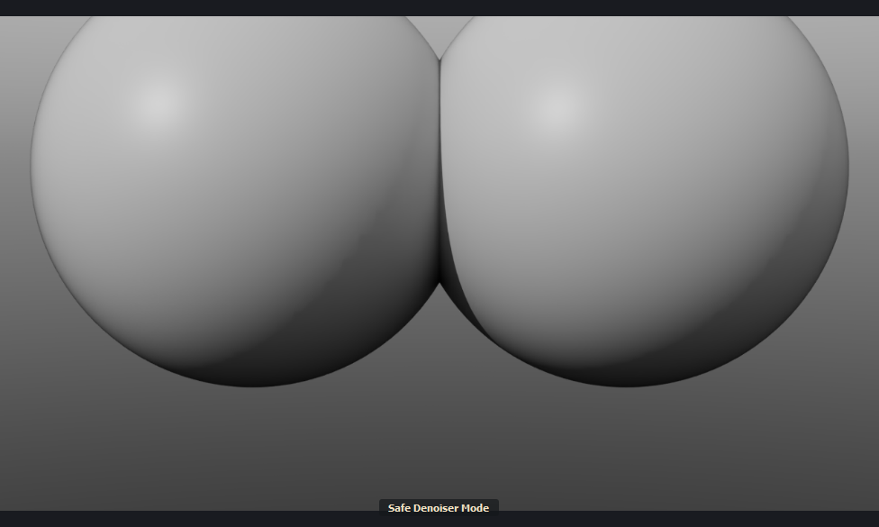

# What's coming in 0.4

Built since 0.3.51.3 and not released yet. Items marked *(0.4 runtime)* need the new runtime ZIP that 0.4 brings; everything else works with the current one.

## The preview window

- **Three engines.** **MoonRay** renders the full picture once. **MoonRay LS** (low sample) and **MoonLightIPR** are realtime: they follow the scene as you edit.
- **RT Off / RT On.** The realtime engines start switched off, so nothing renders by accident. Press the button to follow the scene; press again to stop.
- **Opens on MoonRay, with the crest**, and renders nothing until asked.
- **Each engine has its own size.** MoonRay renders at the camera's resolution; the realtime engines at the preview size (640 px unless changed).
- **Pixel samples per realtime engine**, in Options > Preferences: MoonLightIPR 32 to 256, MoonRay LS 1 to 64. MoonRay LS can also render as wide as the preview.
- **Denoised Beauty just works.** Choose it in the buffer list and the picture is denoised (OptiX, or Open Image Denoise if OptiX is unavailable). No denoiser to set up first.
- **Safe Denoising on the right-click menu**: Off, OptiX or Open Image Denoise. While it is on, the foot of the picture says Safe Denoiser Mode.
- **Dragging with realtime on is much smoother.** The preview takes far less of Modo's time while you drag the camera or an object. MoonRay LS now follows a drag too, where it used to wait for you to let go.
- **Realtime waits while an animation plays**, then renders the frame it stops on.
- **Status on its own line**, so long messages are not cut off.
- **Tile outlines** are pastel blue, move evenly and fade when a tile is done *(0.4 runtime)*.
- **Titled "MoonRay"** when docked in Modo's layout; "MoonRay Preview" as its own window.

*MoonLightIPR chosen, RT On.*

*Safe Denoising on.*

## Draft

- **Much faster.** After moving the camera or an object, the lines are back in about a third of a second on a 266-mesh scene. It used to take over a second.
- **Follows the scene by itself**, with any engine: a quick picture first, then a sharp one.
- **Black outside the camera's frame.**
- **Render and RT switch Draft off** and give you the picture.
- **Nothing stale when switched off.** If the scene changed, the view is cleared instead of showing an old render.
- **Region no longer zooms the view.**

*Draft, with black outside the camera's frame.*

## MoonLightIPR Playblast

- **MoonRay > MoonLightIPR Playblast**, or Options in the preview window.
- Renders the animation on the graphics card, one PNG per frame, with its own width and samples.
- **Plays back when done**, looping, with Pause and a slider.
- Denoised if Denoised Beauty is the chosen buffer.
- A quick look, not an output: existing frames are overwritten and there is no motion blur. Use Render Animation for finals.

## The compositor

- **Options > Compositor**: a node graph over the buffers of a finished render. Nodes to add are listed on the left: the render's buffers, Merge, Grade, Blur and Glow.
- **The result is the Composite buffer** in the list. Editing the graph updates it without rendering again.
- **Saved with the scene**, with undo.
- **Render EXR and animations write `name.composite.exr`** beside the EXR.
- Not yet: compositing during a render, Cryptomatte mattes, MoonLightIPR renders.

*Nodes on the left, the graph, and the selected node's settings.*

## Rendering with MoonRay

- **Smart Render.** MoonRay stops by itself once the picture is clean enough for the denoiser, and denoises it. Choose Draft, Medium or Fine in the render settings or on the picture's right-click menu; the foot of the picture shows the noise reading and where it will stop. On the coffee maker example it finished in 65 to 100 seconds where the full render takes 137.
- **A steadier time left.** One countdown for the whole render, where it used to start over with each of MoonRay's passes and jump about. With adaptive sampling a time is shown only when MoonRay's own figure can be trusted; otherwise the window says how many tiles have finished.
- **Stop keeps the picture.** A render stopped part way is kept and denoised in about a second and a half *(0.4 runtime)*.
- **Safe Denoising shows the render as it goes**, like any other render *(0.4 runtime)*. A stop tells you how far behind the kept picture is.
- **No dark blocks** in the live picture *(0.4 runtime)*.
- **An idle MoonRay uses no processor**, and closes itself if Modo goes away *(0.4 runtime)*.

*Stopped after 25 seconds: kept and denoised.*

*Stopped under Safe Denoising: the status says the picture is the last save.*

## MoonLightIPR closer to MoonRay

- **Shiny surfaces in bounced light**, **tinted glass** and **clearcoats** now match MoonRay's brightness far better.
- **Shadows of see-through surfaces** follow the scene's Presence Shadows setting.
- **Sample Clamp** settings are followed.
- **Blinn, Ashikhmin and GTR roughness** are drawn as MoonRay draws them.
- **Draft outlines line up** under fisheye and spherical cameras.

## Closer to Modo's look

- **Rough Principled materials are no longer dark at low angles**, such as a floor running to the horizon.
- **Image-driven roughness** keeps the right highlight strength on Blinn, Ashikhmin and GTR materials.

## Visibility

- **An item with its eye off does not render.** Render: Yes or No still overrides.
- **MoonLightIPR follows per-ray visibility**: camera, indirect light, reflections, refractions and shadows.
- **A Shader's Cast Shadows switch is followed.**

*The second cube has its eye off and the third is Render: No. The fourth has its eye off but Render: Yes.*

*Shadow-only objects: MoonRay (left), MoonLightIPR (right).*

## Importing MoonRay scenes

- **File > Open reads MoonRay scenes.** Choose an `.rdla` or `.rdlb` file in Modo's own Open (or Import) and the importer brings it in, showing how far it has come. Modo adds one empty mesh to a scene opened this way.
- **Imported lights are no longer far too bright.** Lights left at MoonRay's defaults came in fifty times brighter (seen on the Veach scenes in the asset library). Re-import scenes brought in before this fix.

## Known gaps

- A rare small dark tile can still appear in the live picture under Safe Denoising.
- Scenes with instances, replicators or deformers are still re-read whole when an item moves.
- An adaptive render often has no time-left figure: MoonRay reports only how many tiles have finished, and most finish near the end.
- MoonRay LS is more interactive during a drag but not yet as fluid as MoonLightIPR on heavy scenes.
- Very smooth highlights, and rough Principled highlights, are still dimmer than Modo's.
- Hair in MoonLightIPR is close to MoonRay's, with the top of a tuft a little brighter.
- The compositor has been tested by script more than by hand.
- Tested on one machine (RTX 3090).

How things were measured is in the [MoonLightIPR notes](../moonlightipr/README.md) and the project history.
