# What's coming in 0.4

Built since 0.3.51.3 and not released yet. Items marked *(0.4 runtime)* need the new runtime ZIP that 0.4 brings; everything else works with the current one.

## The preview window

- **Three engines.** **MoonRay** renders the full picture once. **MoonRay LS** (low sample) renders a quick, smaller picture when you press Render. **MoonLightIPR** is realtime: it updates after each edit.
- **RT Off / RT On.** MoonLightIPR starts switched off, so nothing renders by accident. Press the button to follow the scene; press again to stop.
- **Opens on MoonRay, with the crest**, and renders nothing until asked.
- **Each engine has its own size.** MoonRay renders at the camera's resolution; MoonRay LS and MoonLightIPR at the preview size (640 px unless changed).
- **Pixel samples for MoonRay LS and MoonLightIPR**, in Options > Preferences: MoonLightIPR 32 to 256, MoonRay LS 1 to 64.
- **Denoised Beauty just works.** Choose it in the buffer list and the picture is denoised (OptiX, or Open Image Denoise if OptiX is unavailable). No denoiser to set up first.
- **Smart Render and Safe Denoising on the picture's right-click menu.** Safe Denoising is Off, OptiX or Open Image Denoise; while it is on, the foot of the picture says Safe Denoiser. Smart Render is described under Rendering with MoonRay.
- **Dragging with realtime on is much smoother.** MoonLightIPR updates quickly after drag, taking far less of Modo's time.
- **Realtime waits while an animation plays**, then renders the frame it stops on.
- **Status on its own line**, so long messages are not cut off.
- **Tile outlines** are pastel blue, move evenly and fade when a tile is done *(0.4 runtime)*.
- **Titled "MoonRay"** when docked in Modo's layout; "MoonRay Preview" as its own window.

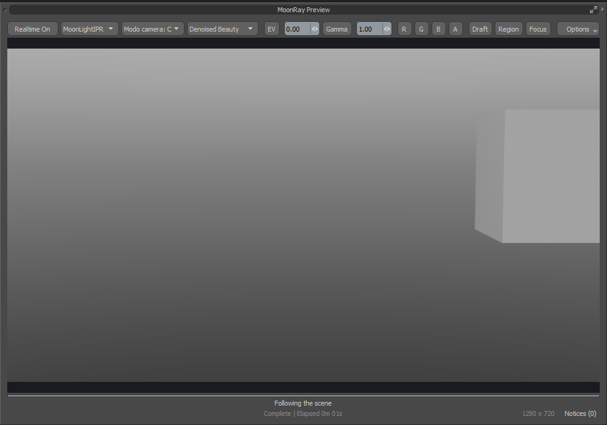
*MoonLightIPR chosen, RT On.*

## Draft

- **Much faster.** After moving the camera or an object, the lines are back in about a third of a second on a 266-mesh scene. It used to take over a second.
- **Follows the scene by itself**, with any engine: a quick picture first, then a sharp one.
- **Black outside the camera's frame.**
- **Render and RT switch Draft off** and give you the picture.
- **Nothing stale when switched off.** If the scene changed, the view is cleared instead of showing an old render.
- **Region no longer zooms the view.**
- **A region is marked, then rendered when you ask.** Drag a region and it gets a moving dotted outline; nothing renders until you press Render or RT.
- **Draft and realtime are one or the other.** Choosing an engine never switches realtime on, and Draft switched on takes realtime off.

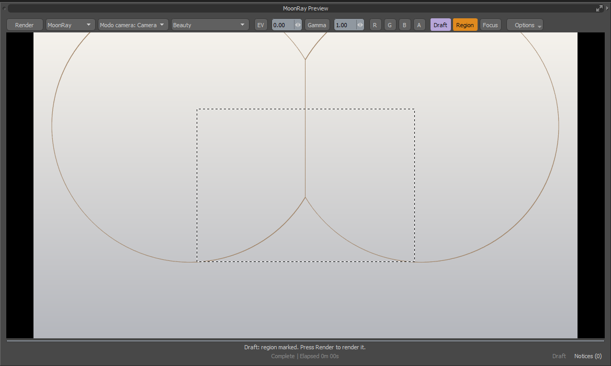
*A region marked on the Draft: press Render to render it.*

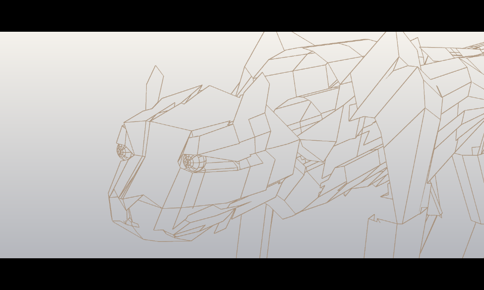
*Draft, with black outside the camera's frame.*

## MoonLightIPR Playblast

- **MoonRay > MoonLightIPR Playblast**, or Options in the preview window.
- Renders the animation on the graphics card, one PNG per frame, with its own width and samples.
- **Plays back when done**, looping, with Pause and a slider.
- Denoised if Denoised Beauty is the chosen buffer.
- A quick look, not an output: existing frames are overwritten and there is no motion blur. Use Render Animation for finals.

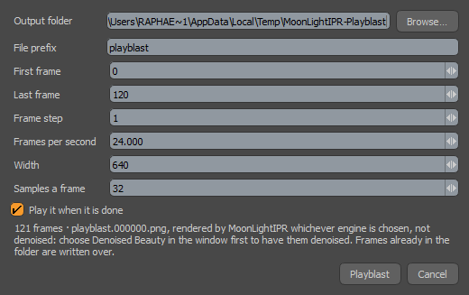

## The compositor

- **Options > Compositor**: a node graph over the buffers of a finished render. Nodes to add are listed on the left:
  - **Buffers** of the render, and **Merge** in seven modes, with a mix amount and an optional mask.
  - **Colour**: Grade, Levels, Contrast, Invert, Clamp, Tone Map, Math.
  - **Filters**: Blur, Glow, Sharpen, Median, Grow / Shrink, Edges, Grain, Vignette, Flip.
  - **Mattes**: Brightness Matte and Channel, to wire into a Merge's mask.
  - **Make**: a plain Colour and a Ramp.
- **The result is the Composite buffer** in the list. Editing the graph updates it without rendering again.
- **Saved with the scene**, with undo.
- **Render EXR and animations write `name.composite.exr`** beside the EXR.
- Not yet: compositing during a render, Cryptomatte mattes, MoonLightIPR renders.

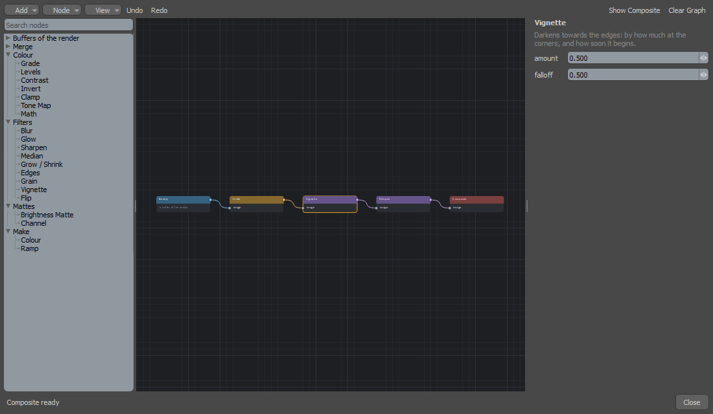
*The nodes to add on the left, a graph of Grade, Vignette and Sharpen, and the selected node's settings.*

## Rendering with MoonRay

- **Smart Render.** MoonRay stops by itself once the picture is clean enough for the denoiser, and denoises it.
  - **Right-click the picture > Smart Render**: Off, Draft, Medium or Fine. The same setting is in the render settings under Denoising.
  - The foot of the picture shows the noise falling and where it will stop, such as "noise 5.6%, stops at 3.0%".
  - The picture is rendered all over at once, in random bucket order, so the noise falls evenly.
  - On the coffee maker example it finished in 40 to 70 seconds where the full render takes 105.

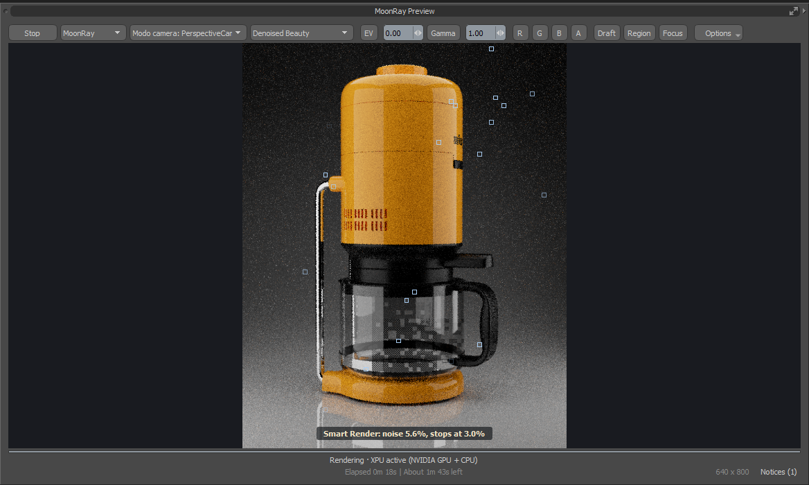
*Smart Render at Fine, 18 seconds in: the noise reads 5.6% and the render will stop at 3.0%.*

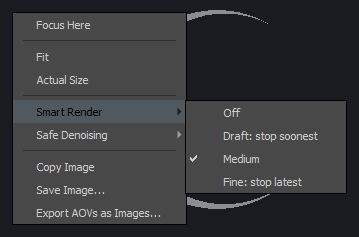
*Right-click the picture: Smart Render, with Safe Denoising below it.*

- **One pass, not three.** A MoonRay preview no longer renders twice quickly before the real render, starting over each time: the picture comes in once, and the render is about a third shorter.
- **A steadier time left.** One countdown for the whole render, where it used to start over with each of MoonRay's passes and jump about. With adaptive sampling a time is shown only when MoonRay's own figure can be trusted; otherwise the window says how many tiles have finished.
- **Stop keeps a whole picture.** MoonRay finishes the tiles it is working on before it stops, so nothing is left dark or blocky, and every buffer is kept, not only the beauty. It takes a few seconds *(0.4 runtime)*.

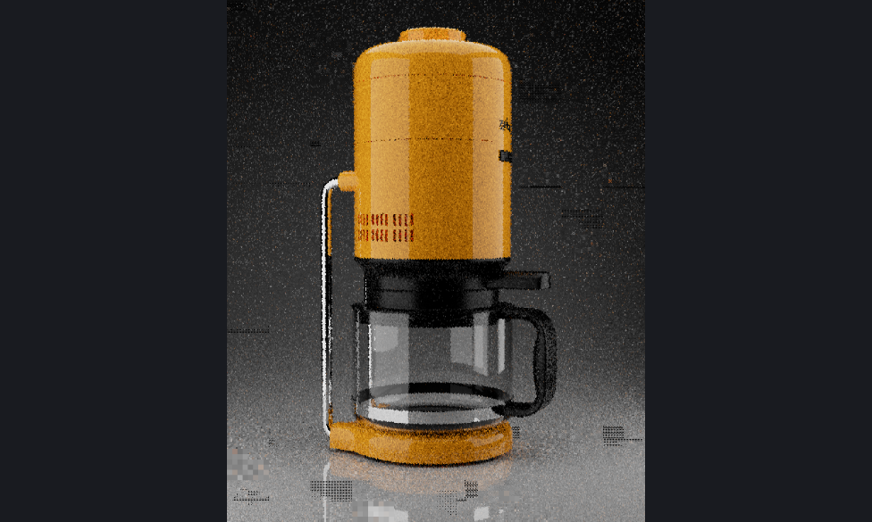
*Stopped at once, as before: the tiles in progress are left dark and patterned.*

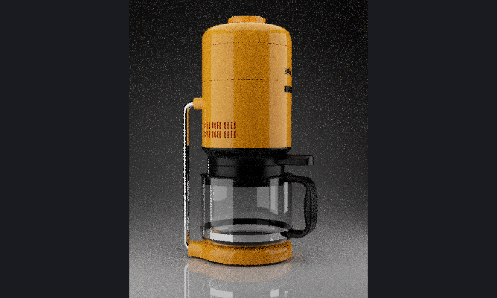
*Stopped the new way: MoonRay finishes those tiles first.*

- **Safe Denoising shows the render as it goes**, like any other render *(0.4 runtime)*. A stop tells you how far behind the kept picture is.
- **Reduced dark blocks** in the live picture *(0.4 runtime)*.
- **An idle MoonRay uses no processor**, and closes itself if Modo goes away *(0.4 runtime)*.

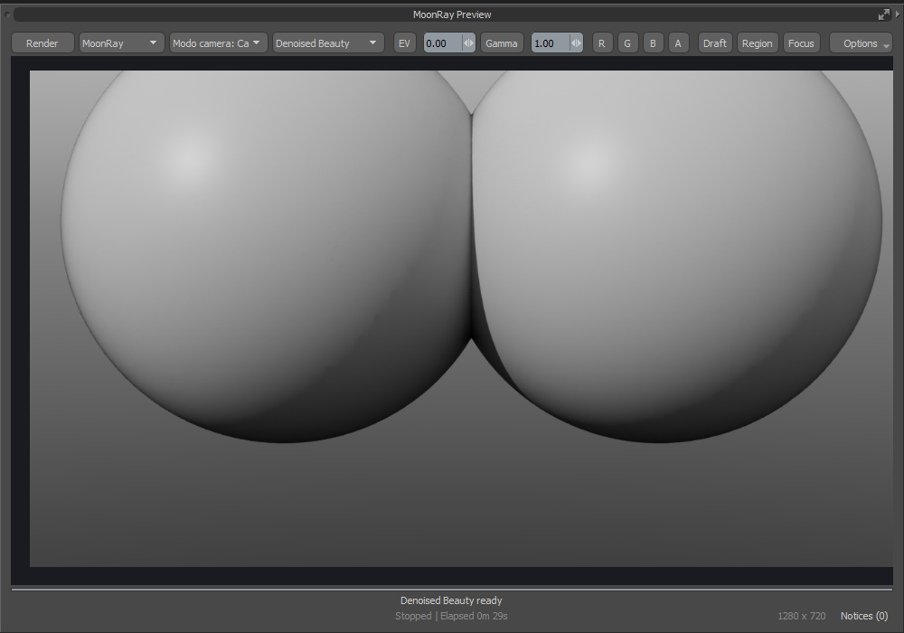
*Stopped after 25 seconds: kept and denoised.*

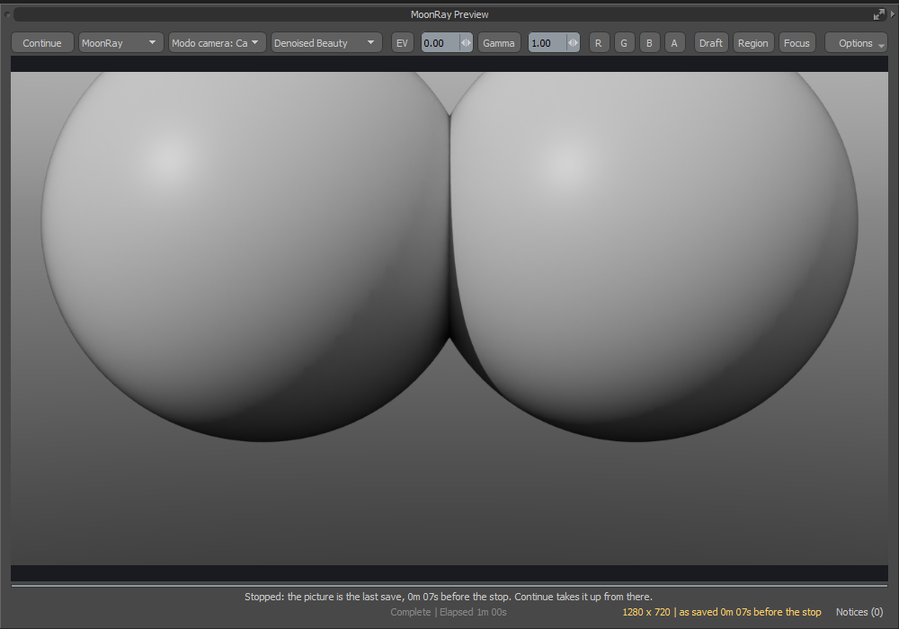
*Stopped under Safe Denoising: the status says the picture is the last save.*

## MoonLightIPR closer to MoonRay

- **Shiny surfaces in bounced light**, **tinted glass** and **clearcoats** now match MoonRay's brightness far better.
- **Shadows of see-through surfaces** follow the scene's Presence Shadows setting.
- **Sample Clamp** settings are followed.
- **Blinn, Ashikhmin and GTR roughness** are drawn as MoonRay draws them.
- **Draft outlines line up** under fisheye and spherical cameras.

## Closer to Modo's look

- **Rough Principled materials are no longer dark at low angles**, such as a floor running to the horizon.
- **Image-driven roughness** keeps the right highlight strength on Blinn, Ashikhmin and GTR materials.

## Visibility

- **An item with its eye off does not render.** Render: Yes or No still overrides.
- **MoonLightIPR follows per-ray visibility**: camera, indirect light, reflections, refractions and shadows.
- **A Shader's Cast Shadows switch is followed.**

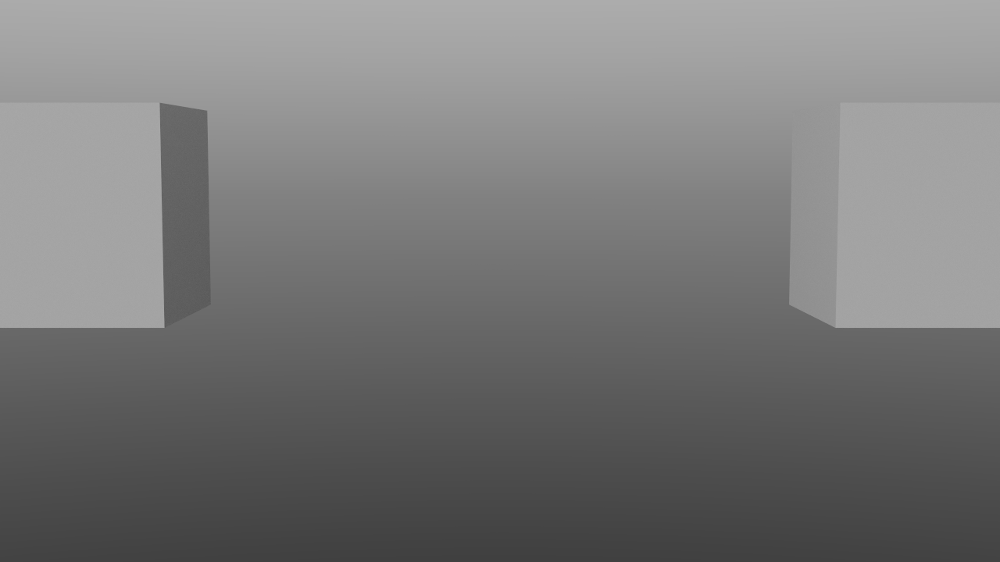
*The second cube has its eye off and the third is Render: No. The fourth has its eye off but Render: Yes.*

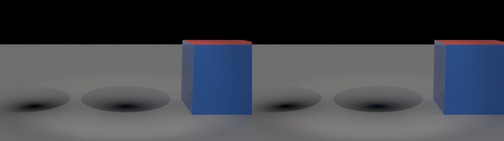
*Shadow-only objects: MoonRay (left), MoonLightIPR (right).*

## Importing MoonRay scenes

- **File > Open reads MoonRay scenes.** Choose an `.rdla` or `.rdlb` file in Modo's own Open (or Import) and the importer brings it in, showing how far it has come. Modo adds one empty mesh to a scene opened this way.
- **Large scenes render.** The bedroom example scene (1.5 million polygons) stopped with "Scene text exceeds the 256 MB shared-scene limit"; a scene of any size is now handed to MoonRay.

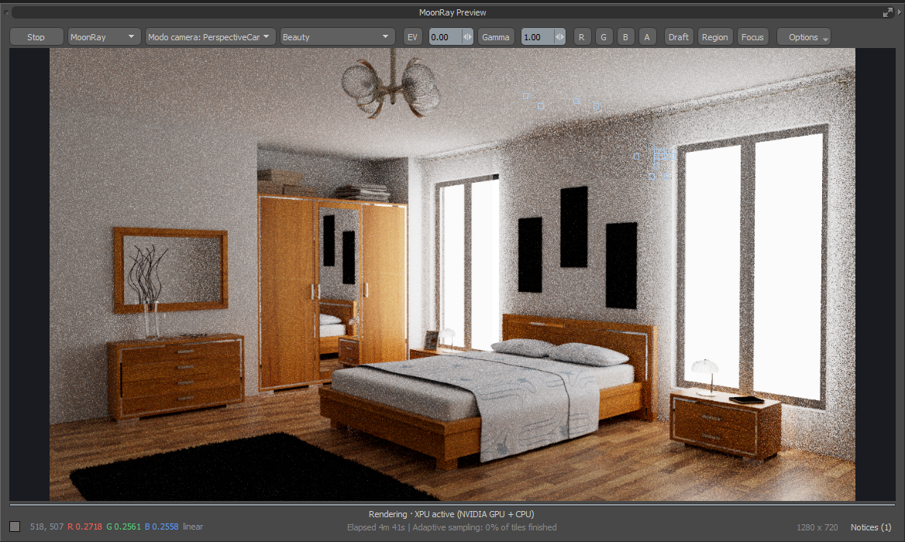
*The bedroom example scene, part way through its render.*

- **Imported lights are no longer far too bright.** Lights left at MoonRay's defaults came in fifty times brighter (seen on the Veach scenes in the asset library). Re-import scenes brought in before this fix.

## Known gaps

What you may run into:

- **Time left:** an adaptive render often shows no time-left figure, only how many tiles have finished.
- **Realtime previews** update after you let go of a drag, not while you drag.
- **Smart Render** works on MoonRay renders in the preview window, not Render EXR or animations. A picture full of fine texture may not read as clean and then renders to its end.
- **Stop** takes a few seconds, since MoonRay finishes its tiles first.
- **Safe Denoising:** a small dark tile can still flash in the live picture now and then.
- **Compositor:** no matte from a Cryptomatte, no transform or crop, and it does not run while a render is going.
- **Playblast:** PNG frames only, no movie file and no motion blur.
- **File > Open** of a MoonRay scene leaves one empty mesh in it and keeps the `.rdla` file's name.
- **Heavy scenes with instances, replicators or deformers** update more slowly when an item is moved.
- **Highlights:** very smooth ones, and rough Principled ones, are still dimmer than Modo's.
- **Hair in MoonLightIPR** is close to MoonRay's, a little brighter at the top of a tuft.

What has and has not been tested is on the [issue tracker](https://github.com/Pbaroque20/MoonRayForModo/issues). Tested on one machine (RTX 3090).

How things were measured is in the [MoonLightIPR notes](../moonlightipr/README.md) and the project history.
