# Patches to OpenMoonRay for the native Windows build

These patches are applied to OpenMoonRay's own source (`sources.json` names each repository, its commit and its
patch) to build MoonRay natively on Windows with MinGW-w64 (UCRT64) for the MoonRay for Modo plugin. Most of them
are portability changes. This file explains the ones whose reason is not obvious from the diff.

## Switches on the Source Overrides page that change no source

Seven switches on Preferences > MoonRay Source Overrides are the plugin's own, with no patch behind them. Each is on
by default; off does as MoonRay itself does.

- **Low-latency rendering**: MoonRay runs below Modo's priority and leaves one processor thread free.
- **Load geometry as binary**: the scene's geometry goes to MoonRay as a binary file beside the scene text.
- **N-gons triangulated cleanly**: flat polygons of more than four corners are cut along their outline (ear clipping),
  the same triangles for MoonRay and MoonLightIPR.
- **Blur moving lights**: a light that moves during the shutter has its motion blur switch (`mb`) set.
- **Display filters given the inputs they need**: a display filter missing an input takes the one it starts on, with a
  notice, and one that cannot be given it is left out rather than drawn pink.
- **Bump node in MoonShine graphs**: the MoonShine graph's Bump node turns a height (an image or any texture) into a
  shading normal, as the plugin's Shader Tree Bump layers do (its own ModoTextureMap in height mode, with a bump
  strength). MoonRay has no node of its own for it; off, the node leaves the normal flat.
- **VDB fire coloured by its temperature**: a VDB shape set to blackbody colour glows in the colours of its emission
  grid's temperatures. The kit adds an RGB grid, `modo_blackbody`, to a cached copy of the file
  (`native-port/modo_vdb_grid.cpp --blackbody`: Planck's law over the CIE 1931 matching functions, Wyman, Sloan and Shirley's
  fit, linear Rec.709 or the working space, at a luminance of one, times the grid's value; below 800 K, 800 K's deep red),
  and points MoonRay, XPU2 and MoonLightIPR at it (`entities.resolve_vdb`). MoonRay has no blackbody of its own; off, the
  fire glows in its incandescence gain mult's one colour.

## `moonray.patch`: `lib/rendering/mcrt_common/Clock.h`, the heat map's clock on Windows

### What MoonRay does

The heat map output ("time per pixel", `RenderOutput` result `RESULT_HEAT_MAP`) adds up, for every pixel, the time
spent shading the rays that land in it. The time is measured by `mcrt_common::Clock`, an RAII wrapper around
`clock_gettime()`, started and stopped around each batch of work in `RayHandlers.cc`, `ShadeBundleHandler.cc`,
`XPURayHandlers.cc` and `RenderFramePasses.cc` (through `MCRT_COMMON_CLOCK_OPEN`). Its default clock is
`CLOCK_THREAD_CPUTIME_ID`, the calling thread's CPU time. The batches are short, typically tens to hundreds of
microseconds each.

### Why that fails on Windows

On Linux, `CLOCK_THREAD_CPUTIME_ID` is accurate to nanoseconds, so each short batch is measured as it is.

On Windows, a thread's CPU time is only advanced when the scheduler's clock interrupt fires, every 15.625 ms (1/64
second) by default. `clock_gettime(CLOCK_THREAD_CPUTIME_ID)`, as the MinGW-w64 winpthreads library provides it, reads
that tick-based count. So a batch that does not straddle a tick is measured as exactly 0, and one that does is
measured as one whole tick, 15.625 ms, whatever it really took.

In the heat map that gives almost nothing. Measured on the same 160 × 120 render of a lit triangle (16 samples per
pixel, scalar mode), before and after this patch:

| | Before (`CLOCK_THREAD_CPUTIME_ID`) | After (`CLOCK_MONOTONIC`) |
|---|---|---|
| Distinct values in the heat map | 3 | 6,812 |
| Pixels reading exactly 0 | 85.6% | 0% |
| Other pixels | exactly 0.015625 s or 0.03125 s (one or two ticks) | from 0.000148 s up, in fine steps |

Before the patch, the heat map is black with scattered white dots, which are the batches that happened to straddle a
tick. It shows where the clock ticked, not where the render spent its time.

### The change

On Windows only (`#ifdef _WIN32`), `Clock`'s default clock is `CLOCK_MONOTONIC`, which winpthreads backs with
`QueryPerformanceCounter`, a counter with sub-microsecond resolution. Other platforms keep
`CLOCK_THREAD_CPUTIME_ID`, unchanged. `Clock` is used only for the heat map, so nothing else is affected.

### What it changes in meaning, and what upstream might prefer

`CLOCK_MONOTONIC` measures elapsed time between start and stop on the same thread, not CPU time. The two differ only
when the thread is preempted or blocked inside a measured batch. In a render, where the render threads are busy
shading, that is rare, and the heat map's purpose (showing which pixels are expensive relative to others) is kept.

An exact Windows equivalent of thread CPU time at high resolution exists: `QueryThreadCycleTime`, which counts the
thread's CPU cycles. It would need a conversion from cycles to seconds and a Windows-specific code path in `Clock`.
If OpenMoonRay supports Windows upstream, that, or this patch's simpler monotonic clock, is needed for the heat map
to mean anything there.

### How it was checked

- The same scene was rendered before and after, in scalar and XPU modes, and the heat map channel compared (numbers
  above).
- Every other output is unchanged: the display filter check, and a toon scene compared between MoonRay and the
  plugin's own preview renderer, give the same results as before the patch.

## `moonray.patch`: toon materials on coarse smooth-shaded meshes (`MOONRAY_MODO_TOON_TERMINATOR`)

Applied by `tools/port_toon_terminator.py`. Only active when MoonRay is started with `MOONRAY_MODO_TOON_TERMINATOR=1`
(the plugin's preference, on by default); without it MoonRay renders exactly as its source does.

### What MoonRay does

On a smooth-shaded polygon mesh (`smooth_normal`, or a subdivision surface) MoonRay shades with the interpolated
normals, but treats the surface as its flat faces in two places:

- Light culling: for a reflection-only BSDF, light from behind the face's geometric normal is dropped before the lobe
  sees it (`PathIntegrator.cc`, the culling normal; `DistantLight.cc` and the other lights' `sample`;
  `BsdfSlice::getSurfaceFlags`). Every `shadow_terminator_fix` mode also fades light by the geometric normal
  (`BsdfSlice::computeShadowTerminatorFix`).
- Shadow rays start on the flat face (`isRayOccluded`), so near the terminator they hit the neighbouring faces.

### Why it shows with toon

A Lambertian lobe is close to black where the geometric and shading normals part, so the face-shaped cut is not seen.
`DwaToonMaterial`'s toon diffuse (`ToonBsdfLobe`) is lit to the edge of its ramp, so its lit band ends in steps, one
per face, smaller under subdivision but still there. `prevent_light_culling` removes the culling, but not the fade or
the self-shadowing.

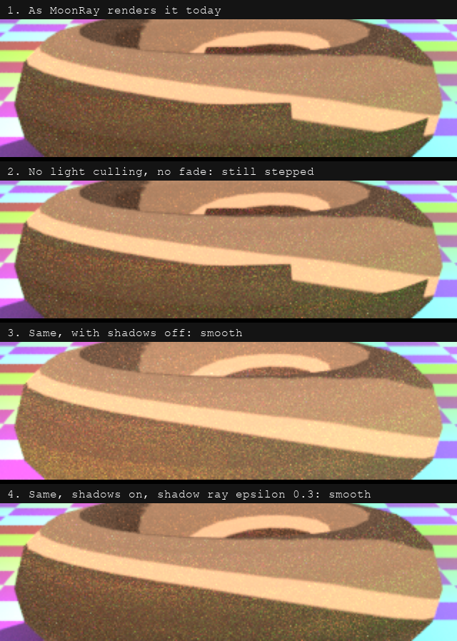

*The torus as MoonRay renders it (1); without light culling and the geometric-normal fade, still stepped (2); with shadows off, smooth (3); with shadow rays started 0.3 out, smooth (4). The steps come from shadow rays starting on the flat faces.*

### The change

1. The toon diffuse lobe is made spherical, as `prevent_light_culling` makes it, and cuts light off by its own shading
   normal instead of being faded by the geometric one (`BsdfBuilder`, `BsdfToon`, scalar and ISPC; the ISPC side reads
   the switch from a global set once from C++, which assumes one ISPC target, as this build has).
2. At a hit on `DwaToonMaterial`, the triangle, quad and subdivision meshes record how far the smooth surface the
   vertex normals describe lies above the flat face (Hanika, "Hacking the Shadow Terminator", Ray Tracing Gems II,
   2021): `Intersection::mModoSmoothOffset`, a new field in the structure's existing padding, so its size and the
   C++/ISPC layout check are unchanged. Shadow rays toward a light near the terminator start from there: fully when the
   light is at or behind the face, fading out by the time it is 0.1 (in cosine) above it
   (`PathIntegratorMultiSampler.cc` and `.ispc`). Other materials record nothing. Instanced copies are left as they are.

### How it was checked

A torus of 24 × 12 quads with `DwaToonMaterial` under a low distant light (`test-results/issue-129/make_repro.py`):
stepped without the variable, smooth with it, in scalar, vector and XPU modes. The same scene with `DwaBaseMaterial`
renders identically with the variable on and off in scalar mode, and within the run-to-run variation of vector and XPU
modes (two renders with it off differ as much).

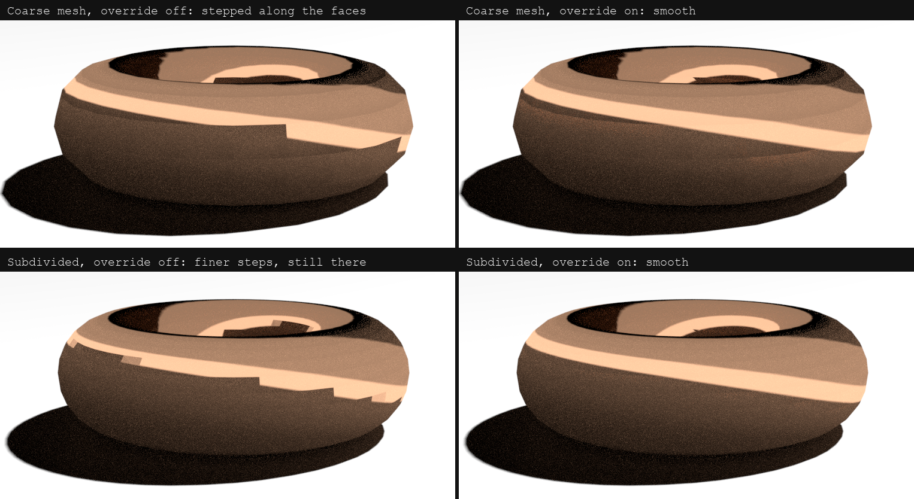

*Coarse and subdivided, with the switch off (left) and on (right). Subdivision makes the steps smaller without removing them.*

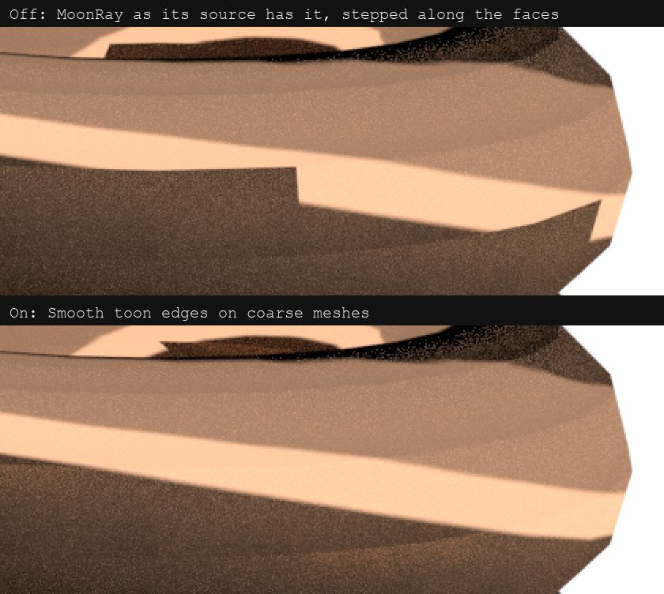

*Close up on the coarse torus.*

## `moonray.patch`: a toon material's albedo output (`MOONRAY_MODO_TOON_ALBEDO`)

Applied by `tools/port_toon_terminator.py`, behind a switch of its own (the plugin's preference, on by default).

### What MoonRay does

The `albedo` material AOV (`Aov.cc` and `Aov.ispc`, `computeAlbedo`) averages `f / pdf` over each lobe's BSDF samples.
For a lobe whose `f` carries the cosine and whose samples are drawn by the cosine, that is its albedo.

### Why it fails for toon

`ToonBsdfLobe` is deliberately flat: its `f` is `albedo × ramp / 2π`, with no cosine, but it is sampled by the
cosine (`pdf = cos / π`). Each sample is then `albedo × ramp / (2 cos)`, which grows without bound towards grazing
directions. On a toon torus at 4 samples a pixel the AOV reaches 202,000 in scalar mode (its true values are under 1).
The denoisers take this AOV as their albedo guide; a guide full of bright specks is read as detail, and the denoised
toon surface comes out as noisy as it was rendered. Clamping or median-filtering the guide afterwards does not recover
it.

### The change

With the switch on, a `ToonBsdfLobe` (`BSDF_LOBE_TOON` in ISPC) contributes its own `albedo()`, the Lambertian
albedo it inherits, the same for every sample. Other lobes are unchanged.

### How it was checked

The toon torus of `test-results/issue-129/make_repro.py` with the albedo and normal guides: the guide stays within the
material's colour (0.9, 0.5, 0.3) in scalar and vector modes, and Open Image Denoise then cleans the toon surface as
it does a `DwaBaseMaterial` one (`test-results/issue-129/check_albedo.py`).

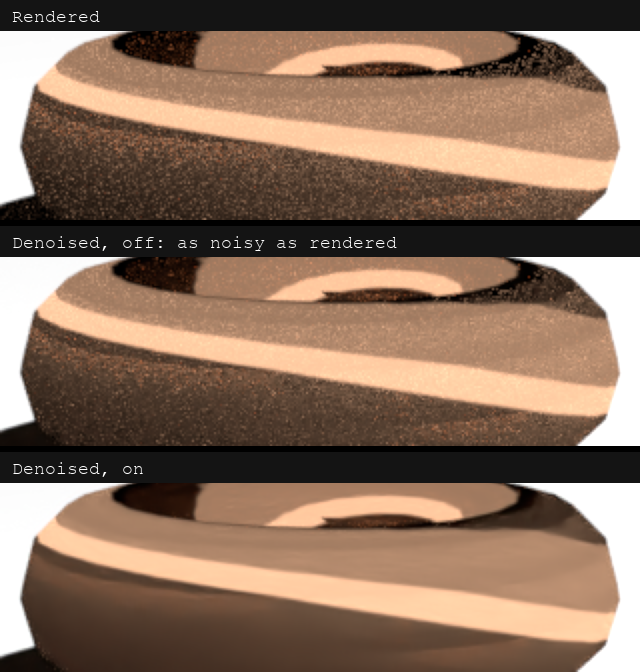

*The render, then denoised with the switch off (as noisy as rendered: the albedo guide is full of specks) and on.*

## `mcrt_denoise.patch`: the denoiser cleans its guides first (`MOONRAY_MODO_DENOISE_CLEAN_GUIDES`)

Applied by `tools/port_denoise_overrides.py`, behind the preference "Denoiser cleans its guides first", on by default.
The plugin starts `denoise.exe` with the same environment as MoonRay, so the switch reaches it.

### What MoonRay does

`OIDNDenoiserImpl` hands Open Image Denoise the albedo and normal guides as rendered, and leaves `cleanAux` off: the
guides are taken to be noisy, and the denoiser trusts them less.

### Why that fails

At a preview's sample counts the guides are close to clean (a material's albedo and a surface's normal change little
from sample to sample), but trusted less, they help less: on textured, bumpy and see-through surfaces the denoiser
keeps more of the render's noise and blurs what the guides would have kept. Open Image Denoise's own documentation
advises cleaning the guides with filters of their own and setting `cleanAux` for the best quality.

### The change

With the switch on, each guide is cleaned first by an `RT` filter of its own, in place, and the beauty's filter is
told the guides are clean (`cleanAux`). Off, the guides are used as rendered. OptiX has no such mode: with it the switch
changes nothing.

### How it was checked

MoonRay renders at 16 samples a pixel, denoised by `denoise.exe -mode oidn_cpu` as the plugin runs it, against the
same scenes at 1,024 (8-bit RMS of the displayed picture): a translucent, scaled dragon on a floor 3.58 to 3.27 (4.77
to 4.36 a stop brighter); a glass, a mirror and a skin ball 2.30 to 1.67 where their highlights show, level (2.17,
2.21) at an exposure that clips them. Tried and left out on the same pictures: pulling fireflies down before
denoising helped only by flattening bright highlights' edges, which would dim a thin rim light too; giving OptiX's HDR
model the picture's brightness (`optixDenoiserComputeIntensity`), and OptiX's AOV model, each gave a picture identical to
MoonRay's own (OptiX measures the brightness itself when it is not given one).

## `moonray.patch`: volumes in Cryptomatte (`MOONRAY_MODO_CRYPTO_VOLUMES`)

Applied by `tools/port_crypto_volumes.py`, behind a switch of its own (the plugin's preference, on by default).

### What MoonRay does

Cryptomatte records the surface a camera ray, or a presence continuation of it, hits (`PathIntegrator.cc`,
`computeRadianceRecurse0`; in vector and XPU modes `ShadeBundleHandler.cc` and `Film.cc`), at the ray's full pixel
weight. Volumes on the way are never recorded, and `computeRadianceVolume` is called with `cryptomatteFlags = 0`.

### Why that fails

A cloud, smoke or fog has no matte. And a surface behind a thick volume has as much coverage as one in the clear, so
where a volume lies in front of a surface the coverages in a pixel add up to more than the volume and surface hide
together; where it lies in front of nothing they add up to less than the pixel's alpha (by 0.60 in the test below).

### The change

- As the frame starts (`PathIntegrator::update`), each layer assignment that holds a volume shader is mapped to the
  Cryptomatte IDs on its geometry's `primitive_attributes` UserData: the first `deep_id_attribute_names` entry, and
  the plugin's `modo_material_id` and `modo_asset_id`. `VdbGeometry` declares `primitive_attributes` for this; it reads
  nothing else from it (`ModoCryptoVolumes.h`).
- At the end of `computeRadianceVolume` for a camera ray (depth 0, lobe type 0; scalar, vector and XPU all march
  volumes there), the `VolumeProperties` steps of the march are walked: each step's share of the opacity, by luminance
  of its extinction as MoonRay's own volume surface depth has it, goes to the step's assignment (the densest volume in
  it). Each volume is recorded once per ray with `addSampleVector` (which locks the pixel), with that share times the
  ray's pixel weight as coverage, at the depth its share is centred on, facing the camera, with the volume's light as
  its beauty. A ray stopped by the transmittance threshold gives what is left to the last volume.
- What shows through the volumes so far is kept for the surface the ray then hits, and for presence surfaces after it:
  per thread for a scalar camera sample, and in `CryptomatteData` for vector and XPU, where `mPresenceDepth` gives up
  16 bits to a 16-bit `mVolumeFront` (the struct is at its 64-byte bound). Those surfaces are recorded at their weight
  times it, and a presence continuation ray inherits it.

### How it was checked

A VDB ball of fog with a hole, in front of two boxes on a floor, with an object Cryptomatte and with all three
categories, rendered in scalar, vector and XPU modes (`test-results/crypto-volumes`): with the switch on, every
pixel's coverage equals its alpha (to 1e-4) in every category and mode, and the fog's matte has the ball's shape and
hole; with the switch off, the output is MoonRay's (no fog matte; coverage short of alpha by up to 0.60).

A partly see-through pane behind the fog shows a separate issue in MoonRay's alpha, not changed here: past a presence
surface, the alpha (`transparency = (1 - presence) * presenceTransparency` in `computeRadianceRecurse0`) leaves out the
volume in front, so with fog of 0.60 in front of a 0.4 pane against the sky MoonRay's alpha is 0.40 where the fog and
pane hide 0.76. The coverage is 0.76.

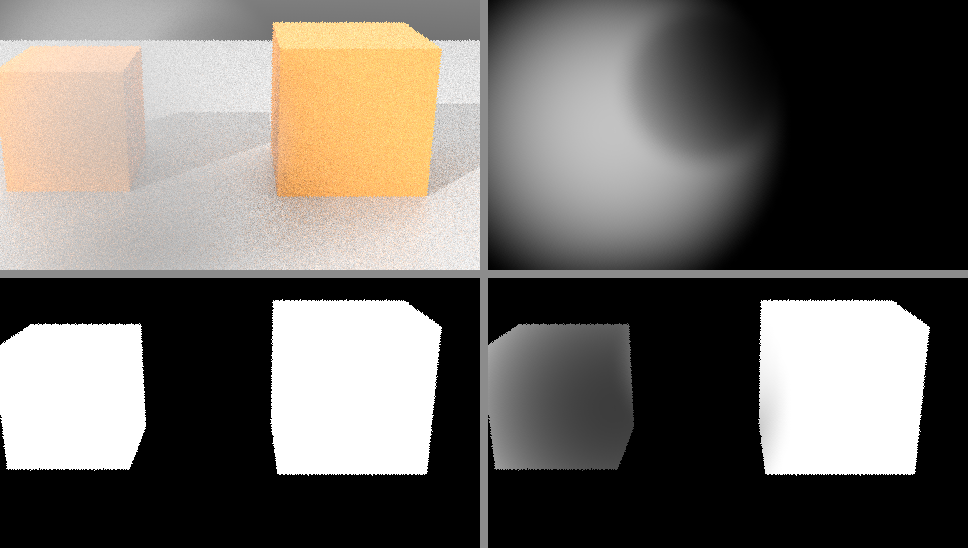

*The check scene at 16 samples a pixel (vector): the render, the fog's own matte, and the boxes' matte with the switch off (bottom left, solid behind the fog) and on (bottom right, faded where the fog hides the box).*

## `moonray.patch`: fog in front of a see-through surface in alpha (`MOONRAY_MODO_FOG_ALPHA`)

Applied by `tools/port_fog_alpha.py`, behind a switch of its own (the plugin's preference, on by default).

### What MoonRay does

In scalar mode, `computeRadiancePresence` sets a presence surface's transparency to
`(1 - presence) * presenceTransparency`. The cutout branch of `computeRadianceRecurse0` just above multiplies by the
volume's transmittance alpha ("We also multiply by the volume's transmittanceAlpha"); the presence branch does not. In
vector and XPU modes a camera path's alpha is the sum of its entries (`fillBundledRadiance`; the miss branches of
`RayHandlers.cc` and `XPURayHandlers.cc`): a surface after a volume counts its pixel weight in full, and the volume's
opacity is counted only for a ray that misses.

### Why that fails

Where the fog's own opacity is not counted, fog in front of a presence surface is missing from alpha. Fog hiding 0.60
in front of a pane of presence 0.4 against the sky gives an alpha of 0.40, where the two hide 0.60 + 0.40 x 0.4 = 0.76.
The picture composites thinner than it renders.

### The change

- Scalar: the presence transparency is multiplied by `reduceTransparency(vt.mTransmittanceAlpha)`, as the cutout's is.
- Vector and XPU: `PathVertex` gains `modoFogFront` (1 at the camera: how much of what lies behind the volumes passed
  so far shows through) and `modoFogPending` (0 at the camera: those volumes' opacity not yet counted). RayState's ISPC
  padding gives up the 8 bytes (`RAY_STATE_MEMBERS_PAD` 28 to 20, 76 to 68). After a camera ray's volumes are marched,
  `pending += pathPixelWeight * front * (1 - transmittance)` and `front *= transmittance`. A camera ray's alpha entry is
  `pending + front * MoonRay's alpha`; a miss, a hit light or a hit on geometry with no material counts `pending`
  alone. A presence continuation keeps `pending` only when the surface it leaves has presence 0 (it is not shaded and
  so counts nothing). A cutout counts `pending` and nothing behind it.
- Without the switch the two floats stay 1 and 0, and every alpha is MoonRay's.

### How it was checked

The fog ball of the Cryptomatte check with a pane of presence 0.4 between it and the boxes
(`test-results/fog-alpha`), scalar, vector and XPU: with the switch on, every pixel's alpha equals the sum of its
Cryptomatte coverages (0.0000 worst difference; 0.76 at the pane against the sky); off, MoonRay's (0.36 worst). Colour
is unchanged: identical in scalar, and in vector within the run-to-run noise of two renders with the switch off. In a
scene without a presence surface the alpha is unchanged.

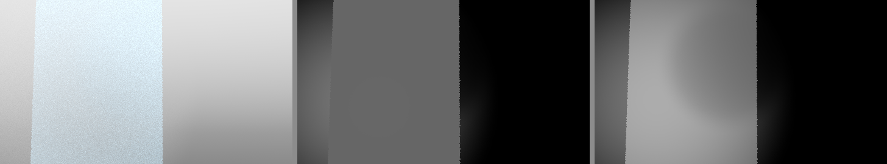

*A pane of presence 0.4 with fog in front of it and sky behind (left); its alpha with the switch off, the pane alone (middle), and on, the fog counted in front of the pane (right). 16 samples a pixel, scalar.*

## `moonray.patch`: a light the camera sees, in light path outputs (`MOONRAY_MODO_CAMERA_LIGHT_LPE`)

Applied by `tools/port_camera_light_lpe.py`, behind a switch of its own (the plugin's preference, on by default).

### What MoonRay does

The miss handlers in vector and XPU modes (`RayHandlers.cc` and its copy, `XPURayHandlers.cc`) declare two variables again inside
their branches: `hitLight`, so that the one the light path code asks is always null, and `lpeStateId` in that code's case 1, so
that the state it accumulates with stays -1. A light a camera ray sees past every surface reaches no light output. Scalar mode has
it right. `C<L.'modo_environment'>`, the kit's Environment background output, was black in vector and XPU modes.

### The fix

The light seen is kept, and the transition to it made, where the camera ray's state is valid. Both handlers need it: with
`RayHandlers.cc` alone, an XPU render's tiles have the output only where they fell back to the CPU, in blocks.

### What the plugin does with it

With Alpha on, a render also holds the Environment background. A PNG, TIFF or Targa has it taken out before its colour is divided by
alpha (`image_formats.with_alpha`): a soft edge is part surface and part environment while alpha counts the surface alone, so
that dividing clipped those edges to white. On a test soft edge of alpha 0.125, the stored colour went from 1.0 to 0.80 on XPU2 and
0.81 on XPU, against 0.81 and 0.82 with the environment hidden from the camera. An EXR keeps its colour as rendered, and holds
the channel for a compositor. A MoonRay EnvLight item has no such label, so soft edges in front of one are not helped.

XPU2 follows the switch (`modoSwitches` 8). Off, MoonRay is as its source has it, and pictures are as they were.

## `moonray.patch`: mirrored meshes face outward (`MOONRAY_MODO_MIRRORED_MESHES`)

Applied by `tools/port_mirrored_meshes.py`, behind a switch of its own (the plugin's preference, on by default).

### What MoonRay does

`PolygonMesh::transformPrimitive` moves a mesh's vertices by its `node_xform` with its faces in the order given, so a placement
that mirrors the mesh (a negative scale) turns every face's winding over: Embree's geometric normal, from the winding, points
inward. The mesh's own normals go through the inverse transpose and keep pointing out. At a hit MoonRay turns both normals to
the side the ray came from by the geometric one, and the shading normal ends up facing away from the camera: a mirrored mesh
with vertex normals renders black (a tester's Modo scenes). One without them is shaded by smooth normals made from the
turned-over faces, and comes out slightly wrong.

### The fix

`PolyMesh` and `OpenSubdivMesh` reverse the orientation of a mirrored mesh as they tessellate (`reverseOrientation`, which
`reverse_normals` uses), so its winding is outward again; a mesh both mirrored and set to `reverse_normals` is not reversed.
Its own normals are negated for `reverse_normals` alone, as before; smooth normals `PolyMesh` makes from a mirrored mesh's faces
are negated where they are made (in `initAttributesAndDisplace`, after any displacement), as the mirror turned them over.

A cube of quads, lit from one side, mirrored and beside the same cube with the mirror baked into its vertices:

| | MoonRay as it is | With the switch | Mirror in the vertices |
|---|---|---|---|
| quads, with normals | 0.0 (black) | 62.03 | 62.03 |
| quads, without normals | 32.45 | 42.36 | 42.36 |
| triangles, with normals | 0.0 (black) | 62.02 | 62.03 |
| triangles, without normals | | 41.11 | 41.11 |

XPU2 follows the switch (`modoSwitches` 16: the same winding reversal of a mirrored mesh it bakes; mirrored instances were
already right) and gives the same values within its noise. Off, MoonRay is as its source has it, and pictures are as they were.

## `scene_rdl2.patch`: MoonRay starts with any PATH (`MOONRAY_MODO_DSO_SEARCH`)

Applied by `tools/port_dso_search.py`, behind a switch of its own (the plugin's preference, on by default).

### What MoonRay does

As it starts, `DsoFinder::guessDsoPath` reads each PATH entry as a folder, looking for `moonray.exe` so as to find the scene
classes beside it. It checks only that an entry exists, so an entry that is a file stops MoonRay before any scene is read: a
tester whose PATH named `c:\Windows\System32\cmd.exe` got "filesystem error: directory iterator cannot open directory: Not a
directory" on every preview and every `.rdla`. It compares names without their extension with `moonray.exe`, which never
matches on Windows, so it always reads the whole of PATH. `SceneContext::loadAllSceneClasses` reads `RDL2_DSO_PATH` the same way.

### The fix

Entries that are not folders, or cannot be read, are passed over without throwing, and `moonray.exe` is matched by its whole name,
so the look stops at the first folder holding it (the kit puts its runtime first). Checked with `cmd.exe` in PATH: MoonRay's own
stops with the error above; with the switch on, the scene renders.

### What the plugin does with it

The kit also hands MoonRay a PATH of folders only (`native.folders_only`), so a runtime without this patch starts too. Off,
MoonRay is as its source has it.

## `moonray.patch`: each Cryptomatte sample counted once (`MOONRAY_MODO_CRYPTO_ONCE`)

Applied by `tools/port_crypto_once.py`, behind a switch of its own (the plugin's preference, on by default).

### What MoonRay does

In vector and XPU modes a camera path reaches the film as several radiance entries, which film threads can add at once.
`Film::addSampleBundleHandlerHelper` gives the path's surface its Cryptomatte coverage with the first of them: it reads
the path's `CryptomatteData::mIsFirstSample`, adds the sample, then clears the flag.

### Why that fails

Two threads that read the flag before either clears it both add the coverage. Now and then every sample of a pixel is
counted twice, and its mattes add up to twice its alpha (coverage 2.0 for an opaque surface).

### The change

With the switch on, the flag is read and cleared in one atomic exchange (`modoTakeFirstSample`, `ModoCryptoOnce.h`),
so one entry alone adds the coverage. Off, MoonRay's read then clear.

### How it was checked

Vector renders of the fog Cryptomatte scene at 480 x 270 and one sample a pixel, counting pixels whose coverage goes
over 1: 2 of 16 renders without this switch had one (one with fog in Cryptomatte on, one with it off); then 2 of 54
off and none of 54 on. A rare race is not proven gone by this, but the exchange leaves no
window for it.

## `moonray.patch`: a stopped render finishing the tiles in hand (Stop finishes the tiles in hand)

Applied by `tools/port_drain.py`. The plugin's preference "Stop finishes the tiles in hand" (on by default) decides
whether the plugin asks for it; off, MoonRay is stopped as its own source stops it.

### What MoonRay does

A render can be stopped at once (cancelled), which leaves the samples then in flight unpaid: the tiles the workers
were on stay dark or coarse in the picture. Or it can be stopped at the end of a pass, which may be most of the render
away.

### Why that fails for a preview

When a preview is stopped by hand, or by Smart Render once its picture is clean enough, the picture is kept and
denoised. Stopped at once, it has dark and coarse patches where the hard tiles were, which the denoiser smears.

### The change

`RenderDriver::requestDrain` (reached through `RenderContext::requestDrain`, which the plugin's persistent session
calls when asked): the workers take no new tiles, the tiles in hand are rendered to the end, the queues are drained as
at the end of any pass, and the frame ends there as a finished one, every buffer written. It does nothing unless asked.

### How it was checked

A preview stopped part way with the switch on and with it off: on, the session is asked to drain and the frame ends as
a finished one; off, the plugin does not ask, and stops as MoonRay's own stop does
(`tools/probe_drain_override.py`).

## `moonray.patch`: UsdPreviewSurface's specular colour (`MOONRAY_MODO_USD_SPECULAR`)

Applied by `tools/port_source_switches.py`, behind a switch of its own (the plugin's preference "UsdPreviewSurface
specular colour", on by default).

### What MoonRay does

With `useSpecularWorkflow` set, UsdPreviewSurface adds no highlight at all: its source says "We can't support this until
we implement Schlick fresnel so do nothing for now."

### Why that fails

A material made in the specular workflow, as USD and MaterialX assets often are, renders as if it had no reflection.

### The change

`BsdfBuilder::addSchlickReflection` (a GGX lobe, or a mirror when the roughness is 0, with Schlick's Fresnel from the
`specularColor` at normal incidence) is added in that workflow, in the scalar and vector code. Off, nothing is added.

### How it was checked

A ball in the specular workflow under a rectangle light, rendered with the switch on and off: on, it has its highlight;
off, none (mean difference 47 across the picture).

## `moonray.patch`: an image without alpha reads as opaque (`MOONRAY_MODO_OPAQUE_ALPHA`)

Applied by `tools/port_source_switches.py`, behind the preference "Images without alpha are opaque", on by default.

### What MoonRay does

`BasicTexture`, and `UdimTexture` for an image named with `<UDIM>`, sample through OpenImageIO, whose fill value for a
channel the image does not have is 0. An image with three channels has an alpha of 0 wherever a material reads it.

### Why that fails

An `ImageMap` with `alpha_only`, or anything taking a texture's alpha as a mask or presence, reads an ordinary RGB image as
fully transparent. The plugin's image layers also recover unassociated colour by dividing by the image's alpha
(`ModoTextureMap` blend 5), so a colour read through such an image is multiplied by a million: a `<UDIM>` tile set lit a
whole scene white until `UdimTexture` had the change too.

### The change

The fill is 1 for every quality level of the texture, in `BasicTexture` and in every tile of a `UdimTexture`: a missing
alpha channel is opaque, as `ImageMap`'s alpha-only mode documents. Off, OpenImageIO's 0.

### How it was checked

An `ImageMap` with `alpha_only` on a three-channel texture as a ball's albedo: white with the switch on, black with it off.

## `moonshine.patch`: rough glass under a mirror smooth surface (`MOONRAY_MODO_TRANSMISSION_ROUGHNESS`)

Applied by `tools/port_source_switches.py`, behind the preference "Rough glass under a smooth surface", on by default.

### What MoonRay does

`DwaBaseLayerable::createLobes` builds a mirror reflection and mirror refraction pair whenever the surface roughness is 0,
even when `use_independent_transmission_roughness` gives the transmission a roughness of its own.

### Why that fails

Frosted glass under a polished surface (roughness 0, transmission roughness above 0) refracts as clear glass.

### The change

The mirror pair is used only when the transmission is also mirror smooth, or there is none; otherwise the microfacet
lobes, which take the transmission roughness. Off, MoonRay's test on the surface roughness alone.

### How it was checked

A smooth glass ball with a transmission roughness of 0.6 in front of a small bright light: with the switch on the light
seen through the ball is blurred, off it is sharp (mean difference 22).

## `moonray.patch`: Auto renders on the graphics card first (`MOONRAY_MODO_AUTO_XPU`)

Applied by `tools/port_source_switches.py`, behind the preference "Auto renders on the graphics card first", on by
default. It is in Preferences > MoonRay > XPU (graphics card), not on the Source Overrides page.

### What MoonRay does

`RenderContext::startFrame` starts the Auto execution mode in vector mode. The XPU branch is in the source, commented out
("Uncomment the following to have AUTO mode start with XPU").

### Why the plugin changes it

On a machine with a supported graphics card, Auto then renders on it, which is much quicker; a scene with something XPU
does not support still falls back (`allowUnsupportedXPUFeatures` is false).

### The change

Upstream's own branch, taken with the switch on. Off, Auto starts in vector mode as MoonRay's source does.

### How it was checked

The same scene in Auto: MoonRay's log says "Executing an XPU render since execution mode was set to auto." with the switch
on, and "Executing a vectorized render since execution mode was set to auto." with it off.

## `moonray.patch`: VDB fire from temperature or flames grids (`MOONRAY_MODO_SCALAR_EMISSION`)

Applied by `tools/port_scalar_emission.py`, behind a switch of its own (the plugin's preference, on by default).

### What MoonRay does

`VdbVolume::initEmissionSampler` (`lib/rendering/geom/prim/VdbVolume.cc`) takes only an RGB grid (`openvdb::VectorGrid`) as a
VDB's emission grid. Any other is refused at load with `Emission grid: "flames" is not an RGB grid.`, and the whole VDB
geometry is dropped from the render, smoke included. EmberGen, Houdini and Blender write their `temperature`, `flames` and
`heat` grids as single values (float grids), so none of their fire glows: a tester's EmberGen explosion rendered as an
empty floor.

### The fix

A float emission grid is read and made into an RGB grid of the same shape (its topology copied, tiles kept as tiles), each
value v as (v, v, v), its background and transform kept (`modoGreyGrid`). From there MoonRay goes on as with an RGB grid:
the emission sampler, its distribution, the emission sample rate. The VDB volume's `incandescence_gain_mult` gives the glow
its colour and strength.

JangaFX's free Midair Explosion (frame 40, emission grid `flames`, incandescence gain mult (24, 9, 2.4)), 480 x 300, 16
samples a pixel:

| | MoonRay as it is | With the switch |
|---|---|---|
| MoonRay (scalar) | the VDB dropped: an empty floor | the fire, lighting the floor (691 s) |
| XPU2, graphics card | | the same picture (116 s) |
| XPU2, processor | | the same picture (969 s) |

XPU2 follows the switch (`xpu2_geom.cc` makes the grid by the same steps, for the card, the host and the emission
distribution); its average matches MoonRay's within 0.001%, the card's and the processor's pictures within 0.007 a pixel.
The MoonLightIPR preview follows it too: its single-number grid is expanded to grey colours once (`moonlightipr_volumes.py`).
Off, MoonRay is as its source has it.

## `moonshine.patch`: toon lines without gaps (`close_line_gaps`)

A new attribute of `ToonDisplayFilter`, behind the preference "Toon lines without gaps", on by default; with it off the
plugin does not write the attribute and the filter renders as MoonRay's own.

### What MoonRay does

The edge detectors answer on either side of a crease and next to nothing at its middle, and `saturate` makes that no ink:
a line comes out as two, with the surface showing between them, broken into dashes by the pixels' staircase. More samples
only clean it.

A toon head as a tester rendered it before the change: the outline and the creases of the face come out doubled and
dashed, the surface showing through the middle of each line. Images by Ironic3D.

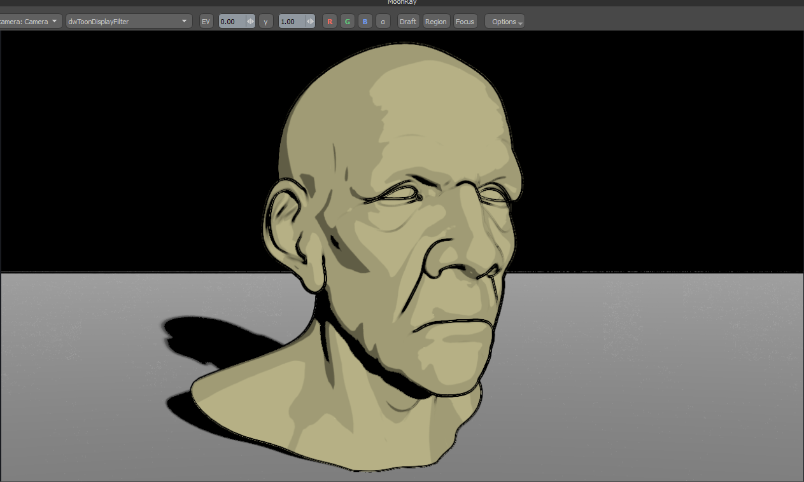

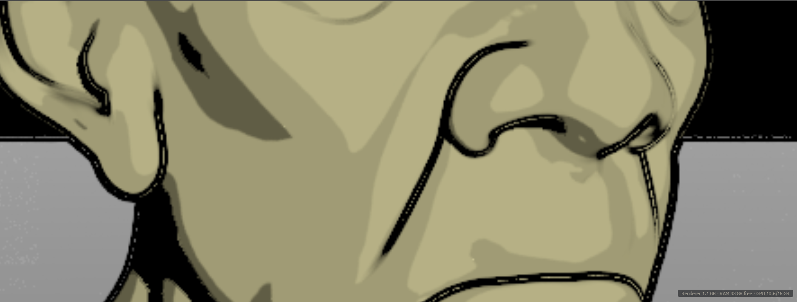

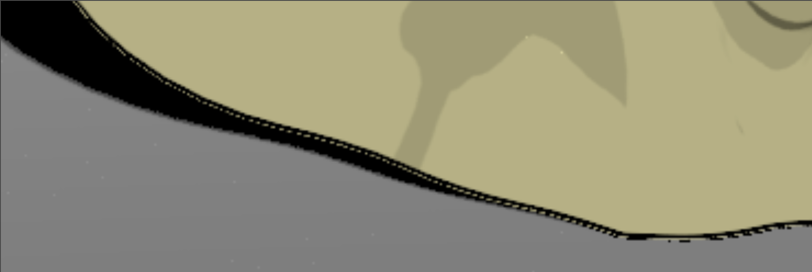

### The change

Near an edge (the nine pixels around this one not on one surface), a pixel takes the most of, along each of four axes, the
lesser line of its two neighbours. The depth and normal inputs' window widens by 2 to give the neighbours their kernels.

The result: with the switch on, the lines come out whole, one solid stroke along each edge, here the lines alone
(Output Mode set to lines), white on black, on the material ball.

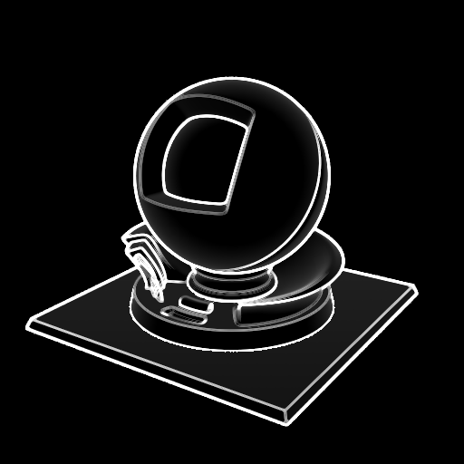

## `moonshine.patch`: toon lines apart from the shading (`output_mode`)

A new attribute of `ToonDisplayFilter`, behind the preference "Toon lines apart from the shading", on by default; with it
off the plugin does not write the attribute and the filter renders as MoonRay's own.

### What MoonRay does

`ToonDisplayFilter` multiplies its cel shading by its ink, `result * min(inkD, inkN)`: the lines and the shading come out
as one picture.

### Why the plugin changes it

Artists composite toon lines over the shading themselves (a colour, a width, a different weight per shot), which needs the
lines as a picture of their own.

### The change

`output_mode`: 0, shading and lines (MoonRay's); 1, the lines alone, as much white as there is ink on black; 2, the shading
without its lines. Two Toon filters, one of each, are two buffers of the preview and two channels of the EXR.

### How it was checked

Built (`ninja bin/ToonDisplayFilter.so bin/ToonDisplayFilter.so.proxy` in `build/native-renderer-avx`), and rendered by
`tools/check_toon_lines.py`: each Output Mode's Toon channel, with and without closing the gaps.

## `moonshine.patch`: toon lines in a colour (`ink_color`)

A new attribute of `ToonDisplayFilter`, behind the preference "Toon lines in a colour", on by default; with it off the
plugin does not write the attribute and the lines are black, as MoonRay draws them. Asked in issue 134.

### What MoonRay does

The ink only darkens: `result * ink` makes every line black. A tester laying the lines over the beauty took the lines
alone (white on black), inverted them and multiplied, and could not fade them without showing white.

### The change

`ink_color` (black by default): where Output Mode draws the shading with its lines, each pixel is the shading where there
is no ink and the ink's colour where there is, `result * ink + ink_color * (1 - ink)`; black ink is MoonRay's own picture.
The lines alone stay white on black: they are the lines' cover, a matte.

Kit side (not MoonRay's source, so no switch): the Compositor's Ink Lines node lays a colour over a picture through such a
matte, Mix fading the lines towards the picture beneath; and a buffer of the lines alone is saved as the lines in their Ink
Color with their cover as alpha (premultiplied in OpenEXR, straight in PNG, TIFF and Targa).

The material ball with red ink:

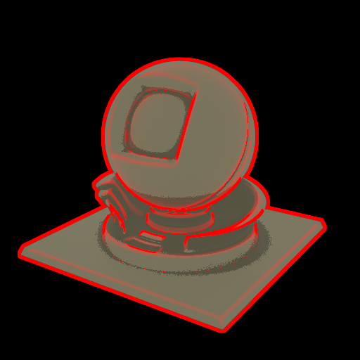

### How it was checked

Built (`ninja bin/ToonDisplayFilter.so` in `build/native-renderer-avx`, a runtime on PATH) and rendered three times on the
material ball: black ink, red ink, and the lines alone. Where there is no ink the red render matches the black one within
3e-6, and where there is, the shading plus red as much as the lines cover, within 6e-5; the lines alone stay white on
black. The Ink Lines node gives the same values from the compositor program, the image tool and the probe's arithmetic
(`tests/test_toon_ink_lines.py`).

## `moonshine.patch`: toon lines smoothed (`smooth_lines`)

A new attribute of `ToonDisplayFilter`, behind the preference "Toon lines smoothed", on by default; with it off the plugin
does not write the attribute and the lines are as MoonRay draws them. Asked in issue 134.

### What MoonRay does

An outline comes from depth. The jump in depth across a silhouette is far over any threshold, so each pixel of an outline
is all ink or none, and the outline steps with the pixel grid along every curve. Lines from normals, which change
gradually, are already soft.

### The change

Where the line changes within the nine pixels around a pixel, the line (with its gaps closed, where that is on) is worked
out over the 7 x 7 pixels around it and blended along its own direction, as FXAA does a picture's edges: two and four taps
read between pixels along the line, up to four pixels long, the four-tap result kept unless it leaves the range of the
pixel and its corners. A step becomes as much ink as the line covers there; a line's inside and its straight runs stay as
they were. The depth and normal inputs' window widens by 6 to give the 7 x 7 pixels their kernels. Elsewhere nothing more
is read.

The material ball's lines alone, close up: Laplacian of Gaussian above and Sobel below, as MoonRay draws them on the left
and smoothed on the right.

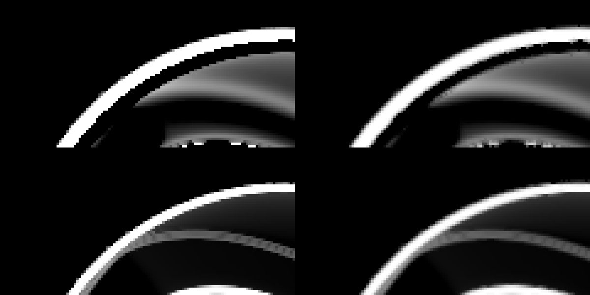

### How it was checked

Built and rendered on the material ball (512 x 512, 8 samples) with each detector, with and without the switch: the
lines' total ink changes by under 1% (14,281 to 14,201 with Laplacian of Gaussian), and the render takes no longer.

### A final render's lines with their alpha (kit side, no switch)

MoonRay writes a display filter's picture as R, G and B alone. Once a render to a file is written (after its composite and
any copy in another type, which read the lines as MoonRay wrote them), the channels of each Toon filter set to Lines only
become its lines in its Ink Color, premultiplied, with `<name>.A` what they cover, in whichever part of the EXR holds them
(`toon_lines.py`). The other channels, parts, headers, data types and compression are kept; a file whose lines have an
alpha already is left alone. Checked on a three-part EXR with a Cryptomatte header and a half-float lines part, and on a
single-part one: alpha equal to the lines' cover (within half-float rounding), colour the ink times it.

## `cl1-pool-scale.patch`: a larger store for rays in flight (no switch)

The change is in `moonray.patch` too, which the build applies; the file alone is kept for the one-library rebuild
(`tools/install_moonlightipr.py`).

`ThreadLocalState.cc` gives each thread four times MoonRay's store of CacheLine1 items, about 4 GB of address space at 16
threads, touched only as it is used. In XPU mode, with many render outputs and adaptive sampling, MoonRay's own size runs
out and the render stops with "timed out whilst trying to allocate a CacheLine1". It changes no picture, so it is not a
MoonRay Source Override; `MOONRAY_MODO_CL1_POOL_SCALE` sets another multiple, from 1 (MoonRay's own) to 8.

