# Rhea: results

Machine: RTX 3090, i7-4930K (6 cores, 12 threads), 64 GB. Nothing else rendering during timed runs. Runs 2026-11-19 and 20.
Rhea was named Sol, and before that "Bregman", earlier the same day; sections 2 to 5 are its first two steps.

## In short

**The denoiser (section 17).** Through the kit's realtime denoiser (OptiX), XPU2's 2-sample frames catch up with
Rhea's, and with diffuse bounces pass them (block error 0.9e-3 against 1.2e-3): Rhea's error is blotches, which a
denoiser keeps. The virtual surface's normals guide no better than the normal output. Found on the way: the kit's
realtime normal guide is turned by the camera's rotation.

**Phase 2 capped, persistent probes (section 16).** Phase 2 takes at most 2 samples a pixel a frame; probes live from
frame to frame, triangulated each frame (Delaunay, then Bregman flips), and phase 2's own camera rays verify the
reconstruction. At rest a frame costs what XPU2's 2 samples cost, and after 32 frames the picture has XPU2's block
error at 1.7 times less per-pixel error. Moving, **a frame every 0.041 s against XPU2's 0.037 to 0.040 s** (2 spp) at 3.4 to 4 times
less per-pixel error and half the block error, and 20% faster than rebuilding the quadtree each frame at the same
error.

**The floor (section 14).** Where the first geometric pass converges little of the frame (Sponza: 8%), Rhea renders it
as XPU2 does: on Sponza the same picture, and along a moving camera 5.71 s a frame against XPU2's 6.00 s. On the test
scene nothing changes (its first pass converges 92%).

**Eighth step, accumulating frames (section 11).** Jittering the probes across frames did not help: the blotches were
probe noise, which fresh seeds already average, and the 0.02% that remains is one-signed. What did: accumulating frames
so that phase 1's weight falls as phase 2's samples pile up, as the bias policy chosen at the start asks.

**Seventh step, diffuse bounces (section 10).** Not the frame's shape but the samples: with diffuse bounces the error
was indirect light, which phase 2 alone reduced. The probes now carry the whole light where the scene bounces
diffusely: **0.20 s at relative MSE 1.0e-4 against XPU2's 0.27 s at 1.24e-3** (9 spp, the same block error), and along
the moving camera a frame every 0.181 s against 0.259 s.

**Sixth step, pipelined frames (section 9).** The CPU prepares the next frame's geometry and finishes the last on 4
background threads while the GPU renders: along a moving camera, **a frame every 0.106 s against XPU2's 0.253 s** (36
spp, at twice Rhea's error). With diffuse bounces 0.358 s against 0.271 s.

**Fifth step, one frame (section 8).** Probes ride in phase 2's frame, their pixels taking extra samples that stop at the
first hit (a depth limit per pixel in XPU2). Without diffuse bounces, on the GPU alone: **Rhea 0.13 s at relative MSE
2.4e-5, mean ratio 0.9998; XPU2 0.27 s at 4.8e-5** (36 spp), in the same process. With diffuse bounces Rhea still trails
(0.37 s at 1.4e-3 against 0.26 s at 1.24e-3).

**Fourth step, shading (section 7).** Dense frames on XPU2's grid (each tile only as deep as its deepest pixel; probes
packed 64 to a tile), 64 samples a probe, and the light's curvature in the reconstruction. On the overflow scene
without diffuse bounces, in the same process: **Rhea 0.156 s at relative MSE 2.7e-5, mean ratio 0.9998**, against XPU2's
0.255 s at 4.8e-5 (36 samples a pixel) and 0.135 s at 1.2e-4 (16): about 1.6 times faster at less error, or 4.4 times
less error for 15% more time. Light passes (probes split where the light bends) were built and measured; on this
scene they chase the probes' noise, and more samples a probe pay better. With diffuse bounces Rhea still trails XPU2
(0.38 s at 1.4e-3 against 0.25 s at 1.24e-3).

**Third step, Rhea's indexer (section 6).** Probes in geometric passes, coarse to fine, reconstruct the visible surface
exactly within the tolerance: no converged pixel's depth is off by more than it, no converged pixel shows another mesh,
no background pixel hides geometry. On the overflow scene without diffuse bounces Rhea now beats XPU2 at equal error:
0.19 s at relative MSE 3.6e-5, against XPU2's 0.28 s at 4.8e-5 (36 samples a pixel), in the same process, with 2,528
probes where the first step had 19,200. Its bias is higher than XPU2's (mean ratio 0.9994, block error 5.6e-4 against
1.0001 and 1.8e-4): the light between coarse probes, which is the shading step's work. With diffuse bounces it still
trails XPU2 (0.35 s at 1.3e-3 against 0.26 s at 1.24e-3).

**First step (sections 2 to 4).** The prototype works end to end on XPU2's unchanged CPU and GPU lanes. **On the
overflow test scene it did not beat XPU2 at equal time:**

| Scene | Engine | XPU2 at the same error | Engine's bias |
|---|---|---|---|
| overflow (no diffuse bounces) | 0.26 s, relative MSE 6.3e-5 | about 0.23 s (27 spp, interpolated) | mean ratio 1.0000 |
| overflow, `max_diffuse_depth` 2 | 0.38 s, relative MSE 1.43e-3 | about 0.22 s (8 spp, interpolated) | mean ratio 1.0001 |

What works: where the region buffer trusts phase 1 (73% of the pixels) its reconstruction of the direct light is as
good as XPU2 at 36 to 64 samples a pixel, and phase 2 removes the bias on average. What loses: the overhead of two
sparse frames on XPU2's grid, and, with diffuse bounces, the indirect light's noise, which phase 1 does nothing for
(section 4).

The second step (section 5) made phase 1 a cache for phase 2's bounces, unbiased by Russian roulette, and added OpenQMC
past the first hit. Both work and stay unbiased, but each takes about 1% off the error on this scene: few bounces land on
what the camera sees, XPU2 already stratifies the dimensions that matter most, and the cache's lookup costs the GPU 18%.

## 1. How it was measured

- Scene: `MoonRayForModo-xpu2/test-results/overflow/scene.rdla`, 320 x 240. Its `pixel_samples` 8 is MoonRay's square
  root: **64 samples a pixel**. Exact uniform sampling (`XPU2_SESSION_UNIFORM_BUDGET=0`).
- **Reference**: XPU2 at the scene's own 64 samples a pixel, 16 seeds averaged (`tools/make_reference.py`). Not a
  1024-sample render: MoonRay and XPU2 narrow a texture's filter as the samples a pixel grow, so a 1024-sample frame is
  sharper than the converged 64-sample one.
- **Engine and XPU2 in one process** (the engine, `bregman_engine.exe` then, `rhea_engine.exe` now: `... xpu2_spp=4,9,16,36,64`, driven by `tools/run_rhea.py`):
  the same lanes, the same clock (configuration upload, renderer, frame), one warm-up run then three timed, medians
  reported. XPU2's frames carry the engine's two light path outputs too, so they pay the same AOV cost.
- Errors against the reference: relative MSE (MoonRay's: (t - r)^2 / (r^2 + 0.01)), 8 x 8 block error (bias shows
  here), mean ratio of the image sums.
- Phase 1 renders on the GPU alone while the CPU traces the probes and scans (`p1mode=1`, `overlap=1`); phase 2 on both.

XPU2's own benchmark worker, for the record: 64 spp in 0.36 to 0.47 s of sampling, 1.21 s preparation, the GPU taking 90%
of 4.9 M samples (`tools/run_xpu2_baseline.py`; one run of the worker ended with "terminate called without an active
exception" after printing its report, in teardown).

## 2. Overflow scene, no diffuse bounces

XPU2 in the engine's process: 4 spp 0.048 s (relative MSE 9.4e-4), 9 spp 0.080 s (3.5e-4), 16 spp 0.14 to 0.18 s
(1.2e-4), 36 spp 0.29 s (4.8e-5), 64 spp 0.41 s (2.1e-5). About 25 ms a frame fixed plus 5.5 ms a sample a pixel.

| Engine settings | Time | Phase 1 / 2 | Phase 2 spp | Relative MSE | Block error | Mean ratio |
|---|---|---|---|---|---|---|
| stride 4, 64 spp a probe, phase 2 4/16/64 (first run, before the silhouette rule) | 0.238 s | 0.066 / 0.150 | 6.0 | 4.8e-4 | 1.1e-3 | 0.9971 |
| stride 4, 64, phase 2 4/16/64, silhouettes | 0.284 s | 0.068 / 0.189 | 6.6 | 9.8e-5 | 4.6e-4 | 0.9994 |
| stride 4, 64, phase 2 4/8/16 | 0.177 s | 0.073 / 0.075 | 4.0 | 1.8e-4 | 5.4e-4 | 0.9992 |
| stride 2, 16, phase 2 4/8/16 | 0.182 s | 0.061 / 0.081 | 3.7 | 1.25e-4 | 5.6e-4 | 0.9999 |
| stride 2, 16, phase 2 2/8/16 | 0.176 s | 0.060 / 0.077 | 2.3 | 1.29e-4 | 5.7e-4 | 0.9999 |
| **stride 2, 32, phase 2 4/16/32** | **0.260 s** | 0.094 / 0.122 | 4.3 | **6.3e-5** | 4.0e-4 | 1.0000 |
| stride 4, 64, phase 2 8/16/32 | 0.239 s | 0.068 / 0.143 | 7.8 | 1.06e-4 | 4.5e-4 | 0.9994 |

(Phase 2's samples: trusted / cell only / everything phase 1 does not trust; background 1. Phase 1 counts as m0 = 64
samples where trusted.)

Where the best run's error lies (`tools/class_errors.py`):

| Region class | Pixels | Phase 1's mean signed error | Share of the final relative MSE |
|---|---|---|---|
| trusted | 55,908 (73%) | -0.00016 | 3.1e-5 |
| cell only (no Delaunay triangle of connected probes) | 307 | +0.0014 | 1.4e-5 |
| silhouette | 829 | -0.044 | 7.8e-6 |
| saddle | 818 | +0.017 | 5.2e-6 |
| radiance edge | 303 | +0.011 | 1.8e-6 |
| uncovered by any patch | 640 | -0.0027 | 1.8e-6 |
| background | 17,920 | 0.00003 | 9e-7 |

The silhouette rule (a pixel next to another mesh, no surface or a depth its cell's plane does not predict, read from the
scans' depth buffer) took the first run's error from 4.8e-4 to 9.8e-5: 93% of that error had been in 3% of the pixels,
silhouette pixels whose footprints blend a ball with the wall behind it while the reconstruction gave them the ball's
probe alone.

Scans in the best run: 19,200 probes, 14,560 on a mesh; patches of 6.3 triangles on average (the displaced balls are
150,146 triangles), up to the 64-ring limit, none cut by the triangle limit; 70 vertices welded across seams, no
non-manifold edge; 162,971 Bregman Delaunay faces made, 301 saddle windows. Host time: probe rays 6 ms, scans 14 ms
(under phase 1's GPU frame), region buffer 37 ms.

| Engine (stride 2, 32, 4/16/32) | Phase 1 reconstruction | Region classes | XPU2, 36 spp | Reference |
|---|---|---|---|---|
| 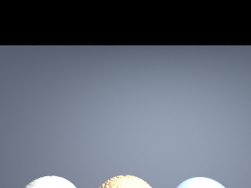 | 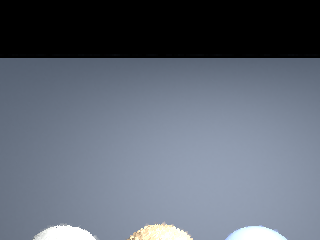 | 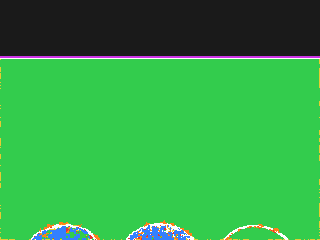 |  |  |

| Engine's error (x10, red brighter, blue darker) | Bregman Voronoi cells | Region buffer (scans' inverse depth) | Phase 2's samples |
|---|---|---|---|
| 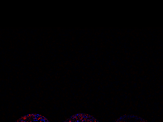 | 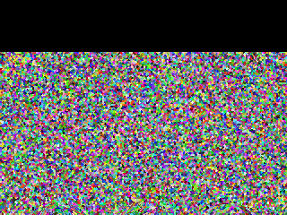 | 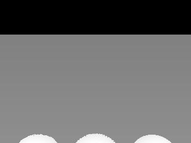 | 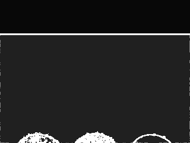 |

Region colours: green trusted, yellow cell only, white silhouette, blue saddle, orange radiance edge, purple uncovered,
red untrusted, dark grey background. On the wall every tangent plane is the same plane, so the cells are the probes'
Euclidean Voronoi cells (the tie rule); on the balls they follow the facets.

## 3. Overflow scene, two diffuse bounces

`SceneVariables { ["max_diffuse_depth"]=2 }` over the scene; its own 16-seed reference.

XPU2: 4 spp 0.12 s (3.07e-3), 9 spp 0.25 s (1.24e-3), 16 spp 0.44 s (5.9e-4), 36 spp 0.90 s (2.4e-4), 64 spp 1.51 s
(1.25e-4).

| Engine settings | Time | Phase 1 / 2 | Phase 2 spp | Relative MSE (phase 2's own beauty) | Mean ratio |
|---|---|---|---|---|---|
| stride 2, 32, phase 2 4/16/32 | 0.408 s | 0.102 / 0.270 | 4.3 | 3.3e-3 (2.7e-3) | 1.0001 |
| stride 2, 16, phase 2 8/16/32 | 0.382 s | 0.058 / 0.284 | 7.2 | 1.43e-3 (1.24e-3) | 1.0001 |
| stride 4, 64, phase 2 8/16/32 | 0.387 s | 0.067 / 0.294 | 7.8 | 1.44e-3 (1.23e-3) | 0.9995 |

| Engine (stride 2, 16, 8/16/32) | XPU2, 9 spp | Reference |
|---|---|---|
| 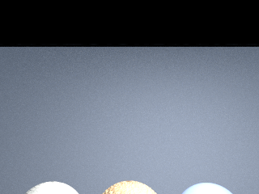 |  | 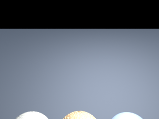 |

## 4. What the numbers say

1. **The reconstruction is good where the region buffer trusts it.** 73% of the pixels, error at XPU2's 36 to 64 spp
   level, from 0.5 to 4 probe samples a pixel. The scans' depths decide trust well: the silhouette rule alone removed
   four fifths of the error.
2. **The bias does vanish.** With phase 1 weighted m / (m + n), every run's mean ratio is within 0.06% of the reference,
   and 0.01% at stride 2.
3. **Sparse frames cost XPU2 a lot.** A probe frame at 1 pixel in 4 or 16 takes longer than a dense 4-spp XPU2 frame:
   the grid hands out every pixel's sample indices up to the frame's largest count and the skipped ones still pass
   through launches; a warp's neighbouring threads take neighbouring pixels, so 3 in 4 or 15 in 16 idle. Phase 2 has the
   same cost: a few pixels at 32 make the whole grid 32 deep. And each frame has its ~25 ms fixed cost; the engine pays
   two, plus 37 ms of host region work, at a resolution where XPU2's whole 16-spp frame is 140 ms.
4. **With indirect light the split costs variance.** The engine's final image is noisier than phase 2's own beauty
   (1.43e-3 against 1.24e-3). A path's first-hit BSDF sample either reaches a light (direct) or bounces (indirect), so
   within a sample the two are anti-correlated and the beauty's noise is less than their sum's; replacing the direct
   part with phase 1's smooth estimate leaves the indirect part's whole noise. Phase 1 saves light samples, and on this
   scene they are not where the noise is.

## 5. Second step: phase 1 as a cache for phase 2's bounces, and OpenQMC (2026-11-19)

What was built is in DESIGN.md (the "second step"): a bounce landing on a surface phase 1 reconstructed takes phase 1's
radiance and stops with probability 1 - p, else goes on carrying 1 / p less C (1 - p) / p (unbiased for any C); and
OpenQMC's Owen-scrambled Sobol sampler for the light and BSDF samples past the first hit. Both in XPU2's shared
integrator, off unless the engine sets them. The GPU program is the engine's own build (`build_rhea.py --gpu`,
`XPU2_OPENQMC`), compiled by OptiX once (about 13 minutes) into a cache of its own (`OPTIX_CACHE_PATH`, 93 MB); the
kit's shared OptiX cache was not written. With both switches off it gives the earlier numbers exactly.

Overflow scene with `max_diffuse_depth` 2; engine at stride 2, 16 samples a probe, phase 2 8/16/32; CPU and GPU:

| Phase 2 | Phase 2 time | Engine time | Relative MSE (phase 2's own) | Mean ratio |
|---|---|---|---|---|
| neither | 0.285 s | 0.383 s | 1.428e-3 (1.243e-3) | 1.00007 |
| frame cache, p = 0.25 | 0.337 s | 0.447 s | 1.409e-3 (1.221e-3) | 1.00005 |
| OpenQMC, nonMirrorDepth 1 to 3 | 0.284 s | 0.378 s | 1.412e-3 (1.230e-3) | 0.99992 |
| both | 0.338 s | 0.431 s | 1.394e-3 (1.211e-3) | 0.99988 |
| frame cache, p = 1 (looks up, never stops) | 0.351 s | 0.444 s | 1.428e-3, the same image as neither | 1.00007 |
| frame cache, p = 0.05 | 0.333 s | 0.426 s | 1.533e-3 (1.351e-3) | 0.99973 |

XPU2 in the same process: 4, 9, 16 spp in 0.119, 0.248, 0.421 s at 3.07e-3, 1.24e-3, 5.93e-4; with OpenQMC past the
first hit 0.117, 0.247, 0.423 s at 3.04e-3, 1.23e-3, 5.85e-4.

1. **Both are unbiased,** as built: every mean ratio within 0.03%, and the cache's p = 1 run is the plain image exactly.
2. **OpenQMC gains about 1%,** in the engine and in XPU2 alike, at no cost. XPU2 already stratifies the camera and the
   first hit's light and BSDF samples (its own Owen-scrambled Sobol); what is left to OpenQMC is the secondary bounces,
   whose integrands are high-dimensional at 8 samples a pixel. MoonLightIPR's 35-40% came from the dimensions XPU2 already
   has.
3. **The frame cache seldom applies on this scene.** On the CPU alone (where the time is the work), stopping 95% of the
   cache's hits (p = 0.05) saved 6% of phase 2. The camera sees the wall and the balls' tops; bounces from the wall reach
   the balls' backs, bounces from the balls go to the sky or the floor below the frame. Only ball-to-wall bounces land on
   what phase 1 reconstructed. The cache also holds phase 1's direct light only, so the stopped paths' missing indirect
   light comes back through the 1 / p correction as variance.
4. **The lookup costs the GPU 18% of phase 2's sampling** even when every lookup fails (GPU alone: 0.320 s without,
   0.378 s with every lookup rejected at its depth test, 0.396 s with lookups that go on). Not yet explained: the lookup
   is a few divisions and one read of a 1.2 MB table per bounce. It needs a GPU profile.

## 6. Third step: Rhea's indexer and geometric passes (2026-11-19)

What was built is in DESIGN.md section 8: Rhea's indexer handles geometry (mesh clusters and topology), and the probes
reconstruct the visible surface in passes, a quadtree from the root stride s0 down to 2 pixels, a quad splitting until
its reconstruction is the visible surface within the tolerance (sandwich gap 0.002 in relative inverse depth, the scans'
connectivity and boundaries, no crease, nothing in front). Shading is unchanged from the first step: probe frame, then
phase 2 with n_lo where the surface converged and n_hi elsewhere, combined as before. Host-only build (`build-8`); the GPU
program is the second step's (`build-4`), whose XPU2 sources are unchanged.

**The geometry.** Every run, against every pixel's centre traced afterwards (for the report only):

| | Value |
|---|---|
| Converged pixels (trusted or radiance edge) | 55,324 (72%) |
| Their inverse depth against the truth | mean 2.7e-6, 99th percentile 1.0e-6, largest 1.3e-3 (tolerance 2e-3) |
| Converged pixels over the tolerance | 0 |
| Converged pixels that see another mesh than their probes' | 0 |
| Background pixels where geometry is | 0 |

**Why quads split** (s0 16, 383 splits): probes on different surfaces 148, some probes missing 140, other geometry in
front 34, a scan's boundary inside 27, a scan stopped short 24, **the sandwich gap 7**, a crease 3. On this scene the
geometric variance is almost all topology (silhouettes against the wall and the sky); curvature hardly splits anything,
and the tolerance barely matters (0.01 in place of 0.002: 1,729 probes in place of 1,754).

**Convergence by pass** (s0 32): 73.2%, 86.6%, 91.9%, 94.8% and 95.3% of the frame converged after passes 0 to 4. The
4.7% left at the finest stride are the silhouette bands; phase 2 renders them whole.

**Overflow scene, no diffuse bounces** (probe_spp 32, n_lo 4, n_hi 32; medians of 5 timed runs, 3 for s0 4):

| s0 | Probes | Geometry | Phase 1 | Region | Phase 2 | Engine | Relative MSE | Block error | Mean ratio |
|---|---|---|---|---|---|---|---|---|---|
| 4 | 5,829 | 0.016 s | 0.046 s | 0.002 s | 0.136 s | 0.202 s | 3.60e-5 | 4.3e-4 | 0.9998 |
| **8** | 2,528 | 0.014 s | 0.040 s | 0.002 s | 0.135 s | **0.193 s** | **3.56e-5** | 5.6e-4 | 0.9994 |
| 16 | 1,754 | 0.017 s | 0.035 s | 0.002 s | 0.133 s | 0.187 s | 3.94e-5 | 7.4e-4 | 0.9983 |
| 32 | 1,599 | 0.022 s | 0.035 s | 0.002 s | 0.157 s | 0.216 s | 6.73e-5 | 1.18e-3 | 0.9959 |
| first step, stride 2 | 19,200 | (under phase 1) | 0.094 s | 0.037 s | 0.122 s | 0.26 s | 6.3e-5 | 4.0e-4 | 1.0000 |

XPU2 in the same processes: 16 spp 0.135 to 0.155 s at 1.20e-4 (block error 3.0e-4), 36 spp 0.28 s at 4.82e-5 (block
error 1.8e-4, mean ratio 1.0001). Phase 2's time varies from run to run by up to a third (0.12 to 0.23 s for one
setting), as XPU2's frames do between processes (36 spp took 0.36 s in one): compare within a row, and read the totals
as about ±15%.

- **Probes and the region pass.** 2,528 probes at s0 8 against 19,200; the region pass 2 ms against 37 ms (the piece
  evaluated per pixel, section 8.4); geometry 14 to 22 ms on the host, before phase 1, most of it the scans. Before
  the passes shared one pool of threads, starting a dozen threads three times a pass made it 66 ms.
- **The light between coarse probes.** Phase 1's mean signed error over trusted pixels: -0.00024 at s0 8, -0.00064 at
  s0 16, -0.00016 in the first step. A wall quad converges at 16 or 32 pixels because the wall is flat, but the light on it
  is not: the shadow gradients are interpolated over the quad, and the radiance-edge rule (section 2) only catches the
  sharp ones (none of the converged pixels at s0 8, 5% at s0 16, 24% at s0 32). That is the shading step's work; geometry is not where the error
  is.
- **The piece** is 166 KB at s0 16 and 235 KB at s0 8 (sites and quads), against the per-pixel frame cache's 1.2 MB at
  320 x 240 and the meshes' 2.7 MB. It grows with the probes, not the pixels.

**Overflow scene, two diffuse bounces** (probe_spp 16, n_hi 32):

| s0 | n_lo | Engine | Relative MSE | Mean ratio |
|---|---|---|---|---|
| 16 | 4 | 0.293 s | 3.04e-3 | 0.9989 |
| 8 | 4 | 0.302 s | 3.27e-3 | 0.9997 |
| 16 | 8 | 0.350 s | 1.32e-3 | 0.9989 |
| first step, stride 2 | 8 | 0.383 s | 1.43e-3 | 1.0001 |

XPU2: 4, 9, 16 spp in 0.12, 0.26, 0.44 s at 3.07e-3, 1.24e-3, 5.93e-4. Better than the first step, still behind XPU2:
the indirect light's noise is phase 2's, and phase 2 on XPU2's grid pays for its sparse counts (8.1 samples a pixel on
average cost more than XPU2's dense 9).

| Leaves by level (s0 32: dark blue coarse to yellow fine) | States (s0 16) | Rhea, s0 8 | Its error (x10) | Converged depth error (red: the tolerance) |
|---|---|---|---|---|
| 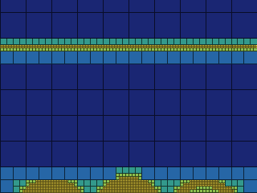 |  |  | 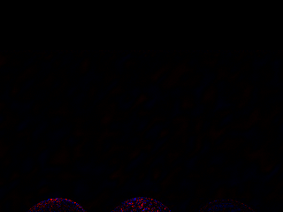 | 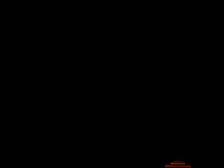 |

| The virtual surface's inverse depth | The truth | Rhea with diffuse bounces (s0 16, n_lo 8) |
|---|---|---|
|  |  |  |

State colours: green trusted, orange radiance edge, dark grey background, red probes on different surfaces, white a
scan's boundary inside, purple other geometry in front, yellow some probes missed, blue the sandwich gap, cyan a crease,
grey a scan stopped short.

## 7. Fourth step: the shading step (2026-11-19)

What was built is in DESIGN.md section 9. One GPU program change (gather tiles), compiled once into the private OptiX cache
(`build-9`: 15 minutes in the GPU lane's preparation, before the timed runs; the cache is now 172 MB, the kit's untouched);
host builds `build-10` to `build-14`.
Overflow scene without diffuse bounces, s0 8, n_lo 4, n_hi 32, medians of 5 timed runs:

| Step | Probe frame | Phase 2 | Engine | Relative MSE | Mean ratio | Block error |
|---|---|---|---|---|---|---|
| third step (32 samples a probe, m0 64) | 0.040 s | 0.135 s | 0.193 s | 3.56e-5 | 0.9994 | 5.6e-4 |
| + per-tile depth (XPU2's grid) | 0.042 s | 0.097 s | 0.160 s | 3.56e-5 | 0.9994 | 5.6e-4 |
| + gather tiles for the probes | 0.029 s | 0.093 s | 0.139 s | 3.56e-5 | 0.9994 | 5.6e-4 |
| + 64 samples a probe, m0 128 | 0.041 s | 0.094 s | 0.152 s | 2.70e-5 | 0.9995 | 4.2e-4 |
| **+ the curvature term, span 4 (the defaults)** | 0.041 s | 0.094 s | **0.156 s** | **2.71e-5** | **0.9998** | 4.1e-4 |

XPU2 in the same processes: 16 spp 0.135 s at 1.20e-4, 36 spp 0.255 to 0.28 s at 4.82e-5 (block error 1.8e-4, mean
ratio 1.0001). The first three rows give the same image: the frames render the same samples, packed differently.
Geometry stays 15 ms and the region pass 2 ms.

**The reconstruction against a converged direct-light reference** (16 seeds x 64 spp with `max_depth` 0,
`ref-overflow-direct`), over the pixels the surface trusts: the probes are unbiased (probe/direct 1.0000 at 64 samples),
the reconstruction is not quite:

| Setting | Reconstruction / direct | Its relative MSE |
|---|---|---|
| s0 16, 32 samples a probe | 0.9977 | 2.7e-5 |
| s0 8, 32 samples a probe | 0.9992 | 2.2e-5 |
| s0 8, 64 samples a probe | 0.9993 | 1.0e-5 |
| s0 8, 64, curvature over one stride | 0.9995 | 3.2e-5 |
| s0 8, 64, curvature over two strides | 0.9994 | 1.6e-5 |
| **s0 8, 64, curvature over four strides** | **0.9997** | **1.0e-5** |
| s0 16, 64, curvature over four strides | 0.9992 | 1.2e-5 |

The bias grows with the stride (light bending between probes); the curvature term removes half of it where its span
fits the light's scale (32 pixels here). What remains is mostly near the balls, where leaves are fine and the span's
neighbours are not probes.

**Light passes** (s0 16, 32 samples a probe, up to 3 passes):

| light_tol | Probes | Probe frames | Engine | Relative MSE | Reconstruction / direct |
|---|---|---|---|---|---|
| none | 1,754 | 1 | 0.187 s | 3.94e-5 | 0.9977 |
| 0.005 | 2,459 | 4 | 0.202 s | 3.71e-5 | 0.9983 |
| 0.002 | 12,745 | 4 | 0.232 s | 3.79e-5 | 0.9996 |

At 0.002 the bias goes, but the third pass still splits 2,408 of the 2,810 quads it tests: below about 1% a probe's
second difference is its noise. 64 samples a probe instead (s0 16, light_tol 0.005): 1,981 probes, 0.200 s, 2.99e-5.

**Phase 2 gathered by sample count** (`gather2=1`): 0.092 s against 0.093 s. Per-tile depth had already taken what
there was; it stays off.

**Where the error is now** (`class_errors.py`, the defaults): probes on different surfaces 1.2e-5, trusted pixels
7.7e-6, a scan's boundary 2.9e-6, of 2.7e-5. The silhouettes' phase 2 noise, not the reconstruction, is the largest share.

**Two diffuse bounces** (defaults, n_lo 8): 0.378 s at 1.40e-3, mean ratio 0.9999; XPU2 9 spp 0.245 s at 1.24e-3.
n_lo 4: 0.263 s at 3.27e-3 (XPU2 4 spp 0.117 s at 3.07e-3). The indirect light is phase 2's, and phase 2's samples cost
Rhea about what they cost XPU2.

| Rhea, the defaults | Its error (x10) | States | Leaves with light passes at 0.002 (s0 16) |
|---|---|---|---|
|  | 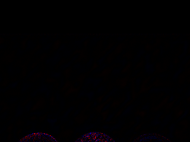 |  | 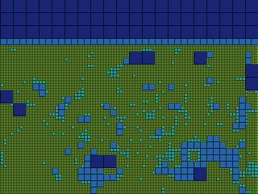 |

## 8. Fifth step: one frame (2026-11-19)

DESIGN.md section 10: probes and phase 2 in one XPU2 frame, a probe's pixel taking 64 more samples that stop at the first
hit (a depth limit per pixel, GPU program `build-15`, compiled once in 15 minutes into the private cache). Overflow
scene without diffuse bounces, the defaults, medians of 5 timed runs, XPU2 on the GPU alone in the same process:

| | Engine | Relative MSE | Mean ratio | Block error |
|---|---|---|---|---|
| Rhea, two frames (the fourth step) | 0.147 to 0.152 s | 2.71e-5 | 0.9998 | 4.1e-4 |
| **Rhea, one frame** | **0.129 to 0.132 s** | **2.38e-5** | **0.9998** | 4.2e-4 |
| XPU2 9 spp | 0.077 to 0.079 s | 3.50e-4 | | |
| XPU2 16 spp | 0.122 to 0.126 s | 1.20e-4 | | |
| XPU2 36 spp | 0.263 to 0.276 s | 4.82e-5 | 1.0001 | 1.8e-4 |

About twice as fast as XPU2 at half its error. One frame saves the probe frame's fixed cost (about 19 ms), and its error
is lower because a probe's pixel now combines all its samples' direct light. The probes stay unbiased (probe/direct
1.0001 against the direct reference), the reconstruction as before (0.9996).

**The CPU in the frame.** With the CPU lane on (`mode=2`), one frame took 0.182 to 0.190 s and two frames 0.164 to
0.172 s: the CPU took about 40,000 deep probe and silhouette samples (a gathered frame's cells start as a checkerboard)
and the frame waited for it. XPU2's own 16 spp frames were 0.150 to 0.180 s with the CPU against 0.13 s without. The
default is now the GPU alone for shading; the CPU does the geometry.

**Two diffuse bounces** (n_lo 8): 0.364 to 0.372 s at 1.40e-3 (mean ratio 0.9998); XPU2 9 spp 0.253 to 0.265 s at 1.24e-3.
Still behind: phase 2 takes 0.35 s for 7.5 full paths a pixel plus the probes, more than XPU2's dense 9.

## 9. Sixth step: the CPU's part, pipelined frames (2026-11-19)

DESIGN.md section 11. 24 frames along a camera path swinging 10 degrees of yaw, the defaults, the GPU alone shading;
medians of the frames' periods. "One after the other" is the same frames with geometry, frame and bookkeeping in turn.
XPU2 renders the same path, a camera-only update each frame.

| | One after the other | Pipelined | The GPU's render in it | XPU2, same path |
|---|---|---|---|---|
| No diffuse bounces, 4 background threads | 0.128 s | **0.106 s** | 0.107 s, 0.106 s | 0.253 s (36 spp) |
| the same, 2 threads | 0.136 s | 0.112 s | 0.111 s, 0.112 s | 0.266 s |
| the same, 8 threads | 0.132 s | 0.113 s | 0.111 s, 0.113 s | 0.269 s |
| the same, 12 threads at normal priority | 0.143 s | 0.135 s | 0.119 s, 0.129 s | 0.274 s |
| Two diffuse bounces, 4 background threads | 0.380 s | **0.358 s** | 0.356 s, 0.358 s | 0.271 s (9 spp) |
| the same, 12 threads at normal priority | 0.352 s | 0.364 s | 0.329 s, 0.364 s | 0.276 s |

- With 4 background threads the frame's period is the GPU's render: the geometry (31 ms there, 19 ms on 12 threads)
  and the bookkeeping (4 ms) are hidden, and the render is not slowed. 17% off a frame without diffuse bounces, 6% with.
- Against XPU2 on the same path at equal error: 0.106 s against 0.253 s a frame, 2.4 times faster, at half the error.
  With diffuse bounces Rhea still trails (0.358 s against 0.271 s).
- Frame 0 of every sequence is the single frame's picture exactly (relative MSE 2.379e-5, 1.399e-3): the pipeline
  changes nothing in what is rendered.
- Still camera, 12 threads (`frames=24 orbit=0`): 0.127 s one after the other, 0.113 s pipelined.
- These sequences turned only the camera's node transform, and the GPU kept frame 0's view (found and fixed in
  section 16). Measured again with the camera turned whole: 0.103 s against 0.277 s, the timings stand.

## 10. Seventh step: diffuse bounces (2026-11-19)

DESIGN.md section 12. Overflow scene with two diffuse bounces, one frame on the GPU, medians of 3 to 5 timed runs.

**Looking for the cause** (Rhea as it was: direct-light probes, n_lo 8, n_hi 32):

| Variant | Device time | Launches | Relative MSE |
|---|---|---|---|
| as it was | 0.320 s | 5 | 1.40e-3 |
| progressive order off | 0.335 s | 3 | 1.40e-3 |
| chunks of 16 samples | 0.337 s | 4 | 1.40e-3 |
| no gathering (per-tile depth only) | 0.372 s | 24 | 1.40e-3 |
| silhouettes at 8 samples, not 32 | 0.258 s | 4 | 1.52e-3 |
| probes at 16 samples, not 64 | 0.298 s | 4 | 1.41e-3 |
| XPU2 9 spp | 0.231 s | 5 | 1.24e-3 |

No tail, no small launches: the samples themselves. Rhea saved one full path a pixel (8 against 9) and spent more than
that on probes and silhouettes.

**Whole-light probes** (`probe_full=1`):

| Phase 2 (converged / elsewhere) | Engine | Relative MSE | Block error | Mean ratio |
|---|---|---|---|---|
| direct-light probes, 8 / 32 (before) | 0.357 s | 1.40e-3 | 1.06e-3 | 0.9998 |
| 4 / 32 | 0.318 s | 7.8e-5 | 1.14e-3 | 0.9999 |
| 2 / 32 | 0.255 s | 7.8e-5 | 1.15e-3 | 0.9999 |
| 1 / 32 | 0.218 s | 7.8e-5 | 1.15e-3 | 0.9999 |
| **2 / 16 (the defaults)** | **0.196 s** | **1.0e-4** | 1.16e-3 | 0.9998 |
| 2 / 16, 32 samples a probe | 0.210 s | 1.3e-4 | 1.64e-3 | 1.0004 |

XPU2 in the same processes: 4, 9, 16 spp in 0.12, 0.27, 0.45 s at 3.07e-3, 1.24e-3, 5.93e-4 (block error 1.58e-3,
1.0e-3, 7.0e-4). Rhea's per-pixel error is twelve times less than XPU2's at 9 spp, its block error about the same
(1.16e-3 against 1.0e-3), in 0.20 s against 0.27 s. The converged pixels' error is the reconstruction's: with k near 1,
phase 2's samples there barely change it (1 to 4 samples give the same relative MSE), and it falls as they grow.

Pipelined along the moving camera (24 frames, 10 degrees): **a frame every 0.181 s against XPU2's 0.259 s** (9 spp).
Without diffuse bounces the defaults keep direct-light probes (whole-light ones: 0.145 s against 0.131 s, the same
error): 0.113 s a frame against XPU2's 0.270 s (36 spp).

| Rhea with diffuse bounces (defaults) | Its error (x10) | XPU2 9 spp |
|---|---|---|
|  | 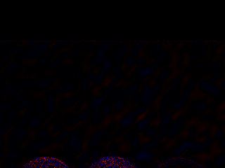 |  |

## 11. Eighth step: accumulating frames, jitter (2026-11-19)

DESIGN.md section 13. A still camera, frames accumulated (`frames=64 orbit=0 accumulate=1`), pipelined; XPU2
accumulating its own 9 spp frames, each with fresh seeds. "Averaged" averages finished frames; "converging" combines
the frames' sums with phase 1 counting as mean(m) K^p samples.

| 64 frames | Relative MSE at 1 / 16 / 64 | Block error at 1 / 16 / 64 | Mean ratio at 64 | Frame |
|---|---|---|---|---|
| **Two diffuse bounces** | | | | |
| averaged, fixed lattice | 1.0e-4 / 1.4e-5 / 9.1e-6 | 1.16e-3 / 3.3e-4 / 1.90e-4 | 0.99979 | 0.17 s |
| averaged, jittered | 1.0e-4 / 1.4e-5 / 9.0e-6 | 1.16e-3 / 3.5e-4 / 1.95e-4 | 0.99981 | 0.18 s |
| converging p 0.5, fixed (the default) | 1.0e-4 / 1.5e-5 / 1.0e-5 | 1.16e-3 / 3.2e-4 / 1.77e-4 | 0.99981 | 0.17 s |
| converging p 0.5, jittered | 1.0e-4 / 2.0e-5 / 1.1e-5 | 1.16e-3 / 3.5e-4 / 1.88e-4 | 0.99989 | 0.18 s |
| converging p 0, jittered | 1.0e-4 / 2.9e-5 / 2.7e-5 | 1.16e-3 / 3.1e-4 / 1.77e-4 | 0.99993 | 0.18 s |
| XPU2 9 spp a frame | 1.2e-3 / 8.4e-5 / 2.6e-5 | 1.0e-3 / 2.7e-4 / 1.50e-4 | 0.99998 | 0.25 s |
| **No diffuse bounces** | | | | |
| averaged, fixed lattice | 2.4e-5 / 2.8e-6 / 1.8e-6 | 4.2e-4 / 1.3e-4 / 8.8e-5 | 0.99983 | 0.11 s |
| converging p 0.5, fixed (the default) | 2.4e-5 / 3.1e-6 / 2.0e-6 | 4.2e-4 / 1.2e-4 / 7.7e-5 | 0.99985 | 0.11 s |
| converging p 0.5, jittered | 2.4e-5 / 6.2e-6 / 2.7e-6 | 4.2e-4 / 1.2e-4 / 7.3e-5 | 0.99992 | 0.11 s |
| XPU2 9 spp a frame | 3.5e-4 / 2.3e-5 / 6.7e-6 | 4.8e-4 / 1.2e-4 / 7.0e-5 | 0.99998 | 0.08 s |

- **Jitter alone changes nothing:** the blotches were the probes' noise, which fresh seeds average; the 0.02% that
  stays is one-signed (interpolation of light that bends), wherever the probes are.
- **The convergent accumulation** lowers the block error and moves the mean ratio towards 1; the lower p, the faster the
  bias goes and the more of phase 2's noise stays. With jitter it takes a little more of the darkening, for 5 to 8% of
  a frame and more per-pixel error: off by default.
- **At equal time with diffuse bounces** (64 Rhea frames against about 46 of XPU2's): about the same block error, a third
  of the per-pixel error. Without diffuse bounces XPU2's 9 spp frames are quicker than Rhea's (0.08 s against 0.11 s)
  and reach the same block error sooner: Rhea's lead there is the single frame's (section 9).

## 12. Sponza, a first look (2026-11-19)

`test-results/sponza/rdl/sponza.rdlb` (the export of 2026-11-18, 1.64 M triangles, 23 lights, about 265 shadow rays a
sample) at 192 x 108 and 64 spp (`scenes/sponza-small.rdla`), the defaults (whole-light probes: the scene bounces
diffusely), one frame on the GPU; geometry cached in a private folder (`MOONRAY_MODO_CACHE`), textures read from the
kit's texture cache as the asset root (`--assets`).

| | Pixels converged | Probes | Geometric passes | Frame |
|---|---|---|---|---|
| overflow (for scale) | 72% | 2,528 | 0.015 s | 0.20 s (XPU2 0.27 s at 9 spp) |
| **Sponza** | **7%** | 4,843 | 2.9 s | **27.2 s** (XPU2 7.7 s at 9 spp) |

- **The convergence rule fails on Sponza.** Quads split because their probes stood on different meshes (743), patches
  stopped at the scan's ring limit (309), mesh borders crossed them (203). Sponza is many separate meshes with open
  borders (40,418 border edges, 80 meshes under the probes), so "four probes on one connected mesh" seldom holds even
  where the surface is one plane. 93% of the pixels go to phase 2 at 16 samples, plus the probes: about three times
  XPU2's samples, at the same GPU rate (about 24,000 samples a second).
- What it trusted stays exact (no converged pixel over the tolerance).
- The geometric passes take 2.9 s, mostly the crease and occluder tests over dense patches (556 triangles a patch).
- **Textures:** 41 of the scene's textures are no longer in the kit's texture cache (252 "cannot open texture" lines),
  so both renderers drew those surfaces without them (magenta). The comparison is fair, but texture detail, which
  interpolating probes blurs, is understated; a fresh export is needed for a faithful test.


## 13. Sponza with coverage (2026-11-20)

DESIGN.md section 14. **The textures came back mid-run:** the kit's texture cache was refilled at 00:01 (by the Modo
session then open), so the runs before it (`sp-A`, `sp-B`) drew 41 textures as missing and every run after it
(`sp-C` on, and the reference) has the whole textured scene. Reference: XPU2 at 8 seeds x 64 spp, an independent seed
(`ref-sponza-small`, `seed=1000 frames=8 accumulate=1 seq_xpu2=64`), scored with `tools/score.py`.

| Sponza 192 x 108 | Geometry converged | Trusted | Geometric passes | Frame | XPU2 9 spp |
|---|---|---|---|---|---|
| connected meshes only (textures missing) | 17% | 7% | 2.9 s | 27.2 s | 7.7 s |
| coverage (textures missing) | 20% | 9% | 4.3 s | 29.5 s | 7.6 s |
| coverage, tolerance 1% | 25% | 6% | 4.2 s | 22.4 s | 6.0 s |
| coverage, 384 x 216 | 38% | 10% | 18 s | 79 s | 22.5 s |
| **coverage, probe samples where read** | 20% | 5% | 3.6 s | **14.3 s** | **5.8 s** |

Error of the last against the reference: **Rhea relative MSE 0.246, block error 1.69e-2, mean ratio 0.9961; XPU2 9 spp
0.188, 1.53e-2, 1.0002.** Rhea is slower and less accurate on Sponza.

- Coverage converges a little more of Sponza (17% to 20%; at twice the resolution 38%), and the converged pixels stay
  exact. The test scene is unchanged by it (the same 55,324 converged pixels and picture).
- **Probe samples only where a converged leaf reads them** halved Sponza's frame (probes' samples 14.4 to 2.4 a pixel)
  and took a fifth off the test scene's (0.144 to 0.116 s without diffuse bounces, 0.196 to 0.159 s with; relative MSE
  2.4e-5 to 2.7e-5 and 1.0e-4 to 1.2e-4: the silhouette probes' pixels lose their extra samples).
- **Where Sponza's error is:** pixels whose geometry converged but whose light does not interpolate (textures, the
  shadows of 23 lights: the radiance-edge rule, 15% of the frame) hold 37% of it. In one frame their samples are
  set from the geometry, before the light is known, so they get the converged count, 2 full paths. Then the 6% the
  scans could not take (`truncated`, 24%), the pixels on different surfaces (18%).
- Sponza's detail is about a pixel at this size (ornaments, bricks, column flutes, separate meshes): the gap, crease and
  coverage tests fail at the finest stride on most of the frame, and the passes cost 3.6 s on 1.6 M triangles.

## 14. The floor (2026-11-20)

DESIGN.md section 15 (`floor_area` 0.3, `floor_spp` 9). Medians of 3 timed runs, XPU2 on the GPU in the same process.

| | First pass converged | Floored | Rhea | XPU2 |
|---|---|---|---|---|
| test scene, no diffuse bounces | 92% | no | 0.117 s, relative MSE 2.7e-5 | 0.127 s at 16 spp, 1.2e-4 |
| test scene, two diffuse bounces | 92% | no | 0.159 s, 1.2e-4 | 0.257 s at 9 spp, 1.24e-3 |
| Sponza 192 x 108, one frame | 8% | yes | 6.06 to 6.35 s (first pass 0.29 s) | 5.98 to 6.11 s at 9 spp |
| **Sponza, 8 frames along the moving camera, pipelined** | 8% | yes | **5.71 s a frame** | 6.00 s a frame |

Sponza's floored frames are XPU2's: the same samples, the same picture (relative MSE 0.1875 against the reference, as
XPU2's), and the same render time (5.77 to 6.05 s against 5.98 to 6.11 s) once the frame carries no sample map (with one,
it was 6% slower). Pipelined, the first pass hides under the GPU's frame and Rhea is no slower than XPU2 on Sponza.

## 15. Demodulated light (2026-11-20)

DESIGN.md section 16. Medians of 3 timed runs on the test scene, 1 on Sponza (scored against `ref-sponza-small`).

| | Demodulated | Trusted | Light edges | Relative MSE | Block error | Mean ratio |
|---|---|---|---|---|---|---|
| test scene, no diffuse bounces | no | 72.0% | 0 | 2.73e-5 | 4.13e-4 | 0.99977 |
| | yes | 72.0% | 0 | 2.76e-5 | 4.22e-4 | 0.99972 |
| test scene, two diffuse bounces | no | 72.0% | 0 | 1.15e-4 | 1.19e-3 | 0.99974 |
| | yes | 72.0% | 0 | 1.18e-4 | 1.19e-3 | 0.99972 |
| Sponza 192 x 108, floor off | no | 4.5% | 15.1% | 0.246 | 1.69e-2 | 0.9961 |
| | **yes** | **7.7%** | **11.9%** | 0.237 | **1.53e-2** | 1.0016 |
| Sponza, XPU2 9 spp | | | | 0.188 | 1.53e-2 | 1.0002 |

- On the test scene it changes nothing that matters: its textures hardly vary between neighbouring probes.
- On Sponza a fifth of the light edges were textures: they now interpolate, and the block error comes down to XPU2's.
  The per-pixel error stays above XPU2's (the light edges left get 2 full paths in one frame), the frame takes 16 s
  against XPU2's 6 s, and specular light scaled by the colour ratio shows as +0.16%. On Sponza the floor stays the
  default's choice.

## 16. Phase 2 capped, persistent probes (2026-11-20)

DESIGN.md sections 17 and 18. The test scene without diffuse bounces, phase 2 capped at 2 samples a pixel
(`phase2_max`, the default), pipelined; relative MSE / block error. Medians of the frames' periods.

**At rest** (32 still frames, `persist=1 frames=32 accumulate=1`), against the test scene's reference:

| | Frames: 1 | 4 | 32 | Mean ratio, 32 | A frame |
|---|---|---|---|---|---|
| persistent, m0 128, power 0.5 | 9.36e-4 / 7.41e-4 | 2.54e-4 / 6.24e-4 | 6.92e-5 / 4.54e-4 | 0.99946 | 0.040 s |
| m0 128, power 0 | | | 5.07e-5 / 3.50e-4 | 0.99962 | |
| m0 32, power 0.5 | | | 5.18e-5 / 3.76e-4 | 0.99957 | |
| **m0 32, power 0 (the persistent defaults)** | 9.43e-4 / 7.28e-4 | 2.70e-4 / 5.67e-4 | 6.74e-5 / **2.67e-4** | **0.99983** | 0.041 s |
| XPU2, 2 spp a frame | 3.66e-3 / 1.39e-3 | 9.25e-4 / 7.41e-4 | 1.15e-4 / 2.70e-4 | 1.00006 | 0.038 s |

- A frame costs what XPU2's 2 samples cost (the probes' extra samples, 4 a known probe, are a few thousand a frame).
- After 32 frames Rhea's block error is XPU2's and its per-pixel error 1.7 times less. A persistent probe's sums
  already hold every frame before, so phase 1 needs no growing weight: power 0 and a smaller m0 let phase 2's samples
  take over the bias sooner. Frame 0 trusts 71.3% of the frame and verifies 97.6%; frame 31 72.5% and 98.5%. New
  probes after frame 0 taper from 50 to 4 a frame (1,855 in all): the cells along silhouettes, where verification keeps
  failing, fill in.

**Moving** (24 frames, 10 degrees of yaw, `persist=1 frames=24 orbit=10 seq_ref=1024`): frames 6, 12 and 23 against
XPU2 frames of the same cameras at 1024 samples a pixel.

| | A frame | Relative MSE (6, 12, 23) | Block error (6, 12, 23) |
|---|---|---|---|
| persistent, keep_spp 4, fade 0.8 | 0.040 s | 1.16e-3, 8.9e-4, 9.4e-4 | 8.4e-4, 1.01e-3, 1.10e-3 |
| keep_spp 16, fade 0.8 | 0.042 s | 1.14e-3, 8.6e-4, 9.0e-4 | 7.3e-4, 7.9e-4, 7.8e-4 |
| keep_spp 8, fade 0.9 | 0.042 s | 1.14e-3, 8.7e-4, 9.1e-4 | 7.5e-4, 8.3e-4, 8.2e-4 |
| **keep_spp 4, fade 0.95, clean absorb (the defaults)** | **0.041 s** | 1.15e-3, 8.8e-4, 9.1e-4 | **7.7e-4, 8.4e-4, 8.5e-4** |
| the quadtree's frames (`persist=0`), capped | 0.050 s | 1.0e-3, 9.6e-4, 1.06e-3 | 7.0e-4, 8.3e-4, 8.1e-4 |
| XPU2, 2 spp | 0.037-0.040 s | 3.96e-3, 3.63e-3, 3.68e-3 | 1.44e-3, 1.55e-3, 1.52e-3 |

- **The camera fix first.** Sequences before build-35 turned only the camera's node transform. XPU2's perspective rays
  take their directions through render space, and its depth output measures depth there too, so the GPU kept frame 0's
  view. With the camera turned as XPU2's camera-only update turns it, the GPU verification passes 97.6 to 99.1% of
  the pixels in every frame (27% before), and new probes fall from about 500 a frame to a median of 60.
- **Persistent against the quadtree:** 20% less a frame (0.041 s against 0.050 s). The CPU's part is 20 ms against
  43 ms, hidden under the GPU's frame either way; the GPU's render is 41 ms against 47 ms (no 64 samples for every
  probe every frame). Same per-pixel error. The block error matches once the probes keep enough samples.
- **Why fade 0.95:** at 0.8 a probe's sums settle at about 4 / (1 - 0.8) = 20 samples while the camera moves, and that
  noise, spread across the probe's triangles, is block error (grown to 1.1e-3 by frame 23, spread over the frame, of
  either sign). More samples a probe or a slower fade both bring it to the quadtree's. The slower fade costs nothing,
  but light that depends on the view follows over about 20 frames instead of 5. This scene cannot measure that lag.
- **Clean absorb** (`clean_absorb`, on): a probe takes its pixel's light only where the frame's depth min and max lie
  on the probe's own plane. About 80 probes a frame (4%) sit in pixels across an edge. It changes the scores by under
  1%; it is kept because it is right, and free.
- Frame 12 reads 0.9991 against 0.9997 for the quadtree, but frame 0 (the same camera) reads 0.9994 for both, and the
  quadtree's own frames 0 and 12 differ by 3.5e-4: the ratio's noise, not a drift.
- **Pipelined sequences re-measured** with the fixed camera, uncapped (`persist=0 phase2_max=0`, section 9's
  configuration): 0.103 s a frame against XPU2's 0.277 s (36 spp), the moving frames at relative MSE 2.5e-5 and block
  error 3.8 to 4.2e-4 against XPU2's 4.7e-5 and 1.7 to 1.9e-4. With two diffuse bounces 0.142 s against 0.270 s
  (9 spp), 1.2e-4 and 1.22 to 1.26e-3 against 1.23e-3 and 0.95 to 1.0e-3. Section 9's timings stand.

## 17. The denoiser (2026-11-20)

DESIGN.md section 20. Persistent probes, 24 frames along the moving camera (10 degrees), frames 6, 12 and 23 against
XPU2 frames of the same cameras at 1024 samples a pixel; relative MSE / block error, each frame's three.

**The test scene without diffuse bounces** (`persist=1 frames=24 orbit=10 seq_ref=1024 denoise=1`):

| | Relative MSE | Block error |
|---|---|---|
| Rhea, as it is | 1.15e-3, 8.8e-4, 9.1e-4 | 7.7e-4, 8.4e-4, 8.5e-4 |
| XPU2 2 spp, as it is | 3.96e-3, 3.63e-3, 3.68e-3 | 1.44e-3, 1.55e-3, 1.52e-3 |
| XPU2, denoised (the kit's normal guide) | 4.4e-4, 4.2e-4, 4.6e-4 | 6.9e-4, 7.4e-4, 8.5e-4 |
| Rhea, denoised (the normal output) | 5.1e-4, 4.4e-4, 4.9e-4 | 7.1e-4, 7.8e-4, 7.7e-4 |
| Rhea, denoised (the virtual surface's normals) | 5.0e-4, 4.6e-4, 5.2e-4 | 7.0e-4, 7.9e-4, 7.7e-4 |
| Rhea, as it is where phase 1 held, denoised elsewhere | 5.8e-4, 4.6e-4, 5.6e-4 | 7.8e-4, 8.4e-4, 8.2e-4 |

**With two diffuse bounces** (the same, `--extra diffuse2.rdla`; Rhea's probes carry the whole light):

| | Relative MSE | Block error |
|---|---|---|
| Rhea, as it is | 1.37e-3, 9.1e-4, 1.03e-3 | 1.36e-3, 1.38e-3, 1.26e-3 |
| XPU2 2 spp, as it is | 7.59e-3, 7.20e-3, 7.34e-3 | 2.23e-3, 2.46e-3, 2.45e-3 |
| **XPU2, denoised** | **3.7e-4, 3.5e-4, 4.0e-4** | **8.3e-4, 9.8e-4, 1.00e-3** |
| Rhea, denoised (the normal output) | 4.6e-4, 3.7e-4, 4.5e-4 | 1.21e-3, 1.26e-3, 1.12e-3 |
| Rhea, denoised (the virtual surface's normals) | 4.6e-4, 3.9e-4, 4.8e-4 | 1.21e-3, 1.25e-3, 1.11e-3 |

A frame: Rhea 0.085 s, XPU2 2 spp 0.074 s with diffuse bounces; the denoiser 3.4 ms at 320 x 240 (its first call
0.09 to 0.14 s, setting up).

- **Denoised, XPU2 catches up, and with diffuse bounces passes Rhea.** XPU2's error at 2 samples is fine noise, which
  the denoiser takes out; Rhea's is the interpolation's, blotches as large as its triangles, which the denoiser keeps
  as picture: Rhea's block error barely moves (1.3e-3 to 1.2e-3), XPU2's falls from 2.4e-3 to 0.9e-3.
- **The virtual surface's normals guide as the normal output does** (within 5%): at 2 samples the normal output is
  already clean on these surfaces, and edges are all a normal guide gives. They cost no output, which is all they save.
- **Keeping Rhea where phase 1 held** is worse than denoising it too: Rhea's own pixels are noisier than denoised ones.
- **The kit's realtime normal guide is turned by the camera.** The normal output agrees with the virtual surface's
  camera-space normals at 0.9999 (frames 12 and 23 of a 60-degree swing); projected onto the camera's axes as
  `xpu2_session.cc` (realtimePicture) does, at 0.978 and 0.943: the cosines of those cameras' own rotations. XPU2's
  render space is the camera's, so the normal output is in camera space already and the kit turns it a second time.
  On this scene the denoiser hardly minds (the scores above move by 1%); a camera turned far from the world's axes
  hands OptiX normals turned as far. With the camera orbited 70 degrees about the scene (`--extra
  camera-orbit70.rdla`, four still frames) the output agrees at 0.999 and the kit's guide at 0.335 (cos 70
  degrees), yet XPU2's denoised frames score the same either way (relative MSE 1.07 to 1.10e-3 with the kit's guide,
  1.08 to 1.14e-3 with the output as it is; block error 5.0 to 5.8e-4 both): on this scene OptiX goes by the colour
  and the albedo. The session now hands the output over in camera space (render2Camera's rotation, the identity
  without motion blur), a commit of its own on this branch for MoonLightIPR.
- Not measured: flicker. Rhea's blotches stay on the surfaces from frame to frame, a denoised 2-sample frame's residue
  does not; per-frame scores cannot show which looks steadier in motion.

## 18. Open

- **The CPU's part, further:** suitability seeding for gathered frames, so the CPU lane could take the shading work
  that cannot hold the frame's end; on heavy scenes, the samples the GPU defers (as in XPU2).
- **The one-signed bias** (interpolation of light that bends): the curvature term over a span that fits the light,
  measured again with whole-light probes; or probes refined where their neighbours' second differences say it pays,
  once a probe's noise is known (XPU2's odd-sample sums on the GPU).
- **Textured, detailed scenes** (Sponza, sections 12 to 15): the samples of light-edge pixels known before the frame
  (the last frame's light in a sequence, or a probe frame of its own when frames are long); specular light kept apart
  from demodulation; patch limits that follow the window and cheaper crease and occluder tests (3.6 s on Sponza); a
  partial floor (probes only where the first pass converges, XPU2's samples elsewhere).
- **Persistent probes, further** (section 16): a fade by how far a probe's new light departs from its mean beyond its
  noise, not a fixed rate (view-dependent light would then follow at once, and diffuse light keep its samples); probes
  pruned once they have left the frame for good; the floor and Sponza in persistent mode; diffuse bounces in
  persistent mode (whole-light probes); moving geometry (a probe is a point on a triangle at rest).
- **The denoiser, further** (section 17): flicker in motion, measured (a camera that only turns maps one frame onto the
  next exactly, a homography); and the virtual surface as the denoiser's guide in time: phase 2's samples of the last
  frames reprojected through it and kept where the frame's verification holds (as realtime path tracers accumulate
  history before denoising), so that the denoiser sees many samples' fine noise, not the interpolation's blotches.

- **Silhouettes:** the largest share of the error is phase 2's noise in the 5% of pixels that never converge.
- **The passes on the GPU,** the piece on the GPU, and T-junctions between leaves of different levels (DESIGN.md 8.5).
- **The frame cache where the camera sees what bounces reach.** An interior (a room, the camera inside) is where it
  should pay; this scene is close to its worst case. Its content should also carry indirect light (a previous frame's
  result, as a realtime preview has one), and its GPU lookup cost needs a profile (section 5).
- **Dense launches.** Probes as their own launch (a probe list, or a camera at 1/s the resolution with a 1-pixel filter
  on a second GPU lane), and phase 2's refine pixels as a pixel list, instead of per-pixel counts on the full grid.
- **Skip what phase 1 knows.** Phase 2 still computes the first hit's direct light it then discards in trusted pixels.
- **One frame, not two.** Per cell, phase 2 may start once its 3 x 3 window's probes are in (DESIGN.md section 6).
- **Bigger, heavier scenes.** 320 x 240 with two lights is where fixed costs weigh most and light samples are cheapest;
  Sponza (23 lights, 69% of the GPU's time in shadow rays) is where light sample reuse has the most to save.
- The lift assumes a still perspective camera without depth of field; patches lose triangles crossing the near plane.

## 19. Reproduce

```bash
python rhea/build_rhea.py [--gpu] --source . --runtime <MoonRayForModo-xpu2>/test-results/interactive-reference-042 --output test-results/rhea/build-N
cd rhea/tools
python make_reference.py --build <MoonRayForModo-xpu2>/test-results/async-build-handoff1 --scene <overflow>/scene.rdla --output <new folder> [--extra <.rdla>]
python run_rhea.py --engine <build-N> --ptx-build <a --gpu build> --scene <overflow>/scene.rdla --output <new folder> --reference <reference.rgba> repeats=5 xpu2_spp=16,36
python class_errors.py <that folder> <reference.rgba>
python summarize.py <run folders...>
python build_delaunay_test.py <worktree> <new folder>   # then run the test it prints: the checks of rhea/delaunay.h
```

`python` is `pythoncore-3.15` (not the Store one). The worktree needs `toolchain`, `build` and `upstream` junctioned from
the main checkout. `--gpu` builds the engine's own GPU program (with OpenQMC); its first run compiles it with OptiX
(about 13 minutes), into the `optix-cache` folder beside the run folders (`run_rhea.py` sets `OPTIX_CACHE_PATH`), never
into the kit's. A host-only build can take an earlier `--gpu` build's program while the XPU2 sources it was built from
are unchanged (section 6 used `build-4`, section 7 `build-9`). The engine's options and defaults: `s0` (8), `min_stride`
(2), `tol` (0.002), `margin` (the pixel filter's reach), `probe_spp` (64), `probe_full` (-1: with diffuse bounces), `n_lo`, `n_hi` (by the probes: 2 and 16 whole-light, 4 and 32 direct), `n_bg` (1), `m0` (128; 32 with persistent probes),
`tau_r` (0.25), `rings`, `tris`, `curvature` (1), `curv_span` (4), `light_passes` (0), `light_tol` (0.02), `gather` (1),
`gather2` (0), `one_frame` (1), `mode` (1: the GPU alone shades), `frames` (0: none), `orbit` (0), `seq_threads` (4), `seq_xpu2` (36), `accumulate` (0), `accum_power` (0.5; 0 with persistent probes), `jitter` (0), `floor_area` (0.3), `floor_spp` (9), `seed` (0), `coverage` (1), `demod` (1), `phase2_max` (2: phase 2's samples a pixel at most, the floor's too; 0 no cap), `persist` (0), `keep_spp` (4), `cell` (8), `gap_passes` (2), `fade` (0.95), `clean_absorb` (1), `seq_ref` (0: the moving frames unscored), `denoise` (0: with `seq_ref`, the scored frames denoised), `cache` (default off),
`cache_p` (0.25), `cache_tol` (0.02), `qmc_depth` (0: off), `xpu2_qmc` (XPU2's comparison frames with OpenQMC). Each run
writes the films, `leaves.png`, `geomerr.png`, `depth.png` and `depth-true.png`, and the piece as `surface.rhea`.

Sections 6 to 15 were measured before the phase 2 cap: `phase2_max=0` gives their configuration back. Sections 2 to 5 were measured with the first two steps' engine (fixed lattice, options `stride` and `n_mid`), at
commits 861a81a0 and dbbcac7b.
