# XPU2 asynchronous renderer: measurements, 22 and 23 October 2026

RTX 3090 and i7-4930K (6 cores, 12 logical processors). Two synthetic fixtures of the published benchmark, both
textured, lit by a constant environment: gallery-dense (384×288, 68 meshes, 254,000 triangles) and workshop-detail
(512×384, 134 meshes, 98,000 triangles). Original XPU is the pinned 0.4.2 runtime in fresh processes, timed by
MoonRay's own MCRT time; a warm XPU with its scene kept loaded is no faster (checked 22 October). XPU2 is timed from
its first claim to the merged film on the host. Each XPU2 time is the median of three after one warm-up; nothing else
rendered meanwhile, though on 23 October the desktop's own applications kept the GPU busy part of the time and XPU2's
times vary by a few milliseconds from run to run. Preparation (scene read, plan, Embree and OptiX scene builds, mip
upload; 0.95 to 1.33 s) is reported apart, as XPU's render preparation is.

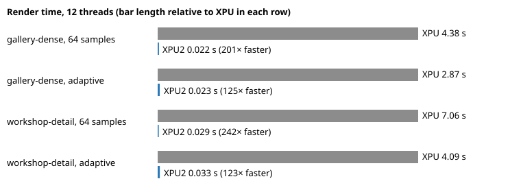

## Uniform sampling: 64 samples a pixel

Report: `test-results/async-benchmark-9/report.json` (the build of 23 October).

| Scene | Threads | XPU | XPU2 | Less time |
| --- | --- | --- | --- | --- |
| gallery-dense | 12 | 4.380 s | 0.0217 s | 99.5% |
| gallery-dense | 1 | 27.351 s | 0.0320 s | 99.9% |
| workshop-detail | 12 | 7.062 s | 0.0292 s | 99.6% |
| workshop-detail | 1 | 45.171 s | 0.0298 s | 99.9% |

The first frame of a session, which also loads the fine-detail texture tiles it needs, took 0.026 to 0.044 s.

### The same image

XPU2 runs the parity pipeline's estimator with the same random numbers, so it converges to XPU's image. At 1024
samples a pixel, against XPU's own 1024-sample reference:

| XPU, 1024 samples | XPU2, 1024 samples | Difference × 20 (linear) |
| --- | --- | --- |
| 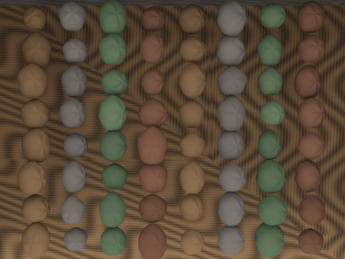 |  | 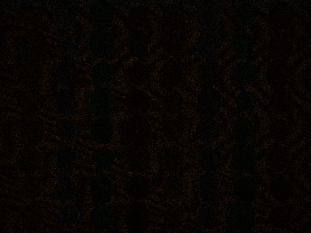 |
| 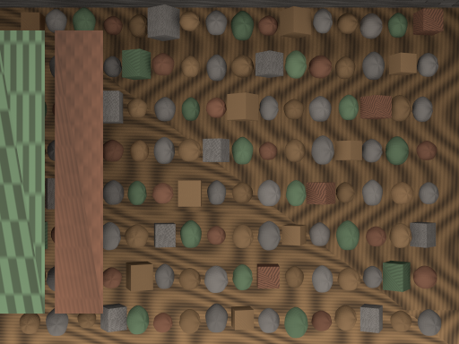 |  | 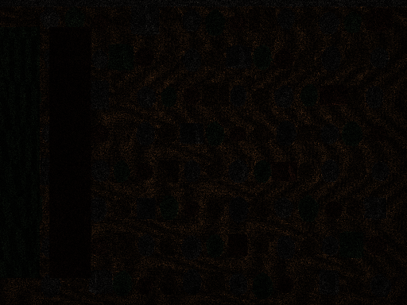 |

The differences are each image's own sampling noise at 1024 samples: the largest pixel differs by 0.014 (gallery)
and 0.017 (workshop), and no 8×8 block's mean by more than 0.0012 and 0.0014.

The timed 64-sample frames:

| XPU, 64 samples | XPU2, 64 samples |
| --- | --- |
|  4.380 s, relative MSE 0.004695 |  0.0217 s, relative MSE 0.004238 |
| 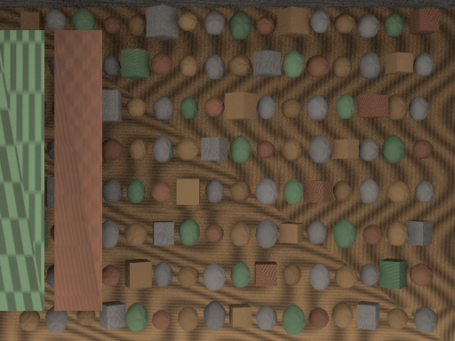 7.062 s, relative MSE 0.003966 | 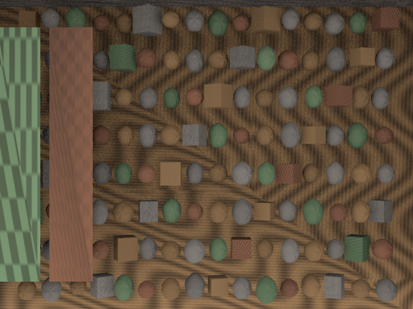 0.0292 s, relative MSE 0.003933 |

### Quality gates, unchanged from the published benchmark

- **Every timed image** is at or below XPU's own 64-sample error against the 1024-sample XPU reference: relative MSE
  0.004238 against 0.004695 (gallery) and 0.003933 against 0.003966 (workshop).
- **Device split** (VER-3): CPU-only and GPU-only renders each pass, and agree within 0.0001 on every 8×8 block mean.
- **Held-out seeds** 17, 47, 101 and 151 pass.
- **1024 samples** converge to the reference: maximum pixel 0.014 and 0.017, maximum 8×8 block mean 0.0012 and
  0.0014, against limits of 0.08 and 0.015.

### Where the time goes

The GPU renders about 99% of a frame at 400 to 530 million samples a second; the CPU lane takes its share and
finishes at the same moment. A frame is the GPU's work plus about half a millisecond to bring its film to the host.
Alone, the CPU lane renders gallery-dense in 2.16 s at 12 threads, about half XPU's time, from Embree's native
triangles.

## Adaptive sampling

The same fixtures with MoonRay's adaptive sampling on both renderers: `sampling_mode` 2, 16 to 1024 samples a pixel,
target error 10, read after each scene. XPU's error is the lowest of its three timed runs. Error is relative MSE
against the same 1024-sample reference. Report: `test-results/async-adaptive-benchmark-3/report.json`.

| Scene | Threads | XPU | XPU2, same settings | XPU2 at XPU's quality | Less time at XPU's quality |
| --- | --- | --- | --- | --- | --- |
| gallery-dense | 12 | 2.872 s, error 0.00990, 37.6 spp | 0.0200 s, 0.01231, 30.7 spp | 0.0230 s, 0.00896, 41.3 spp (target 8) | 99.2% |
| gallery-dense | 1 | 15.947 s, 0.01071, 35.3 spp | 0.0193 s, 0.01231, 30.7 spp | 0.0198 s, 0.01045, 35.7 spp (target 9) | 99.9% |
| workshop-detail | 12 | 4.088 s, 0.00902, 33.3 spp | 0.0250 s, 0.01057, 31.5 spp | 0.0334 s, 0.00757, 42.9 spp (target 8) | 99.2% |
| workshop-detail | 1 | 26.263 s, 0.00923, 32.8 spp | 0.0256 s, 0.01057, 31.5 spp | 0.0297 s, 0.00905, 36.3 spp (target 9) | 99.9% |

| XPU, adaptive | XPU2, adaptive at XPU's quality | XPU's samples | XPU2's samples |
| --- | --- | --- | --- |
| 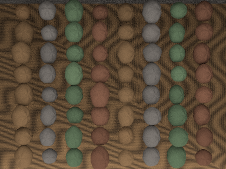 | 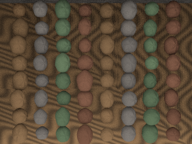 | 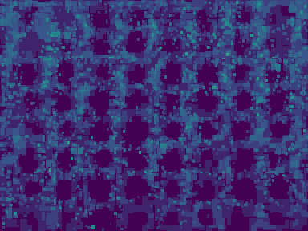 | 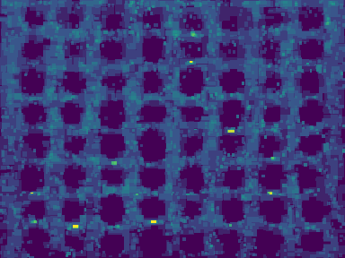 |
| 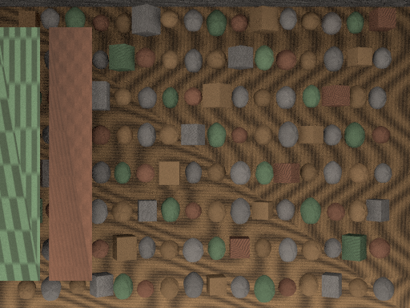 | 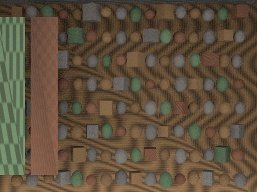 | 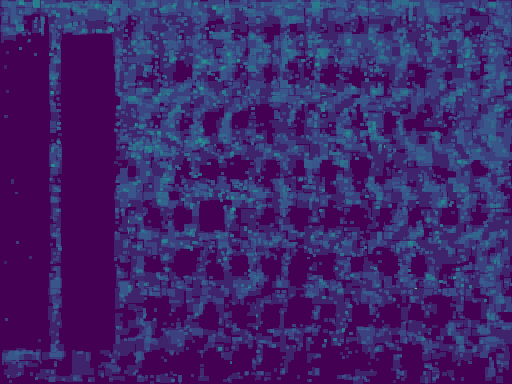 | 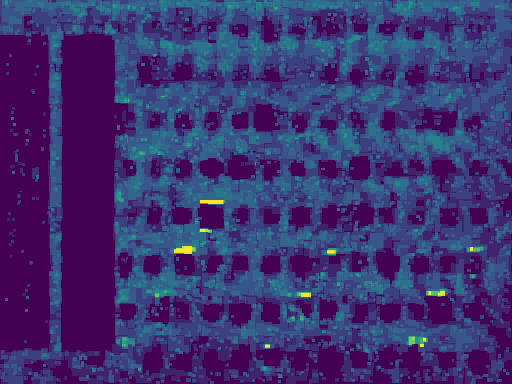 |

The sample maps run from 19 samples (dark) to 1024 (yellow) on a log scale. Both renderers stop early on the smooth
spheres and spend their samples on the textured floor and the edges.

- **At the same target**, XPU2 gives pixels 4 to 18% fewer samples and its image error is 14 to 24% higher. The trees,
  pass schedule and stopping rule are MoonRay's, but the estimate reads XPU2's own samples, which split into even and
  odd halves differently from MoonRay's sample tables: XPU2 stops more pixels after the 19-sample stage (50,700
  against 31,100 on gallery). Pixel by pixel, where both gave a pixel the same samples, their errors are the same.
  So the table also gives the time at the target where XPU2's error is at or below XPU's.
- **The passes are made on the GPU.** The whole frame is queued at once; on the device, each pass's errors, region
  trees, masks and active tiles are made from the passes before it, and the next render follows. Passes made on the
  host instead give every pixel exactly the same samples (checked on both scenes), at 0.055 s and 0.076 s a frame.
  This is the benchmark's way: the kit's previews make their passes on the host unless its adaptive passes preference
  says otherwise (`XPU2_SESSION_CHAIN`, off by default; `xpu2_session.cc`, `native.py`).
- **The CPU alone** renders an adaptive frame in 1.29 s (gallery) and 1.97 s (workshop) at 12 threads, also less
  than XPU's time, and agrees with the GPU-only frame within 0.0042 on every 8×8 block mean.
- **Steady.** The trees see only completed passes, so an adaptive frame's allocation does not depend on timing: every
  timed frame had the same mean samples and the same error to six places.
- **Where the time goes.** A gallery frame is about 8 ms of samples, with the uniform stage's 2.1 million taking
  5.6 ms. Each later pass takes about 0.3 ms on the GPU even when small: about 0.12 ms is the latency of one sample's
  path, and the rest the pass's errors (0.02 ms), trees (0.08 ms) and masks with compaction (0.065 ms).
- **Not checked here:** held-out seeds and a 1024-sample convergence run for adaptive frames; those gates are the
  uniform benchmark's.

## Limits

Two synthetic scenes of the prototype's admitted domain (diffuse and emissive materials, image maps, a constant
environment); not a general or end-to-end claim. Images are not byte-repeatable across runs (accumulation order
varies); the parity pipeline is. The figures come from `make_async_figures.py` over the two reports above.
