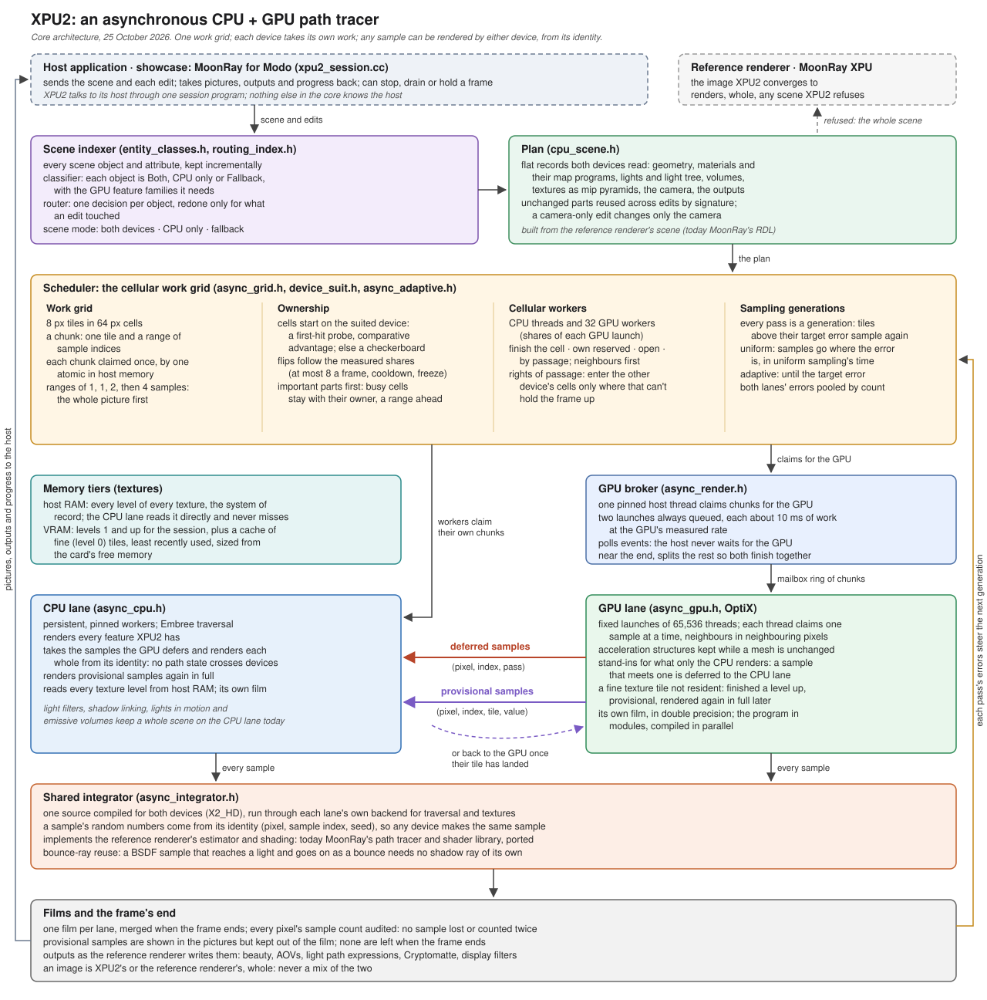

# XPU2 engineer manual

*XPU2: Asynchronous Monte Carlo Path Tracer designed by Raphael Tobar. Not affiliated with or endorsed by DreamWorks Animation; MoonRay and OpenMoonRay are DreamWorks Animation's.*

How XPU2 works, part by part, with the files behind each part. Written 2026-10-25; updated 2026-10-26 for the
tessellation handler and the second round of scene preparation (`INDEXER.md` sections 16 and 17); corrected 2026-10-30
against `MoonLightIPR` at 422a003, the 0.5 release, where XPU2 is part of the kit. The design notes it points to go
deeper. Where this manual and the code disagree, the code wins: fix the manual.

All paths are relative to `xpu2/interactive/` unless they start with `xpu2/` or another top-level folder.



The manual has four parts:

- **Part I, the core:** XPU2's own architecture, independent of the renderer it implements and the host it runs in.
- **Part II, the reference renderer:** MoonRay, whose path tracer and shader library XPU2 ports and whose images XPU2
  must match.
- **Part III, the host:** MoonRay for Modo, where XPU2 runs on real production scenes.
- **Part IV, working on XPU2:** building, testing, porting features, switches and the file map.

## Contents

**Part I. The core**
1. [What XPU2 is](#1-what-xpu2-is)
2. [The rules everything rests on](#2-the-rules-everything-rests-on)
3. [A frame from start to finish](#3-a-frame-from-start-to-finish)
4. [The scene indexer and the plan](#4-the-scene-indexer-and-the-plan)
5. [The scheduler](#5-the-scheduler)
6. [The GPU broker and the GPU lane](#6-the-gpu-broker-and-the-gpu-lane)
7. [The CPU lane](#7-the-cpu-lane)
8. [The shared integrator](#8-the-shared-integrator)
9. [Sampling](#9-sampling)
10. [Memory tiers and partial shading](#10-memory-tiers-and-partial-shading)
11. [Films and the frame's end](#11-films-and-the-frames-end)

**Part II. The reference renderer: MoonRay**

12. [The MoonRay port](#12-the-moonray-port)

**Part III. The host: MoonRay for Modo**

13. [XPU2 in MoonRay for Modo](#13-xpu2-in-moonray-for-modo)

**Part IV. Working on XPU2**

14. [Building and running](#14-building-and-running)
15. [Testing against the reference](#15-testing-against-the-reference)
16. [Porting a feature](#16-porting-a-feature)
17. [How correctness is kept](#17-how-correctness-is-kept)
18. [Switches for testing and diagnosis](#18-switches-for-testing-and-diagnosis)
19. [File map](#19-file-map)
20. [Glossary](#20-glossary)
21. [Not done yet](#21-not-done-yet)
22. [Further reading](#22-further-reading)

# Part I. The core

## 1. What XPU2 is

XPU2 is an asynchronous CPU + GPU path tracer. The CPU and GPU render the same image at once, as peers: each claims
its own work and neither waits for the other. Work goes to the device best suited to it, and away from a device that
can't render it. Because a sample is defined by its identity, it gives the same result on either device.

XPU2 follows the Interactive xPU Renderer Spec (21 October 2026). Spec requirement IDs (ARC-01, CA-08, ACC-07, ...)
appear in code comments; section 20 explains the prefixes.

XPU2 reproduces a **reference renderer**, currently MoonRay (Part II): its images must converge to the reference's.
A **host** application sends XPU2 scenes and receives its images, currently MoonRay for Modo (Part III).

## 2. The rules everything rests on

These hold everywhere. A change that breaks one is a bug, even when the picture looks right.

1. **A sample is defined by its identity, not by who renders it.** A sample is (pixel, sample index, frame seed).
   Its random numbers come from that identity alone (`sample_stream.h`), so either device computes the same sample,
   and a sample can move between devices at any point before it starts.
2. **One integrator for both devices.** The path tracer is written once, as `X2_HD` code (host and device), and
   compiled for both the CPU lane and the GPU program. There is no separate GPU version to keep in sync.
3. **Neither device waits for the other.** The host never blocks on the GPU (it polls events), and the GPU always has
   a launch queued (spec ARC-01).
4. **A chunk of work is claimed exactly once**, by one atomic on a cursor in host memory (CA-06). Nothing is shared
   across PCIe.
5. **A started sample is never dropped, and nothing is counted twice** (ACC-03). When a frame ends, the two films are
   merged and every pixel's sample count is audited (ACC-07).
6. **No path state crosses devices.** When the GPU can't finish a sample, the CPU renders that sample again from its
   identity. The GPU's partial work is thrown away.
7. **Never blend renderers.** A scene is either XPU2's or the reference renderer's, whole. XPU2 never patches pixels
   into a reference image or the other way round.

## 3. A frame from start to finish

1. **The scene arrives** from the host, followed by edits as they happen.
2. **Indexing.** Every object is classified by which device can render it, and the scene gets a mode: both devices,
   CPU only, or fallback to the reference renderer (section 4).
3. **The plan.** The scene becomes flat records both devices read. Unchanged parts are reused (section 4).
4. **The lanes prepare.** The CPU lane builds its Embree scene. The GPU lane builds its acceleration structures and
   uploads the plan. A camera-only edit keeps all of this and only updates the camera.
5. **Cells are seeded.** A first-hit probe finds what each cell of the image sees. Each cell starts on the device suited
   to it (section 5).
6. **The frame runs.** The CPU lane's workers claim their own chunks from the work grid. The broker claims chunks for
   the GPU and keeps two launches queued (section 6). Every sample runs the shared integrator start to finish and adds
   its result to its lane's film.
7. **Samples hand off.** A GPU sample that meets something only the CPU renders is deferred to the CPU. A GPU sample
   whose fine texture tile isn't resident finishes from a coarser level as a provisional sample, and is re-rendered in
   full later (section 10).
8. **Sampling generations decide when to stop.** After each pass, tiles whose error is still above the target sample
   again (section 9).
9. **The frame ends.** The films merge, sample counts are audited, and outputs go to the host (section 11).

## 4. The scene indexer and the plan

Design: `INDEXER.md` sections 1 to 6, 12, 16 and 17.

**The indexer** keeps every scene object and attribute, updated incrementally as edits arrive.

- **The classifier** (`entity_classes.h`) gives each object a device class: `Both`, `Cpu` (the CPU lane alone) or
  `Fallback` (the reference renderer takes the scene). It also records the GPU feature families the object needs and
  its relative shading cost on each device. A material is classified by the families its BSDF tree and map graph use,
  so one unusual material among many common ones doesn't decide the whole scene.
- **The router** (`routing_index.h`) keeps one decision per object and redoes only what an edit touched. Unknown
  means fallback.
- **The scene mode.** Any `Fallback` object sends the scene to the reference renderer. Some features keep the whole
  scene on the CPU lane (section 7).

**The plan** (`cpu::prepare`, `cpu_scene.h`) is the scene as flat records both lanes read: geometry, materials and
their map programs, lights and the light tree, light filters, volumes, textures as mip pyramids, the camera and the
outputs. The plan builder is also the final check of every attribute: an object classified `Both` can still be
refused here, with a reason.

- Unchanged meshes, tessellations, grids, images and light tables are reused across edits by signature
  (`deepSignature` covers a displaced mesh's maps).
- A camera-only edit (`Scene::onlyCameraDirty`) keeps the plan and both lanes' scenes. `cpu::updateCamera` and
  `GpuLane::updateCamera` take about 0.1 ms. Scenes whose geometry depends on the camera (adaptive subdivision,
  volumes, filters, motion) prepare again.

**The canonical copy** (`canonical_session.h`, added 2026-10-26 in its present form). The plan is made from a replica of
the received scene, not from the scene itself: the renderers keep reading the replica's objects (materials, maps)
while new edits land in the received scene. Each attribute is captured into the index as bytes and decoded into the
replica. Packed vectors (numbers, RDL's vectors and colours) go as one block, and the index holds each attribute once,
moved in from the capture (`SceneIndex::same`). On a scene with 1 GB of geometry the copy takes about 4 s.

The plan builder reads the reference renderer's scene format, so it belongs to the MoonRay port as much as to the core
(section 12).

## 5. The scheduler

Design: `ASYNC.md` ("How a frame runs"), `INDEXER.md` section 7.

- **The work grid** (`async_grid.h`). The image is cut into 64-pixel cells. Each cell queues its unstarted work as
  16-byte chunks: one 8×8 tile and a range of sample indices, ordered by sample range so a cell converges evenly.
  Claims are atomics on host cursors.
- **Cells by suitability** (`device_suit.h`). A first-hit probe (four camera rays per tile, on the CPU) finds what
  each tile sees. From the classifier's families, the chance of deferral and the lanes' measured rates, each cell gets
  a probability that the GPU should own it. Cells start on the device with the comparative advantage, before any
  stealing. Without a probe they start as a CPU/GPU checkerboard.
- **Ownership flips** towards the device that rendered most of a cell: at most 8 flips a frame, a 16-frame cooldown,
  and a 64-frame freeze after thrashing. Deferred samples count as the CPU's.
- **Progressive order.** A uniform frame's sample ranges grow 1, 1, 2, then the chunk size. No device gets a chunk past
  the least-sampled range of the cells it works (its frontier) unless it holds a right of passage, so the whole
  picture fills first.
- **Important parts first.** The pictures so far score each cell. Cells above the mean stay with their owner and may
  run a range ahead. The rest are open to either device, most important first.
- **Rights of passage.** A device may enter a cell the other has reserved only when that can't hold up the frame. The
  CPU may enter when its chunk would end before the GPU gets there, or when the GPU hasn't claimed lately. The GPU may
  enter when the CPU's backlog outlasts four of its launch windows, in a cell it wouldn't mostly defer.
- **Cellular workers on both devices.** The CPU threads and 32 GPU workers (shares of each launch) each sit in a cell
  and move by the same rules: finish the cell, then their own reserved cells, then open cells, then by passage,
  neighbours first. A GPU launch still runs all at once; only where its work comes from is cellular.

## 6. The GPU broker and the GPU lane

**The broker** (`async_render.h`) is one host thread, pinned to its own core, that claims chunks for the GPU.

- It keeps two launches queued, each sized from the GPU's measured rate to about 10 ms of work (`windowMs`), and never
  below two samples per thread.
- It polls events and never waits for the GPU.
- Near the end of a frame it splits what's left so both devices finish together (the lookahead).
- In low-latency mode (`async::lowLatency`) no XPU2 thread runs above the process's priority, and one CPU thread is
  left free for the host.

**The GPU lane** (`async_gpu.h` on the host, `async_gpu.cu` and the module files on the device, `async_gpu_abi.h` and
`async_gpu_device.h` shared):

- **One CUDA stream** carries everything in order: chunk uploads into the mailbox ring, launches, readbacks and
  texture-cache updates.
- **Launches** are fixed grids of 65,536 threads (`launchThreads`). Each thread claims one sample at a time with an
  atomic: first parked samples, then its range of chunk items. Neighbouring claims are neighbouring pixels of the same
  sample, so warps trace coherent rays. The device film accumulates in double precision.
- **Acceleration structures.** One GAS per mesh, kept while the mesh is unchanged, under an IAS. Curves and points
  are OptiX custom primitives.
- **Stand-ins.** Objects classified `Cpu` are in the GPU scene as bounding stand-ins (a moving mesh's motion bounds,
  a VDB's box, points' bounds). A sample that meets one is deferred to the CPU lane through the deferred-samples ring.
- **The program in modules.** OptiX compiles each module separately and in parallel, but a module's call graph
  compiles as a whole, so the program is split until no module is large. Today it has nine modules (section 12 lists
  them). Direct callables can't trace rays in OptiX 7.6, so anything that traces is a continuation callable or stays
  in ray generation. Callable modules are compiled relocatable (`-rdc`), or NVRTC drops their entry points. Big
  helpers are kept out of line (`X2_CALL`, beside `X2_HD` in `sample_stream.h`). An OptiX call inside a callable can
  take a module's compile from seconds to tens of minutes.
- **Profile.** `XPU2_PROFILE` times each stage on the GPU (rays, shadow rays, material callables, presence, volume
  crossings) and counts rays per sample.

## 7. The CPU lane

`async_cpu.h`. Persistent, pinned workers claim their own chunks by the cellular rules. Embree, in robust mode,
traverses triangles, and user geometry handles curves and points. The CPU lane:

- renders every feature XPU2 has, including those the GPU defers (today: points, geometry in motion, VDB volumes, and
  heterogeneous and emissive volumes);
- works through the retry queue: deferred GPU samples, each re-rendered whole from its identity;
- re-renders provisional samples in full: every texture level is in RAM, so the CPU never misses;
- keeps its own film, merged with the GPU's when the frame ends.

Some features keep a whole scene on the CPU lane because the GPU programs lack them and they affect every sample
(`GpuLane::cpuOnly`): today, lights in motion, light filters, shadow linking, lobe light sets and emissive volumes.

## 8. The shared integrator

`async_integrator.h`. One complete sample, start to finish, for either device. The core's contract with it:

- It is templated on a backend (`integrate<Backend>`). Each lane supplies traversal, visibility and texture access;
  the integrator supplies everything else.
- It takes a sample's identity and draws every random number from it.
- It returns a finished sample, a deferral (the sample met a stand-in) or a provisional result (a texture miss), and
  never path state to resume elsewhere.
- It writes its result to the lane's film: radiance, alpha, AOV values, Cryptomatte events.

What it computes is the reference renderer's estimator: today MoonRay's path tracer with its lights, BSDF and light
samples combined by MIS, per-lobe depth limits, Russian roulette, clamping, presence, volumes and subsurface
(section 12).

**Bounce-ray reuse.** A BSDF sample that reaches a light and continues as a bounce needs no separate shadow ray: the
bounce's nearest hit settles it. This halved the shadow rays on the Modo test scene. It is off where the two could
differ: presence shadows, shadow linking, volumes, a minimum shadow distance and similar cases
(`Config::shadowReuse`).

## 9. Sampling

- **Random numbers** (`sample_stream.h`). The dimensions that matter most (camera, first-hit BSDF, light and
  subsurface) are stratified across a pixel's samples with Sobol, digitally shifted. Everything else comes from a
  per-bounce Philox4x32-10 stream in a fixed order. All of it derives from the sample's identity. Branch IDs are
  deterministic tree addresses, never queue order.
- **Sampling generations** (`async_adaptive.h`, class `Cellular`). Every frame runs by generations. Each generation is
  a pass, and tiles whose error is still above the target sample the next pass. The sampling mode only decides when to
  stop:
  - uniform: every pixel is seeded with an eighth of its samples (at least 16). The rest go where the error is,
    within the time uniform sampling would have taken. At most twice the uniform total, and 16 times the samples per
    pixel;
  - adaptive: until the target error, between the minimum and maximum samples.

  With a GPU, the CPU lane takes chunks too, and the two lanes' errors are pooled by their counts
  (`Adaptive::merged`).
- **The reference's own adaptive sampler** is available too (`XPU2_SESSION_ADAPTIVE=trees`): MoonRay's error trees,
  regions and pass schedule. The host and the GPU build identical trees from `async_adaptive_core.h`, which writes out
  every multiply-add a compiler could fuse (`mulRn`, `addRn`).
- **The pass chain** (`async_adaptive.cu`, `GpuLane::launchChain`, `XPU2_SESSION_CHAIN=1`) queues a whole adaptive
  frame on the GPU at once: per pass, four CUDA kernels (errors, trees, masks, compaction) and a render. It is off by
  default.

## 10. Memory tiers and partial shading

- **Host RAM** holds every texture's mip levels and is the system of record (`host_texture.h`). The CPU lane reads it
  directly. Since 2026-10-26 the finest level (level 0) is decoded tile by tile the first time it is read
  (`Pyramid::loadTile`, through an OpenImageIO ImageCache), the coarser levels as the scene is prepared;
  `XPU2_SESSION_EAGER_TEXTURES=1` decodes them all at once. 8-bit files are kept as bytes (`tex::Mip::format`).
- **VRAM** holds every texture's levels 1 and up for the whole session, plus a cache of level-0 (fine-detail) tiles,
  loaded on demand and evicted least recently used.
- **Under memory pressure** the oldest decoded level-0 tiles are let go, and a scene that still does not load has its
  textures compressed (BC6H), then limited, for the session (texture overflow mode, `ASYNC.md`, "Limits a scene can meet").
- **A tile that cannot be read** fails the frame with its file and reason, and the scene goes to the reference renderer.
- **The cache's budget** (`GpuLane::fineBudget`) is measured at each preparation, and again as a frame starts if the card has filled up (`fineCacheTooBig`): what the scene's level-0 tiles need,
  up to the card's free memory minus a fifth of the card (at least 1.5 GB left for the frame and the host's own use),
  and never below 256 MB. `XPU2_SESSION_FINE_BUDGET_MB` fixes it.
- **Filtering** is shared by both devices (`texture_core.h`, adapted from OpenImageIO). A miss names the tile it needs
  in a scene-wide tile space.
- **Partial shading** (on by default). A GPU sample whose level-0 tile isn't resident finishes from the parent texel a
  level up and is provisional: shown in the pictures, kept out of the film. The CPU, or the GPU once the tile lands,
  re-renders it in full. A provisional sample isn't counted in its pass until it's done in full, so the error estimate
  never sees a low-fidelity sample. With `XPU2_SESSION_PARTIAL=0`, such samples park in a bounded GPU queue
  until their tile lands instead.
- **Pinned host memory** for readbacks is capped at a quarter of the machine's memory, between 2 and 16 GB.

## 11. Films and the frame's end

- Each lane keeps its own film. When the frame ends the films merge, and every pixel's sample count is audited.
- Provisional samples are shown in the pictures but kept out of the film. None are left when the frame ends (audited).
  A drain (stop now, keep what's done) finishes the provisional samples first.
- The pictures fill pixels no sample has reached yet from their neighbours, for display only.
- Outputs are written as the reference renderer writes them (section 12).

# Part II. The reference renderer: MoonRay

## 12. The MoonRay port

Design: `PATH_TRACER.md`. Progress: `FEATURE_PROGRESS.md`.

XPU2 implements MoonRay: its estimator, lights, cameras, BSDF lobes, materials, maps, volumes, subsurface, hair,
curves, outputs and adaptive sampler, each ported from MoonRay's source (the vector-mode ISPC where XPU follows it)
into `X2_HD` code both lanes run. Each ported file credits its MoonRay source (Apache-2.0). Every port is checked
against MoonRay renders (section 15). MoonRay XPU is also the fallback for scenes XPU2 refuses.

**Shading library**

| Area | Files |
|---|---|
| Estimator | `async_integrator.h` |
| Cameras (perspective, orthographic, depth of field and bokeh, spherical, fisheye, DomeMaster3D, bake) | `camera_core.h` |
| Lights, light tree, light filters, light textures | `light_core.h`, `light_tree.h`, `light_filter_core.h`, `light_image.h` |
| Shading state at a hit, primitive attributes | `shade_state.h`, `surface_core.h`, `triangle_hit.h`, `resume_core.h` |
| Materials: DwaBase family, combinators, UsdPreviewSurface, switch materials | `shade_dwabase.h`, `shade_dwalayer.h`, `shade_material.h`, `shade_builder.h` |
| Maps: bindings, map programs, map nodes | `shade_maps.h`, `shade_mapnodes.h`, `shade_mapnodes_more.h`, `shade_noise.h`, `shade_color.h`, `shade_colorcorrect.h` |
| BSDF lobes and Fresnel | `shade_lobes.h`, `shade_lobes_eval.h`, `shade_fresnel.h` |
| Subsurface | `shade_bssrdf.h` |
| Hair, glitter, flakes | `shade_hair.h`, `shade_glitter.h`, `shade_glitter_tables.h`, `shade_flakes.h` |
| Volumes and VDB, emissive volumes | `volume_core.h`, `volume_grid.h`, `volume_emission.h` |
| Curves and points | `curve_core.h`, `curve_embree.h` (vendored by `vendor_curves.py`), `points_core.h` |
| Math helpers, shared tables | `shade_math.h`, `shade_tables.h` (made by `make_shade_tables.py`) |

**Reading MoonRay scenes (the plan builder)**

| File | Role |
|---|---|
| `cpu_scene.h` | The plan from MoonRay's RDL scene: meshes, instances, parts, lights, camera, render settings. `X2_NEED` builds its message only on failure: building it every time cost seconds in loops over millions of indices |
| `dwa_admission.h` | DwaBase-family objects into `shade::DwaRecord`s, with `DwaBase::update()`'s hints |
| `map_admission.h` | Material bindings into `MapBinding`s and each material's map program, in dependency order |
| `mesh_displacement.h` | MoonRay's PolyMesh tessellation and displacement for triangle meshes |
| `light_tree_build.h`, `light_image_build.h`, `light_mesh_build.h` | Light tree, light textures and mesh lights, built on the host |
| `xpu2_geom.cc`, `xpu2_geom.h` (`xpu2_geom.dll`) | MoonRay's own OpenSubdiv tessellation, displacement callbacks and OpenVDB reading, built separately with MoonRay's flags so XPU2's build never sees MoonRay's internal headers |
| `xpu2/indexed_scene.h`, `xpu2/rdl_scene_index.h`, `xpu2/rdl_replica.h`, `canonical_session.h` | The RDL capture under the indexer (section 4) |

**Outputs**

| File | Role |
|---|---|
| `aov_plan.h` | Render outputs as MoonRay's RenderOutputDriver sets them up: files, parts, channels, the AOV schema, material AOV expressions and LPE state machines |
| `aov_core.h` | A sample's AOV values in one array laid out as MoonRay's AovSchema, merged by MoonRay's filters |
| `aov_material.h` | Material AOVs from the lobes, Fresnels and subsurface, with PBR validity |
| `aov_state.h` | State-variable and primitive-attribute AOVs, depth, wireframe |
| `aov_crypto.h` | Cryptomatte as MoonRay's vector mode keeps it |
| `aov_display.h` | Display filters: MoonRay's own display filter DSOs run over XPU2's buffers |
| `aov_write.h` | The EXR files as MoonRay writes them: parts, channels, compression, metadata, windows |

**The GPU program's modules**

| Module source | Holds |
|---|---|
| `async_gpu.cu` | Ray generation, misses, hits: the path loop, light sampling, the traces |
| `async_material.cu` | A hit's BSDF, a material's presence |
| `async_maps.cu` | The map interpreter |
| `async_lights.cu` | Light shapes: sampled, intersected, evaluated |
| `async_lobes.cu` | Lobes: evaluated, sampled, their albedo |
| `async_volumes.cu` | Volume radiance, subsurface, shadow transmittance (continuation callables) |
| `async_dwa.cu` | DwaBase resolve: a tree's layers blended |
| `async_dwalobes.cu` | A resolved DwaBase material's lobes, glitter |
| `async_extras.cu` | The camera, AOVs |

`async_adaptive.cu` holds the adaptive pass chain's CUDA kernels (section 9). It is a CUDA program, not an OptiX
module.

**Things to know about the port**

- **Render space.** XPU2 shades in world space; MoonRay shades in render space. Where MoonRay reads a value as a
  render-space quantity, XPU2 converts it (`PATH_TRACER.md`, "Render space"). A missed conversion shows up as shifted
  highlights.
- **Quirks.** Some of MoonRay vector mode's quirks are reproduced and others aren't (XPU2 then matches scalar mode).
  `FEATURE_PROGRESS.md` lists each one and the choice made.
- **Where MoonRay itself can't render.** MoonRay's vector mode crashes on Windows for emissive volumes, VDB emission
  and glitter, so those are checked against scalar mode.

# Part III. The host: MoonRay for Modo

## 13. XPU2 in MoonRay for Modo

XPU2 renders MoonRay for Modo's previews, which makes Modo the showcase for XPU2 on real production scenes.

```
Modo ── MoonRay for Modo kit ───────────────► moonray_xpu2.exe  (XPU2 session)
                 ▲            │                        │
                 │            │  "@@MODO_XPU2 FALLBACK <reason>"
                 │            └──────────────► moonray.exe (MoonRay XPU takes the same scene)
                 └── pictures through shared memory, @@MODO_* protocol lines on stdout
```

- **XPU2 in the kit.** Since 0.5 XPU2 is part of the standard kit (`native.py`, `preferences.py`, `persistent.py` and
  `xpu2_sampling.py` in `kit/MoonRayForModo/python/moonray_modo/`), its session in `runtime-xpu2` beside `runtime`. A
  preference picks the GPU renderer (XPU2 by default, or MoonRay XPU). When XPU2 is chosen and the render's execution
  mode is XPU or Auto, the preview session starts `moonray_xpu2.exe` in MoonRay's place. Final renders, MoonRay LS and
  MoonLightIPR stay MoonRay's.
- **The session program** (`xpu2_session.cc`, built as `moonray_xpu2.exe`) is the only part of XPU2 that knows the
  host. It speaks the kit's persistent preview protocol v1, the same one MoonRay's session speaks
  (`native-port/persistent_session.inc`): the scene and its deltas, frames, drain, hold and cancel, pictures through
  shared memory.
- **Fallback.** If XPU2 refuses something in the scene, its GPU programs aren't compiled, or the GPU fails, the
  session prints `@@MODO_XPU2 FALLBACK <reason>` and exits. The kit starts MoonRay XPU on the same scene, and the
  Render Log shows the reason. The same happens if XPU2 crashes. When an edit makes the scene renderable again, XPU2
  takes it back.
- **Scenes in memory.** The scene's text may come as `modo-memory:<length>:<name>` and, since 2026-10-26, the
  geometry's binary scene as `modo-memory-rdlb:<length>:<name>` (`readBinaryMemory`): mappings the kit holds, so a
  heavy scene's gigabyte of geometry doesn't go through the disk. MoonRay, on fallback, is handed files. A scene already
  applied has let its prepared parts go, its text holding the meshes' fingerprints alone: the kit writes it again first
  (`persistent._Rewrite`).
- **Without `MOONRAY_MODO_SESSION`**, `moonray_xpu2.exe` passes its arguments to the kit's own `moonray.exe`
  (`MOONRAY_XPU2_MOONRAY` names it).

What the session does besides rendering:

- **Shader cache.** `--compile-shaders` compiles the GPU programs into OptiX's disk cache (about an hour the first
  time) and leaves a mark for this driver and these programs. `--shaders-compiled` exits 0 when the mark is there and
  3 when it isn't. If the cache is gone (a driver update, the cache's size limit), the session hands the scene to
  MoonRay after a minute rather than compile for an hour.
- **Outlines** for the kit: `@@MODO_TILES` (cells being rendered), `@@MODO_WORKERS` (each CPU worker's tile) and
  `@@MODO_GPU_WORKERS` (cells the GPU's queued launches hold, drawn in their own colour).
- **Checkpoints** (class `Checkpoints`): the frame so far, saved every `checkpoint_interval` minutes, with MoonRay's
  "Wrote:" lines, for a scene that asks. A capability of the session: the 0.5 kit does not ask, as Safe Denoising is
  greyed while XPU2 renders the preview (`lxserv/moonray_render_settings.py`, `panel.py`) and `render.py` writes no
  saves under XPU2. Resuming from a save isn't done yet: Continue starts the render again.
- **Denoiser guides.** Albedo and normal at the first hit, for the kit's denoiser. Smart Render, MoonRay's, is greyed
  while XPU2 renders the preview, and realtime asks for no guides (`denoising.py`).
- **Realtime** (`INDEXER.md` section 13). With the kit's RT switch on, the preview follows the scene at the realtime
  size. A realtime frame is the GPU's alone: its first pass covers every pixel (sparse first passes, a quarter of
  the pixels then the rest, are off: XPU2_SESSION_RT_SPARSE=1), launches are sized to about 15 ms and a picture goes
  out every 33 ms. The session also has `RealtimeDenoiser` (OptiX's HDR denoiser on its own high-priority stream, for
  Denoised Beauty with guides), which the 0.5 kit does not use: under XPU2 it offers no Denoised Beauty in realtime
  and writes no guides for it (`panel.py` `_offer_denoised`, `denoising.py`).
- **Settings from Modo.** The kit's render settings for sampling generations (Generation Samples, Halting Rule,
  Halt at Noise, First Look, Most Samples, CPU Workers) reach the scene as UserData `/modo/xpu2/generations`. Its
  form 2 says they rule: a scene's adaptive sampling is then MoonRay's alone, and XPU2 samples from Pixel Samples and
  these settings (form 1 left an adaptive scene its own minimum, maximum and target error). The kit's Devices
  preference sets `XPU2_SESSION_MODE`. The kit's Source Overrides (`MOONRAY_MODO_*`) apply to XPU2 as to MoonRay.
- **Limits.** Prepared geometry up to what the machine has room for, measured from the free RAM as each scene is
  prepared, between 256 MB and 64 GB (`geometryBudget`; `XPU2_SESSION_GEOMETRY_MB` fixes it), and a memory ceiling.
- **The frame report** in the log: when the grid ran out of chunks, the GPU's launches and rate, parked samples,
  texture cache loads and evictions, and the GPU profile when `XPU2_PROFILE` is set.

`xpu2_scene.cc` and `xpu2_cpu.cc` are three-line units that split the session's build: `build_session.py` compiles
the plan builder and the CPU integrator as separate units, in parallel.

# Part IV. Working on XPU2

## 14. Building and running

Prerequisites and the pinned reference runtime are in `BUILDING.md`: the Windows MoonRay development tree
(`toolchain/msys64` g++, `build/native-avx`), Embree 4.4.1, OpenImageIO 3.1.17, OptiX 7.6 headers, CUDA 12.8 runtime
and NVRTC, and an NVIDIA GPU. Every output folder must be new.

```powershell
# 1. The renderer and its GPU program (also the benchmark worker, async_probe.exe)
python xpu2/interactive/build_async.py --source $toolchainRoot --runtime $referenceRoot --output test-results/async-build-N

# 2. The session runtime the kit runs: moonray_xpu2.exe, xpu2_geom.dll (cached by its sources), the GPU programs
#    of build N, and the pinned runtime's libraries
python xpu2/interactive/build_session.py --source $toolchainRoot --runtime $referenceRoot --build test-results/async-build-N --output test-results/xpu2-session-N

# 3. Compile the GPU programs into OptiX's cache (about an hour the first time; cached after)
test-results/xpu2-session-N/runtime-xpu2/moonray_xpu2.exe --compile-shaders

# 4. A release: XPU2 is part of the standard kit (kit/MoonRayForModo); the package adds the session's folder as runtime-xpu2
python tools/package_development_release.py --runtime <runtime> --geometry <geometry> --xpu2-runtime test-results/xpu2-session-N/runtime-xpu2

# 5. Check the package. For a development install, copy runtime-xpu2 into the installed kit beside runtime (Modo closed)
python tools/check_release_package.py <version> [<release folder>]
```

Run each script with `--help` for its full arguments. Notes:

- `build_session.py` refuses an async build whose GPU program sources have changed since. Build again (step 1), or
  pass `--cpu-test` for CPU-only tests (`XPU2_SESSION_MODE=0`), which never load the GPU programs.
- Any change to code the GPU program includes means compiling the shaders again (step 3). Use `XPU2_OPTIX_LEVEL=0`
  for quick correctness builds.
- The scripts in `xpu2/tools/modo-cl/` find the session harness in this tree; their results go to the test-results
  folder each names at its top, outside the repository.
- Close Modo before installing, and check `tasklist` shows no `modo.exe`.
- Never attach gdb to Modo: its JIT breakpoint on `nvgpucomp64` kills Modo. Use `xpu2/tools/modo-cl/debug_modo.py`.

## 15. Testing against the reference

| Check | How |
|---|---|
| Unit tests | `python -m unittest discover -s xpu2/interactive -p "test_*.py"` |
| Scheduler invariants | `async_grid_test.cc`: every chunk claimed once under 12 workers and the broker, every pixel gets exactly its samples, cellular rules, flip limits |
| A feature against MoonRay | `feature_tests/make_*_scenes.py` writes a feature's scenes; `feature_tests/feature_compare.py` renders XPU2 and MoonRay and prints 8×8 block error and mean ratio beside the noise floor |
| Outputs | `feature_tests/aov_compare.py`, `crypto_compare.py` |
| Sampling | `feature_tests/cellular_check.py`: generations, trees and uniform against a converged MoonRay image |
| A session as the host drives it | `session_harness.py --exe moonray_xpu2.exe --scene ... --output ...` |
| A real Modo scene | `xpu2/tools/modo-cl/` exports headless; `compare.py <scene> <w> <h> --moonray --xpu2 <session>` |
| Speed | `run_async_benchmark.py`, `run_async_adaptive_benchmark.py`, `run_material_benchmark.py` |

Test with the host's environment where it matters: without the kit's Source Overrides some scenes render
differently in both renderers (for example `MOONRAY_MODO_OPAQUE_ALPHA`), and `compare.py` takes `--env`. Never render
anything else while a benchmark is timing.

## 16. Porting a feature

1. **Read the reference's code** for the feature: MoonRay's scalar C++ and its vector ISPC, which XPU follows. Note
   the quirks.
2. **Port the device code** as `X2_HD` into the right shared header (section 12). Keep MoonRay's operation order, and
   credit the MoonRay source file in the header comment (Apache-2.0).
3. **Admit it in the plan builder**: read its attributes with MoonRay's defaults (`cpu_scene.h` or an admission
   header) and refuse what's out of scope with a clear reason.
4. **Classify it** in `entity_classes.h`: `Both`, `Cpu` (with a GPU stand-in) or `Fallback`, and its GPU family.
5. **Place it in a GPU module.** Keep modules small, and nothing that traces in a direct callable.
6. **Write test scenes** (`feature_tests/make_<feature>_scenes.py`) and compare: on the CPU lane first
   (`XPU2_SESSION_MODE=0`, 256 samples a pixel), then on the GPU after a shader compile.
7. **Record it** in `FEATURE_PROGRESS.md` with the check's numbers, and update this manual if a part changed.

## 17. How correctness is kept

- **Same estimator, same random numbers.** Shared `X2_HD` code and identity-derived random numbers make a sample the
  same sample on either device. Embree and OptiX may still find slightly different hits; those differences are
  measured statistically (spec CPU-12).
- **Fused arithmetic is written out** where both devices must agree exactly (the error trees): `mulRn`, `addRn`.
- **Audits.** Every pixel's sample count is checked when the films merge, and no provisional sample may be left when
  a frame ends.
- **Checked against the reference.** Every port is compared with MoonRay on block error and mean ratio, against
  MoonRay's own seed-to-seed noise floor (section 15).
- **The parity pipeline** (`deadline_pipeline.h`), the older synchronous design, is kept as an exact-arithmetic
  reference: fixed ownership and byte-repeatable images.

## 18. Switches for testing and diagnosis

Environment variables read by the session or the renderer. The defaults are the normal behaviour.

| Variable | Effect |
|---|---|
| `XPU2_SESSION_MODE` | `0` CPU only, `1` GPU only, `2` both (default) |
| `XPU2_SESSION_COARSE_FIRST` | `0` leaves out the coarse first pass of a heavy scene |
| `XPU2_SESSION_PREP_ITEMS` | `1` logs each mesh made, its time and triangles |
| `XPU2_SESSION_SPILL_MB` | Holds decoded texture tiles to this many MB, for tests |
| `XPU2_SESSION_CARD_FREE_MB` | Says the card has this much memory, all of it free, for tests of a full card |
| `XPU2_SESSION_PARTIAL=0` | No partial shading: texture misses wait for their tile |
| `XPU2_SESSION_ADAPTIVE=trees` | MoonRay's error trees instead of sampling generations |
| `XPU2_SESSION_ADAPTIVE_CPU=0` | With generations, the GPU takes every chunk |
| `XPU2_SESSION_UNIFORM_BUDGET=0` | Exact uniform sampling (for comparisons with MoonRay's uniform renders) |
| `XPU2_SESSION_CHAIN=1` | The adaptive pass chain on the GPU |
| `XPU2_SESSION_SHADOW_REUSE=0` | No bounce-ray reuse |
| `XPU2_SESSION_PREVIEW_MS` | Interval between progressive pictures (default 100) |
| `XPU2_SESSION_LOW_LATENCY` | `0` or `1`: overrides the host's low-latency setting |
| `XPU2_SESSION_FINE_BUDGET_MB` | Fixes the level-0 texture cache's budget |
| `XPU2_SESSION_GEOMETRY_MB` | Fixes the prepared-geometry budget (default: measured from free RAM, 256 MB to 64 GB) |
| `XPU2_SESSION_GPU_GEOMETRY_MB` | The card's geometry budget, past which the largest meshes go to the CPU lane alone (added 2026-10-26) |
| `XPU2_SESSION_MEMORY_MB` | The session's memory ceiling (added 2026-10-26) |
| `XPU2_SESSION_GEOMETRY_CACHE=0`, `_GEOMETRY_CACHE_GB` | No tessellation cache on disk; its size (default 20 GB) (added 2026-10-26) |
| `XPU2_SESSION_TESSELLATION_JOBS` | Meshes tessellated at once (default 1) (added 2026-10-26) |
| `XPU2_SESSION_SHARED_INSTANCES=0` | Each instance baked into a mesh of its own (added 2026-10-26) |
| `XPU2_SESSION_EMBREE_COMPACT=0` | The CPU lane's Embree scenes without the compact flag (added 2026-10-26) |
| `XPU2_SESSION_FLOAT_TEXTURES=1` | 8-bit textures kept as floats (added 2026-10-26) |
| `XPU2_SESSION_EAGER_TEXTURES=1` | Every texture level decoded as the scene is prepared (added 2026-10-26) |
| `XPU2_SESSION_RT_TEXTURE_SIDE` | Realtime's largest texture side (default 1280; 0: whole) (added 2026-10-27) |
| `XPU2_SESSION_CANONICAL_FILE=1` | The canonical replica also written as an RDLB file, to inspect (added 2026-10-26) |
| `XPU2_SESSION_RT_DENOISE=0`, `_RT_GUIDES`, `_RT_SHOW`, `_RT_DEBUG`, `_RT_PRIORITY=0` | Diagnostics of the session's realtime denoiser, unused by the 0.5 kit (`INDEXER.md` section 13) |
| `XPU2_SESSION_DEBUG_FAILURES` | Names the CPU lane's first failed shadings and texture lookups |
| `XPU2_PROFILE` | GPU profile by stage, printed per frame |
| `XPU2_OPTIX_LEVEL` | `0` to `3`: lower OptiX optimization for quick GPU test builds (cached as a separate program) |
| `XPU2_OPTIX_EXCEPTIONS` | OptiX exception checks in the GPU program |
| `XPU2_ASYNC_HOST_PASSES=1`, `XPU2_ASYNC_TREE_THREADS`, `XPU2_ASYNC_NO_RESERVE` | Benchmark worker (`async_probe.exe`) options |

The `XPU2_*_MODULE` and `XPU2_*_UNIT` macros are build-time defines that select which module or unit a source file
compiles as. They are not runtime switches.

## 19. File map

Everything in `xpu2/interactive/` unless a path says otherwise. Line counts are approximate. The core and the MoonRay
port share one folder today; this map says which layer each file belongs to.

**Core**

| File | What it is |
|---|---|
| `async_render.h` (1.4k) | Coordinator and GPU broker, `RenderOptions`, the frame's end, merge and audit |
| `async_grid.h` (0.5k) | Work grid, chunks, cellular rules, ownership flips |
| `device_suit.h` | Cells by suitability |
| `async_cpu.h` (1.8k) | CPU lane |
| `async_gpu.h` (2.5k) | GPU lane, host side |
| `async_gpu_abi.h`, `async_gpu_device.h` | Host/device shared layout, launch parameters, device texture access |
| `async_integrator.h` (2.8k) | One sample, both devices: the core's contract, holding the reference's estimator |
| `async_adaptive.h`, `async_adaptive_core.h`, `async_adaptive.cu` | Sampling generations, the error trees, the GPU pass chain |
| `sample_stream.h` | Identity-derived random numbers, `X2_HD` and `X2_CALL` |
| `texture_core.h`, `host_texture.h` | Shared texture filtering, host texture storage |
| `entity_classes.h`, `routing_index.h` | Classifier and router |
| `spsc_ring.h`, `snapshot_budget.h` | Small shared utilities |

**MoonRay port:** the tables in section 12.

**Host (MoonRay for Modo)**

| Path | What it is |
|---|---|
| `xpu2_session.cc` (2.0k), `xpu2_scene.cc`, `xpu2_cpu.cc` | `moonray_xpu2.exe`: protocol, fallback, outlines, checkpoints, realtime denoiser |
| `session_harness.py` | Drives a session as the kit does, without Modo |
| `native-port/persistent_session.inc`, `native-port/modo_*.h` | The kit's preview protocol, shared with MoonRay's session |
| `kit/MoonRayForModo/python/moonray_modo/` | XPU2 in the kit: `native.py` (renderer, devices, runtime folder), `preferences.py`, `persistent.py`, `xpu2_sampling.py`; `kit/MoonRayForModo/lxserv/moonray_xpu2.py` |
| `tools/package_development_release.py`, `tools/check_release_package.py` | The release, with `runtime-xpu2` beside `runtime`, and its check |
| `xpu2/tools/kit/` | `check_xpu2_session_qt.py` and other checks; `build_xpu2_kit.py` and `install_xpu2.py` are retired, kept as a record |
| `xpu2/tools/modo-cl/` | Headless Modo export (`run_cl.py`, `export_probe.py`), comparison (`compare.py`), crash debugging (`debug_modo.py`) |

**Build and test**

| File | What it is |
|---|---|
| `build_async.py` | The renderer's benchmark worker (`async_probe.exe`) and its OptiX program |
| `build_session.py`, `build_geom.py` | The session runtime; `xpu2_geom.dll` with MoonRay's flags |
| `native_build.py`, `gpu_build.py` | Shared C++ and NVRTC build helpers |
| `reference_runtime.py`, `reference-lock.json` | The pinned MoonRay reference runtime and its hash lock (1,135 files) |
| `async_probe.cc`, `run_async_*.py`, `run_material_benchmark.py` | Benchmarks |
| `async_grid_test.cc`, `test_*.py`, `feature_tests/` | Tests |

**Earlier designs.** The synchronous parity pipeline and the 22 October prototype: `deadline_pipeline.h`, `mixed_*.h`,
`cpu_lane.h`, `gpu_lane.h`, `cpu_pool.h`, `cpu_jobs.h`, `cpu_service.h`, `gpu_jobs.h`, `path_stage.h`,
`progressive.h`, `sample_tree.h`, `prototype_*.py`, and most `*_probe.cc` files with their `run_*.py` drivers. The
first attempt (October 16) is in `xpu2/*.md` and `xpu2/*.cc` at the top level.

## 20. Glossary

| Term | Meaning |
|---|---|
| Reference renderer | The renderer whose image XPU2 must converge to, and which takes scenes XPU2 refuses: today MoonRay XPU |
| Host | The application that sends scenes and takes pictures: today MoonRay for Modo |
| Lane | One device's renderer: the CPU lane or the GPU lane |
| Tile | 8×8 pixels |
| Cell | 64×64 pixels: the unit of ownership, scheduling and outlines |
| Chunk | 16 bytes of work: one tile and a range of sample indices |
| Broker, feeder | The host thread that claims chunks for the GPU and keeps its launches queued |
| Mailbox | The device-memory ring the broker passes chunks through |
| Frontier | The least-sampled range a device may hand out without a right of passage |
| Right of passage | Permission to enter a cell the other device has reserved |
| Deferral | A GPU sample handed to the CPU lane and rendered again whole from its identity |
| Stand-in | A bounding primitive in the GPU scene for an object only the CPU renders |
| Provisional sample | A GPU sample finished from a coarser texture level, to be rendered again in full |
| Generation | One pass of sampling generations: the tiles still above their target sample again |
| Pass chain | A whole adaptive frame queued on the GPU: kernels and a render per pass |
| Parity pipeline | The older synchronous pipeline, kept as an exact reference |
| Fallback | Handing the whole scene to the reference renderer |
| Spec prefixes | ARC architecture, CA cellular scheduling, ACC accuracy, MBX mailbox, MEM memory, GPU and CPU lanes, THR throughput mode, VER verification |

## 21. Not done yet

From the design notes. Each has more detail where it's listed.

**Core**

- Scene edits as change sets to both devices. Realtime's moves and light changes already go without a rebuild where
  they can (`GpuLane::updatePlacements`, `cpu::placeMoved`), and unchanged meshes keep their GAS; other edits prepare
  the plan again, and a changed mesh's structures are built again, never refitted (`INDEXER.md` order, step 6).
- GPU program modules linked per scene by its families (`INDEXER.md` section 5).
- Cellular generations on the GPU pass chain; the adaptive chain as one CUDA graph (`ASYNC.md`).
- SIMD batches on the CPU lane (`ASYNC.md`).
- Material-coherent shading on the GPU: on hold, since the profile says shadow rays dominate (`INDEXER.md` section 9).

**MoonRay port**

- On the GPU: VDB, heterogeneous and emissive volumes, points and motion (deferred to the CPU today); light filters,
  shadow linking and lobe light sets (they keep a scene on the CPU today).
- Resuming from a checkpoint, and deep output (`FEATURE_PROGRESS.md`).

## 22. Further reading

| Document | About |
|---|---|
| [`ASYNC.md`](../interactive/ASYNC.md) | The asynchronous renderer: grid, lanes, mailbox, textures, ownership, adaptive sampling |
| [`ASYNC_RESULTS.md`](../interactive/ASYNC_RESULTS.md) | Early benchmark results and comparison images |
| [`INDEXER.md`](../interactive/INDEXER.md) | Indexer, routing, scheduling, partial shading, shadow reuse, generations, scene preparation, realtime, Modo scenes |
| [`PATH_TRACER.md`](../interactive/PATH_TRACER.md) | MoonRay's estimator, lights, materials, curves, hair, glitter, the material benchmark |
| [`FEATURE_PROGRESS.md`](../interactive/FEATURE_PROGRESS.md) | Every MoonRay feature: state and check |
| [`KIT_ROADMAP.md`](../interactive/KIT_ROADMAP.md) | XPU2 in the Modo kit: a history note to 24 October, and the first measurements |
| [`BUILDING.md`](../interactive/BUILDING.md) | Build prerequisites and the pinned reference |
| [`feature_tests/README.md`](../interactive/feature_tests/README.md) | The feature comparison scripts |
| [`xpu2/tools/README.md`](../tools/README.md) | Kit and headless Modo tools |
